# Orbivisor 아키텍처

Orbivisor가 안에서 어떻게 움직이는지를 한 문서로 모은다. 읽는 사람은 시스템 전체를 이해하려는 개발자나 운영자다.
쓰는 법은 [사용 안내](guide/)에, 각 기능을 왜 그렇게 정했는지는 [설계 문서](index.md#설계와-계획)에 있다.

- 이 문서는 2026-11-19의 `main`(계획 62까지) 코드를 읽고 썼다. 설계 문서와 코드가 다르면 코드를 따랐고, 다른 곳은
  본문에 "설계와 다름"으로 적었다. 계획 63(게스트 CPU 모델·클러스터 CPU 기준)은 §4·§9.1·§9.6·§14에, 계획 64(NUMA·전용 CPU·hugepages)는
  §3.2·§6.1·§8.4·§9.1·§9.7·§14에 더했다(그 인용의 줄 번호는 계획 64 브랜치 `656c72d`의 것). 계획 67(SDN 서비스)은 §11.6에 두고
  §1.1·§4·§12.5·§13·§14·§17·§18·§19를 맞췄다.
- 인용은 `crates/<크레이트>/src/<파일>:<줄>` 꼴이다. 줄 번호는 이 시점의 것이라 코드가 바뀌면 조금씩 어긋난다.
- 확인하지 못한 것은 [§19 확인하지 못한 것](#19-확인하지-못한-것)에 모았다.

## 목차

1. [개요](#1-개요)
2. [노드 프로세스 구조](#2-노드-프로세스-구조)
3. [클러스터 상태와 합의(Raft)](#3-클러스터-상태와-합의raft)
4. [리더의 일](#4-리더의-일)
5. [노드 생존, 리스, HA와 펜싱](#5-노드-생존-리스-ha와-펜싱)
6. [노드 간 통신](#6-노드-간-통신)
7. [API와 웹 서비스](#7-api와-웹-서비스)
8. [원하는 상태와 reconciler](#8-원하는-상태와-reconciler)
9. [컴퓨트](#9-컴퓨트)
10. [스토리지](#10-스토리지)
11. [네트워크](#11-네트워크)
12. [지표 수집과 감시](#12-지표-수집과-감시)
13. [보안 모델](#13-보안-모델)
14. [버전이 섞인 클러스터와 업그레이드](#14-버전이-섞인-클러스터와-업그레이드)
15. [규모 특성](#15-규모-특성)
16. [패키지와 배포](#16-패키지와-배포)
17. [시험 전략](#17-시험-전략)
18. [용어와 참고 문서](#18-용어와-참고-문서)
19. [확인하지 못한 것](#19-확인하지-못한-것)

---

## 1. 개요

Orbivisor는 Rust로 쓴 온프레미스 KVM/QEMU 가상화 클러스터다. 노드마다 같은 데몬 `orbivisord` 하나가 돌고, 관리는
CLI `orbivisorctl`이나 그 데몬이 내장한 웹 UI로 한다.

- **대칭형 노드.** 관리 전용 서버(vCenter 같은 것)가 없다. 모든 노드가 같은 바이너리로 API·웹·reconciler를 돌리고,
  클러스터 상태는 노드 안에 내장한 Raft(openraft)로 복제한다. 어느 노드에 붙어도 클러스터 전체를 관리한다.
- **QEMU 직접 제어.** libvirt 없이 QEMU 명령줄을 직접 만들고 QMP로 제어한다(`crates/opl-qemu`).
- **원하는 상태 모델.** API는 Raft에 "이렇게 되어야 한다"(spec)만 쓰고, 각 노드의 reconciler가 자기에게 배정된 VM을
  그 상태로 맞춘 뒤 결과(status)를 다시 Raft에 쓴다(Kubernetes와 비슷).
- 바이너리 이름은 계획 43에서 바뀌었다. 크레이트는 여전히 `opld`·`oplctl`이고 `[[bin]] name`이 `orbivisord`·
  `orbivisorctl`이다(`crates/opld/Cargo.toml:10-14`, `crates/oplctl/Cargo.toml:10-14`). 데이터 디렉터리·설정 파일·
  유닛 이름에는 옛 이름(`opl`, `opld.toml`, `opld.service`)이 남아 있다.

### 1.1 Proxmox VE·vSphere와 견주기

| | Orbivisor | Proxmox VE | VMware vSphere |
|---|---|---|---|
| 관리 지점 | 모든 노드(대칭), 내장 VIP·앞단 프록시 | 모든 노드(대칭) | vCenter(따로 둔 VM) |
| 클러스터 상태 | 내장 Raft(openraft + redb) | corosync + pmxcfs | vCenter DB |
| 하이퍼바이저 제어 | QEMU/QMP 직접 | QEMU(qm, Perl) | ESXi |
| 노드 수 | 투표 멤버 3/5/7 + learner·관찰 노드, 300노드 시험 | corosync 한계(수십 노드) | 클러스터당 96호스트 |
| HA | 리스 + watchdog·IPMI/Redfish 펜싱, 기본 복구 약 22초 | watchdog 펜싱, 보통 2분 안팎 | HA 에이전트·하트비트 데이터스토어 |
| SDN | 브리지·VLAN·정적 VXLAN, nftables 보안 그룹, OVN SDN(논리 스위치·IPAM·DHCP 계획 65, 공급자 네트워크·분산 라우터·게이트웨이 HA·SNAT·유동 IP·DHCPv6·RA·OVN ACL 보안 그룹 계획 66, OVN 부하 분산·NIC QoS·단순 → SDN 옮기기·OVN 접근 잠금·SDN 경보·2.5D 토폴로지 계획 67) | SDN(EVPN 포함) | NSX(따로) |
| 백업 | 백업 풀(qcow2·증분 체인)과 백업 저장소(계획 68: 4 MiB 청크 중복 제거·노드 암호화·S3·검증·GC·라이브 복원·읽기 전용 붙이기), 따로 둘 서버 없음 | Proxmox Backup Server(따로) | VADP + 서드파티(Veeam 등) |

Proxmox·vSphere 칸은 공개 문서의 일반적인 값이고 이 저장소에서 확인한 것이 아니다.

### 1.2 크레이트 지도

| 크레이트 | 줄 수(대략) | 하는 일 |
|---|---|---|
| `opl-types` | 30k | 리소스 모델(39종), spec·status 타입, 순수 함수(핫플러그 계획, 권한 평가 등). OpenAPI 스키마(`openapi` 기능) |
| `opl-qemu` | 7k | QEMU 명령줄 만들기, QMP·QGA 클라이언트, 펌웨어 찾기, cloud-init ISO 만들기 |
| `opl-store` | 9k | 백업 저장소(계획 68): 청크·고정 인덱스·매니페스트 v3 형식, 암호화 키 계층·복구 키·escrow, 로컬·S3 백엔드(직접 짠 SigV4), GC 표시·쓸기·Bloom 필터, 검증, NBD 클라이언트·서버(`backup-serve` 헬퍼), 가짜 S3(`fake-s3` 기능) |
| `opl-driver` | 47k | `Hypervisor` 트레이트와 `QemuHypervisor`·`MockHypervisor`, 스토리지 백엔드, 브리지·VXLAN·nftables, VIP, Ceph 구성, OVN 설치·OVSDB 클라이언트 |
| `opl-cluster` | 16k | Raft(openraft + redb), 상태 머신, watch, 리스, 투표 멤버 관리(`VoterKeeper`), 관찰 노드 |
| `opl-peer` | 9k | 노드 간 gRPC(tonic, mTLS), Raft 전송, 클러스터 CA·인증서, 노드 감시(`NodeMonitor`) |
| `opl-reconciler` | 14k | 노드마다 VM을 원하는 상태로 맞추는 루프, HA watchdog(`HaGuard`), 펌웨어 사본 따라가기 |
| `opl-api` | 138k | HTTPS REST API(axum, utoipa), 인증·권한, Task 실행기, 스케줄러, HA 관리자, 백업·복제·마이그레이션 Task, 알림 |
| `oplctl` | 29k | CLI `orbivisorctl`(HTTP API를 부름) |
| `opld` | 35k | 데몬 `orbivisord`: 설정, 실행기, 시작 순서, 지표 수집·기록, 웹 UI 내장, 제어 소켓 |
| `web/` | 91k(TS) | React 웹 UI |

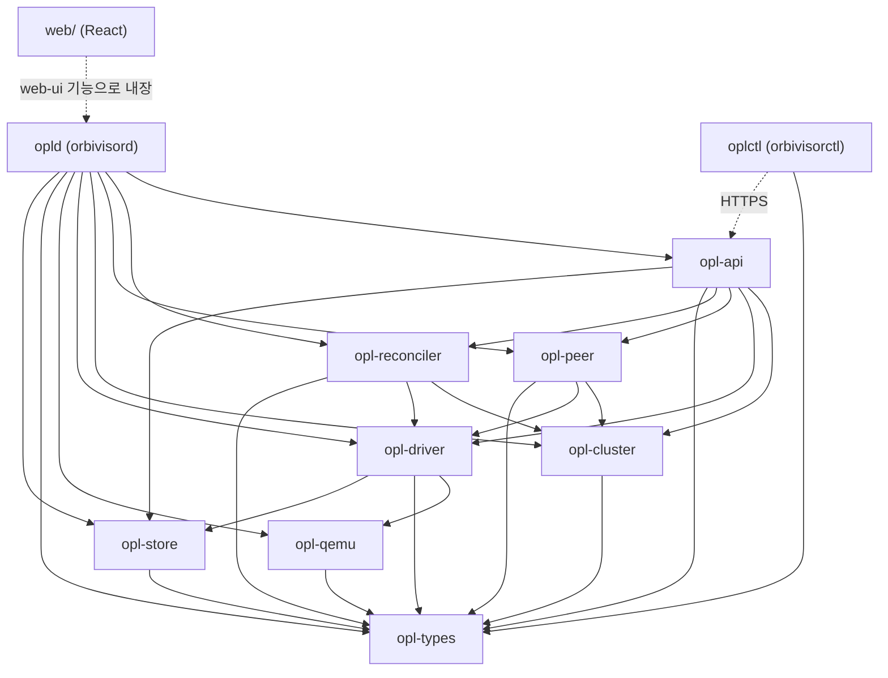

의존은 각 `Cargo.toml`에서 확인했다(`crates/opl-peer/Cargo.toml:23-25`, `crates/opl-api/Cargo.toml:37-41`,
`crates/opld/Cargo.toml:93-99`). `oplctl`은 `opl-types`만 쓰고 API와는 HTTPS로만 말한다.

주요 외부 크레이트: openraft 0.9.25(`serde`, `storage-v2`), redb 4.4, tonic 0.14(gRPC), axum 0.8, utoipa 6·
utoipa-axum, rustls 0.23(ring), rcgen(인증서), argon2, ldap3, lettre(메일), rust-embed(웹 내장)
(`Cargo.toml:31-63`).

### 1.3 구성 요소 한눈에

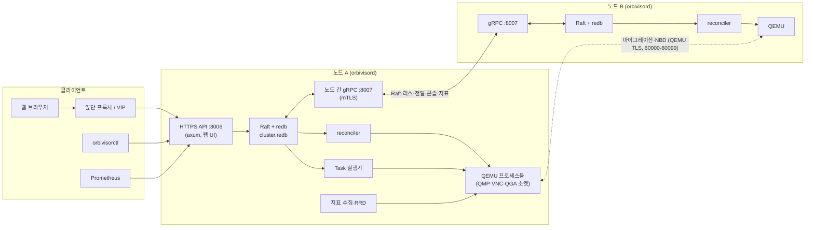

---

## 2. 노드 프로세스 구조

### 2.1 실행 모드

`orbivisord`에는 하위 명령이 없다. 인자는 `--config`(기본 `/etc/opl/opld.toml`)와 `--release-vips`뿐이다
(`crates/opld/src/main.rs:66-73`). `--release-vips`는 systemd `ExecStopPost`가 부르는 VIP 떼기 전용이다
(`main.rs:354-376`). 노드의 성격은 설정과 저장소가 정한다.

| 상태 | 정하는 것 | 도는 것 |
|---|---|---|
| 초기화 전 노드 | `{data_dir}/pki`가 없음 | 제어 소켓만 열고 `init`·`join`을 기다린다(`main.rs:141-161`) |
| 일반 멤버 | 기본 | 전부(API, reconciler, Task, 리더 루프 …) |
| 위트니스 | 설정 `witness = true`(`crates/opld/src/config.rs:34-37`) | Raft 저장소와 노드 간 서버, 생존 리스만. API·QEMU·리더 루프 없음(`member.rs:999-1052`). 투표는 하지만 후보가 되지 않는다 |
| 관찰 노드 | 저장소에 기록된 모드(`RoleKeeper`가 바꿈) | Raft 밖에서 투표 멤버 하나를 따라가며 상태를 받는 일반 노드(§3.5) |

### 2.2 실행기와 스레드 (계획 45)

API 폭주나 느린 디스크가 Raft 하트비트와 HA 리스 갱신을 늦춰 멀쩡한 노드가 펜싱되지 않도록 한 프로세스 안에서
일을 나눈다(`crates/opld/src/runtime.rs:1-50`).

| 실행기·스레드 | 스레드 이름 | 크기 | 도는 것 |
|---|---|---|---|
| tokio `core` | `orbivisor-core` | 2개 고정(`runtime.rs:20`) | Raft, 노드 간 서버(TLS·HTTP/2), 제어 레인 연결, HA 리스 갱신(`HaGuard`), `HaManager`, `NodeMonitor`, `VoterKeeper`, `RoleKeeper`, VIP, 생존 리스, 제어 소켓 |
| tokio `api` | `orbivisor-api` | `[runtime] api_threads`(기본 CPU/2, 최소 2) | HTTPS API·웹·watch·콘솔 WebSocket |
| tokio `work` | `orbivisor-work` | `[runtime] work_threads`(같은 기본) | reconciler, Task 실행기, 스케줄러, janitor, 지표, 풀, overlay·방화벽 에이전트, 텔레메트리, 업데이트, Ceph, 노드 간 서버가 받은 무거운 요청 처리기, 벌크 레인 연결 |
| OS 스레드 | `orbivisor-watchdog` | 1 | HA watchdog 장치를 1초마다 쓰다듬기(`crates/opl-reconciler/src/ha.rs:333-339`) |
| OS 스레드 | `orbivisor-store` | 1 | redb 쓰기 트랜잭션과 fsync를 하나씩(`crates/opl-cluster/src/writer.rs:1-34`) |
| OS 스레드 | `orbivisor-notify` | 1 | 실행기 확인과 systemd 알림(`crates/opld/src/notify.rs:131`) |
| OS 스레드 | `opl-audit` | 1 | 감사 로그 쓰기(`crates/opl-api/src/audit.rs:126`) |

배치는 `member.rs:331-334`에서 정하고 각 spawn이 `on(&rt.core, …)`/`on(&rt.work, …)`으로 실행기를 고른다.
`main`은 `runtimes.core.block_on(run)`으로 돈다(`main.rs:90-101`).

**systemd watchdog.** 유닛은 `Type=notify`, `WatchdogSec=30s`, `WatchdogSignal=SIGKILL`이다
(`packaging/deb/opld.service`). `orbivisor-notify`가 `WATCHDOG_USEC/3`(1~10초, 기본 10초)마다 세 실행기에 빈 작업을
넣고, `core`와 `api`가 2초(간격의 절반이 더 짧으면 그만큼) 안에 돌려야만 `WATCHDOG=1`을 보낸다. `work`만 늦으면
경고만 남기고 계속 보낸다(`notify.rs:1-39,137-150`). sd_notify 크레이트 없이 `$NOTIFY_SOCKET`에 직접 쓴다
(`notify.rs:47-77`). `KillMode=process`라 데몬이 죽어도 QEMU는 그대로 돌고, 다시 뜬 데몬이 다시 붙는다(§8.2).

`READY=1`은 세 곳에서 보낸다: 초기화 전 노드가 제어 소켓을 열었을 때(`main.rs:143`), 멤버가 Task 실행기의 고아
정리 직전(`member.rs:833-836`, 정족수가 없으면 고아 정리가 오래 걸려 시작 제한에 걸리지 않게), 시작을 마쳤을 때
(`main.rs:165`).

HA watchdog(노드 재부팅)과 systemd watchdog(데몬 재시작)의 관계는 [§5.3](#53-자기-펜싱-watchdog)과
[클러스터 운영 안내](guide/cluster.md#제어부-가용성)에 있다.

### 2.3 디렉터리와 파일

설정은 TOML이고 모르는 키를 거부한다(`config.rs:25-27`). 기본 경로(`config.rs:1329-1349`):

| 키 | 기본값 | 뜻 |
|---|---|---|
| `listen` | `0.0.0.0:8006` | HTTPS API·웹 |
| `cluster_listen` | `0.0.0.0:8007` | 노드 간 gRPC(`listen`과 달라야 함, `config.rs:1548`) |
| `cluster_addresses` | 비면 `address` 하나 | 다중 링크(§6.7) |
| `data_dir` | `/var/lib/opl` | 영속 데이터(0700으로 만듦, `main.rs:380-391`) |
| `run_dir` | `/run/opl` | 소켓·pid 파일 |
| `control_socket` | `{run_dir}/opld.sock` | 로컬 제어 소켓(0600) |
| `[migration] ports` | `60000-60099` | QEMU 마이그레이션·NBD(`config.rs:1812`) |

설정 절: `[hypervisor] [reconciler] [schedule] [janitor] [backup] [replication] [pools] [migration] [ha] [network]
[updates] [telemetry] [audit] [remotes] [runtime] [api] [vip] [web] [node] [ceph] [download] [metrics] [sdn]`
(`config.rs:63-106`). 예시는 `packaging/deb/opld.toml.example`.

`data_dir` 아래:

| 경로 | 내용 | 인용 |
|---|---|---|
| `opld.lock` | 두 데몬이 같은 디렉터리를 쓰지 않게 하는 flock | `main.rs:393-411` |
| `node-id` | 노드 UUID | `crates/opld/src/bootstrap.rs:27` |
| `pki/` | `ca.crt`, `node.crt`, `node.key`(0600) | `crates/opl-peer/src/pki.rs:31-35` |
| `cluster/cluster.redb` | Raft 로그 + 상태 머신 + 스냅샷 | `crates/opl-cluster/src/cluster.rs:46` |
| `migration-tls/` | QEMU 마이그레이션용 인증서 사본(시작마다 다시 씀) | `crates/opl-driver/src/migration.rs:144-185` |
| `vm/<id>/` | VM의 영속 파일(UEFI 변수 `uefi-vars.fd`, `tpm/`), 복제·저장소 백업의 플리싱 `fleece-{i}.img`와 `backup.sock`, 라이브 복원 배선 `live-restore.json`·오버레이 `lr-disk{i}.qcow2`(계획 68) | `crates/opl-driver/src/qemu.rs:144-150`, `qemu/live_restore.rs` |
| `backup-run/` | 저장소 백업·복원·옮기기의 NBD 소켓, 라이브 복원 헬퍼의 소켓·pid·로그(`lr-<vm>.*`)(계획 68) | `crates/opld/src/member.rs:81` |
| `pools/<id>` | 풀 마운트 지점 | `member.rs:457` |
| `uploads/`, `migration-disks/`, `replicas/` | 업로드, 마이그레이션·복제 상태 | `member.rs:72-74,613` |
| `audit/audit.log` | 감사 로그 | `crates/opl-api/src/audit.rs:53` |
| `alerts/` | 노드 알림 상태·보낸 기록 | `crates/opl-api/src/alerts/book.rs:21` |
| `metrics/*.rrd` | 지표 기록 | `crates/opld/src/metrics/rrd.rs:134-147` |
| `vips` | 이 노드가 붙인 VIP 기록 | `crates/opl-driver/src/vip.rs:106` |

`run_dir/vm/<id>/`에는 `qmp.sock`, `vnc.sock`, `qga.sock`, `tpm.sock`, `qemu.pid`, `swtpm.pid`, `cidata.iso`가 있다
(`crates/opl-qemu/src/paths.rs:35-46`). `/etc/opl/opld.toml`은 유닛의 `ConditionPathExists`다.

### 2.4 시작 순서

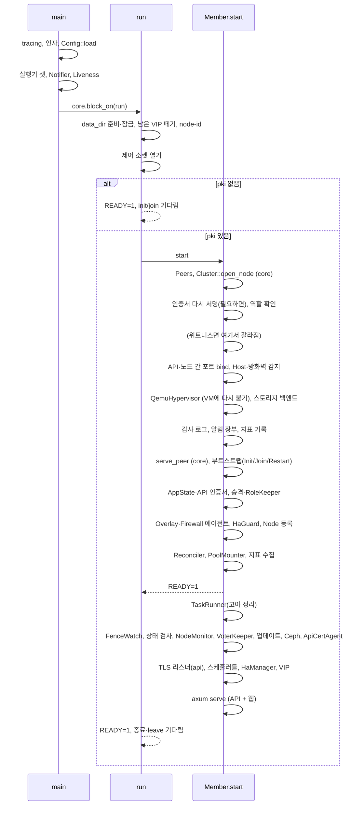

근거: `main.rs:76-212`, `member.rs:346-935`.

---

## 3. 클러스터 상태와 합의(Raft)

### 3.1 무엇을 저장하나

노드마다 redb 파일 하나(`cluster/cluster.redb`)에 Raft 로그와 상태 머신을 같이 둔다
(`crates/opl-cluster/src/store.rs:1-43`).

| redb 테이블 | 키 → 값 |
|---|---|
| `raft_log` | 로그 index → 항목(JSON) |
| `objects` | (kind, id) → 리소스(JSON) |
| `names` | (kind, name) → id (이름 유일성 색인) |
| `meta` | `vote`, `committed`, `last_applied`, `last_purged`, `last_membership`, `snapshot_meta`, `snapshot_data`, `node_mode`, `schema_version` … |

- **리소스 39종** (`crates/opl-types/src/resource.rs`의 `Kind`): Vm, StoragePool, Volume, Node, Task, User, ApiToken,
  Cluster, JoinToken, Network, Snapshot, SecurityGroup, Backup, BackupJob, VmImport, Settings, Realm, Remote, Session,
  VipHolder, HaGroup, PlacementRule, NodeFence, HaCheck, Ceph, AlertRule, NotificationTarget, Folder, Grant,
  AccessRole, Group, TwoFactor, CpuCatalog, Sdn, Router, FloatingIp, LoadBalancer, NetworkMigration, BackupStore(계획 68).
- 모든 리소스는 같은 봉투 `Resource<S,T> { id, name, revision, labels, spec, status }`다(`resource.rs:7-18`).
- **revision은 클러스터 전체에 하나인 순서다.** 리소스의 `revision`은 마지막으로 바꾼 Raft 로그 index이고
  (`crates/opl-cluster/src/state_machine.rs:381,419,427,443`), 목록의 revision은 `last_applied`다
  (`store.rs:283-299`). status 쓰기도 revision을 바꾼다.
- **스키마 버전.** `SCHEMA_VERSION = 1`이고 더 새 파일·스냅샷은 거부한다(`store.rs:20,121-125`).
- 모든 쓰기 트랜잭션은 `orbivisor-store` 스레드 하나에서 돈다. `append`는 fsync 커밋 뒤에 돌아온다
  (`crates/opl-cluster/src/log_store.rs:195-196`).
- **지표와 감사 로그, 노드 알림 상태는 Raft에 넣지 않는다**(§12, §13).

### 3.2 명령과 상태 머신의 검사

Raft에 들어가는 명령은 다섯 가지다: `Create`, `UpdateSpec`, `UpdateStatus`, `UpdateStatusIf`, `Delete`
(`crates/opl-cluster/src/types.rs:39-68`). `UpdateSpec`·`Delete`는 `expected_revision`을 줄 수 있고, `UpdateStatusIf`는
늘 준다. 리더에게 보내는 요청은 따로 `LeaderRequest { Write, AddLearner, AddVoter, Remove, RenewLease, RenewVip,
ReadIndex }`다(`types.rs:114-162`).

적용(`apply_command`, `state_machine.rs:310-474`)은 결정적이어야 하므로 클러스터 전체를 보는 검사를 여기서 한다.
거부된 명령도 로그 index를 소비한다(그래서 revision에 빈 번호가 있다).

| 검사 | 거부 | API 응답 | 인용 |
|---|---|---|---|
| 기대 revision 불일치 | `RevisionMismatch` | **412** `revision_mismatch`(`If-Match`) | `state_machine.rs:325-330`, `crates/opl-api/src/error.rs:114-118` |
| 같은 id가 있음 | `AlreadyExists` | 409 `already_exists` | `state_machine.rs:334-348` |
| 종류 안에서 이름 중복 | `NameTaken` | 409 `name_taken` | 〃 |
| 배타성: VM 디스크 볼륨·NIC MAC은 모든 VM에서 하나, 스냅샷 이름은 VM마다 하나, 폴더 이름은 형제끼리 대소문자 무시하고 하나 | `InUse` 등 | 409 `volume_in_use`·`mac_in_use`·`name_taken` | `crates/opl-cluster/src/exclusive.rs:11-38`, `state_machine.rs:478-524` |
| 폴더: 부모가 같은 트리에 있음, 순환, 깊이 16, 빈 폴더만 지우기 | `FolderCycle`·`FolderTooDeep`·`FolderNotEmpty` | 409 | `crates/opl-cluster/src/folders.rs:127-227` |
| 폴더 할당량(vcpus, memory_mib, disk_bytes, vms, dedicated_vcpus) | `QuotaExceeded` | 409 `quota_exceeded` | `folders.rs:272-460` |
| 노드 자원(전용 CPU 수, 크기마다 hugepages MiB — 계획 64) | `HostResourcesExceeded` | 409 `no_capacity`(`details {node, resource, limit, used}`) | `crates/opl-cluster/src/hosts.rs:40,131` |

- 할당량은 "상한을 넘고 **또 사용량이 느는** 쓰기"만 거부한다. 노드 바꾸기·이름 바꾸기·줄이기는 훑지 않는다.
  VM 사용량은 배타성 검사와 같은 훑기에서 센다.
- 배타성 훑기는 같은 종류의 모든 객체를 읽는다(O(N)). 비용은 [§15](#15-규모-특성).
- "VM은 한 노드에서만 돈다"는 Raft 쪽 검사가 아니다. VM이 어느 노드에서 도는지는 `spec.node` 하나로 정해지므로
  둘이 될 수 없고, 펜싱(§5)이 옛 노드의 프로세스를 끈다.
- 상태 머신은 spec·status JSON이 종류에 맞는지 보지 않는다. 형식을 아는 API만 쓰게 한다(`cluster.rs:721-722`).
- API 핸들러는 적용 전에 같은 검사를 먼저 해(예: `crates/opl-api/src/quota.rs`) 대개 빠르게 거절하지만, 경쟁하는
  두 쓰기 사이의 최종 판정은 상태 머신이 한다.

### 3.3 watch

- `WatchHub`가 적용 묶음을 메모리에 1024개(`HISTORY`) 두고 redb 커밋 뒤 tokio broadcast로 보낸다
  (`crates/opl-cluster/src/watch.rs:14,110-121`).
- `watch(since)`는 revision이 `since`보다 큰 사건을 준다. `since`가 기록보다 오래되면 `Expired`, 구독자가 버퍼보다
  뒤처지면 `Lagged`, 스냅샷을 설치하면 `Reset`(기록을 비움)이다(`watch.rs:124-169`). 다시 시작하면 기록은
  `last_applied`부터라 그 전 revision은 모두 만료다(`watch.rs:98-107`).
- 영속 watch 기록이나 따로 둔 압축은 없다. 클라이언트는 만료되면 목록을 다시 읽는다(§7.3).

### 3.4 스냅샷과 로그 압축

- opld의 `raft_config`(`crates/opld/src/member.rs:162-176`)는 스냅샷 정책을 정하지 않으므로 openraft 0.9.25 기본값을
  쓴다: 로그 **5000개마다** 스냅샷(`LogsSinceLast(5000)`), 스냅샷 뒤 로그 **1000개** 남김. 바꾼 것은 조각 크기 1 MiB와
  조각마다 제한 시간 10초뿐이다.
- 스냅샷은 상태 전체를 JSON 문서 하나 `{schema_version, objects: [(Kind, Resource)]}`로 만든다
  (`state_machine.rs:37-41`). `spawn_blocking`에서 만들고 같은 redb의 `meta.snapshot_data`에 둔다. 옛 스냅샷이 새것을
  덮지 않는다(`state_machine.rs:147-161,528-543`).
- 설치하면 `objects`·`names`를 지우고 다시 쓴 뒤 watch에 `Reset`을 보낸다(`state_machine.rs:180-212,590-609`).
- 로그 지우기(purge)는 `last_purged`까지 지우고 기록한다(`log_store.rs:103-113`).

### 3.5 투표: 투표 멤버, learner, 관찰 노드, 위트니스

Raft 시간(`member.rs:167-169`): **하트비트 200 ms, 선거 제한 시간 1000~2000 ms.**

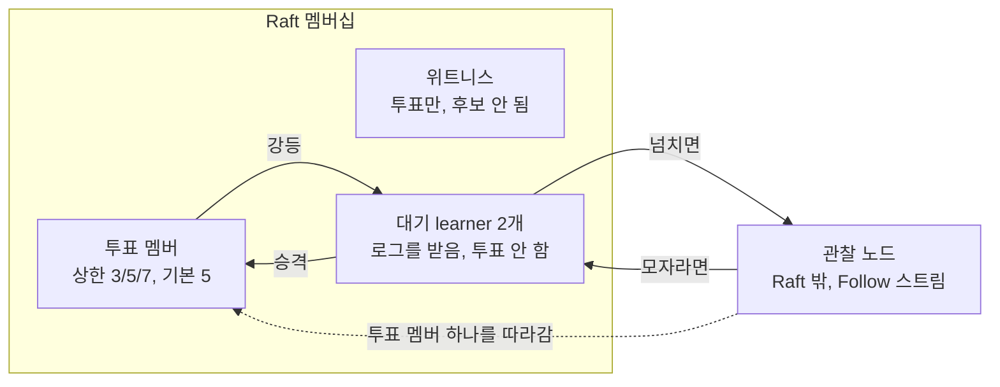

- **투표 멤버 상한.** 설정 `voters`는 3·5·7 가운데 하나, 기본 5다(`crates/opl-types/src/settings.rs:250-264`).
  홀수만 고를 수 있다.
- **정족수.** 투표 멤버 n의 과반수(n=3이면 2, 5면 3, 7이면 4)가 살아 있어야 쓰기가 커밋된다. `VoterKeeper`는
  "살아 있는 투표 멤버 × 2 > 투표 멤버 수"를 바꾸기 전과 뒤 모두 만족할 때만 멤버십을 바꾼다
  (`crates/opl-cluster/src/voters.rs:178-199`).
- **`VoterKeeper`** (`voters.rs`): 모든 노드에 뜨지만 리더에서만 1초마다 돈다(`voters.rs:73-83,365`). 판단 기준은
  리스 갱신 나이다: 건강 = 10초 안, 살아 있음 = 3초 안, 오프라인 = 30초 넘게. learner가 리더 로그에서 64개 안이면
  따라잡았다고 본다(`voters.rs:56`). 고르는 순서(`pick`, `voters.rs:162-280`):
  1. 위트니스 learner를 먼저 올린다.
  2. 상한보다 적으면 올린다. 투표 멤버가 적은 장애 영역(`[node] zone`)의 노드를 먼저.
  3. 상한보다 많으면 내린다: 오프라인 > 살아 있지 않음 > 붐비는 영역 > 건강하지 않음 > 큰 id. 임기 첫 10초에는 안 한다.
  4. 상한과 같은데 오프라인 투표 멤버가 있으면 따라잡은 learner와 한 번에 바꾼다(`Replace`).
  5. 투표 멤버 밖에 건강한 learner를 2개(`STANDBY_LEARNERS`) 두고 나머지는 관찰 노드로 보낸다(`voters.rs:50`).
- **관찰 노드(계획 48).** Raft 멤버가 아니다. 관찰 노드가 되면 Raft 로그를 지우고(`store.rs:166-190`), 투표 멤버 하나에
  `Follow` 스트림을 열어 적용된 변경을 받는다. 1초마다 진행 표시가 오고, `since`가 만료면 전체 스냅샷을 받는다
  (`crates/opl-cluster/src/follow.rs:20,272`). 3초 동안 진행이 없으면 다른 투표 멤버로 옮긴다(`FOLLOW_STALL`,
  `crates/opl-cluster/src/replica.rs:29`). 노드마다 `RoleKeeper`가 1초마다 자기 역할을 맞춘다
  (`crates/opl-cluster/src/roles.rs:1-36`). 리더가 learner 모두에 하트비트·로그를 보내는 일이 노드 수만큼 늘던 것을
  줄이려는 것이다(§15).
- **위트니스.** `enable_elect = false`라 투표는 하지만 후보가 되지 않는다(`member.rs:166`). 늘 투표 멤버이고 상한에
  들어간다. VM·API·리더 일은 하지 않는다. 노드 둘 + 위트니스 하나로 정족수를 만드는 용도다.
- **옛 방식.** 모든 노드가 `voter-limit` 기능을 알리기 전(롤링 업그레이드 중)에는 `VoterKeeper`가 쉬고 각 노드가
  스스로 투표 멤버가 되려 한다(`promote_until_voter`, `member.rs:1500-1580`, 5→60초 재시도).
- **리더 선출 시간.** 리더가 죽으면 openraft가 마지막 하트비트 뒤 리더 리스(약 2초)와 선거 제한 시간(1~2초)을 기다려
  새 리더가 서기까지 **노드 수와 관계없이 3~4초**다(잰 값 3.2~3.6초, [클러스터 운영 안내](guide/cluster.md#대규모-클러스터)).

### 3.6 합류와 떠나기

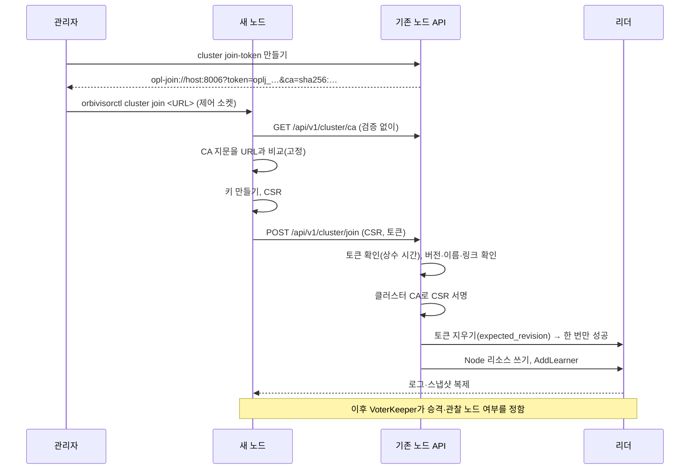

- 합류 토큰은 `oplj_<id>_<secret>`, TTL 기본 1시간·최대 7일, Raft에는 SHA-256만 둔다
  (`crates/opl-api/src/cluster.rs:39-42,305-345`). 합류는 HTTPS API로 한다(gRPC가 아님).
- 새 노드는 URL의 지문으로 CA를 고정한 뒤 그 CA만 믿는다(`crates/opld/src/join.rs:46-112`). 인증서 SAN에는 API 주소,
  모든 링크 주소, localhost가 들어간다(`cluster.rs:535-556,664-677`).
- **떠나기(`leave`).** 유일한 투표 멤버이거나 남는 투표 멤버가 모두 위트니스이거나 이 노드에 VM이 배정되어 있으면
  거부한다. 아니면 `Node`를 지우고 `Remove`를 보낸다(`member.rs:1112-1134,1359-1377`).
- **죽은 노드 지우기(`DELETE /nodes/{key}`).** 오프라인 노드만. Ceph 기록 → `Remove`(투표 멤버에서 빼고 노드 빼기) →
  `Node` 삭제 → 펜싱 설정 → 복제 대상에서 빼기 순서다. **그 노드의 VM은 그대로 남는다**(HA VM이면 HA가 먼저
  옮겼을 것이다)(`cluster.rs:769-815`, `crates/opl-cluster/src/leader.rs:211-244`).

### 3.7 쓰기 경로: 팔로어에서 리더로

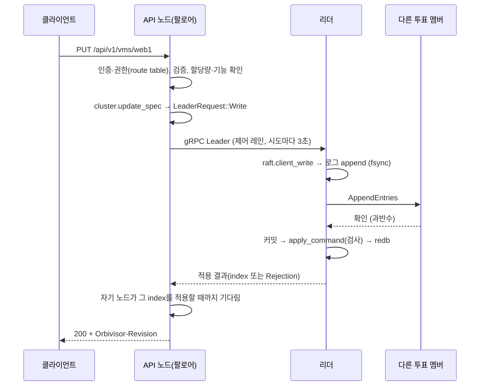

- 리더가 아니면 `NotLeader`를 받고 `Forwarder`(opl-peer의 `Leader` RPC)로 보낸다
  (`crates/opl-peer/src/client.rs:1053`, `crates/opl-peer/src/server.rs:306-313`). 시도마다 3초
  (`FORWARD_ATTEMPT_TIMEOUT`), 실패하면 50 ms마다 다시 시도해 전체 **10초**(opld의 `WRITE_TIMEOUT`,
  `member.rs:79,353`; 라이브러리 기본은 5초)까지 간다(`cluster.rs:36-43`).
- 성공하면 자기 노드가 그 index를 적용할 때까지 기다리므로 같은 노드에서 자기 쓰기를 바로 읽는다
  (`cluster.rs:780-797`).
- **리더가 바뀌는 중의 쓰기.** 제한 시간이 지나면 `Timeout`이고 "나중에 커밋될 수도 있음"이다(`cluster.rs:93-96`). 응답이
  없던 시도 뒤 다시 보낸 것이 거부되면, 같은 id의 `Create`가 `AlreadyExists`이거나 조건 없는 `Delete`가 `NotFound`이면
  앞 시도가 적용된 것으로 본다(`cluster.rs:836-862`). 조건부 쓰기는 이렇게 풀지 않는다.
  API는 `Timeout`을 503 `cluster_no_quorum`, `NotLeader`를 503 `not_leader`로 돌려준다.
- **읽기.** 기본은 자기 노드의 저장소(리더를 거치지 않음). 모든 인증 응답에 `Orbivisor-Revision`이 붙고, 클라이언트가
  `Orbivisor-Min-Revision`을 보내면 그 revision까지 5초 기다린다(없으면 503 `revision_unavailable`,
  `crates/opl-api/src/revision.rs:1-40`). 리더 확인이 필요한 곳은 `read_barrier`(리더에서 `ensure_linearizable`) 또는
  `read_index`(리더에게 `ReadIndex`를 묻고 자기 적용을 기다림, 팔로어·관찰 노드에서도 됨)를 쓴다
  (`cluster.rs:1189-1214`).

---

## 4. 리더의 일

**리더가 바뀔 때 무엇을 켜고 끄지 않는다.** 위트니스가 아닌 모든 노드가 시작할 때 아래 루프를 모두 띄우고
(`member.rs:871-925`), 루프가 틱마다 "내가 지금 리더인가"(`cluster.members().leader == Some(cluster.id())`)를 본다.
리더가 아니면 메모리 상태를 비우고 넘어간다. 리더면 대개 `read_barrier()`로 앞 임기의 커밋을 따라잡은 뒤 읽는다.
그래서 리더가 바뀌면 새 리더의 루프가 다음 틱(대개 1~60초)에 일을 이어받는다. 진행 상태가 Raft에 있는 일(백업 작업,
알림 상태, Task)은 그대로 이어지고, 메모리에만 있는 것(리스 표, 배치 추천 게시판)은 새로 쌓는다.

| 루프 | 하는 일 | 주기 | 인용(`crates/opl-api/src/` 아래, 따로 적지 않으면) |
|---|---|---|---|
| `HaManager` | 리스가 끊긴 노드의 HA VM 복구, 전원 펜싱, HA 상태 검사 대응, 배치 규칙 위반 고치기, failback, 복구 대상 미리 계산 | 1초(failback 30초, 계획 10초) | `ha.rs:88-95,633` |
| `NodeMonitor` | 리스 나이로 `NodeStatus.online` 쓰기(바뀔 때만) | 2초, 10초면 오프라인 | `crates/opl-peer/src/monitor.rs:34-41,131-136` |
| `VoterKeeper` | 투표 멤버 승격·강등, 대기 learner·관찰 노드 목록 | 1초 | `crates/opl-cluster/src/voters.rs:73-83` |
| `ClusterJanitor` | 오프라인(60초 넘게)·지워진 노드의 대기 Task 실패 처리, 고아 스냅샷, 끝난 Task 정리(7일·1000개), 만료 세션, `receiving`에 24시간 넘게 머문 백업, 백업 저장소의 남은 쓰기 잠금(끝난 Task의 `committing`·`gc`·`sweeping`, 받는 사본은 10분 멈춘 것), 고아 grant, 어느 노드도 가리키지 않고 1시간 넘은 CPU 카탈로그, 클러스터 CPU 기준 다시 셈·기록(§9.6) | 10초 | `janitor.rs:54-66,289,316,435`, `cpu_baseline.rs:148` |
| `SnapshotScheduler` | 예약 스냅샷 만들기·정리 | 60초 | `schedule.rs:39,234` |
| `BackupJobScheduler` | 백업 작업 실행(진행은 Raft에 있어 새 리더가 잇는다), 대상(풀·저장소)마다 보존, 저장소 작업의 `copy_to` 복사 줄 세우기, 백업 저장소의 GC·예약 검증·`verify_new` 검증 Task 만들기(계획 68) | 60초 | `backup_jobs.rs:346,395` |
| `ReplicationScheduler` | 로컬 디스크 복제 Task 만들기(원본 노드당 2개까지) | 60초 | `replication.rs:175-183,320` |
| `Balancer` | 부하 불균형 재기, 추천 게시 또는 자동 마이그레이션(계획 53) | 틱 10초, 실행 300초, 리더 된 뒤 첫 실행 60초 안 | `balancer.rs:34,50-57,121` |
| `AlertEngine`(리더 몫) | `node_offline`, `backup_job_failed`, SDN 조건, `backup_verify_failed`·`backup_store_unavailable`(계획 68) 알림. 상태는 `AlertRule.status`(Raft) | 5초 | `alerts/engine.rs:548-588` |
| `VipManager` | VIP마다 들 노드 정하기(`VipHolder`) | 1초 | `vip.rs:34-38,226` |
| 배치 현황 | 리스로 받은 노드 부하를 다른 노드에 RPC(`ReadPlacement`)로 알려 줌 | 캐시 1초 | `placement_board.rs:154`, `score.rs:299-342` |
| `TelemetryReporter` | 텔레메트리 보고 | 틱 60초, 24시간마다 | `telemetry.rs:221-229,292` |
| `RemotePoller` | 원격 클러스터 상태 모으기 | 30초 | `remotes.rs:558-559,608` |
| `OvnSync` | Raft의 SDN 네트워크·서브넷·VM NIC·라우터·유동 IP·보안 그룹·부하 분산기·QoS·옮기기 다리를 OVN NB에 맞추기(다른 것만, 펜싱 토큰), 지운 노드의 SB chassis 지우기(모든 노드가 `sdn-services`면 중앙 에이전트가 대신), 10초마다 게이트웨이 주인·LB 멤버 건강 관찰(SDN 경보 입력), `SdnStatus.sync`(§11.4~§11.6). `Sdn`이 `ready`가 아니면 쉼 | 바뀌면 0.5초 모아, 60초마다, 리더 확인 1초 | `ovn_sync/mod.rs:44-48,82-83,136,486` |
| 리스 표 | 노드의 `RenewLease`를 받아 메모리에 기록(§5.1) | 요청마다 | `crates/opl-cluster/src/lease.rs` |

리더 일이 **아닌** 것(오해하기 쉬운 것):

- **VM 처음 배치(스케줄링).** 요청을 받은 노드의 API가 한다(`scheduler.rs:121-130`, `vms.rs:929,1080,1706`). 리더에게서는
  부하 자료만 받는다(`score.rs:292-322`).
- **클러스터 지표 요약.** 요청을 받은 API 노드가 모든 노드에서 모은다(§12.3).
- **노드 알림 대부분.** 사건이 난 노드가 평가한다(§12.5).
- **노드 비우기.** 비우는 노드의 Task로 돈다(§5.7).
- **CPU 카탈로그 읽기.** 노드마다 자기 QEMU에 묻고 자기가 올린다(§9.6). 리더는 그 결과로 **클러스터 CPU 기준만** 셈해
  `ClusterStatus.cpu_baselines`에 쓴다(위 `ClusterJanitor` 틱, 계획 63). 노드가 VM을 켤 때는 이 기록만 읽으므로 리더가
  바뀌어도 모든 노드가 같은 기준을 쓰고, 새 리더는 다음 틱에 같은 값을 셈한다(같으면 쓰지 않는다).
- **구독 보고 루프는 없다.** 구독은 API(`subscription.rs`)만 있다.
- **OVN 설치와 chassis 맞추기.** 설치는 `sdn-*` Task(그 노드에서), chassis·중앙 단위 맞추기는 노드마다의 `SdnAgent`다(§11.4).
  리더는 NB만 쓴다.

**리더 장애 때.** 새 리더가 3~4초 안에 선다(§3.5). 진행 중이던 쓰기는 §3.7처럼 다시 시도된다. 리스 표는 임기가 바뀌면
비워지고 새 리더는 자기가 그 임기를 본 때를 기준(base)으로 나이를 센다(`lease.rs:58-65`,
`crates/opl-peer/src/monitor.rs:213-260`). 그래서 HA 복구까지의 시간에 선거 시간이 더해진다. 펜싱 중인 노드 목록은
임기가 바뀌어도 남는다(`lease.rs:51-53`).

---

## 5. 노드 생존, 리스, HA와 펜싱

### 5.1 리스로 보는 노드 생존 (계획 47)

- 리스 갱신은 `LeaderRequest::RenewLease { node, checks, load }`다. **Raft 로그에 쓰지 않는다.** 리더가 과반수 리더인지
  확인(`ensure_linearizable`)한 뒤 현재 임기의 메모리 표에 노드별 갱신 시각, HA 상태 검사 결과, 부하 요약을 적는다.
  펜싱 중인 노드는 `Rejected(Fenced)`를 받는다(`crates/opl-cluster/src/lease.rs:77-128`).
- **확인 묶기.** 노드 수백 대가 갱신할 때 갱신마다 과반수 왕복을 하지 않도록 `ConfirmBatch`가 확인을 묶는다. 요청은
  자기가 도착한 뒤 시작한 확인만 쓰므로 많아야 확인 두 번을 기다린다(`lease.rs:182-260,309-325`).
- 노드 쪽은 돌려받은 index를 자기가 적용해야 성공으로 본다(`crates/opl-cluster/src/cluster.rs:922-957`).
- **누가 얼마나 자주.** 펜싱을 쓰는 노드는 `HaGuard`가 `fence_after/10`(0.2~2초, `fast` 1초·`safe` 2초)마다
  (`crates/opld/src/config.rs:616-622`), 펜싱을 끈 노드와 위트니스는 2초마다(`member.rs:84`).
- **오프라인 판정.** 리더의 `NodeMonitor`가 마지막 갱신이 10초 넘으면 `online = false`를 쓴다(`monitor.rs:213-260`).
  옛 버전 노드가 섞여 있으면(`lease-liveness` 기능 없음) Ping으로 판단한다(`monitor.rs:145-171`).

### 5.2 HA 시간 묶음

| `[ha] profile` | `fence_after` | watchdog | 복구 시작(watchdog 펜싱) | 복구 시작(`process` 펜싱) |
|---|---|---|---|---|
| `fast`(기본) | 10초 | 10초 | 10 + 10 + 2 = **22초** | 12초 |
| `safe` | 30초 | 30초 | 62초 | 32초 |

근거: `crates/opld/src/config.rs:440-457,480-486`(`RECOVER_MARGIN_SECS = 2`). 노드는 자기 값을 `NodeStatus.ha`에 쓰고
리더는 노드마다 그 값을 쓴다. 옛 HA 설계 문서의 기본값(30초/30초, 복구 약 65초)은 이제 `safe`에 해당한다(설계와 다름).

### 5.3 자기 펜싱: watchdog

노드 쪽(`crates/opl-reconciler/src/ha.rs`):

- `/dev/watchdog`(하드웨어 또는 softdog)는 리스가 신선하고 HA VM을 시작하거나 다시 붙일 때만 연다(`ha.rs:387-421`).
  제한 시간은 `WDIOC_SETTIMEOUT`으로 5~3600초.
- 전용 OS 스레드 `orbivisor-watchdog`가 1초마다 쓰다듬는다. **리스가 신선하지 않고 HA VM이 돌고 있으면** 쓰다듬기를
  멈춘다(`ha.rs:509-540`). 실행기가 막혀도 이 스레드는 리스 규칙대로 움직인다.
- 리스가 `fence_after` 넘게 끊기면 reconciler가 HA VM을 강제로 끈다(`crates/opl-reconciler/src/worker.rs:468-487`).
  데몬 자체가 멈췄으면 watchdog이 노드를 재부팅한다. 둘 중 어느 쪽이든 리더가 복구를 시작하는 22초 전에 옛 VM은
  꺼져 있다.
- HA VM이 없을 때만 magic close로 깔끔하게 닫는다(`ha.rs:440-466`).

### 5.4 전원 펜싱: IPMI·Redfish (계획 51)

- 노드마다 IPMI, Redfish, 명령 가운데 4개까지 순서대로 시도한다(`crates/opl-types/src/fence.rs:15-41`).
- 리더가 끊는 조건: 리스 나이 ≥ `fence_after`(10초), 그 노드에 펜싱 설정과 HA VM이 있음, 리더 자신의 리스가
  `fence_after`보다 신선함(`crates/opl-api/src/ha.rs:926-945`). 한 임기에 (n−1)/2대(최소 1대)까지
  (`ha.rs:396-399`).
- 끄기 호출 15초, 꺼졌는지 1초마다 15초까지 확인(`crates/opl-api/src/power_fence.rs:21-25`). 꺼진 것이 확인되면 바로
  복구한다. 실패하면 `recover_after`(22초)를 기다린다.
- 다른 노드가 3600초마다 BMC에 닿는지 확인하고 60초마다 설정을 다시 본다(`crates/opld/src/fence_watch.rs:1-27`).
  남의 전원 상태 읽기는 peer `FenceStatus` RPC다.

### 5.5 HA 복구 타임라인

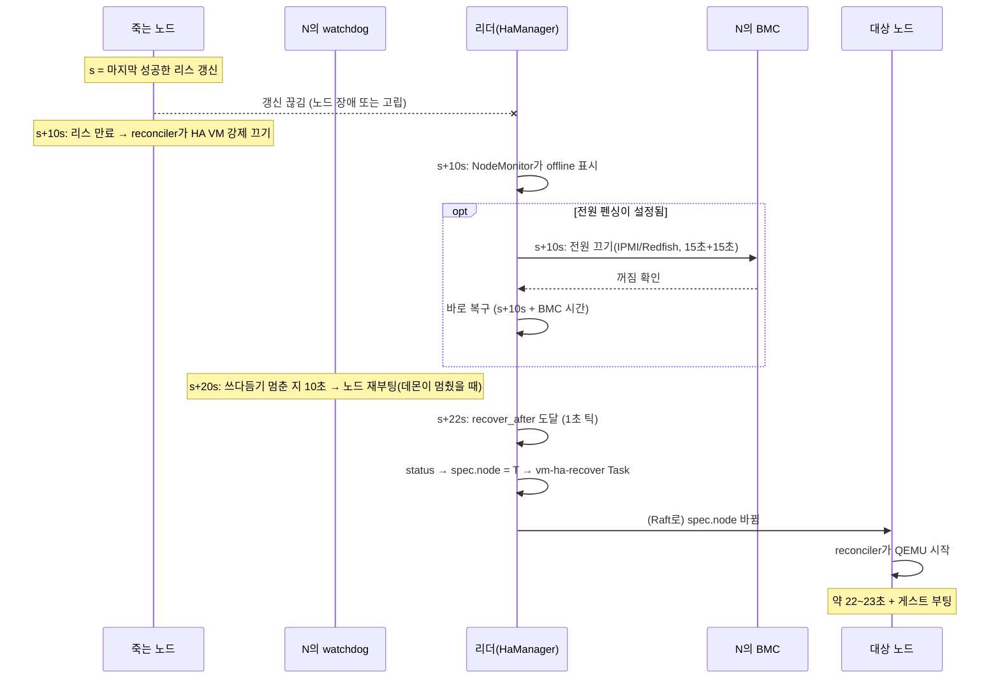

- 리더는 노드가 죽었다고 보는 조건이 "리스 나이 ≥ `recover_after`" 또는 "전원 꺼짐 확인 뒤 갱신 없음"이다
  (`ha.rs:2032-2066`).
- 복구 순서는 우선순위, 이름 순이다. 대상 노드마다 시작을 기다리는 VM은 `ha_start_concurrency`(기본 4)개까지이고,
  시작은 120초 뒤 세지 않는다(`ha.rs:69`). 쓰는 동안 그 노드를 펜싱 중으로 표시해 갱신을 거부한다.
- 리더도 같이 죽었으면 선거 시간(§3.5)이 더해지고 나이는 새 리더의 기준부터 센다.
- 사용 안내의 잰 값(`process` 펜싱, 12초 설정): 약 12~13초([HA 안내](guide/ha.md)).

### 5.6 HA 정책, 배치 규칙, 상태 검사

- **HaGroup**(노드 우선순위 0~1000, `restricted`, `nofailback`)과 **PlacementRule**(hard/soft × affinity/anti-affinity
  × VM/노드, 무게 1~100, `ha_may_violate`)(`crates/opl-types/src/placement.rs:20-35,152-168`).
- VM의 HA 설정: `max_restart`·`max_relocate` 기본 1, 우선순위 기본 50, `guest_watch` 기본 60초
  (`crates/opl-types/src/vm.rs:170-246`). 옮긴 횟수는 600초 창으로 센다(`ha.rs:63`).
- **HA 상태 검사(계획 52).** 노드마다 5초마다 링크·ping·풀 검사를 하고(`crates/opld/src/checks.rs:35`) 결과를 리스
  갱신에 실어 보낸다. 리더는 유예(기본 10초) 뒤 warn·migrate·restart_elsewhere·fence 가운데 정해진 동작을 한다.
  과반수 노드가 같은 검사에 실패하면 경고만 하고(망 전체 문제를 노드 문제로 오판하지 않게), 노드 복구가 진행 중인
  틱에는 하지 않는다(`crates/opl-api/src/ha_health.rs:1-54`, `ha.rs:733-748`).

### 5.7 로컬 디스크 HA: 복제 (계획 55)

- VM마다 대상 노드 3개까지, 일정 `*/N`분(기본 `*/15`)(`crates/opl-types/src/replication.rs:10-56`).
- 원본 노드의 `vm-replicate` Task가 처음에는 전체, 그다음부터는 대상마다의 dirty bitmap 증분을 보낸다. 원본 QEMU가
  NBD+TLS로 대상 노드의 받는 QEMU에 직접 쓰고, 대상은 회차마다 overlay에 받아 끝나면 복제본에 합친다
  (`crates/opl-api/src/tasks/vm_replicate.rs:1-11`, `crates/opl-peer/src/replica.rs:1-4`). 제어는 peer
  `ReplicaPrepare/Finish/Abort` RPC다.
- 장애 때 리더는 쓸 수 있는 복제본이 있는 노드로만, 가장 새로운 시점 순으로 복구한다. 마지막 복제 뒤의 쓰기는
  잃는다. 복제 방향은 거꾸로 바뀐다(`ha.rs:1217-1240,1537-1562`). 대상 reconciler가 VM을 켜기 전에 복제본을 올린다
  (`worker.rs:1124-1145`).

### 5.8 노드 유지보수와 비우기

`start_drain`이 `spec.maintenance = true`를 쓰고 그 노드에 `node-drain` Task를 만든다(`crates/opl-api/src/drain.rs:40-124`).
Task는 이름 순으로 VM을 하나씩 라이브 마이그레이션하고 hard affinity로 묶인 VM은 함께 옮긴다
(`crates/opl-api/src/tasks/drain.rs:1-4`). 유지보수 노드는 배치와 HA 대상에서 빠진다(`scheduler.rs:294,394`). 호스트 종료
정책(`conditional` 기본: 재부팅은 freeze, 끄기는 failover; `freeze`, `failover`, `migrate`)은
`crates/opld/src/shutdown.rs:74-81`에 있다.

---

## 6. 노드 간 통신

### 6.1 opl-peer gRPC

- 서비스 하나 `opl.peer.v1.Peer`에 RPC 28개다. **`.proto` 파일이 없다.** `crates/opl-peer/build.rs`가
  `tonic_build::manual`로 서비스를 정의하고, 메시지는 protobuf가 아니라 serde JSON 코덱이다(일부는 바이너리 코덱)
  (`build.rs:1-19`, `crates/opl-peer/src/codec.rs`).
- 포트는 `cluster_listen`(기본 8007). 메시지 최대 64 MiB, HTTP/2·TCP keepalive 10초(제한 20초)
  (`crates/opl-peer/src/lib.rs:68-77`).

| RPC | 하는 일 |
|---|---|
| `AppendEntries`, `InstallSnapshot`, `Vote` | openraft |
| `Leader` | 팔로어가 리더에게 `LeaderRequest`(쓰기, 멤버십, 리스·VIP 갱신, ReadIndex) 전달 |
| `Ping` | 생존 확인(옛 버전과 섞였을 때의 노드 감시) |
| `Follow` | 관찰 노드가 투표 멤버를 따라가는 서버 스트림 |
| `MigrateIncoming`, `MigrateWait`, `MigrateAbort` | 라이브 마이그레이션 대상 준비·대기·취소 |
| `ReplicaPrepare`, `ReplicaFinish`, `ReplicaAbort` | 로컬 디스크 복제 회차 |
| `Console` | VNC 바이트 양방향 중계 |
| `UefiVars`, `TpmState`, `PushFirmware`, `PurgeFirmware` | UEFI 변수·TPM 상태 가져오기·사본 밀어 넣기 |
| `GuestAgent` | 게스트 정보, 비밀번호 설정 |
| `ReadAudit`, `ReadMetrics`, `ReadMetricsHistory`, `PushMetricsHistory`, `ReadAlerts` | 노드 로컬 자료 읽기·지표 기록 넘기기 |
| `FenceStatus`, `ReadPlacement`, `NodeDisks`, `CephStatus` | 전원 상태, 배치 현황, Ceph 구성 |
| `ReadTopology` | 노드의 실시간 빈 메모리·빈/남는 hugepages·orbivisord 친화(계획 64, 노드 토폴로지 화면) |

### 6.2 mTLS와 클러스터 CA

- **클러스터 CA.** `cluster init` 때 rcgen으로 ECDSA P-256, path length 0, CN `Orbivisor cluster {name} CA`, 20년 짜리를
  만든다(`crates/opl-peer/src/pki.rs:23,59-81`, `crates/opld/src/main.rs:423-438`). **CA 개인 키는 파일이 아니라 Raft의
  `ClusterSpec { ca_cert_pem, ca_key_pem }`에 있다**(`crates/opld/src/bootstrap.rs:57-67`). 그래서 어느 멤버든 합류하는
  노드의 CSR에 서명할 수 있다.
- **노드 인증서.** CN = 노드 UUID, EKU serverAuth + clientAuth, keyEncipherment(QEMU/GnuTLS가 필요), 824일
  (`pki.rs:24-26,84-139`). 자동 갱신은 없다. 설정의 주소가 바뀌어 SAN이 모자라면 시작할 때 같은 키로 다시 서명한다
  (`member.rs:100-135`).
- **확인(`authorize`, `server.rs:246-277`).** 모든 RPC에서 클라이언트 인증서가 클러스터 CA에 이어지고, CN이 UUID이고,
  그 노드가 멤버여야 한다(합류 중 멤버십이 빌 때만 예외). `orbivisor-target` 메타데이터가 자기 id와 다르면
  `permission_denied`(다른 노드가 같은 주소를 쓰게 된 경우를 잡는다). `Follow` 스트림은 프레임마다 다시 본다.

### 6.3 Raft 전송과 연결

- `GrpcNetwork`가 openraft의 `RaftNetworkFactory`를 구현해 같은 이름의 RPC로 보낸다. 제한 시간은 openraft의
  `hard_ttl`, `Unavailable` 등은 `Unreachable`로 바꿔 openraft가 물러나게 한다(`crates/opl-peer/src/client.rs:1064-1193`).
- 연결은 (레인, 링크 주소)마다 tonic `Channel` 하나를 게으르게 열고 다시 쓴다. 연결 제한 시간 2초(`client.rs:65,377-410`).
- **레인 둘.** 제어 레인(Raft, `Leader`, `Ping`, `Follow`)은 `core` 실행기, 벌크 레인(나머지: 콘솔, 마이그레이션 제어,
  펌웨어, 감사·지표 읽기)은 `work` 실행기에서 돈다(`client.rs:120-123,211-216`). 벌크 일이 Raft 하트비트를 늦추지
  않게 하려는 것이다.

### 6.4 마이그레이션과 복제의 데이터 흐름

gRPC는 **제어만** 한다. 데이터는 QEMU끼리 직접 TCP + QEMU 자체 TLS로 간다.

- 대상 노드가 `MigrateIncoming`(120초)을 받으면 `-incoming defer`로 QEMU를 띄우고 `[migration] ports`(60000~60099)에서
  빈 포트를 골라 돌려준다. 로컬 디스크가 있으면 NBD 서버 포트도 준다(`crates/opl-driver/src/migration.rs:36-46,200-206`).
- 원본 QEMU가 `tcp:host:port`로 붙는다. 양쪽 모두 `tls-creds-x509`(`verify-peer: true`)에 `migration-tls/`의 노드 인증서를
  쓴다(`crates/opl-qemu/src/qmp.rs:1036-1053`, `crates/opl-driver/src/qemu.rs:648-674`).
- 로컬 디스크(계획 42)는 대상의 `nbd-server-start`(TLS)에 원본이 NBD `blockdev-add` 뒤 `blockdev-mirror`로 복사한다
  (`qemu.rs:701-723,2512-2538`, `crates/opl-api/src/tasks/migrate.rs:594-620`).
- 연결할 주소는 대상 노드의 지금 쓰는 링크다(`migrate.rs:415-433`). 대량 전송용 망을 따로 두는 것은 없다.

### 6.5 콘솔 중계

웹 콘솔은 `GET /api/v1/vms/{id}/console` WebSocket(VNC/RFB 바이너리 프레임) 하나다. VM이 다른 노드에 있으면 API 노드가
벌크 레인의 양방향 `Console` RPC를 열고, 그 노드가 QEMU의 VNC 유닉스 소켓에 잇는다(`crates/opl-api/src/console.rs:51-82`,
`server.rs:760-834`). 권한은 2초마다 다시 본다. 시리얼 콘솔은 없다.

### 6.6 여러 노드에 묻기(fan-out)

- `fan_out::gather`가 노드 32개(`FAN_OUT`)까지 동시에 묻고 결과를 순서대로 모은다(`crates/opl-api/src/fan_out.rs:9-25`).
  지표, 감사 로그, 알림, 지표 기록 요약이 쓴다.
- 노드마다 제한 시간: 지표 3초, 감사·알림·지표 기록 5초, Ceph 20초, 게스트 3/25/15초.
- 캐시는 클러스터 지표 요약에만 있다(10초, §12.3).

### 6.7 다중 링크 (계획 49)

- `cluster_addresses`에 주소를 여러 개 두면 앞의 것을 먼저 쓴다. 모두 `cluster_listen` 포트다
  (`crates/opld/src/config.rs:44-48,1639-1654`). 멤버십의 `OrbNode.addrs`로 다른 노드에 알린다.
- 바꾸는 규칙(`crates/opl-cluster/src/links.rs:1-27`): 연결 실패면 바로, 제한 시간 초과는 연속 두 번이거나 마지막
  성공에서 400 ms(`LINK_DEAD_AFTER`)가 지났을 때. 선호 링크는 30초마다 다시 시도. "400 ms + 하트비트 200 ms <
  선거 최소 1000 ms − 하트비트 200 ms"라 링크 하나가 조용히 죽어도 선거가 나지 않게 맞췄다.
- 보내지 못한 호출(연결 오류, 다른 노드)은 다른 링크로 한 번 다시 보낸다(`client.rs:185-200,311-348`). QEMU 마이그레이션·
  NBD·복제도 지금 쓰는 링크를 쓴다.

### 6.8 API 요청이 다른 노드에 관한 것일 때

노드 사이에 일반 HTTP 프록시는 없다. 쓰기는 Raft로(§3.7), 읽기는 자기 복제본에서, 노드 로컬 작업은 정해진 RPC(콘솔,
게스트 에이전트, 펌웨어, 감사·지표·알림 읽기, 전원 상태, Ceph)로 한다. 그 밖의 것은 원하는 상태를 Raft에 쓰면 그 노드의
reconciler나 Task 실행기가 한다. `remote_proxy.rs`는 다른 **클러스터**로 보내는 프록시다.

---

## 7. API와 웹 서비스

### 7.1 HTTPS 서버

- axum 0.8 + rustls 0.23(ring). 자체 `TlsListener`가 핸드셰이크 제한 시간 10초, 동시 256개, ALPN `http/1.1`만
  (WebSocket 때문)이다(`crates/opl-peer/src/tls.rs:23-158`). 클라이언트 인증서는 요구하지 않는다.
- 포트 8006(`listen`). **평문 HTTP 리스너와 HTTP→HTTPS 넘기기는 없다.**
- **API 인증서.** 설정 `[api] tls_cert`/`tls_key` 파일이 있으면 그것, 없으면 노드 인증서. 클러스터 설정 `api_names`가
  있으면 `ApiCertAgent`가 그 이름을 넣은 serverAuth 인증서(CN `orbivisor-api`)를 클러스터 CA로 서명해 연결을 끊지 않고
  바꾼다(`crates/opl-api/src/api_cert.rs:1-65`, `crates/opl-peer/src/tls.rs:28-53`). 인증서 올리기 API는 없다.
- **제어 소켓** `opld.sock`(0600, 인증 없음, 루트 전용)은 `GET /v1/status`, `POST /v1/init|join|leave`만 있는 따로 된
  axum 라우터다(`crates/opld/src/control.rs:95-132`). `orbivisorctl cluster init|join|leave`가 쓴다.

### 7.2 REST 구조와 OpenAPI

- 모두 `/api/v1` 아래다(`crates/opl-api/src/lib.rs:406-407`). `api()` 함수 하나가 utoipa-axum의
  `OpenApiRouter::routes(routes!(…))`를 이어 붙여 **라우터와 OpenAPI 문서를 같은 정의에서** 만든다
  (`lib.rs:150-381`).
- 주요 묶음: `/auth/*`(로그인·2FA·OIDC), `/users`, `/tokens`, `/realms`, `/remotes`, `/nodes`, `/cluster`, `/health`,
  `/settings`, `/storage-pools`, `/volumes`, `/networks`, `/security-groups`, `/vms`(동작·마이그레이션·콘솔·복제),
  `/snapshots`, `/backups`, `/backup-jobs`, `/vm-imports`, `/images`, `/tasks`, `/watch`, `/audit`, 지표·알림·알림 대상,
  HA 그룹·검사·배치, Ceph, `/folders`, `/access-roles`, `/groups`, `/grants`, `/permissions/*`.
- `GET /api/v1/openapi.json`은 인증 없이 열려 있다(`lib.rs:394-400`). 보안 방식은 Bearer 토큰과 쿠키 `opl_session`.
- 웹의 타입은 `pnpm gen:api`가 `cargo run -p opl-api --bin opl-api-openapi`로 문서를 뽑고 openapi-typescript로
  `web/src/api/schema.d.ts`를 만든다(CI가 차이를 검사).

**미들웨어 순서**(바깥부터): `proxy::layer`(신뢰하는 프록시의 `X-Forwarded-*`, CORS) → `revision::layer` → 맞은
경로에만 `audit::layer`, `authz_routes::layer`(`lib.rs:385-411`).

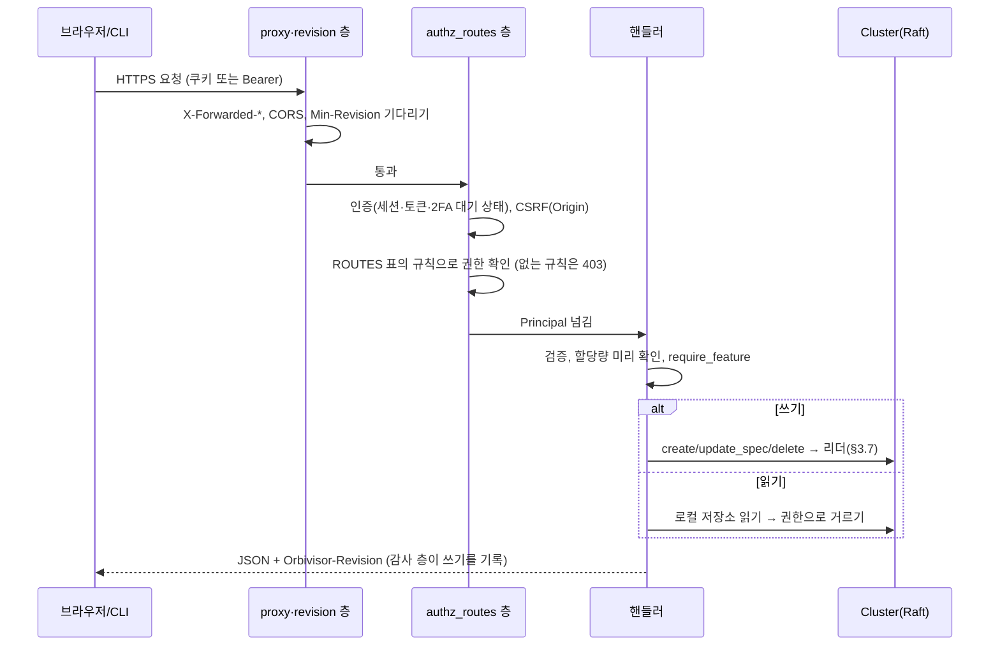

### 7.3 watch와 WebSocket

SSE는 없다. WebSocket 둘이다.

- `GET /watch?kinds=…&since=<revision>`: 커밋된 변경(`Put`, `Deleted`, `Reset`)을 19종에 대해 흘린다. 사용자·토큰은
  해시가 있어 빠진다(`crates/opl-api/src/watch.rs:23-69`). `since`가 만료면 업그레이드 전에 409 `expired`, 도중이면
  `{"type":"error","code":"expired|lagged|closed"}`를 보내고 닫는다. 클라이언트는 목록을 다시 읽는다.
- 사건마다 권한으로 거른다. 보이던 객체가 안 보이게 되면 가짜 `deleted`를, 구독자의 권한이 바뀌면 `permissions`를
  보내고 닫는다(`watch.rs:86-91,160-174`).
- 웹은 `web/src/api/LiveProvider.tsx`가 watch 하나로 TanStack Query 캐시를 갱신한다.
- 콘솔은 §6.5.

### 7.4 인증

| 방식 | 요점 | 인용 |
|---|---|---|
| 로컬 사용자 | argon2id(blocking 스레드). 없는 사용자도 가짜 해시로 확인해 시간 차이를 없앰 | `crates/opl-api/src/auth.rs:108-143` |
| LDAP 영역 | ldap3 + rustls. 디렉터리 그룹을 역할로, 맞는 게 없으면 403 `no_role` | `users.rs:251-322` |
| OIDC | code flow + PKCE S256 + nonce. 로그인 상태는 클러스터 CA 키에서 HKDF로 뽑은 키로 서명한 쿠키라 어느 노드든 콜백을 받음. RS256·ES256 | `oidc_login.rs:1-210` |
| API 토큰 | `opl_<uuid>_<secret>`, SHA-256만 저장, 상수 시간 비교. 선택 `scope`(권한 × 대상)로 주인 권한과 교집합 | `auth.rs:155-176,591-611`, `crates/opl-types/src/auth.rs:142-150` |
| 2단계 인증 | TOTP(SHA-1), 복구 코드 10개(SHA-256), 패스키(직접 쓴 최소 WebAuthn 검증기, attestation none). 대기 세션 300초. 역할·영역별 강제, OIDC 사용자는 제외. **API 토큰은 2FA를 건너뜀** | `two_factor.rs`, `webauthn.rs:1-8`, `auth.rs:795` |
| 세션 | 쿠키 `opl_session`(HttpOnly, SameSite=Strict, Secure), 12시간. 모든 노드가 `shared-sessions`를 알리면 Raft `Session`(쿠키의 SHA-256이 이름)에, 아니면 노드 메모리에. 사용자마다 32개, 마지막 사용은 60초에 한 번 씀. 비밀번호를 바꾸면 `session_epoch`가 올라 모든 노드의 세션이 끝남 | `auth.rs:28-38,356-541,634-639` |

- **CSRF.** 쿠키 요청은 `Origin`이 `Host`와 같거나 허용한 `web_origins`여야 한다(아니면 403 `cross_origin`). CSRF 토큰은
  없다(`auth.rs:329-344,692-718`).
- **로그인 제한.** 노드 메모리. (사용자, IP)는 연속 5번, IP는 20번 실패하면 30초부터 두 배씩 15분까지 잠그고 429와
  `Retry-After`를 준다. IPv6는 /64로 센다(`crates/opl-api/src/limit.rs:1-25`). 2FA 실패는 노드 메모리와 Raft
  `TwoFactorStatus` 둘에서 센다.

### 7.5 권한(authz)

- `authz_routes::layer`가 인증하고 `ROUTES: &[(method, template, Rule)]` 표(약 200개)에서 규칙을 찾는다. 규칙은
  `Public`, `Handler`, `List`, `Root(권한)`, `Read(객체)`, `Object(객체, 권한)`이다. 표에 없는 경로는 403. 시험이 OpenAPI의
  모든 경로가 표에 있는지 본다(`crates/opl-api/src/authz_routes.rs:46-67,477-516`).
- 읽을 수 없는 객체는 404(있는지 숨김), 읽을 수는 있는데 권한이 없으면 403(`authz/mod.rs:355-370`).
- 기본 역할 `Admin`, `Operator`, `Viewer`, `None`(grant로만 권한)에 사용자 정의 역할(`AccessRole`)·그룹·grant가 더해진다
  (`crates/opl-types/src/auth.rs:19-28`).
- **폴더(계획 62).** VM·네트워크·풀에 트리가 따로 있고 권한은 위 폴더에서 아래로 내려간다. 거부 규칙은 없다.
- **권한 색인.** 설계의 이름은 `AuthzIndex`지만 코드의 타입은 `Authz`다(`crates/opl-api/src/authz/mod.rs:177-342`).
  Folder·Grant·AccessRole·Group·User 커밋이 세대를 올리고(watch를 `now_or_never`로 기다리지 않고 읽음), 세대마다
  `AuthzSnapshot` 하나를 만들고, 주체마다 `EffectiveIndex`를 1024개 LRU에 둔다. 색인은 `all`(전역 admin의 빠른 길),
  `owner` 층(root, contents, folders, objects), 토큰 범위 `ceiling`으로 되어 있다(`authz/index.rs:128-196`).
  확인은 해시 찾기 두 번이다. 비용은 §15.

### 7.6 헬스 체크, VIP, 앞단 프록시

- `GET /api/v1/health`(인증 없음). `?live`는 늘 200. 기본(`ready`)은 리더를 앎, 적용 지연 5초 미만, (펜싱을 쓰면) HA 리스
  신선, `core`·`api` 실행기가 느리지 않음, 유지보수 아님, `api` 역할이면 200, 아니면 503이다. 익명에게는 `status`와
  `failed`만 보인다(`crates/opl-api/src/health.rs:1-155`).
- **내장 VIP(계획 46).** `[vip] addresses`/`interface`. 리더의 `VipManager`가 VIP마다 노드를 정해 Raft `VipHolder`에
  적고, 각 노드의 `VipAgent`가 헬스 체크가 200인 동안 1초마다 3초짜리 VIP 리스를 갱신하고 끝나기 0.5초 전에 놓는다.
  붙이기는 `ip addr add` + `arping -U -c 3`(gratuitous ARP)다(`crates/opl-api/src/vip.rs:1-40`,
  `crates/opl-driver/src/vip.rs:1-97`). **VIP를 리더가 드는 것이 아니다**(리더는 정하기만). keepalived는 쓰지 않는다.
- **앞단 프록시.** `[api] trusted_proxies`로 `X-Forwarded-*`를 믿는다. `orbivisorctl cluster api-endpoints -o haproxy`가
  HAProxy 설정 줄을 낸다(`crates/oplctl/src/cli.rs:311`). 어느 노드든 API 전체를 내므로 헬스 체크로 노드를 고르면 된다.

### 7.7 웹 UI를 만들고 내는 법

- **스택.** React 19, Vite 8, react-router 7(지연 로딩 경로), TanStack Query 5, openapi-fetch, radix-ui/shadcn,
  Tailwind 4, i18next, uPlot(차트), noVNC(콘솔), vitest·msw·Playwright(`web/package.json`).
- **화면(계획 61).** 영역 여섯(홈, VM, 인프라, 보호, 활동, 설정)과 영역 안 탭, ⌘K 명령 팔레트(`web/src/layout/nav.ts:39-132`,
  `web/src/palette/`).
- **빌드와 내장.** `pnpm -C web build`가 `web/dist`를 만든다. opld의 `web-ui` 기능이 rust-embed로 `$OPL_WEB_DIST`
  (`crates/opld/build.rs`가 `web/dist` 절대 경로로 정함)를 바이너리에 넣는다. 배포 빌드는 없으면 실패하고, 디버그
  빌드는 디스크에서 읽고 없어도 된다(`crates/opld/src/web.rs:1-30`). `[web] enabled = false`면 웹을 내지 않는다
  (`member.rs:929-934`).
- **응답.** `assets/*`는 `public, max-age=31536000, immutable`, 그 밖(`index.html` 등)은 `no-cache` + SHA-256 강한
  ETag(304). 모르는 경로는 `index.html`(SPA), 없는 `assets/`는 404, `/api/*`는 JSON 404, GET/HEAD 밖은 405. CSP·
  `nosniff`·`no-referrer` 머리글(`web.rs:44-153`).
- 웹을 따로 내려면 `packaging/portal/`(nginx, 같은 캐시 규칙)을 쓰고 클러스터 설정 `web_origins`에 그 주소를 넣는다
  (`crates/opl-types/src/settings.rs:37`).
- 개발 서버는 `/api`(WebSocket 포함)를 `https://localhost:8006`으로 넘긴다(`web/vite.config.ts`).

---

## 8. 원하는 상태와 reconciler

### 8.1 spec과 status

- spec은 API가 쓰는 "원하는 것", status는 노드가 쓰는 "실제"다. VM의 `spec.node`가 VM이 돌 노드다
  (`crates/opl-types/src/vm.rs:34-105`). status에는 `phase`(Stopped, Starting, Running, Stopping, Failed, Migrating),
  `node`, `pid`, `last_error`, `hardware`(돌고 있는 하드웨어와 미뤄진 변경), `migration`, `replication`, `ha` 등이 있다
  (`vm.rs:845-1117`).
- VM status를 쓰는 곳이 여럿이다: reconciler(기본), Task 실행기(snapshot, schedule_error), 리더(rule_violations,
  last_recovery), hotplug Task(hardware), 복제 Task(replication). 모두 `update_status_checked`(revision을 비교하는
  `UpdateStatusIf`)로 쓰고 남의 필드는 보존한다(`crates/opl-reconciler/src/worker.rs:1910-1965`).
- `spec.node`를 쓰는 곳: 시작할 때 API의 스케줄러(`crates/opl-api/src/vms.rs:379,1762`), 마이그레이션 커밋
  (`tasks/migrate.rs:808`), HA 복구(`ha.rs:1268,1510`).

### 8.2 reconciler: Raft 상태에서 QEMU 프로세스로

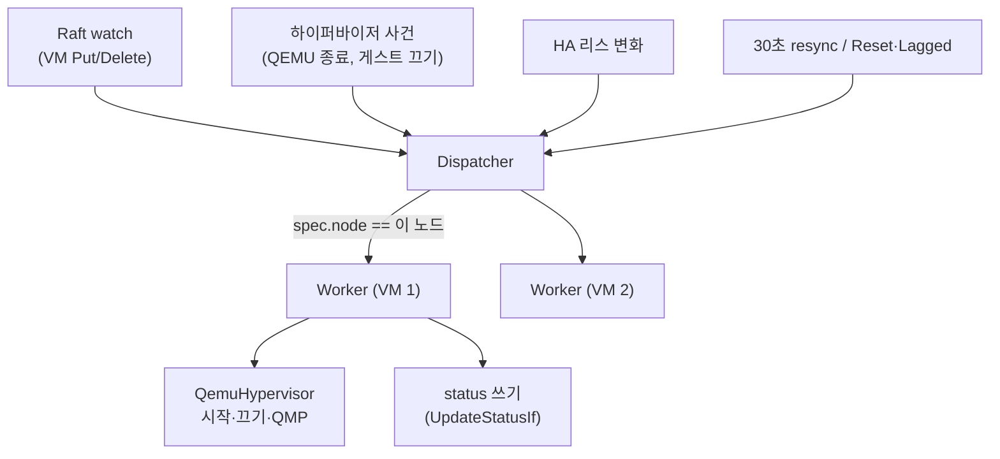

- 노드마다 `Dispatcher` 하나, 배정된 VM마다 `Worker` 태스크 하나. 같은 VM은 하나씩, 다른 VM은 동시에 처리한다
  (`crates/opl-reconciler/src/lib.rs:1-4`, `reconciler.rs:156-167`).
- 하이퍼바이저 사건을 먼저 구독하고 목록을 읽은 뒤 그 revision부터 watch한다(`reconciler.rs:175-294`). "내 VM"은
  `spec.node`로만 정한다. 배정되지 않은 QEMU가 이 노드에 돌고 있으면 경고만 하고 건드리지 않는다.
- 주기: resync 30초, ACPI 끄기 제한 60초, 오류 재시도 2초, 게스트 ping 5초, 펌웨어 동기화·게스트 정보 60초
  (`crates/opl-reconciler/src/config.rs:13-88`).
- **다시 시작.** 1초에서 두 배씩 60초까지, 600초에 5번 실패하면 멈춘다(`backoff.rs:21-23`). 재시작 정책 `Never`면 Failed,
  `OnFailure`면 물러나며 다시, HA VM은 `max_restart` 뒤 리더에게 다른 노드로 옮겨 달라고 한다. 게스트가 스스로 끄면
  `spec.power = stopped`(`worker.rs:423-468`).
- **데몬 재시작을 견디기.** QEMU는 `-daemonize`로 뜨고, Linux에서는 `systemd-run --scope --unit=opl-vm-<id>`로 감싼다
  (`crates/opl-driver/src/qemu.rs:407-436`). 살아 있는지는 pid 파일의 fcntl 잠금으로 본다. 시작할 때
  `QemuHypervisor::new`가 `{run_dir}/vm/*`를 훑어 산 VM에 QMP로 다시 붙고, 죽은 데몬이 얼려 둔 파일 시스템을 녹이고,
  죽은 VM의 런타임 디렉터리를 지운다(`qemu.rs:228-289`). reconciler를 멈춰도 VM은 계속 돈다.

### 8.3 Task

- `Task { op, target, node }`, `op`은 약 40가지(`crates/opl-types/src/task.rs:20-225`). status는 `state`(Pending,
  Running, Succeeded, Failed), `error`, `progress`(단계 + 바이트)다.
- 노드마다 `TaskRunner` 하나가 자기 노드의 Pending Task를 watch해 CAS로 Running으로 바꾸고 tokio 태스크로 돌린다
  (`crates/opl-api/src/tasks.rs:247-325,863-898`). 크기를 정한 작업자 풀은 없다. **순서**는 대상마다의 줄
  (`by_target`)로 맞춘다: 같은 VM·볼륨·백업·노드·Ceph의 앞 Task가 끝나야 다음이 돈다(`tasks.rs:600-664`).
- **다시 시작해도 대개 이어지지 않는다.** 데몬이 다시 뜰 때 Running인 Task는 "interrupted: orbivisord restarted"로 실패
  처리한다. 노드 업그레이드(`NodeUpgrade`), 단순 → SDN 옮기기(`NetworkMigrate`, 계획 67), 라이브 복원(`BackupLiveRestore`,
  계획 68)만 이어간다(`tasks.rs`의 이어 가는 Task 목록) — 셋 다 진행을 Raft·노드 파일에 두고 다시 읽어 걸음을 정한다.
- 제한 시간 기본 600초. 마이그레이션·백업·복원·복제·가져오기·업그레이드·비우기·내려받기·flatten·Ceph는 없음.
- **잠금.** 클러스터 전체의 VM 잠금은 없다. 노드 로컬 `vm_lock`이 그 노드에서의 VM spec 검증·쓰기를 줄 세우고
  (`crates/opl-api/src/state.rs:46-48`), 노드 사이 경쟁은 revision 비교(412)로 막는다. 라이브 마이그레이션 동안은
  reconciler의 "hold"(`begin_migration`/`end_migration`)가 그 VM을 건드리지 않게 한다(`reconciler.rs:73-90`).
- Task를 취소하는 API는 없다. 정리는 리더의 janitor(§4).

### 8.4 미뤄진 변경과 핫플러그 (계획 54)

- 돌고 있는 VM의 spec을 바꾸면 `vm-hotplug` Task를 만들고 그 id를 `orbivisor-task` 머리글로 준다
  (`crates/opl-api/src/vms.rs:1007-1038,1821-1835`). 계획은 순수 함수 `hotplug::plan`이 세운다: NIC 빼기 → 디스크
  빼기 → vCPU → 메모리 → CD 미디어 → 디스크 더하기 → NIC 더하기(`crates/opl-types/src/hotplug.rs:17-41`). 첫 실패에서
  멈추고 spec의 디스크·NIC 목록을 되돌린다.
- **바로 적용:** 시작할 때 정한 최대 안의 vCPU(Linux x86_64만), virtio-mem 메모리(2 MiB 단위), 미리 만든 `pcie-root-port`
  8개에 virtio-blk 디스크·NIC 더하기와 돌면서 더한 것 빼기, CD 미디어 바꾸기(`crates/opl-qemu/src/cmdline.rs:14-279`).
- **미뤄짐(`status.hardware.pending`)**: 재시작이 필요한 것(CPU 모델·토폴로지, 최대값, 펌웨어, 머신, cloud-init, TPM,
  Secure Boot, 게스트 에이전트 …), 지원 안 됨, 한도, 실패(`vm.rs:953,991-1002`). 다음에 끄고 켜면 적용된다. 보류 `cpu`는
  스펙뿐 아니라 클러스터 CPU 기준·숨김 목록이 바뀌어도 생기고, 그것은 각 노드의 검사 루프가 다시 셈해 쓴다(§9.6). 보류 `numa`(계획 64)는 CPU 정책·스레드·에뮬레이터·vNUMA·hugepages가 켤 때 기록
  (`hardware.numa`)과 다를 때다(§9.7). 전용 VM의 vCPU 핫플러그는 켤 때 상한까지 잡아 둔 pCPU에 새 스레드를 고정하고, virtio-mem은
  게스트 노드마다 장치 하나다.
- 그 밖의 디스크·NIC 변경은 409로 거부한다.

---

## 9. 컴퓨트

### 9.1 QEMU 명령줄

순수 함수 `build_cmdline`(`crates/opl-qemu/src/cmdline.rs:53-349`)이 만든다.

- 늘 `-S -nodefaults -no-user-config`로 멈춘 채 띄우고 QMP `cont`로 시작한다.
- `-machine q35|virt[,smm=on],accel=kvm|hvf|tcg`, `-cpu <model>[,enforce][,<flag>=on|off]…`(계획 63, `cpu_option`
  `crates/opl-qemu/src/cmdline.rs:356`). 모델·플래그는 켤 때 해석해 기록한 `ResolvedCpu`에서 온다(§9.6). 기록이 없으면(계획 63
  전, 업그레이드 중) 예전처럼 `-cpu host`(TCG나 모델 Max면 `max`)다.
- vNUMA·hugepages·호스트 노드 묶기(계획 64)는 켤 때 기록 `hardware.numa`가 있을 때만 게스트 노드마다 메모리 백엔드와 `-numa`를
  더한다(§9.7). 없으면 `-m`만으로 지금과 바이트까지 같다.
- 디스크는 `-blockdev`(file, host_device, rbd 드라이버) + virtio-blk-pci 또는 SATA(ide-hd). NIC는 virtio-net-pci 또는
  e1000e, tap(Linux) 또는 user(macOS). VXLAN 망이면 `host_mtu`.
- VNC는 유닉스 소켓, QMP 소켓, pid 파일. QMP 클라이언트는 비동기(`crates/opl-qemu/src/qmp.rs`).
- **하이퍼바이저 추상.** `Hypervisor` 트레이트(`crates/opl-driver/src/hypervisor.rs:156-511`)의 구현은 `QemuHypervisor`와
  시험용 `MockHypervisor`다. KVM과 HVF는 따로 된 드라이버가 아니라 `HostProfile`의 가속기 차이다
  (`crates/opl-qemu/src/host.rs:9-94`): Linux는 `/dev/kvm`이 열리면 KVM, 아니면 TCG, macOS는 Homebrew
  `qemu-system-aarch64` + HVF. macOS는 개발용이다(tap·브리지·방화벽·vCPU 핫플러그·virtio-mem·Secure Boot 없음).

### 9.2 펌웨어, Secure Boot, vTPM

- UEFI는 OVMF(x86_64)/AAVMF(aarch64). Secure Boot는 `/etc/qemu/firmware`·`/usr/share/qemu/firmware`의 QEMU 펌웨어
  설명으로 Microsoft 키가 든 것을 찾고 q35에 `smm=on`과 `secure=on` pflash를 쓴다(`crates/opl-qemu/src/firmware.rs:1-25`).
- UEFI 변수 파일은 노드 로컬(`{data_dir}/vm/<id>/uefi-vars.fd`)이다. VM이 다른 노드에서 켜지면 `FirmwareFetcher`가
  `status.firmware_node`에서 peer `UefiVars`/`TpmState`로 가져오고, 다른 노드에 사본을 미리 밀어 둔다
  (`crates/opl-reconciler/src/firmware.rs:1-70`). 사본은 `firmware_epoch`, `firmware_copies`로 추적한다.
- vTPM은 VM마다 swtpm 하나(`--daemon --terminate`, 따로 된 systemd scope). 상태는 `{data_dir}/vm/<id>/tpm/`, QEMU에는
  `tpm-crb`(q35)/`tpm-tis-device`(virt)(`crates/opl-driver/src/tpm.rs:1-6`). Debian의 swtpm AppArmor 프로필에
  `packaging/deb/apparmor/orbivisor-swtpm`을 더한다.

### 9.3 게스트 에이전트와 cloud-init

- QGA는 `qga.sock` virtserialport(`org.qemu.guest_agent.0`). 정보(`guest-info`, OS, 호스트 이름, 망 인터페이스, 파일
  시스템)와 동작(ping, 끄기, fsfreeze, 비밀번호 설정)(`crates/opl-qemu/src/qga.rs:177-315`). 백업·복제 때 fsfreeze를
  쓴다. 다른 노드의 VM이면 peer `GuestAgent` RPC.
- cloud-init은 NoCloud. 직접 쓴 ISO9660/Joliet 쓰개로 `cidata` ISO를 만든다(genisoimage 없음). 날짜를 고정해
  마이그레이션 양쪽이 같은 바이트를 만들고, 켤 때마다 다시 만든다(`crates/opl-qemu/src/iso9660.rs:1-140`).

### 9.4 템플릿과 링크드 클론 (계획 58)

링크드 클론은 템플릿에서만, 한 단계, 같은 풀 안에서 만든다(`crates/opl-api/src/tasks/clone.rs:117,357-361`).
dir·NFS는 모든 형식, LVM-thin·ZFS·RBD는 raw만, 공유 LVM은 안 된다(`crates/opl-types/src/storage.rs:461-469`).
`flatten`으로 부모에서 떼어낸다. 이미지 라이브러리는 §10.4.

### 9.5 라이브 마이그레이션과 무중단 크기 바꾸기

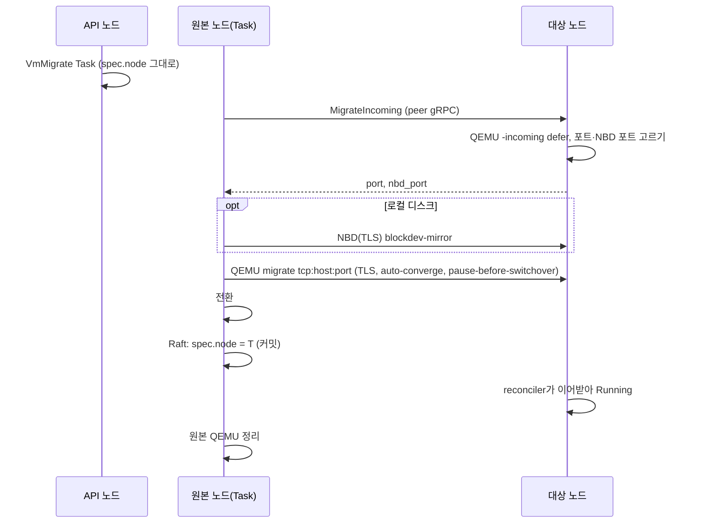

- 마이그레이션 동안 원본 reconciler는 hold로 VM을 건드리지 않는다. `spec.node`를 커밋한 뒤에야 대상 reconciler가 그
  VM을 자기 것으로 본다(`crates/opl-api/src/tasks/migrate.rs:1-9,808`).
- 진행은 Task `progress`에 쓴다. 꺼진 VM의 저장소 옮기기는 없다(계획 42의 범위 밖).
- 크기 늘리기: 블록 풀이면 저장소를 먼저 늘리고 실제 크기를 QMP `block_resize`에 준다(`crates/opl-api/src/tasks.rs:1428-1466`).

### 9.6 CPU 모델, 노드 카탈로그, 클러스터 기준 (계획 63)

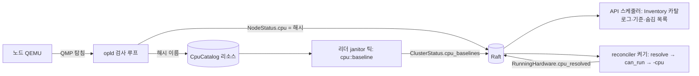

- **모델.** `CpuModel`은 `host`·`max`·`cluster`·`x86-64-v2|v2-aes|v3|v4`·QEMU 이름(`Named`)이고 `CpuSpec.flags`는 `+이름`/`-이름`
  이다(`crates/opl-types/src/cpu.rs`). 수준 넷만 코드에 얼린 정의(Proxmox와 같음)이고, 그 밖의 모델 목록은 코드에 없다.
  API는 별칭(`Icelake-Server`)을 노드들이 알린 카탈로그로 버전 모델(`-v1`)로 바꿔 저장한다(`crates/opl-api/src/cpu.rs`).
- **노드 탐침.** opld가 시작할 때와 QEMU 바이너리(경로·크기·mtime)가 바뀔 때 QEMU를 VM과 같은 머신·가속기로 띄워
  `query-cpu-definitions`·모델마다 `query-cpu-model-expansion`·`-cpu help`를 읽어 `CpuCatalogSpec`을 만든다
  (`crates/opl-qemu/src/cpu.rs:268`, `crates/opld/src/cpu.rs:151` `CpuWatch`). 카탈로그 본문은 이름이 SHA-256인 `CpuCatalog`
  리소스 하나이고(같은 QEMU·CPU·가속기 노드가 나눠 씀, x86 약 41 KB), `NodeStatus.cpu`에는 해시·QEMU 버전·가속기·호스트
  벤더만 있다 — 주기적으로 다시 쓰이는 노드 상태에 40 KB를 싣지 않으려고. 다른 노드에 RPC로 묻지 않으므로 스케줄러·HA
  리더가 오프라인 노드의 능력도 안다.
- **리더의 기준.** 리더의 janitor 틱(10초)이 순수 함수 `cpu::baseline(nodes, catalogs, settings)`(`crates/opl-types/src/cpu.rs:1004`)로
  아키텍처마다 기준을 셈해 달라졌으면 `ClusterStatus.cpu_baselines`에 쓰고, 모델·플래그가 바뀌면 기록 Task `cpu-baseline`과
  감사 `cpu.baseline`을 남긴다(`crates/opl-api/src/cpu_baseline.rs:148`). auto는 x86_64만이다(위트니스 아닌 등록된 노드 모두,
  공통 버전 모델 가운데 기능이 가장 많은 것, 벤더가 섞이면 `x86-64-v*`).
- **켜기.** reconciler가 `CpuContext`(노드 아키텍처·가속기, 기준, 숨김 목록, 노드 카탈로그, `crates/opl-reconciler/src/cpu.rs:39`)로
  `resolve`(모델 펴기 → 숨김 목록 → VM 플래그, 숨김이 이김, `cpu.rs:448`)와 `can_run`(`cpu.rs:525`)을 하고, 결과를
  `RunningHardware.cpu_resolved`에 기록한다. 마이그레이션 받는 쪽·다시 붙기는 이 기록을 그대로 써서 대상의 기준·숨김 목록이
  달라도 같은 CPUID다. 명명 모델·수준은 x86_64에서 `enforce`다.
- **스케줄러.** `Inventory`가 카탈로그·기준·숨김 목록을 들고 같은 `CpuContext`를 만든다. 새로 켜기(배치·HA 복구·복제
  배치)는 스펙을 대상에서 해석하고, 도는 VM 옮기기(마이그레이션·비우기·균형 조정·HA 되돌아가기)는 `cpu_resolved`를 본다
  (`crates/opl-api/src/scheduler.rs:387` `migration_fits`). `host`·`max` VM은 막지 않고 원본에 있고 대상에 없는 플래그를
  경고한다(`scheduler.rs:400`).
- **보류.** CPUID는 실행 중 바꿀 수 없어 차이는 보류 `cpu`(`Restart`, "power cycle required")다. 스펙 변경은 핫플러그
  Task가, 기준·숨김 목록·카탈로그 변경은 각 노드의 검사 루프 끝 `refresh_pending`(`crates/opl-reconciler/src/cpu.rs:192`)이
  자기 VM에 쓴다.
- **업그레이드.** 모든 노드가 기능 `cpu-models`를 알릴 때까지 노드는 카탈로그·`NodeStatus.cpu`를 쓰지 않고, 리더는 기준을
  쓰지 않으며, reconciler는 `cpu_resolved`를 기록하지 않는다(§14). 쓰는 법은 [CPU 모델과 플래그](guide/vms.md#cpu-모델과-플래그)·
  [클러스터 CPU 기준](guide/cluster.md#클러스터-cpu-기준).

### 9.7 NUMA 토폴로지, 전용 CPU·hugepages 장부, vCPU 고정 (계획 64)

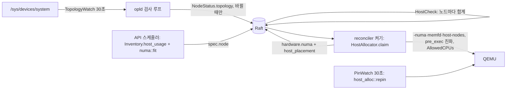

- **탐침.** `crates/opld/src/topology.rs:122` `probe(sys, proc)`가 `/sys/devices/system/{cpu,node}`·`/proc/meminfo`를 읽어
  `NodeTopology`(소켓·코어당 스레드·온라인 CPU, 호스트 노드마다 CPU·메모리·hugepages 풀, 거리, SMT 형제·L3 묶음, 페이지 크기,
  `isolated`·`nohz_full`, `pinning`·`cpuset` 능력)를 만든다. 뿌리 경로를 받으므로 고정물 트리(`crates/opld/tests/fixtures/topology/`)로
  시험한다. `TopologyWatch`(`topology.rs:514`, Linux만)가 등록 전에 한 번, 검사 루프 여섯 회차(30초, `PROBE_EVERY`)마다와 노드
  설정 `host_resources`가 바뀐 회차에 읽고, 값이 다를 때만 `NodeStatus.topology`에 쓴다(`probed_at`도 그때만 — 2소켓 256 CPU에서
  1,924바이트). **빈 자원은 노드 상태에 넣지 않는다** — VM을 켤 때마다 Raft 쓰기가 생기므로, 빈 것은 VM 기록에서 셈하고 화면은
  노드 RPC `ReadTopology`(빈 메모리·빈/남는 hugepages·orbivisord 친화)로 바로 묻는다. 같은 루프가 노드 설정을 적용한다: 예약 CPU로
  opld 자기 스레드 친화, `nr_hugepages` 쓰기(설정이 바뀔 때만), 경고 문자열.
- **세 층의 자원 세기.** 같은 순수 함수(`crates/opl-types/src/numa.rs` — `layout:1165`, `fit:1480`, `fit_fixed:1531`,
  `demand:1952`, `HostLimits:2047`·`exceeded:2079`)를 셋이 쓴다. 위가 빠르고 거칠며 아래가 정확하고 마지막에 정한다.
  1. **Raft 받아들이기 검사**(`crates/opl-cluster/src/hosts.rs:40` `HostCheck`, 폴더 할당량과 같은 VM 훑기): VM 만들기·스펙 쓰기
     뒤 그 VM이 running·템플릿 아님·`node` 있음이고 `demand`가 0이 아니면, 그 노드의 전용 pCPU 합과 크기마다 hugepages MiB 합이
     상한(`host_resources`의 전용 집합 크기, 토폴로지의 풀)을 **넘고 쓰기 전보다 늘 때만** `HostResourcesExceeded`(API 409
     `no_capacity`, `details {node, resource, limit, used}`)다. 정확한 pCPU 번호는 셈하지 않는다 — 합계만 결정적으로 본다. 두 API
     노드(또는 API와 HA 리더)가 같은 노드의 마지막 전용 CPU를 동시에 노리면 커밋 순서로 하나만 된다. 마이그레이션 확정 쓰기는 보지
     않는다(받는 쪽 할당기가 이미 잡았다).
  2. **스케줄러**(`crates/opl-api/src/scheduler.rs:284` `Inventory::host_usage`, `:342` `numa_fits`): 노드마다 도는 VM의 기록된
     `host_placement`(그 노드의 것)는 정확히, 아직 켜지 않은 VM과 오는 마이그레이션은 `fit`·`fit_fixed`로 흉내 내 센 뒤 새 VM을
     `fit`해 본다. 새로 켜기(배치·HA 복구·복제 배치)는 스펙 모양, 도는 VM 옮기기(마이그레이션·비우기·균형 조정·HA 되돌아가기)는
     `fit_fixed(hardware.numa)`다. 켜기는 `HostResourcesExceeded`면 그 노드를 빼고 한 번 다시 고른다. 균형 조정기는 전용 VM을
     옮기지 않는다. 빈 메모리 순위는 노드 메모리에서 hugepages 풀을 뺀 값이다. `numa_plan`(`:758`)이 `/vms/{key}/numa`에 같은 판정을 준다.
  3. **노드 할당기**(`crates/opl-reconciler/src/host_alloc.rs:52` `HostAllocator`, opld마다 하나 — 작업자들과 `IncomingMigrations`가
     `Arc`로 나눔): 켜기·받기 때 잠금 안에서 `claim`(`:70`)이 정확한 pCPU·호스트 노드·페이지를 고르고 예약을 만든다. 보는 것은 이
     노드의 Raft 기록 + 켜는 중·받는 중 예약 + `/sys`의 실제 `free_hugepages`(다른 프로세스가 쓴 것)다. 한 노드의 QEMU는 그 노드의
     opld만 띄우므로 이 잠금 하나로 pCPU가 두 번 잡히지 않는다. 다른 VM의 켜는 중 예약 때문에 안 되면 `Waiting`(실패로 세지 않음),
     아니면 `Cannot`(꺼짐). 받는 중 예약은 실행 디렉터리의 `hardware.json`에 남아 opld가 다시 떠도 되살린다.
- **기록.** 켤 때 `RunningHardware.numa`(게스트가 보는 것: 노드마다 소켓·메모리, 거리, 페이지, 정책 — 마이그레이션 양쪽이 같아야
  한다)와 `host_placement`(이 노드에만 맞는 것: 자리마다 pCPU, 에뮬레이터 CPU, `isolate`가 비운 형제, 게스트 노드마다 호스트 노드)를
  쓴다(계획 63 `cpu_resolved`와 같은 길). 라이브 마이그레이션은 받는 쪽이 `fit_fixed`로 고른 배치를 `MigrateIncomingResponse.host_placement`로
  돌려주고 원본 Task가 확정 뒤 기록에 쓴다(`crates/opl-peer/src/migration.rs:47`). 스펙과 기록의 차이는 보류 `numa`(`Restart`)다(§8.4).
- **명령줄과 고정.** `numa`가 있을 때만(없으면 바이트까지 같다) 게스트 노드마다 `memory-backend-ram|memfd`(`hugetlb`·`host-nodes`·
  `policy=bind|preferred`·`prealloc`)와 `-numa node`·`-numa cpu`(소켓 단위)·`-numa dist`(`crates/opl-qemu/src/cmdline.rs:384`).
  드라이버는 순수 함수 `numa::pinning`(`numa.rs:2282`)이 셈한 `RuntimePinning`만 건다: 스코프 `--property=AllowedCPUs`
  (`crates/opl-driver/src/qemu.rs:4029`), `pre_exec`의 `sched_setaffinity`(QEMU·swtpm), QMP가 붙은 뒤(`-S`, `cont` 전) 모든 스레드
  고정 — vCPU는 `query-cpus-fast`의 소켓·코어로 자리를 찾아 그 pCPU, 나머지는 에뮬레이터 집합, 커널 일꾼(`PF_USER_WORKER` 등,
  `crates/opl-driver/src/affinity.rs:28`)은 건너뜀(`qemu.rs:4072` `pin_threads`). vCPU는 `/proc/<pid>/task/<tid>/status`로 확인하고
  틀리면 QEMU를 끈다. 고정은 실행 디렉터리 `pinning.json`에 남아 실행 중 붙인 vCPU와 아래 루프가 읽는다. 노드에 예약·전용 집합이
  없고 배치도 없으면 아무것도 걸지 않는다(opld가 예약 CPU로 자기를 묶었으면 공유 VM도 공유 집합으로 다시 건다 — 물려받지 않게).
- **어긋남 고치기.** `crates/opld/src/checks.rs:191` `PinWatch`가 여섯 회차(30초)마다와 `host_resources`가 바뀐 회차에
  `host_alloc::repin`(`host_alloc.rs:296`)을 부른다: 도는 VM마다 기록과 지금 세 집합으로 고정을 다시 셈해 스코프 `AllowedCPUs`
  (`systemctl set-property --runtime`)와 스레드 친화가 다를 때만 다시 걸고 경고 로그를 남긴다(누가 `taskset`을 썼거나 공유 집합이
  바뀜). swtpm은 다시 걸지 않는다.
- **업그레이드.** 기능 `numa`(`crates/opl-types/src/node.rs:386`)를 모든 노드가 알릴 때까지 노드는 토폴로지를 쓰지 않고(읽기와 노드
  설정 적용은 함), API는 새 칸을 409 `cluster_upgrading`으로 막는다. 기록·응답의 새 칸은 그 기능을 쓰는 VM에만 생기고, Raft 검사는
  `demand > 0`인 VM에만 걸리므로 복제본마다 같은 판정이다. 쓰는 법은 [NUMA·전용 CPU·hugepages](guide/vms.md#numa전용-cpuhugepages)·
  [호스트 준비](guide/cluster.md#호스트-준비-예약전용-cpu와-hugepages).

---

## 10. 스토리지

### 10.1 풀 백엔드

`Storage` 트레이트(`crates/opl-driver/src/storage.rs:71-450`)가 만들기·가져오기·지우기, 활성화(공유·배타), 스냅샷,
크기 바꾸기, 복사·내보내기, 백업 대상·비트맵, overlay, link_clone, flatten을 정한다. `Storages`가 풀 종류에 따라
보낸다(`storage/storages.rs:16-37`).

| 백엔드(`PoolBackend`) | 공유 | 볼륨 | 스냅샷 | 메모 |
|---|---|---|---|---|
| Dir | 로컬 | qcow2·raw 파일 | qcow2 내부 | 백업 저장 가능 |
| Nfs | 공유 | 〃 | 〃 | 노드마다 마운트(`PoolMounter`), 백업 저장 가능 |
| LvmThin | 로컬 | thin LV `opl-{id}` | `-s-{tag}` LV(raw) | `crates/opl-driver/src/storage/lvm.rs:1-3` |
| Zfs | 로컬 | sparse zvol | `@tag`(raw) | `storage/zfs.rs:1-2` |
| Rbd | 공유 | Ceph RBD 이미지 | RBD 스냅샷(raw) | QEMU rbd 드라이버로 직접(커널 map 없음), `storage/rbd.rs:1-3` |
| LvmShared(+iSCSI) | 공유 | thick LV, 한 노드에서 배타 활성화 | 없음 | `lvm.rs:1563-1565` |

출처: `crates/opl-types/src/storage.rs:46-102`.

**Ceph 자동 구성(계획 56).** apt 패키지(ceph-mon, mgr, osd, volume)를 깔고 `ceph-mon --mkfs`, `ceph-volume lvm create`를
돈다. cephadm을 쓰지 않고 cephadm이 쓰는 디스크는 거부한다. 단계마다 다시 해도 같다
(`crates/opl-driver/src/ceph/host.rs:1-38`). 노드 디스크·Ceph 상태는 peer `NodeDisks`/`CephStatus`로 묻는다.

### 10.2 볼륨과 스냅샷

볼륨은 Raft `Volume` 리소스이고, 실제 할당·지우기는 Task가 저장소 드라이버로 한다. VM 스냅샷은 `Snapshot` 리소스
(VM마다 이름 하나)이고 예약 스냅샷은 리더의 `SnapshotScheduler`가 만든다(§4). LVM·ZFS·RBD 스냅샷은 raw가 필요하다.

### 10.3 백업과 복제

- **백업**은 dir·NFS 풀의 `backups/{id}/`에 디스크마다 압축 qcow2, 펌웨어 변수, 매니페스트로 둔다
  (`crates/opl-types/src/backup.rs:1-2`). 전체 백업은 임시 스냅샷을 내보내고, **증분**은 영속 dirty bitmap(`opl-{id}`)을
  쓴다(`crates/opl-api/src/tasks/backup.rs:24-30,392-396`). 백업 작업은 리더가 돌린다(§4).
- **원격 복제(DR)**는 다른 클러스터로 준비된 백업을 HTTPS로 밀고 SHA-256으로 확인한다
  (`crates/opl-api/src/tasks/replicate.rs:1-9`). 저장소 백업은 원격 저장소에 없는 청크만 보낸다(아래).
- **백업 저장소(계획 68)**는 루트 리소스 `BackupStore`(백엔드: 백업 풀 안 `{루트}/store/{id}/` 또는 S3, 암호화 키는 Raft에만 —
  API·watch·감사에서 뺌, GC·검증 일정, 읽기 전용)다. 데이터(청크·인덱스·매니페스트 v3·블롭)는 저장소 안에만 있고 Raft에는 리소스와
  상태(주인·사용량·GC 진행·쓰기 잠금 `committing`/`sweeping`·`sweep_epoch`)만 있다. 형식·백엔드·GC·검증·NBD는 `opl-store`
  크레이트이고 Raft·Task를 모른다 — `opl-api`의 `stores.rs`(저장소 열기·노드 고르기), `tasks/backup_store.rs`(파이프라인·커밋·
  백업·복원·지우기·옮기기·복사), `tasks/store_tasks.rs`(초기화·GC·검증·scan), `tasks/live_restore.rs`가 걸음을 차례로 부른다.
  - **읽기는 pull**: 실행 중 VM은 복제(§5.7)와 같은 copy-before-write 플리싱(VM 상태 디렉터리의 성긴 파일) 위 snapshot-access
    노드를 QEMU가 유닉스 소켓 NBD로 내보내고(증분은 남의 노드 비트맵 문맥 `qemu:dirty-bitmap:opl-fl-point` — 부모 비트맵은 끄지
    않고 같은 transaction에서 꺼진 임시 비트맵으로 시점을 얼림), 꺼진 VM은 `qemu-nbd`다. opld의 Task가 순수 Rust NBD 클라이언트로
    4 MiB씩 읽어 0 검사 → 청크 id(SHA-256 또는 키 HMAC) → base 같은 자리·이번 실행·`HEAD` 있음 확인 → lz4·AES-256-GCM(결정적
    nonce) → 올림을 겹쳐 돈다. 저장소 쪽 스냅샷이 필요 없어 모든 풀에서 같다.
  - **GC는 표시·쓸기**: 저장소 시계의 T0 → 시작 때 진행 중이던 백업을 기다림 → Raft CAS 쓰기 잠금(`committing`이 비어야
    `sweeping`, epoch + 1)과 늦은 표시 → T0 − 5분보다 오래된 표시 없는 청크를 지움. 표시 집합은 Bloom 필터. 백업은 매니페스트를
    쓰기 전에 `committing`에 들어가고, 시작 뒤 epoch가 바뀌었으면 "있음"으로 건너뛴 청크를 다시 확인해 사라진 것을 열린 원본에서
    다시 올린다. 안전은 `opl-store`의 모형 proptest가 지킨다.
  - **복원은 NBD 서버**: 보통 복원·옮기기·복사는 opld 안의 NBD 서버(`StoreExport` — 풀린 청크 LRU, 미리 읽기, 0 청크는 구멍)를
    `qemu-img convert`가 읽고, 라이브 복원은 같은 서버를 헬퍼 `orbivisord backup-serve`(표준 입력 설정, Linux systemd면
    `opl-bkserve-<id>` scope)로 띄워 QEMU가 오버레이의 backing으로 읽는다(`reconnect-delay=300`). Task가 배선 파일
    (`live-restore.json`)을 두면 reconciler의 보통 켜기가 드라이버를 거쳐 그 배선의 명령줄로 켜고, Task는 `blockdev-mirror`
    (`write-blocking`, `on-source-error: stop`) → `job-complete`로 대상 볼륨에 갈아탄다. HA 관리자는 `live_restore`가 있는 VM을
    건너뛰고, reconciler는 그 VM의 QEMU가 죽으면 재시작 정책과 관계없이 같은 배선으로 다시 켠다(`Pivoting` 뒤에는 대상으로 보통 켬).
  - **노드 닿음**: 노드마다 60초에 한 번 쓸 수 있는 저장소의 `store.json`을 읽어 `NodeStatus.backup_stores`에 적는다(바뀔 때만).
  - 자세한 것은 [백업 저장소 안내](guide/backup.md#백업-저장소중복-제거암호화s3)와
    [설계](superpowers/specs/2026-11-23-backup-store2-design.md).
- **로컬 디스크 복제(HA)**는 §5.7.
- VMware 가져오기(OVA, ESXi)는 `VmImport` 리소스와 Task다([백업·복제·가져오기 안내](guide/backup.md)).

### 10.4 이미지 라이브러리

내장 클라우드 이미지 목록과 관리자가 더한 항목을 `(id, arch)`로 둔다(`crates/opl-types/src/image_catalog.rs:1-3`).
내려받기는 Task(`tasks/download.rs`)다. CI의 `catalog-links`(주 1회)가 내장 링크가 살아 있는지 본다.

---

## 11. 네트워크

### 11.1 브리지와 VLAN

브리지는 관리자가 만든다(ISO 설치는 기본 경로 NIC를 `vmbr0`에 넣는다). VLAN은 `vlan_filtering`을 켠 VLAN 인식
브리지를 쓴다(`crates/opl-types/src/network.rs:23-32`). tap은 iproute2로 만든다(`crates/opl-driver/src/net.rs:1-3`).
노드는 자기 브리지 목록을 60초마다 다시 알리고 스케줄러는 그 망이 있는 노드에만 놓는다.

### 11.2 VXLAN

- 평범한 커널 장치: `oplv<vni>` 브리지 + `oplx<vni>`(`type vxlan id … local … dstport 4789`)(`net.rs:488-499`).
- BUM 트래픽은 다른 모든 노드의 정적 목록으로 head-end 복제한다(MAC 0의 FDB 항목, `net.rs:552-593`). opld의 overlay
  에이전트가 60초마다(바뀌면 1초 뒤) 맞춘다(`crates/opld/src/overlay.rs:1-28`). 기본 MTU 1450.

### 11.3 보안 그룹(nftables)

보안 그룹을 nftables **bridge 계열** 테이블 `opl_<tag>` 하나에 tap마다 체인으로 그려 `nft -f -`로 한 번에 적용한다.
conntrack을 쓰고 원본 MAC을 확인한다(`crates/opl-driver/src/firewall.rs:1-110`). 에이전트가 60초마다 다시 맞추고
(`crates/opld/src/firewall.rs:1-24`), 보안 그룹이 걸린 NIC가 있는 VM은 방화벽 동기화가 성공해야 켠다
(`crates/opl-reconciler/src/firewall.rs`). SDN NIC는 OVS 포트라 이 훅을 타지 않으므로 건너뛴다(`crates/opld/src/firewall.rs`). 그룹 펼치기(NIC의 그룹 순서 → 규칙 순서,
없는 그룹이면 막기)는 순수 `opl_types::security_group::nic_policy`이고 SDN NIC의 OVN ACL(§11.5)도 같은 함수로 펼친다 — 옮긴 뒤에도
nftables 규칙 글은 바이트 그대로다(`the_ruleset_text_is_unchanged`). 스케줄러·`firewall_unsupported`는 단순 NIC만 본다
(`VmSpec::has_simple_firewall`).

### 11.4 SDN: OVN과 OvnSync (계획 65)

설계는 `docs/superpowers/specs/2026-11-20-sdn-ovn-design.md`, 쓰는 법은 [네트워크 가이드](guide/network.md#sdn-ovn)다. OVN을
뒷단으로 쓰고 Orbivisor가 Neutron ML2/OVN의 자리(NB에 원하는 상태를 쓰는 관리 시스템)를 맡는다. 단순 네트워크(§11.1~11.3)는
그대로이고, 관리자가 `sdn init`을 하기 전에는 아무 루프도 일하지 않는다.

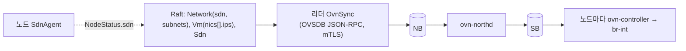

- **리소스.** `Sdn`(이름 `sdn` 하나, `CephCluster`와 같은 모양): `status.phase`(bootstrapping·ready), 중앙 목록과 주소, OVN 판,
  NB·SB 클러스터 id, 한 번에 하나만 도는 중앙 Task 자리 `pending`(리비전 확인 쓰기), 동기화 `sync`. 네트워크 `spec.sdn`·
  `subnets`, NIC `ips`, 노드 `status.sdn`(chassis 상태, 판, encap 주소, 중앙이면 NB·SB Raft 역할·northd 활성)
  (`crates/opl-types/src/sdn.rs`, `network.rs`). 모두 기능 `sdn` 뒤에 있다(§14).
- **설치(Task).** `sdn-init`·`sdn-central-add`·`sdn-central-remove`(대상 `Sdn`)와 `sdn-chassis-install`(대상 노드)이 그 노드의
  `OvnHost`(`crates/opl-driver/src/ovn/host.rs`, Ceph의 `CommandRunner`를 같이 씀) 단계를 돈다: 빠진 꾸러미만 apt, TLS 사본
  `/etc/opl/ovn/`, 배포판 중앙 단위 끄고 가리기, `ovsdb-tool create-cluster`/`join-cluster`(DB `/var/lib/opl/ovn/`), Orbivisor
  단위 `opl-ovn-nb`·`-sb`·`-northd`(`units.rs` — 노드 주소의 `pssl`만), 리더·멤버 기다리기, chassis 구성(OVS `external_ids`,
  `set-ssl`). 단계마다 지금 상태를 먼저 봐서 다시 하면 잇고, 남의 OVN·모르는 클러스터 id의 DB는 거절한다. `sdn-init`은 DB를
  임시 파일에 만들어 클러스터 id를 Raft에 **먼저** 적고 제자리로 옮긴다 — 그래서 제자리의 DB는 늘 Raft가 아는 id다
  (`crates/opl-api/src/tasks/sdn.rs`).
- **노드 `SdnAgent`**(`crates/opld/src/sdn.rs:61`): `Sdn`이 있을 때만, 중앙 목록·자리·underlay가 바뀌거나 60초마다 chassis의
  `ovn-remote`·`encap-ip`·TLS를 맞추고, 중앙이면 멈춘 단위를 켜고 스키마 변환(`ovsdb-client needs-conversion`/`convert`)을
  하며, 장치 없는 이 클러스터의 OVS 포트를 지운다. 상태는 검사 루프가 `NodeStatus.sdn`에 바뀔 때만 쓴다.
- **OVSDB 클라이언트**(`crates/opl-driver/src/ovn/ovsdb.rs`): RFC 7047 JSON-RPC를 `tokio-rustls` 위에서 직접 말한다(`ovn-nbctl`을
  부르지 않음 — 리더가 macOS일 수도 있고, "다른 것만 한 트랜잭션에 + 펜싱 `wait`"을 명령줄로 만들기 어렵다). 노드 인증서로
  붙고 서버 인증서를 클러스터 CA와 이름(중앙 IP 또는 그 노드 주소의 호스트)으로 확인한다. 붙자마자 `_Server`의 `Database`
  행을 읽어 쓰는 쪽은 클러스터 리더에만(`connect_any(.., leader_only)`, `:363`), 읽는 쪽(`GET /networks/{key}/ips`)은 팔로어도
  쓴다. 서버의 `echo` 탐침에 답한다. 시험은 가짜 서버(`fake_ovsdb.rs`)와 실제 24.03.8의 요청·답 고정물이다.
- **`OvnSync`**(`crates/opl-api/src/ovn_sync/`): 리더 루프(§4). 차례마다 임기(`Cluster::leader_term()`)를 잡고 `read_barrier()`
  뒤 임기가 그대로인지 다시 본 다음, 순수 함수 `nb::desired(networks, vms, nodes, tag)`(`nb.rs:162`)로 바라는 행
  (`Logical_Switch` `opl-<네트워크 id>`, IPv4 DHCP 서브넷마다 `DHCP_Options`, 템플릿이 아닌 VM의 SDN NIC마다
  `Logical_Switch_Port` `opl-<VM id>-<MAC>` — 주소·포트 보안·`requested-chassis`(마이그레이션 중이면 "원본,대상"과
  `activation-strategy=rarp`))을 만들고, 주인 표시(`external_ids:orbivisor:cluster`)가 있는 NB 행만 읽어 견주어(`plan`, `:433`)
  다른 것만 쓴다. Raft 읽기가 실패한 차례는 아무것도 지우지 않는다.
- **펜싱.** 트랜잭션마다 첫 연산이 `NB_Global.external_ids`에 대한 `wait`(읽은 값 그대로) + 토큰 `"<임기>:<인덱스>"`를 넣은
  `update` + `nb_cfg += 1`이다(`fence_ops`, `nb.rs:651`). NB의 토큰 임기가 내 임기보다 크면 쓰지 않고 `sync`·SB 청소도 하지
  않는다(물러난 리더). 그래서 리더가 바뀌는 순간 옛 리더가 낡은 상태로 쓰더라도 새 리더의 `wait`이 깨져 다시 읽는다.
  네트워크마다(지울 스위치·DHCP 행 묶음도 따로) 한 트랜잭션이고 각각 펜싱 연산을 갖는다(`plan` — 한 네트워크의 실패가
  다른 네트워크를 막지 않는다, 계획 65 리뷰 1). SB 청소는 쓰기 바로 앞에서 같은 임기의 리더인지 다시 본다. 투표 멤버 하나인 Raft는 다시
  떠도 임기가 그대로였다(같은 임기는 같은 리더이므로 막지 않는다 — 시험이 `(임기, 인덱스)`로 견준다).
- **SB.** OvnSync가 SB에 쓰는 것은 Raft에 없는 노드 UUID 이름의 `Chassis`·`Chassis_Private` 지우기뿐이다.
  `SdnStatus.sync`는 바뀔 때만(시각만 바뀌면 60초에 한 번) Raft에 쓴다. 규모: 네트워크 50·포트 5천을 빈 가짜 NB에 넣으면
  트랜잭션 50개, 다 맞은 NB를 다시 읽고 견주기까지 Mac 디버그 빌드에서 약 1.7초.
- **IPAM.** 주소의 출처는 VM 스펙 `nics[].ips`다. API의 `prepare`(`crates/opl-api/src/ipam.rs:68` `assign`)와 Task의 새 VM
  (`:214` `assign_new` — 복제·배포·가져오기·복원)이 서브넷의 가장 낮은 빈 주소를 고르거나 준 주소를 검사하고(`opl_types::ipam::
  allocate`, 정렬된 사용 목록의 틈을 찾음), Raft 상태 머신이 `("ip", "<네트워크 이름>/<주소>")` 배타 값으로 겹침을 막는다
  (`crates/opl-cluster/src/exclusive.rs:46`, 템플릿 제외). 거절되면 5번까지 다시 고르고, 그 뒤 409 `ip_in_use`. 있던 NIC는
  저절로 채우지 않는다(CLI `network ips --fill`이 스펙에 적음). DHCP는 OVN 내장(`server_mac` = `02:` + 네트워크 id 해시)이고
  `router` 옵션이 없다.
- **포트 바인딩.** `resolve`가 SDN NIC의 `NicBackend::Tap`을 `br-int`·망 MTU·`ovn_port`로 채우고, 드라이버가 tap을
  `ovs-vsctl --may-exist add-port br-int …`(`iface-id`=논리 포트, `crates/opl-driver/src/net.rs:800`)로 붙인다. 켤 때는
  기다리지 않고(10초 안에 `ovn-installed`가 없으면 로그 경고), 마이그레이션 받는 쪽은 받을 QEMU를 띄우기 전에 30초까지
  기다려 안 되면 받기를 거절한다(`crates/opl-driver/src/qemu.rs:576`). 스케줄러 `has_sdn`은 chassis가 `ready`인 노드만
  (`crates/opl-api/src/scheduler.rs:245`).
- **TLS.** NB·SB·Raft 포트는 모두 클러스터 CA mTLS(`/etc/opl/ovn/`의 노드 인증서 사본)이고 평문 리스너가 없다(§13).
- **없는 것.** 부하 분산·QoS·단순 → SDN 옮기기·SB RBAC·OVN 알림은 계획 67이다(라우팅·보안 그룹은 §11.5). EVPN/BGP/FRR은
  없다. VXLAN의 정적 head-end 복제는 노드 수에 비례해 BUM 트래픽이 늘므로 노드가 아주 많으면 SDN 네트워크가 낫다.

### 11.5 SDN 라우팅과 OVN 보안 그룹 (계획 66)

설계는 `docs/superpowers/specs/2026-11-20-sdn-ovn-plan66-design.md`, 쓰는 법은 [네트워크 가이드](guide/network.md#외부공급자-네트워크와-노드-physnet)
다. 원칙은 §11.4 그대로다: 원하는 상태는 Raft에만 있고(`Router`·`FloatingIp` 리소스, `NetworkSpec.sdn.provider`, 서브넷
`floating_pools`·`ipv6_mode`, `NodeSpec.sdn`), 리더 `OvnSync`만 NB에 쓰며, 노드 `SdnAgent`는 자기 OVS·veth만 만진다. 새 칸은 모두
기능 `sdn-routing` 뒤이고(§14), 이 칸을 쓰지 않으면 `desired`가 계획 65와 같은 NB 행을 낸다(고정물에 연산 0개 — 시험).

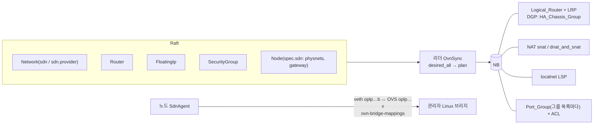

- **노드 physnet**(`crates/opl-driver/src/ovn/physnet.rs`, `OvnHost::reconcile_physnets`): `NodeSpec.sdn.physnets`(physnet →
  관리자 Linux 브리지)마다 veth 짝 `oplp<h8>b`(브리지에 매닮)·`oplp<h8>o`(OVS 브리지 `oplp<h8>x`에)와 `ovn-bridge-mappings`
  항목을 만든다(`h8` = SHA-256(태그/physnet) 앞 8자 — `opl_types::sdn::physnet_ifnames`. `oplx<h8>`가 아닌 까닭은 VXLAN 장치
  `oplx<vni>`와 겹칠 수 있어서). 주인은 이름 모양(`is_physnet_ifname`, `x`로 끝남) + OVS `Bridge`의 내 태그다. 남의 매핑은 차례
  그대로 두고 충돌한 physnet은 `ready: false`. 빼는 차례는 매핑 → veth → OVS 브리지(veth는 이름으로만 찾으므로 먼저). 게이트웨이
  후보면 `ovn-cms-options`에 `enable-chassis-as-gw`(사람이 보는 표시, 실제 후보는 Raft). 결과는 `NodeStatus.sdn.physnets`·`gateway`.
  스케줄러 `Inventory::missing_physnet`이 공급자 NIC의 physnet이 `ready`인 노드만 고른다.
- **NB 그리기**(`crates/opl-api/src/ovn_sync/nb.rs` `desired_all`): 공급자 네트워크는 스위치 + `localnet` LSP `opl-ln-<네트워크 id>`
  (`network_name`=physnet, `tag`=VLAN). 라우터는 `Logical_Router` `opl-r-<id>`, 인터페이스마다 LRP `opl-lrp-<네트워크 id>`(서브넷
  게이트웨이 주소, `router_mac`, `gateway_mtu`, RA는 `ipv6_mode`가 있을 때) + 스위치 쪽 `opl-rsp-…`(`type=router`), 바깥이 있으면
  분산 게이트웨이 포트(DGP) `opl-gw-<id>` + 공급자 스위치 쪽 `opl-rgw-<id>`(`nat-addresses=router` — 넘김 뒤 GARP), 정적 경로와
  기본 경로(바깥 서브넷 게이트웨이). 동서 라우팅은 OVN 기본대로 분산이다(`centralize_routing` 없음). 자식 행(LRP·경로·NAT·
  `HA_Chassis`)에도 주인 표시를 달아 관리자가 우리 라우터에 넣은 행은 둔다. 빠지는 LRP는 라우터 `ports`에서 빼면서 명시적으로
  지운다(OVSDB는 참조 검사를 가비지 정리보다 먼저 하므로 HA 그룹을 가리키는 고아 DGP가 그룹 지우기를 막는다).
- **게이트웨이 HA**: 라우터마다 `HA_Chassis_Group` `opl-ha-<id>`(DGP의 `ha_chassis_group`, `Gateway_Chassis`는 쓰지 않음).
  후보 = 게이트웨이 우선순위가 있고, 유지보수가 아니며, 바깥 physnet이 `ready`인 노드(`nb::NodeInputs` — OvnSync는 Node 쓰기를
  이것으로 걸러 5초 검사 루프로는 깨지 않는다). 순위는 순수 `opl_types::sdn::gateway_ranking`(관리자 우선순위 내림, 같으면
  HRW SHA-256(라우터‖노드) 내림, 앞 5개, `priority` 32767부터) — 상태 없이 고르게 흩고 노드 더하기·빼기에 그 노드가 이기던
  라우터만 움직인다. 주인 고르기·넘김·되돌아감은 OVN(BFD)이 하고 Orbivisor는 하지 않는다. 후보가 없으면 DGP `enabled=false`, HA
  그룹·`opl-rgw`·NAT를 쓰지 않는다(그룹 없는 DGP는 모든 chassis가 같은 MAC으로 답하는 분산 포트가 되므로). 보기 `RouterView.hosting`은
  API 노드가 NB의 DGP `status:hosting-chassis`를 읽은 것(팔로어도 읽음, `ovn_sync::read_nb`). 여러 노드 시험의 넘김: 점잖은 멈춤
  약 0.15초, `kill -9` 약 3초(BFD), 노드 통째 3.1초.
- **NAT**(`router_nat`): 바깥 IPv4가 있고 SNAT가 켜졌으면 인터페이스 IPv4 서브넷마다 `snat`. 유동 IP는 `dnat_and_snat`
  (`orbivisor:fip`) — 대상 NIC의 네트워크가 바깥이 그 유동 IP 네트워크인 라우터의 인터페이스이고 IPv4가 있을 때만. VM의 chassis
  노드(켜짐, 마이그레이션이면 둘)가 모두 바깥 physnet을 `ready`로 알리면 `logical_port` = NIC LSP·`external_mac` = NIC MAC(분산),
  아니면 둘을 비워 게이트웨이가 한다(중앙). Neutron의 전역 스위치 대신 노드마다 저절로 고른다. 보기 `FloatingIpView.state`는 Raft에서
  같은 규칙으로 센다.
- **IPAM**(`crates/opl-api/src/ipam.rs`): 라우터 바깥 주소·유동 IP(`HeldIps`)가 NIC와 한 주소 공간이고 Raft 겹침 키 `ip`를 세 종류가
  함께 쓴다(`opl-cluster/src/exclusive.rs`의 `SHARED_IP_KINDS`). 다른 겹침 키: `router-net`(네트워크는 라우터 하나), `fip-nic`
  (NIC 하나에 유동 IP 하나), `physnet`(`<physnet>/<vlan|flat>`). 라우터·유동 IP는 `floating_pools`(없으면 `pools`)에서, NIC의 자동
  할당은 `floating_pools`를 건너뛴다. SLAAC 계열 서브넷은 EUI-64(`ipam::eui64`·`allocate_v6_mode`).
- **DHCP·RA·cloud-init**: DHCPv4 `router`는 라우터 인터페이스인 네트워크와 공급자 네트워크에만(라우터 없는 오버레이는 계획 65 그대로).
  `ipv6_mode`가 `dhcpv6-*`면 DHCPv6 `DHCP_Options`(`server_id` = 네트워크 `server_mac`), RA(`ipv6_ra_configs`, `send_periodic`)는 라우터
  포트에만. cloud-init `render_sdn`은 `SdnNicNetwork { spec, routed }`로 고정 주소의 `gateway`와 v1 `ipv6_slaac`·`ipv6_dhcpv6-*`를
  적는다. instance-id는 NIC 주소로만 세므로 라우터를 붙여도 그대로다.
- **보안 그룹 → Port_Group ACL**(`crates/opl-api/src/ovn_sync/acl.rs`): 계획 26의 뜻(NIC의 그룹 순서 → 그룹 안 순서로 처음 맞는
  규칙)은 그룹마다 Port_Group 하나(Neutron)로는 그릴 수 없다 — 같은 그룹이 NIC마다 다른 자리에 온다. 그래서 **NIC의 그룹 목록
  (`NicPolicy::key()`)마다 Port_Group** `opl_<태그>_<SHA-256(key) 앞 16자>`를 두고, `nic_policy`가 펼친 규칙 i번째를 우선순위
  `32000 − i` ACL(`in` → `to-lport`, `out` → `from-lport`, `accept` → `allow-related`)로 그린다. 32767은 물리 망 DHCP 응답 허용,
  1000은 들어오기 막기·나가기 `allow-related`(명시). 없는 그룹이 낀 목록은 `nic_policy`가 더한 `out drop`이 띠의 마지막 자리다.
  OVN은 한 층 안에서 가장 높은 맞는 ACL 하나로 판정하므로 "처음 맞는 것"이 정확하고 층(`tier`)은 쓰지 않는다. 한 포트는 한
  Port_Group에만 든다. ACL은 내용으로 짝지어 다른 것만 넣고 빼고, 관리자의 표시 없는 ACL은 둔다. `match`는 검증된 타입에서만
  만든다(`acl_match` — 사용자 글이 들어가지 않음).
- **실패하면 닫힘**: 트랜잭션 차례가 목록 Port_Group → 네트워크 → 라우터 → 지울 스위치 → 지울 라우터 → 지울 Port_Group(`ports ==
  []` 조건으로만) → 지울 DHCP다. 네트워크 트랜잭션은 포트를 새 Port_Group에 넣기 전에 그 Port_Group을 `wait`(이름 + 우리 태그)하므로
  Port_Group 쓰기가 실패하면 포트가 생기지 않는다. 그래서 OvnSync의 "NB가 바뀌었으니 차례를 멈춤" 판단은 펜싱 연산의 실패
  (`index < n_fence`)로만 좁혔다(Port_Group `wait` 하나가 다른 네트워크를 막지 않게).
- **두 세계의 차이**는 집행하는 곳이 준다: SDN NIC는 포트 보안이 보낸 IP 위조도 막고, OVN이 맺은 연결의 요청 방향을 늘 ACL에
  다시 비춰 허용을 빼면 그 연결이 끊기며(`ct_mark.blocked`), IPv6 NS·NA·RS·RA·MLD는 양 방향 늘 허용(65532)이다. GitHub `ovn` 작업이
  nftables·OVN 이름공간의 같은 탐침 표와 이 차이를 본다.
- **규모**(가짜 NB, Mac 디버그 빌드): 포트 5천 + 목록 50개 × 규칙 50(ACL 2650)의 견주기 약 75 ms(가짜 서버 읽기 약 5.5초는 가짜의 비용).
- **API**(`crates/opl-api/src/routing.rs`): `/routers`·`/floating-ips`, `PUT /nodes/{key}`의 `spec.sdn`(`sdn::check_node_sdn` — 409
  `physnet_in_use`), 공급자 네트워크는 루트 `cluster.admin`, 라우터·유동 IP는 네트워크 폴더의 `network.config`와 잇는 네트워크의
  `network.assign`·대상 VM의 `vm.config`. 할당량 `routers`·`floating_ips`는 네트워크 폴더만이고 상태 머신이 센다(§3.2). 라우터·유동
  IP는 계획 67부터 watch 대상이다(§11.6).

### 11.6 SDN 서비스: 부하 분산·QoS·옮기기·OVN 잠금·경보 (계획 67)

설계는 `docs/superpowers/specs/2026-11-21-sdn-ovn-plan67-design.md`, 쓰는 법은 [네트워크 가이드](guide/network.md#부하-분산)다. §11.4·§11.5의
원칙 그대로 원하는 상태는 Raft에만 있다: 새 리소스 `LoadBalancer`·`NetworkMigration`(네트워크 폴더, `Kind` 38), NIC `qos`
(`NicSpec.qos`), `SdnSpec.lockdown`과 `SdnStatus.lockdown`(`LockdownState { applied, pending, … }`), 노드 `NodeStatus.qos`·`NodeSdn.lockdown`·
`peers`, SDN 경보 조건 여덟. 모두 기능 `sdn-services` 뒤이고(§14), 쓰지 않으면 NB 행·tap 명령·nftables 글·cloud-init 씨앗·OVN 단위가 계획 66과
바이트까지 같다(고정물 시험).

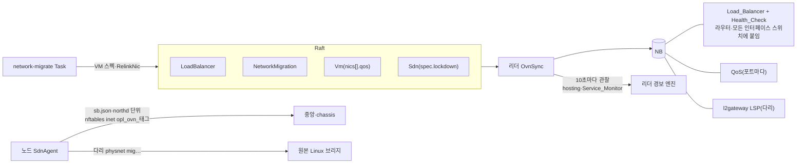

- **부하 분산**(`crates/opl-types/src/load_balancer.rs`, `crates/opl-api/src/ovn_sync/lb.rs`, `load_balancers.rs`): LB의 프로토콜마다
  `Load_Balancer` `opl-lb-<id>-<proto>`(`vips` = 안 VIP와 바깥 VIP의 리스너마다 `"VIP:포트" = "백엔드,…"`, `options { reject, affinity_timeout? }`),
  건강 검사가 있는 리스너마다 `Load_Balancer_Health_Check`(안·바깥 VIP에 하나씩), NIC 멤버의 `ip_port_mappings`(`<LSP>:<monitor 주소>`). 순수
  `vips`·`health_rows`·`ip_port_mappings`가 NIC 멤버를 `resolve(vm, mac)`로 풀고, 남은 멤버가 없는 리스너는 빈 백엔드(`reject`). LB 행은 VIP
  네트워크 라우터의 `Logical_Router.load_balancer`와 **그 라우터의 모든 인터페이스 스위치**에 붙는다(라우터가 VIP ARP에 답해 같은 서브넷
  클라이언트도 닿고, 클라이언트 스위치가 분산 DNAT — Octavia OVN 공급자와 같은 모양, GitHub 탐침으로 확인). 붙일 곳이 없는 LB는 행을 쓰지
  않는다. 트랜잭션 차례는 목록 Port_Group → **LB**(새 행은 같은 트랜잭션에서 이미 있는 스위치·라우터에 named-uuid로 붙임) → 네트워크 → 라우터 →
  지울 것(…→ 지울 LB)이고, 새 LB와 새 스위치·라우터가 한 차례에 함께 생기면 `lb::deferred`로 같은 차례에 한 번 더 맞춘다. 건강 검사 출발
  주소는 LB·멤버 네트워크마다 IPAM에서(`monitors` — 라우터 포트 주소는 northd의 `svc_monitor_mac` ARP 답과 다툼). Raft 겹침 키 `ip`를 VM·
  라우터·유동 IP·LB 넷이 함께 쓰고(`SHARED_IP_KINDS`), `lb-listener`(`<VIP 네트워크>/<vip>/<proto>/<port>`). 보기 `LoadBalancerView`의 멤버 건강은
  API 노드가 SB `Service_Monitor`를 역할 포트로 읽은 것(`ovn_sync::read_monitors`), 보안 그룹 경고는 `NicPolicy::admits_in`으로 센다.
  바깥 VIP는 게이트웨이 chassis에서만 DNAT되고 넘김 뒤 `nat-addresses=router`의 GARP에 든다(여러 노드 탐침 1.3초).
- **QoS**(`crates/opl-types/src/qos.rs`, `ovn_sync/qos.rs`, `crates/opl-driver/src/net.rs`): SDN NIC는 `nic_rows`가 낸 `QoS` 행 최대 둘(`from-lport`
  보내기·DSCP, `to-lport` 받기, 우선순위 2000, 주인 `orbivisor:port`)을 네트워크 묶음이 포트와 한 트랜잭션에 쓴다. 단순 NIC는 런타임
  `NicBackend::Tap.qos`를 드라이버가 tap을 만들 때 `clsact` + matchall `police`(우선순위 49152)로 걸고, 실행 중 바꾸기는 핫플러그 계획의
  `Step::SetNicQos(i)` → `HostNet::set_tap_qos`(`tc -j qdisc`·글 `tc filter show`로 읽어 다른 훅만 `del`+`add` — matchall은 제자리 바꾸기를
  받지 않음, 버스트는 바이트, 커널 틱 반올림은 2% 안이면 같음). 노드 능력 `NodeStatus.qos`(시험 dummy에 `clsact`)를 스케줄러·`vms.rs`가 본다
  (409 `qos_unsupported`). 둘 다 폴리싱이라 같은 뜻이다(측정: SDN 50 → 50.0, tc 40 → 38.8 Mbit/s).
- **옮기기 엔진**(`crates/opl-types/src/network_migration.rs`, `crates/opl-api/src/tasks/network_migrate.rs`, `network_migrations.rs`): 순수
  `plan(PlanInput) -> MigrationPlan`이 VM NIC마다 방식(`offline`·`live`·`restart`·`blocked`)·주소와 출처(`given` → `guest-agent` → `cloud-init` →
  `ipam`)·막힘·경고와 다리 노드를 낸다(미리 보기와 Task가 같은 함수). `network-migrate` Task(`TaskOp::NetworkMigrate { step: start|rollback|
  finish }`)는 VM마다 그때 다시 계획해 다르면 그 VM만 `failed`, VM 스펙·전원·도는 NIC(`status.hardware`)를 보고 다음 한 걸음을 하므로 opld가
  다시 떠도 이어 간다(시간 제한 없음, `status.vms`에 VM마다 상태). `live`는 핫플러그 계획의 새 단계 `Step::RelinkNic(i)`(같은 순번·MAC·모델에
  네트워크만 단순 ↔ SDN — `hotplug::relinkable`/`plan_relink`, 일반 `plan`·`PUT`은 여전히 거절하고 `PUT`은 409 `nic_network_live`) →
  `HostNet::relink_tap`(브리지 `nomaster` → OVS `add-port`와 `iface-id`, MTU, tc 떼고 다시) → `ovn-installed` 30초 → QMP `set_link` 끔·켬, 오지
  않으면 tap을 되돌림. `restart`는 끄기 뒤 NIC 바꾸기와 켜기를 한 번에 쓴다. 다리: Task가 `status.bridge = {node, physnet: mig<h8>}`를 적으면
  OvnSync `ovn_sync/migration.rs::add_bridges`가 대상 스위치에 `l2gateway` LSP `opl-l2gw-<id>`(원본이 VLAN이면 `tag`)와 다리 동안 DHCP `router`를
  더하고, 다리 노드의 `SdnAgent`가 계획 66 physnet 길(`with_bridges`)로 veth·OVS 브리지·매핑을 만든다(`mig<h8>` 모양은 관리자 physnet에서
  막음). Raft 겹침 키 `migration-source`(원본마다 진행 중 하나)·`migration-vm`(`spec.vms ∪ status.vms[].vm`, 끝난 옮기기는 값 없음 —
  `exclusive_values(kind, spec, status)`). 다리 동안 대상의 라우터 붙이기는 409 `network_migrating`. 다리 노드를 지우면(`DELETE /nodes`)
  옮기기를 `paused`로 두고 다리 기록을 지운다.
- **OVN 접근 잠금**(`crates/opl-driver/src/ovn/units.rs`·`lockdown.rs`, opld `SdnAgent`, `crates/opl-api/src/tasks/sdn.rs`): 잠긴 중앙의 SB는
  `--config-file=/etc/opl/ovn/sb.json`(6642 `role=ovn-controller`, 6645 특권, `punix`)으로 뜨고 northd는 잠긴 중앙엔 6645, 아직 아닌 중앙엔
  6642로 붙는다(`northd_args(centrals, locked)`). **중앙을 바꾸는 것은 각 중앙의 에이전트**다(Task는 한 노드에서만 돌아 다른 중앙의 단위를 쓸 수
  없다): `sdn-lockdown` Task는 `SdnSpec.lockdown`과 `pending`을 쓰고 기다리기만 하며, 각 중앙이 자기 차례(`lockdown_turn` — 다른 중앙이 모두
  온라인·리더/팔로어)에 단위를 쓰고 SB를 다시 띄워 따라잡은 뒤 `applied`에 든다(`ovsdb-server/list-remotes`의 6645로 돌고 있는 모양을 봐 멈췄다
  와도 이어 감). 모든 중앙이 잠긴 뒤 노드마다 nftables `inet opl_ovn_<태그>`(집합 `members`·`centrals`·`geneve` 4/6, 포트마다 `accept` + `drop`,
  글 전체를 `nft -f -`)를 맞추고, `Sdn`·`Node` 사건이면 1초 모으기 전에 집합만 다시 셈한다(`quick_firewall` — 지운 노드 1.1초에 끊김). 허용 집합은
  순수 `opl_types::sdn::allow_sets`(중앙 더하기 중인 노드 포함). 미리 확인은 중앙 에이전트가 `ss`로 읽어 알린 `NodeSdn.peers`와 집합을 견준다(409
  `lockdown_peers_outside`, `force`). 지운 노드의 SB `Chassis` 청소는 리더 OvnSync에서 **SB Raft 리더인 중앙의 에이전트**(로컬 `punix`, 이름
  조건 transact)로 옮겼다 — 역할 포트에서는 남의 행을 지울 수 없으므로. `sdn init`은 모든 노드가 `sdn-services`면 잠근 채 세운다.
- **SDN 경보**(`crates/opl-types/src/alert/sdn.rs`, `crates/opl-api/src/alerts/engine.rs`): 순수 `evaluate(rule, &SdnInputs) ->
  Vec<SdnFinding { holds: Option<bool>, detail }>`(모르면 `None` — 단계를 그대로 둠)을 리더 엔진(`leader_rules`의 `sdn_rule`)이 부르고 상태는
  다른 리더 경보처럼 `AlertRule.status.active`(§12.5). 입력은 Raft(노드 상태·`SdnStatus`·라우터·LB)와 관찰 `SdnObservations { term, at, hosting,
  monitors }` — 리더 OvnSync가 차례 뒤와 10초마다(`observe_every`) 읽어 `OvnSyncConfig.observations`(Arc 칸, API 상태와 같은 칸)에 두고, 엔진은
  지금 임기의 120초 안 관찰만 쓴다. 게이트웨이 넘김은 엔진이 기억한 마지막 관찰과 같은 임기의 새 관찰을 견주는 이벤트(리더가 바뀌면 첫 관찰은
  견주지 않음). 게이트웨이 후보는 OvnSync와 같은 `opl_types::sdn::gateway_candidates`. 권하는 묶음 `default_rules`가 `POST /alert-rules/sdn-defaults`
  (같은 이름은 그대로 — 웹 "SDN 경보 켜기"와 같은 이름).
- **토폴로지**(`crates/opl-api/src/topology.rs`, `web/src/topology/`, `web/src/components/iso/`): `GET /network-topology?folder=&live=`가 읽을 수 있는
  네트워크·라우터·LB·유동 IP·VM을 한 응답으로(감춘 것은 `hidden` 수, `live=true`면 NB `hosting`·SB `Service_Monitor`를 한 번). 웹은 순수
  `layoutTopology`(결정적 층 배치 — 공급자 → 라우터 → 인터페이스 네트워크, 깊이 순 SVG)와 아이소메트릭 조각(`iso()` 투영, `IsoBlock`·`IsoSlab`·
  `IsoPrism`·`IsoLink`, `useIsoViewport`)으로 그린다 — 조각은 계획 70의 2.5D 클러스터 보기가 그대로 쓴다. 네트워크 200·라우터 50·VM 2000
  배치 13 ms, SVG 원소 약 11,400개.
- **watch**: `WATCHABLE`에 `Router`·`FloatingIp`·`LoadBalancer`·`NetworkMigration`(폴더 거르기). 웹 `LiveProvider`는 이 종류의 사건에 목록을
  고치지 않고 그 화면의 질의를 1초 모아 다시 읽는다(보기는 서버가 OVN 상태를 덧붙인 모양이라).
- **권한·할당량**: LB·옮기기는 네트워크 폴더의 객체(`network.config`, VIP·대상 네트워크의 `network.assign`, NIC 멤버·옮길 VM의 `vm.config`),
  잠금·경보는 루트. 할당량 `networks`·`load_balancers`(바깥 VIP는 `floating_ips`도 하나)를 상태 머신이 계획 66과 같은 꼴로 세고, **몫이 느는
  바꾸기**(LB에 바깥 VIP를 붙임)도 본다(`FolderUsage::of_network_member`). 유동 IP 떼기는 붙은 VM의 `vm.config`로도 된다(경로표 `Handler`).

---

## 12. 지표 수집과 감시

### 12.1 수집

- **주기 5초**(`INTERVAL`, `MissedTickBehavior::Skip`), `work` 실행기의 태스크(`crates/opld/src/metrics/sampler.rs:26,64`).
- **노드 9개 값**(`crates/opl-types/src/metrics.rs:172`): CPU %, 메모리 사용/전체, 디스크 읽기/쓰기 B/s, 망 받기/보내기
  B/s, `data_dir` 파일 시스템 사용/전체. Linux에서 `/proc/stat`, `/proc/meminfo`, `/proc/diskstats`(전체 디스크만),
  `/sys/class/net/*/statistics`(물리 장치만), `statvfs`(`crates/opld/src/metrics/host.rs:56-227`).
- **VM 8개 값**: CPU(`/proc/<pid>/stat`을 vCPU 수로 나눔), RSS, 디스크 읽기/쓰기 B/s·IOPS(QMP `query-blockstats`, VM마다
  1초 제한), 망 받기/보내기(tap 카운터를 게스트 쪽에서 본 방향으로)(`sampler.rs:164-366`). Running·Paused VM만.
  cgroup이나 load average는 쓰지 않는다.
- 틱마다 부하 요약(`LoadSummary`: 1·5분 CPU ‰, 메모리, VM 256개까지)을 리스 갱신에 실어 리더에 보낸다
  (`sampler.rs:248-253`). 리더가 받는 지표는 이것뿐이고 배치·HA·균형에 쓴다.
- **지표는 Raft에 쓰지 않는다**(`crates/opld/src/member.rs:772`).

### 12.2 저장: 메모리와 RRD

- **메모리**: 계열마다 `VecDeque` 720개(5초 × 1시간). 1시간 동안 새 점이 없는 VM 계열은 지운다
  (`crates/opld/src/metrics/store.rs:17-105`).
- **디스크(RRD)**: `{data_dir}/metrics/node.rrd`, `metrics/vm/{id}.rrd`, `metrics/pool/{id}.rrd`.

| 단 | 간격 × 칸 | 보존 | 칸 내용 |
|---|---|---|---|
| Raw5s | 5초 × 720 | 1시간 | 값 하나 |
| Min1 | 1분 × 1440 | 1일 | 평균·최대·최소 |
| Min30 | 30분 × 336 | 1주 | 〃 |
| Hour6 | 6시간 × 1460 | 1년 | 〃 |

- 파일 형식(`crates/opld/src/metrics/rrd.rs:1-47`): 매직 `OPLRRD`, 리틀 엔디언 f32(NaN = 모름), 첫 4 KiB에 머리글 두 벌
  (A/B를 번갈아, SHA-256 앞 8바이트), 단마다 4 KiB 정렬, 칸 = `floor(t/step) mod rows`. 크기는 VM 336 KiB, 노드
  376 KiB, 풀 92 KiB로 고정이다(`rrd.rs:1035-1038`).
- 60초(`[metrics] flush_secs` 60~600)마다 자료 → fdatasync → 머리글 → fdatasync 순으로 쓴다. 잃는 것은 많아야 마지막
  간격이다. 다시 시작하면 Raw5s를 메모리로 되살린다(`crates/opld/src/metrics/history.rs:44-74,305`).
- 지워진 VM·풀의 파일은 스캐너가 두 번 연속 후보, `read_index` 성공, 그 id의 미완료 Task 없음, 지우기 직전 다시
  확인을 모두 만족할 때만 지운다(`history.rs:1099-1192`).

### 12.3 클러스터 요약

- `GET /api/v1/metrics/cluster`를 받은 **API 노드**가 직접 모은다(리더를 거치지 않음). 위트니스를 빼고, 오프라인으로
  기록된 노드는 부르지 않고 `unreachable`로 적는다(`crates/opl-api/src/metrics_history.rs:131,362-416`).
- peer `ReadMetricsHistory`(`Digest { top: 10 }`, 점 120개)를 노드 32개까지 동시에, 노드마다 5초 제한으로 묻는다.
- **10초 캐시**(키 64개, 같은 요청은 한 번만 채움)(`metrics_history.rs:45-47,100-108`). 응답은 클러스터 합(CPU는 코어
  수로 가중), 바쁜 노드 20개, VM 상위 10개(Raft에 없는 VM은 뺌), 풀 사용량(Raft `NodeStatus.pools`). VM·풀 목록은 캐시
  뒤에 호출자의 권한으로 거른다.
- 웹 대시보드는 1시간 범위면 5초, 그 밖은 60초마다 다시 묻는다(`web/src/charts/metrics.ts:19-21`).
- 그 밖: 마지막 값 `/metrics/nodes`, `/nodes/{key}/metrics`, `/vms/{key}/metrics`(peer `ReadMetrics`), 기록
  `/nodes|vms|storage-pools/{key}/metrics/history`.

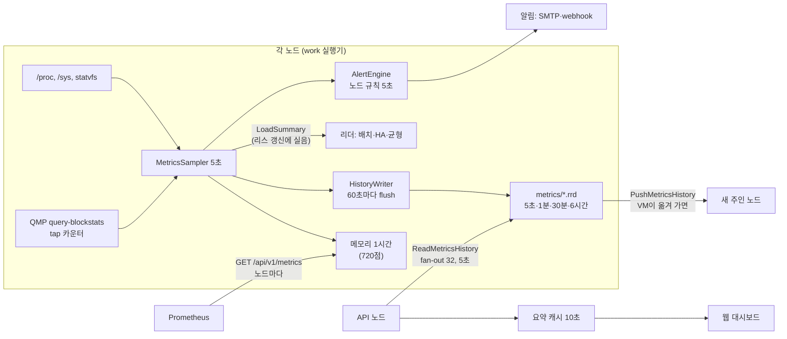

### 12.4 VM이 옮겨 갈 때의 기록

마이그레이션이 직접 부르지 않는다. 기록 스캐너가 10분마다(VM 사건 뒤면 30초 뒤에) 자기 `vm/*.rrd` 가운데 주인
(`status.node`, 없으면 `spec.node`)이 다른 노드인 것을 찾아 peer `PushMetricsHistory`(16바이트 VM UUID + 파일, 1 MiB
까지)로 보낸다. 받는 쪽은 칸마다 합친다. 최근 30초 안에 점이 있거나 아직 쓰지 않은 점이 있으면 건너뛴다. 한 번에 30초,
동시 8개, 회차당 120초. 거부되면 600초부터 두 배씩 하루까지 물러난다(`history.rs:57-68,713-781,1136-1252`).

### 12.5 알림과 통지

- **규칙 종류**: `node_metric`, `vm_metric`, `pool_usage`, `node_offline`, `vm_failed`, `task_failed`, `ha_recovery`,
  `backup_job_failed`(`crates/opl-types/src/alert.rs`), 계획 67의 SDN 여덟(`sdn_quorum_lost`·`sdn_central_down`·`sdn_chassis_down`·
  `sdn_gateway_unavailable`·`sdn_gateway_failover`·`sdn_sync_failed`·`sdn_physnet_not_ready`·`sdn_lb_member_down` — §11.6).
- **누가 평가하나.** 모든 비위트니스 노드에서 5초 틱 + watch로 돈다. 노드 규칙(지표, VM 실패, Task 실패, HA 복구, 로컬
  풀)은 사건이 난 노드가, 공유 풀은 온라인 노드 가운데 id가 가장 작은 노드가, `node_offline`·`backup_job_failed`와 SDN 조건은
  리더가 한다(`crates/opl-api/src/alerts/engine.rs:1-8,548-588`).
- **상태.** 노드 알림은 `{data_dir}/alerts/state.json`(임시 파일 → fsync → rename, Raft 아님), 리더 알림은
  `AlertRule.status.active`(Raft, 쓰기에 성공해야 통지)(`alerts/book.rs:1-30`). `pending → firing`(`for_secs` 뒤),
  `repeat_secs`(기본 4시간)마다 다시 알림, 조건이 60초 동안 거짓이면 해제. 노드당 활성 500개까지.
- **통지 대상**: SMTP(lettre, starttls/tls/none)와 webhook(json, slack, teams, ntfy, gotify). 동시 4, 대상마다 1, 제한
  10초, 재시도 30·120·600초, 대상마다 60초에 20개(넘치면 "N개 더" 하나), 큐 1000, 15분 지나면 버림
  (`crates/opl-api/src/alerts/send.rs:400-418`). 보낸 기록은 `alerts/history.log`(4 MiB에서 돌림).
- `/alerts`, `/alerts/history`는 peer `ReadAlerts` fan-out으로 모은다.

### 12.6 Prometheus

`GET /api/v1/metrics`(텍스트 형식 0.0.4)는 **노드마다** 자기 노드, 자기 VM, 자기 준비된 풀, 클러스터 게이지
(`orbivisor_cluster_*`, `orbivisor_node_is_raft_leader`, `orbivisor_alerts_firing`)를 낸다. 설정 `prometheus.enabled`가
꺼져 있으면 404, Node 읽기와 루트 VM 읽기 권한이 필요하다(viewer 토큰이면 됨). 5초 캐시, 15초보다 오래된 VM 점은 뺀다
(`crates/opl-api/src/prometheus.rs:1-456`). 그래서 Prometheus는 모든 노드를 긁어야 한다.

---

## 13. 보안 모델

| 영역 | 어떻게 | 인용·절 |
|---|---|---|
| 노드 간 | gRPC mTLS, 클러스터 CA, CN = 노드 UUID, 멤버만 | §6.2 |
| QEMU 마이그레이션·NBD·복제 | QEMU TLS, 양쪽 `verify-peer` | §6.4 |
| API | HTTPS만(평문 리스너 없음), 쿠키 Secure·HttpOnly·SameSite=Strict, Origin 검사 | §7.1, §7.4 |
| 합류 | 한 번 쓰는 토큰(해시만 저장) + CA 지문 고정 | §3.6 |
| 인증 | argon2id, LDAP, OIDC(PKCE), 범위 토큰, TOTP·패스키·복구 코드 | §7.4 |
| 권한 | 경로 표의 규칙, 폴더로 내려가는 grant, 역할·그룹, 404/403로 존재 숨김, watch·콘솔 계속 다시 확인 | §7.5 |
| 할당량 | 폴더마다 vCPU·메모리·디스크·VM 수, Raft 적용에서 최종 판정 | §3.2 |
| 감사 로그 | 노드마다 `{data_dir}/audit/audit.log`(JSON 줄, 1초마다 fsync, 16 MiB × 8). 쓰기 요청·콘솔 열기·OIDC 콜백. `GET /audit`이 fan-out으로 모음. **Raft에 없다** | `crates/opl-api/src/audit.rs:1-470` |
| 제어 소켓 | 0600 유닉스 소켓, 인증 없음(루트 전용) | §7.1 |
| OVN(계획 65~67) | NB·SB·Raft는 `pssl`만, 클러스터 CA mTLS(노드 인증서 사본), OvnSync는 서버 이름도 확인. 잠금(계획 67, 새 클러스터 기본): SB 역할 포트 `role=ovn-controller`(chassis는 자기 행만), northd 전용 특권 포트 6645, Raft 멤버십을 따르는 nftables 주소 허용 목록(지운 노드는 인증서가 살아 있어도 끊김). `Port_Binding`·`MAC_Binding`·`FDB`는 OVN RBAC가 id를 보지 않음, NB에는 RBAC 없음. SDN NIC의 보안 그룹은 OVN ACL(포트 보안이 IP 위조도 막음), 포트는 Port_Group이 있어야 생김(실패하면 닫힘) | §11.4~§11.6 |
| swtpm | AppArmor 추가 규칙 | §9.2 |
| 백업 저장소(계획 68) | 노드에서 AES-256-GCM(HKDF로 나눈 키, HMAC 청크 id, 결정적 nonce, 매니페스트 HMAC 인증), 주 키는 Raft에(API·watch·감사·`Debug`에서 뺌), 복구 키·저장소 안 argon2id escrow, S3는 rustls + SigV4(인증서 검증 실패는 다시 하지 않음), `backup-serve` 소켓 0600·설정은 표준 입력 | §10.3 |

**저장된 비밀은 암호화하지 않는다.** LDAP `bind_password`, OIDC `client_secret`, IPMI/Redfish 비밀번호, SMTP 비밀번호,
webhook 토큰, TOTP 비밀, 백업 저장소의 암호화 주 키와 S3 비밀 키(계획 68), **클러스터 CA 개인 키**가 Raft(redb)에 평문으로 있다. API 응답·watch·`Debug` 출력에서만 숨긴다
(`crates/opl-types/src/` 아래 `realm.rs:59,111`, `fence.rs:92,123`, `alert.rs:764`, `two_factor.rs:133`, `cluster.rs:23`).
보호는 0700 데이터 디렉터리뿐이다(계획 62 설계도 그렇게 적었다). 그래서 노드 하나의 `cluster.redb`나 백업을 얻으면
클러스터 CA로 노드 인증서를 만들 수 있다. 복구 코드와 API 토큰·세션·합류 토큰은 해시, 패스키는 공개 키만, cloud-init
비밀번호는 SHA-512 crypt 해시(`crates/opl-types/src/crypt.rs:1-2`)로 둔다.

인증서 자동 갱신·CA 교체는 없다. 노드 인증서는 824일, CA는 20년이다.

---

## 14. 버전이 섞인 클러스터와 업그레이드

- 클러스터 하나의 "기능 수준" 번호는 없다. 노드마다 자기 버전이 아는 **기능 문자열** 목록(`FEATURES`:
  `voter-limit`, `observer`, `multi-link`, `lease-liveness`, `shared-sessions`, `hotplug`, `folders`, `two-factor`,
  `metrics-history`, `vip`, `cpu-models`, `numa`, `sdn`, `sdn-routing`, `sdn-services`, `backup-store` …)을 `Node` status에 알린다(`crates/opl-types/src/node.rs:341-369`).
- 새 기능을 쓰는 API는 `require_feature`로 **모든 노드**가 그 기능을 알리는지 보고, 아니면 **409 `cluster_upgrading`**을
  준다. `require_current`는 이 빌드보다 옛 노드가 있는지, `require_upgraded`는 버전이 없는 노드가 있는지 본다
  (`crates/opl-api/src/cluster.rs:434-519`). 호출하는 곳은 약 100곳이다.
- 배경 루프도 같은 방식으로 옛 동작으로 돌아간다: `VoterKeeper`(`voter-limit`), 관찰 노드(`observer`), 리스 기반
  생존(`lease-liveness`, 없으면 Ping), 세션 공유(`shared-sessions`, 없으면 노드 메모리), 지표 기록 넘기기
  (`metrics-history`).
- **직렬화 호환.** 새 필드는 `#[serde(default, skip_serializing_if…)]`로 더해 옛 노드가 읽고 쓸 수 있게 한다
  (`crates/opl-cluster/src/types.rs:127-148`). 옛 노드가 몰래 덮어쓰면 안 되는 변경은 새 필드 대신 **새 명령**으로
  만들어 옛 노드가 아예 실패하게 한다(예: `UpdateStatusIf`, `types.rs:54-56`). 단일 링크 노드의 `OrbNode`는 openraft
  `BasicNode`와 바이트가 같다(`types.rs:169-237`). 모르는 명령은 역직렬화에 실패한다.
- **업그레이드.** APT 채널(stable, testing, enterprise)에서 패키지를 받는 `NodeUpgrade` Task가 노드를 하나씩 올린다.
  데몬을 다시 시작해도 이어지는 Task 셋 가운데 하나다(§8.3). 자세한 것은 [시작하기](guide/getting-started.md).

---

## 15. 규모 특성

잰 값은 설계 문서와 사용 안내에 기록된 것이고 이 문서를 쓰며 다시 재지 않았다. 규모 시험 코드는
`crates/opl-cluster/tests/scale.rs`(`--features scale-it`, 기본 노드 300, CI 100)다.

**노드 수에 따른 Raft (계획 48 뒤, 개발 Mac Apple Silicon 10코어, 시험 빌드, 메모리 저장소, 투표 5 + 대기 learner 2 + 관찰
노드)** — [클러스터 운영 안내](guide/cluster.md#대규모-클러스터), [설계 §14](superpowers/specs/2026-11-11-availability-scale-design.md):

| 항목 | 기준(`scale.rs`) | 노드 30 | 노드 100 | 노드 300 |
|---|---|---|---|---|
| 쓰기 지연 p99(리더에서 하나씩) | < 50 ms(CI 200 ms) | 1.7~1.8 ms | 4.2~4.4 ms | 11.7~12.6 ms |
| 관찰 노드 뒤처짐 p99 | < 500 ms | 0.8~0.85 ms | 2.3~2.4 ms | 6.8~7.1 ms |
| 리더의 초당 RPC | < 35 + 노드당 4.5 | 93 | 254~255 | 352~355 |
| 노드 하나 추가 | < 2초 | 1 ms | 3 ms | 5~8 ms |
| 투표 멤버 장애 뒤 관찰 노드가 다시 붙기까지 | < 5초 | 0.2초 | 1.2초 | 1.2초 |
| 리더 장애 뒤 새 리더 | < 5초 | 3.2초 | 3.3~3.6초 | 3.4~3.6초 |

- 계획 47(관찰 노드 없이 나머지가 learner)에서는 노드 300의 리더 RPC가 1,320(그 3분의 2가 learner 하트비트), 쓰기 p99가
  31~33 ms였다.
- 실제 디스크: 투표 멤버 다섯을 파일 저장소에 두면 같은 컴퓨터에서 노드 6이 p99 64 ms, 노드 300이 67 ms였다(다섯이 디스크
  하나에서 fsync를 줄 섬). 실제 노드의 쓰기 지연에는 그 노드 디스크의 fsync가 더해진다.
- 리더 장애 3~4초는 openraft 0.9.25의 리더 리스와 선거 제한 시간에서 온다. 설계 §5의 목표 3초 미만보다 길어 시험 기준을
  5초로 두었다(설계와 다름).

**VM 1만 개에서 Raft 적용 비용**(`crates/opl-cluster/src/folders.rs:1054-1136`의 `quota_apply_cost_with_10k_vms`, 디스크·NIC
하나씩, 폴더 20개 중 10개에 할당량; [폴더 설계](superpowers/specs/2026-11-18-folders-permissions-quotas-2fa-design.md),
[폴더 안내](guide/folders.md)):

| VM 쓰기 하나의 apply | 배포 빌드 | 디버그 빌드 |
|---|---|---|
| 할당량 없는 폴더에 만들기(배타성 훑기) | 17.8 ms | 145 ms |
| 할당량 폴더에 만들기 | 27.5 ms | 221 ms |
| 할당량 폴더에서 노드 바꾸기(훑기 건너뜀) | 17.1 ms | 146 ms |

배타성 훑기가 VM 수에 비례하므로 VM이 아주 많은 클러스터에서는 이것이 VM 쓰기 처리량의 상한이 된다(적용은 하나씩이라
17.8 ms면 계산상 초당 약 56개. 잰 값은 아니다).
할당량이 없는 클러스터는 더하는 비용이 없다.

**권한 색인 비용**(계획 62 설계의 단계 보고, 디버그 빌드): VM 1만·grant 500·폴더 200에서 색인 만들기 약 1.5 ms, 목록
거르기 약 6 ms(시험 상한 100 ms). 전역 admin은 색인 없이 바로 통과한다.

**한도.** 폴더 10,000개·깊이 16, grant 10,000개, 사용자마다 API 토큰 100개, 세션 32개, 노드당 활성 알림 500개, watch 기록
1024 묶음, 노드 간 메시지 64 MiB, fan-out 32.

---

## 16. 패키지와 배포

### 16.1 Debian 패키지

- 패키지 `orbivisor`(amd64). 의존: qemu-system-x86, qemu-utils, ovmf, iproute2, nftables, systemd. 추천: nfs-common,
  lvm2, ceph-common, swtpm 등. 옛 제품 이름의 패키지는 빈 전환 패키지로 남아 있다(`packaging/deb/`).
- 빌드: `pnpm -C web build && OPL_VERSION=… cargo build --release -p opld --features web-ui -p oplctl`
  (`packaging/deb/build-deb.sh:6`).

| 설치 경로 | 내용 |
|---|---|
| `/usr/bin/orbivisord`, `/usr/bin/orbivisorctl` | 바이너리(+ `opld`, `oplctl` 심볼릭 링크) |
| `/usr/lib/systemd/system/opld.service` | 유닛(+ 별칭 `orbivisord.service`) |
| `/usr/share/orbivisor/opld.toml.example` | 설정 예시 |
| `/etc/apparmor.d/abstractions/orbivisor-swtpm` | swtpm 규칙(conffile) |
| `/etc/opl/opld.toml` | 노드 설정(설치기나 관리자가 씀) |
| `/var/lib/opl`, `/run/opl` | 데이터, 런타임(§2.3) |

**유닛 `opld.service`**: `Type=notify`, `NotifyAccess=main`, `WatchdogSec=30s`, `WatchdogSignal=SIGKILL`,
`Restart=on-failure`, `RestartSec=2`, `KillMode=process`(VM을 죽이지 않음), `TimeoutStopSec=15min`,
`LimitNOFILE=1048576`, `ConditionPathExists=/etc/opl/opld.toml`, `StartLimitIntervalSec=60`, `StartLimitBurst=10`,
`ExecStopPost=… --release-vips`(`packaging/deb/opld.service:6-29`).

VM은 `opl-vm-<id>.scope`, swtpm은 `opl-tpm-<id>.scope`로 데몬과 따로 돈다(§8.2).

postinst는 swtpm AppArmor include를 더하고 첫 설치면 서비스를 켜고 시작한다(chroot 안이면 켜기만). postrm은
`/var/lib/opl`, `/etc/opl`을 지우지 않는다.

### 16.2 설치 ISO

Debian 13(trixie) netinst(SHA-256 고정, `packaging/iso/debian.lock`)에 preseed를 더한다. LVM 분할, ssh 서버, 일반 사용자
없음. `late_command`의 `orbivisor-setup.sh`가 CD의 패키지 설치 → 기본 경로 NIC를 `vmbr0` 브리지로 → 호스트 이름과
주소로 `/etc/opl/opld.toml` 쓰기 → 콘솔 안내(`/etc/issue.d`)를 한다(`packaging/iso/preseed/orbivisor-setup.sh`).
`orbivisor-ci-init.service`는 무인 설치 시험 전용이다(cloud-init과 무관). 첫 부팅 뒤 `orbivisorctl cluster init` 또는
`join`으로 클러스터를 만든다.

### 16.3 저장소와 웹 포털

APT 저장소는 trixie 아래 채널 `stable`, `testing`, `enterprise`(`packaging/repo/build-repo.sh`). `packaging/portal/`은
`web/dist`를 nginx로 따로 내는 이미지다(§7.7).

---

## 17. 시험 전략

- **단위 시험.** `cargo test --workspace`. 순수 함수(명령줄 만들기, 핫플러그 계획, 권한 평가, 스케줄러, RRD)를 따로 시험하고,
  `MockHypervisor`와 메모리 저장소로 여러 노드 클러스터를 한 프로세스에 띄운다. insta 스냅샷, proptest(권한 색인이 참조
  구현과 같은지, 백업 저장소 GC가 동시 백업의 청크를 지우지 않는지). 백업 저장소는 메모리 백엔드와 가짜 S3(`opl-store`의
  `fake-s3` — SigV4 확인·실패 주입·시계 조종)로 S3 없이 시험한다.
- **실제 시험(기능으로 켬).** 실제 QEMU·커널·저장소가 필요해 기본으로는 돌지 않는다.

| 기능 | 크레이트 | 시험하는 것 |
|---|---|---|
| `qemu-it`, `net-it`, `vtpm-it` | opl-qemu, opl-driver, opl-reconciler, opld | 실제 QEMU, 브리지·tap, swtpm |
| `storage-it`, `nfs-it`, `lvm-it`, `zfs-it`, `rbd-it`, `lvm-shared-it`, `ceph-it` | opl-driver, opl-api, opld | 저장소 백엔드, Ceph 자동 구성 |
| `migration-it`, `ha-it`(+ `opl-peer/fault-it`) | opld | 실제 프로세스 마이그레이션, HA·펜싱, 장애 주입 |
| `install-media-it`, `templates-it` | opld | 설치 매체·cloud-init, 템플릿 |
| `web-it`(= `qemu-it` + `web-ui`) | opld | 웹 내장과 실제 VM |
| `starve-it` | opld | 실행기를 일부러 막고 Raft·리스가 견디는지(§2.2) |
| `metrics-it` | opld | 지표 수집·기록 |
| `backup-it`(= `qemu-it`), `s3-it`(= `backup-it`) | opld | 실제 QEMU로 백업 저장소 백업·증분·GC·검증·복원·라이브 복원(orbivisorctl로), S3 호환 저장소(HTTP·사설 CA HTTPS, GC와 백업 동시, 저장소 멈춤 도중 백업·라이브 복원, 두 클러스터 DR) |
| `sdn-it` | opld | 깨끗한 Ubuntu 24.04에 OVN 설치·mTLS·OvnSync·DHCP·포트 바인딩, physnet·공급자 네트워크·라우터·SNAT·유동 IP·RA·DHCPv6·nftables와 OVN 보안 그룹 비교, 부하 분산·건강 검사 넘김·바깥 VIP·QoS 측정(iperf3)·단순 NIC tc·옮기기(라이브 tap·다리·되돌리기·끝내기)·잠금(RBAC·허용 목록)(root, OVN을 남김) |
| `sdn-multinode-it` | opld | 한 호스트의 systemd 컨테이너 셋을 노드로: OVN Raft 셋, chassis 사이 Geneve·동서 라우팅, SNAT, 분산·중앙 유동 IP, 게이트웨이 넘김, 두 chassis 마이그레이션, 죽은 중앙 `cluster/kick`, 계획 67의 잠금 켜고 끄기·여러 chassis 보안 그룹·LB 넘김·바깥 VIP GARP·Geneve 너머 QoS·VXLAN 원본 옮기기와 다리 노드 바꾸기·SDN 경보(webhook)·지운 노드 끊기(root, docker) |
| `scale-it` | opl-cluster | 수백 노드 규모(§15) |
| `ldap-it` | opl-api | 실제 LDAP 서버 |
| `catalog-it` | oplctl | 이미지 목록의 링크 |

출처: 각 `Cargo.toml`의 `[features]`, [개발 안내](guide/development.md).

- **웹.** vitest(+msw), 타입 검사, lint, `gen:api` 차이 검사, Playwright e2e.
- **패키지.** `packaging/tests/*.sh`(shellcheck 포함), deb 설치·APT 저장소 시험(debian:13 컨테이너), ISO.

**CI** (`.github/workflows/`):

| 작업 | 도는 것 |
|---|---|
| `ci.yml` `check`(Ubuntu, macOS) | fmt, clippy `--all-features -D warnings`, `cargo test --workspace`, `starve-it`, `metrics-it`, `scale-it`(노드 100, p99 기준 200 ms), `storage-it`(Linux — NBD·`qemu-nbd`, 저장소 백업·라이브 복원 Task 포함) |
| `ci.yml` `web` | pnpm typecheck·lint·test·gen:api 차이·audit·build |
| `ci.yml` `shell`, `package` | 패키지 스크립트, deb 빌드와 설치 |
| `ci.yml` `linux-kvm`(root, 80분) | qemu·net·web·nfs·lvm·zfs·rbd·lvm-shared·migration·ha·vtpm·cpu·numa·backup 실제 시험, `OPL_TEST_SYSTEMD=1` |
| `ci.yml` `backup-s3` | SeaweedFS S3 컨테이너 둘(HTTP·사설 CA HTTPS)로 `s3-it`(계획 68) |
| `ci.yml` `ceph`, `ovn`, `install-media`, `ldap`, `deny` | Ceph, OVN(설치·mTLS·OvnSync·DHCP·바인딩·클라우드 이미지 게스트 DHCP·라우팅·보안 그룹 비교·부하 분산·QoS·옮기기·잠금), 설치 매체·템플릿·vTPM 실제 게스트, LDAP, cargo-deny |
| `ci.yml` `sdn-multinode` | 한 러너의 privileged systemd 컨테이너 셋(`ci/sdn-node/Dockerfile`)이 Orbivisor 노드 셋 — 여러 노드 OVN(약 6분) |
| `iso.yml` `iso-e2e` | BIOS·UEFI 설치 ISO 끝까지(주 1회, 태그, `ci-probe/**` 가지) |
| `catalog.yml` `catalog-links` | 이미지 목록 링크(주 1회) |

`ci-probe/**` 가지에 밀어 GitHub 러너에서만 되는 시험(KVM·LDAP·패키지)을 따로 돌리는 것이 "GitHub 탐침"이다. 일반 시험은
배포 서버에서도 돈다.

---

## 18. 용어와 참고 문서

| 용어 | 뜻 |
|---|---|
| 투표 멤버(voter) | Raft 정족수에 드는 노드. 3/5/7 |
| learner | 로그를 받지만 투표하지 않는 Raft 멤버. 대기 learner 2개를 둔다 |
| 관찰 노드(observer) | Raft 밖에서 투표 멤버를 따라가는 노드(계획 48) |
| 위트니스(witness) | 투표만 하고 VM·API·리더 일을 하지 않는 노드 |
| 리스(lease) | 노드가 리더에게 주기적으로 갱신하는 생존 표시. Raft 로그에 쓰지 않는다 |
| 펜싱(fencing) | 죽었다고 본 노드의 VM을 확실히 끄는 것(watchdog 재부팅, 전원 끄기) |
| `fence_after` / `recover_after` | 리스가 끊기고 VM을 끄기까지 / 리더가 다른 노드에서 켜기까지 |
| spec / status | 원하는 상태 / 실제 상태 |
| revision | 리소스를 마지막으로 바꾼 Raft 로그 index |
| reconciler | 노드에서 VM을 spec에 맞추는 루프 |
| Task | 노드에서 도는 오래 걸리는 작업(Raft 리소스) |
| 제어 레인 / 벌크 레인 | 노드 간 연결 둘: Raft·리스(`core`) / 콘솔·마이그레이션·읽기(`work`) |
| 기능 문자열 | 노드가 아는 기능 이름. 모두가 알아야 새 기능을 씀(409 `cluster_upgrading`) |

**사용 안내**: [시작하기](guide/getting-started.md), [가상 머신](guide/vms.md), [스토리지](guide/storage.md),
[네트워크](guide/network.md), [고가용성](guide/ha.md), [클러스터 운영](guide/cluster.md),
[백업·복제·가져오기](guide/backup.md), [웹 화면](guide/web-ui.md), [접근과 보안](guide/access.md),
[폴더와 권한](guide/folders.md), [구독과 텔레메트리](guide/subscription.md), [개발](guide/development.md).

**설계 문서**(코드와 다르면 코드가 맞다):

- 핵심: [노드 코어](superpowers/specs/2026-10-20-opl-node-core-design.md),
  [견고성](superpowers/specs/2026-10-27-robustness-design.md),
  [API·보안](superpowers/specs/2026-10-28-api-security-design.md)
- HA·규모: [HA·펜싱·위트니스](superpowers/specs/2026-11-02-ha-fencing-witness-design.md)(기본값이 옛것),
  [제어부 가용성과 대규모 클러스터(계획 45~56)](superpowers/specs/2026-11-11-availability-scale-design.md)
- 마이그레이션·저장소: [라이브 마이그레이션](superpowers/specs/2026-10-30-live-migration-design.md),
  [로컬 디스크 마이그레이션](superpowers/specs/2026-11-10-storage-migration-design.md),
  [공유 스토리지 NFS](superpowers/specs/2026-10-28-shared-storage-nfs-design.md)와 이후 LVM-thin·ZFS·Ceph·iSCSI 설계,
  [백업](superpowers/specs/2026-11-04-backup-design.md), [증분 백업](superpowers/specs/2026-11-09-incremental-backup-design.md),
  [백업 저장소 2 — 중복 제거·검증·암호화·S3·라이브 복원(계획 68)](superpowers/specs/2026-11-23-backup-store2-design.md)
- 네트워크: [네트워크·SDN](superpowers/specs/2026-11-03-network-sdn-design.md),
  [SDN(OVN) 계획 65~67](superpowers/specs/2026-11-20-sdn-ovn-design.md),
  [SDN(OVN) 2 — 라우터·게이트웨이 HA·유동 IP·OVN 보안 그룹(계획 66)](superpowers/specs/2026-11-20-sdn-ovn-plan66-design.md),
  [SDN(OVN) 3 — 부하 분산·QoS·토폴로지·옮기기·OVN 잠금·SDN 경보(계획 67)](superpowers/specs/2026-11-21-sdn-ovn-plan67-design.md)
- 지표: [실시간 지표(계획 44)](superpowers/specs/2026-11-11-monitoring-ui-design.md),
  [지표 기록·대시보드·알림·Prometheus(계획 60)](superpowers/specs/2026-11-18-dashboard-metrics-notifications-design.md)
- 화면·권한: [웹 UI](superpowers/specs/2026-10-23-web-ui-design.md),
  [UI·UX 개편(계획 61)](superpowers/specs/2026-11-18-ui-ux-redesign-design.md),
  [폴더·권한·할당량·2FA(계획 62)](superpowers/specs/2026-11-18-folders-permissions-quotas-2fa-design.md)
- 컴퓨트: [설치 매체·cloud-init](superpowers/specs/2026-11-17-install-media-cloud-init-design.md),
  [템플릿·링크드 클론](superpowers/specs/2026-11-17-templates-linked-clones-design.md),
  [vTPM·Secure Boot·게스트 에이전트](superpowers/specs/2026-11-18-vtpm-secure-boot-guest-agent-design.md)
- 배포: [설치·업데이트·구독](superpowers/specs/2026-11-05-install-update-subscription-design.md)
- 전체 목록: [docs/index.md](index.md)

### 설계 문서와 코드가 다른 곳(요약)

| 설계 문서 | 문서의 말 | 코드 |
|---|---|---|
| HA·펜싱·위트니스 §3.1·§7 | `fence_after` 30초, watchdog 30초, 복구 약 65초. IPMI·HA 그룹·failback 범위 밖 | 기본 `fast` 10/10초, 복구 22초. 계획 50·51에서 모두 구현 |
| 노드 코어 §8 | 리더가 2초마다 ping, 10초면 오프라인 | 리스 기반(계획 47). Ping은 옛 버전과 섞였을 때만 |
| 노드 코어 §3.1 | 클러스터 기능 수준 | 노드마다 기능 문자열 |
| 가용성 §5 | 리더 장애 3초 미만, 오프라인 투표 멤버는 내린 뒤 올림 | 3~4초(기준 5초), `Replace` 한 번 |
| 가용성 §8.3 | 균형 문턱 0.15 | 정수 퍼센트 15(`settings.rs:131`) |
| 라이브 마이그레이션 | 인증서가 바뀌면 TLS 파일을 다시 씀, 로컬 디스크 안 옮김, 주소는 `members().addr` | 시작마다 다시 씀, 계획 42가 NBD로 옮김, 지금 쓰는 링크 |
| 네트워크·SDN | 돌고 있는 VM의 NIC 더하기·빼기 막음 | 계획 54부터 핫플러그 |
| API·보안(계획 13) | 세션은 노드마다, `X-Forwarded-For`·감사 로그·버전 섞임 범위 밖, 콘솔은 권한 바뀌어도 안 닫힘 | Raft 세션 공유, 모두 구현, 콘솔 2초마다 다시 확인 |
| 폴더(계획 62) | `AuthzIndex`가 `cluster.follow`, ApiToken도 세대를 올림 | `Authz`가 `cluster.watch`, ApiToken은 안 올림 |
| 지표(계획 60) | 노드 RRD 약 380 KiB, 풀 약 90 KiB, `fallocate`, 넘친 알림은 하나로 합침 | 376 KiB, 92 KiB, NaN 파일 쓰고 rename, 넘치면 추적 멈추고 `overflow` 표시 |

---

## 19. 확인하지 못한 것

- **잰 값.** §15의 숫자(쓰기 p99, 적용 비용, 권한 색인 비용, 리더 장애 시간)와 §5.5의 HA 복구 잰 값은 설계 문서와 사용
  안내에 기록된 것을 옮겼다. 이 문서를 쓰며 다시 재지 않았다(cargo를 돌리지 않았다).
- **openraft 기본값.** 스냅샷 5000개·남기는 로그 1000개는 opld가 정하지 않아 openraft 0.9.25의 기본값이라고 판단한 것이다.
  저장소 안 코드에는 그 숫자가 없다.
- **Proxmox VE·vSphere 비교**(§1.1)는 일반적인 공개 정보이고 이 저장소에서 확인하지 않았다.
- **확인하지 않은 세부**: `ha_reserve`(HA 예약 용량) 적용 코드, `guest_watch`의 실행 상수, 균형기의 동시 이동 한도(설계는
  2), 리더가 받은 `LoadSummary`를 어디에 얼마나 두는지, API 요청 본문 크기 제한(`DefaultBodyLimit`를 찾지 못함 — axum
  기본값을 쓰는 것으로 보인다).
- **SDN 여러 노드는 컨테이너로만 보았다.** chassis 셋 사이 Geneve, 두 chassis 라이브 마이그레이션, OVN Raft 셋, 게이트웨이
  `HA_Chassis_Group` 넘김(BFD), 죽은 중앙의 `cluster/kick`은 GitHub `sdn-multinode` 작업(한 러너의 systemd 컨테이너 셋, 커널은
  하나)이 본다. 실제 하드웨어·물리 VLAN 스위치의 장애와 넘김 시간, 게스트 OS의 응답, 여러 chassis에 걸친 보안 그룹(Port_Group
  ACL), 컨테이너 안 QEMU가 KVM으로 돌았는지는 확인하지 않았다(계획 66 설계 §18 스테이지 6). 넘김 시간은 BFD 기본값의 기록이다.
  계획 67의 여러 chassis 보안 그룹·LB 넘김·바깥 VIP GARP·QoS·옮기기 다리·잠금·경보도 같은 컨테이너 셋에서만 보았다(계획 67 설계 §18 스테이지 6).
- **계획 67에서 확인하지 못한 것.** 부하 분산의 넘김 시간(3.6~4.4초)은 간격 2초·`fall` 2로 잰 것이고 기본값(5초·3번 — 약 15초)은 재지 않았다.
  QoS 정확도는 50 Mbit/s 안팎의 veth·Geneve 측정이고 높은 속도·실제 NIC·물리 스위치의 DSCP 처리는 보지 않았다. 옮기기 `live`의 게스트 쪽
  (링크 다시 보기·DHCP 다시 묻기)은 게스트 없는 QEMU VM으로만 봤다(tap이 `br-int`로, `ovn-installed`, PID 그대로). `sdn_quorum_lost`는 순수
  시험 표로만 보았다(컨테이너 셋에서 중앙 둘을 죽이면 Orbivisor Raft도 정족수를 잃음). 단순 NIC tc는 opld를 다시 띄워도 다시 맞추지 않는다
  (커널이 tap과 함께 들고 있다고 보고 재부팅 흉내로는 확인하지 않음). 토폴로지의 SVG 원소 수(2000 VM에 약 11,400)는 설계 목표 5000을 넘는다.
- **계획 68(백업 저장소)에서 확인하지 못한 것.** S3는 CI의 SeaweedFS와 가짜 S3로만 시험했다(AWS·Wasabi·Ceph RGW는 손 확인).
  아주 큰 저장소(청크 수억 개)의 GC 시간·메모리는 재지 않았다. 라이브 복원의 헬퍼·opld·QEMU 죽음은 실제 QEMU에서는 S3 큰 디스크
  시험(`backup-s3`)과 드라이버 재연결 탐침으로, 나머지는 가짜 하이퍼바이저로 본다. fleece가 1초에 1 GiB보다 빨리 차는 경우는
  QEMU 동작(게스트 쓰기는 성공, 내보내기 읽기만 실패)을 작은 APFS 이미지로만 확인했다.
- **OVN 24.03 RBAC가 막지 않는 것.** 잠금은 SB `Chassis`·`Encap`·`Chassis_Private`의 주인만 보고, `Port_Binding`·`MAC_Binding`·`FDB` 쓰기는 id 검사
  없이 받는다(OVN이 그렇게 정의). 망가진 chassis의 포트 가로채기는 막지 못하고 탐지 경보도 아직 없다.
- **OVN 판에 기대는 것.** 바깥 → 안의 큰 DF 패킷에 ICMP가 없는 것(`gateway_mtu`가 게이트웨이로 나가는 방향만 잼), ACL 우선순위
  65532의 이웃 찾기 허용, 맺은 연결을 끊는 `ct_mark.blocked`는 OVN 24.03.8에서 본 동작이다. 다른 판에서는 다시 봐야 한다.
- **없는 것으로 확인한 것**(찾았지만 없음): `.proto` 파일, EVPN/BGP, L7 부하 분산·QoS 정책 리소스, 구독 보고 루프,
  SSE, 평문 HTTP 리스너, 시리얼 콘솔, Task 취소, 데몬 재시작 뒤 Task 이어가기(업그레이드 제외), 클러스터 전체 VM 잠금,
  인증서 자동 갱신과 CA 교체, 저장 비밀 암호화, keepalived, 대량 전송용 망, 꺼진 VM의 저장소 옮기기.
