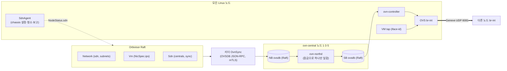

# SDN(OVN) 설계 — 논리 스위치·서브넷·IPAM·DHCP, 라우터·게이트웨이·NAT, 보안 그룹·부하 분산 (계획 65~67)

작성일: 2026-11-20
상위 문서: `2026-11-03-network-sdn-design.md`(계획 25 VXLAN·계획 26 보안 그룹), `2026-11-11-availability-scale-design.md`(계획 56 Ceph 자동 구성 §10·§23), `2026-11-17-install-media-cloud-init-design.md`(계획 57 cloud-init network-config), `2026-11-18-folders-permissions-quotas-2fa-design.md`(계획 62 폴더·권한), `2026-11-19-numa-pinning-design.md`(계획 64, 문서 모양)
기준 트리: 계획 64 끝(`25795d5c`). 이 문서는 구현 전 설계다. SDN 전체(계획 65~67)를 그리고, 스테이지는 **계획 65만** 나눈다. 계획 66·67은 시작할 때 이 문서의 §16을 바탕으로 스테이지를 더한다. 스테이지 보고는 구현하면서 덧붙인다.

## 1. 목적

사용자가 2026-11-11에 "보강해야 돼… SDN 기능처럼", 이어서 "OpenStack OVN 기능처럼"이라고 했다. 지금 네트워크는 관리자가 만든 Linux 브리지(선택적으로 VLAN), Orbivisor가 만드는 VXLAN(정적 head-end 복제), nftables bridge 계열 보안 그룹뿐이다(`docs/architecture.md` §11). 서브넷·IPAM·DHCP·라우터·NAT·플로팅 IP·부하 분산·QoS가 없고, VM이 가질 IP를 Orbivisor가 모른다. `docs/architecture.md` §11.4·§19는 "OVN, OvnSync, EVPN/BGP/FRR은 없다"고 적는다.

이 설계는 **OVN을 백엔드로** 쓰고 Orbivisor가 **Neutron ML2/OVN의 자리**(클라우드 관리 시스템, CMS)를 맡는다. 원칙 다섯:

- **원하는 상태는 Raft에만 있다.** 리더의 `OvnSync`가 Raft 리소스(네트워크·서브넷·VM NIC, 66부터 라우터·플로팅 IP·보안 그룹)를 OVN northbound DB(NB)에 옮겨 쓴다. NB는 Orbivisor가 다시 만들 수 있는 파생물이다(리더가 바뀌거나 NB를 비워도 다음 동기화가 되살린다).
- **OVN 제어 평면은 Orbivisor가 설치하고 세운다**(계획 56 Ceph와 같은 길): `ovn-central`(NB·SB ovsdb-server 클러스터, `ovn-northd`)은 관리자가 고른 노드(기본은 투표 멤버) 1·3·5개에, OVS와 `ovn-controller`는 모든 Linux 노드에.
- **지금 네트워크는 "단순 네트워크"로 그대로 둔다.** 브리지·VLAN·VXLAN 네트워크와 그 VM, nftables 보안 그룹은 바이트까지 지금과 같다. macOS 노드는 단순 네트워크만 쓴다.
- **테넌트는 새 개념이 아니라 계획 62의 네트워크 폴더다**(§11).
- **기능을 켜기 전에는 아무 일도 하지 않는다.** 새 빌드를 배포해도 관리자가 `sdn init`을 하기 전에는 꾸러미를 깔지 않고 OVN에 붙지 않는다(svc01·svc02는 이 상태로 배포한다).

| | OpenStack Neutron ML2/OVN | Proxmox VE 8 SDN | VMware NSX 4 | Orbivisor 계획 65~67 |
|---|---|---|---|---|
| 데이터 평면 | OVS + OVN(Geneve) | Linux 브리지 + VLAN·QinQ·VXLAN·EVPN(FRR) | NSX 가상 스위치(N-VDS/VDS) + Geneve | 단순: Linux 브리지·VLAN·VXLAN(지금), SDN: OVS + OVN(Geneve) |
| 제어 평면 | NB에 쓰는 ML2 드라이버 + 주기적 불일치 고치기 | `/etc/pve/sdn` 설정을 노드마다 ifupdown2로 적용, EVPN은 BGP | NSX Manager 클러스터 3대, 중앙 제어 평면 | Raft → 리더 `OvnSync` → NB(§8) |
| 묶음·격리 단위 | 네트워크(VNI 자동), 공급자 네트워크(physnet·VLAN) | 영역(zone: simple·vlan·qinq·vxlan·evpn) › VNet | 전송 영역(overlay·VLAN) › 세그먼트 | 단순 네트워크 종류(bridge·vxlan) / SDN 네트워크(`sdn`, 66에 `provider`) |
| 서브넷·IPAM | 서브넷(할당 풀·게이트웨이·DNS), Neutron DB IPAM | 서브넷, IPAM(pve 내장·NetBox·phpIPAM) | IP 풀·블록, 세그먼트 서브넷 | 네트워크 안 서브넷, Raft IPAM(NIC 스펙에 IP, §9) |
| DHCP | OVN 내장(분산, `DHCP_Options`) | dnsmasq(simple 영역, 8.1부터) | 세그먼트·게이트웨이 DHCP 서버 | OVN 내장 DHCPv4(65), DHCPv6·RA(66) |
| 라우팅·NAT | 분산 라우터, 게이트웨이 chassis HA, SNAT, 플로팅 IP(분산 가능) | EVPN 영역의 출구 노드·SNAT | Tier-0/Tier-1 게이트웨이, Edge 클러스터, NAT | 66: `Logical_Router`, `HA_Chassis_Group`, SNAT, 플로팅 IP |
| 방화벽 | 보안 그룹 → `Port_Group` + `ACL` | pve-firewall(SDN과 따로) | 분산 방화벽(DFW) | 단순: nftables(지금), SDN: 66에서 `Port_Group` + `ACL` |
| 부하 분산·QoS | Octavia OVN 공급자(`Load_Balancer`), QoS 정책 | 없음 | NSX ALB(Avi)·LB, 세그먼트 QoS | 67: `Load_Balancer`·건강 검사, `QoS` |
| 테넌트 | 프로젝트(Keystone) | 없음(권한 경로 `/sdn/zones/…`) | 프로젝트·VPC(4.1부터) | 계획 62 네트워크 폴더(§11) |
| BGP | ovn-bgp-agent(따로) | EVPN 영역(FRR) | Tier-0 BGP | 나중(§16) |

## 2. 범위

| 계획 | 넣는 것 |
|---|---|
| **65** | OVN 설치·구성 Task(중앙 1·3·5, 모든 노드 chassis), 노드 SDN 에이전트, 리더 `OvnSync`(NB 쓰기·펜싱·다시 맞추기), SDN 네트워크(`Logical_Switch`, Geneve), 서브넷과 Raft IPAM, OVN 내장 DHCPv4, VM NIC 논리 포트(주소·포트 보안), OVS 포트 바인딩(br-int tap, `requested-chassis`, 라이브 마이그레이션의 두 chassis 바인딩), 스케줄러 조건, API·CLI·웹, GitHub `ovn` 작업 |
| **66** | 공급자(외부) 네트워크(`localnet`, 노드의 physnet 연결), 라우터(`Logical_Router`·라우터 포트·정적 경로), 게이트웨이 chassis HA(`HA_Chassis_Group`), SNAT, 플로팅 IP(`dnat_and_snat`, 분산), DHCPv6·RA, **보안 그룹을 OVN `Port_Group`·`ACL`로** |
| **67** | 부하 분산(`Load_Balancer`·건강 검사), QoS(`QoS` 대역폭·DSCP), 토폴로지 화면, 단순 → SDN 옮기기 도구, 네트워크 폴더 할당량, SB RBAC, OVN 상태 알림 |

**초안과 다르게 나눈 것.** 초안은 보안 그룹을 67에 두었다. 코드를 보면 (1) 보안 그룹 리소스와 규칙 모델은 계획 26에 이미 있고(`opl_types::security_group`) OVN으로 옮기는 일은 `OvnSync`의 번역 하나다. (2) 66이 라우터·플로팅 IP로 SDN VM을 밖에 열면 그 판에 보안 그룹이 없으면 안 된다. (3) 계획 65의 SDN 네트워크는 라우터가 없는 고립 L2라 보안 그룹이 없어도 밖에서 닿지 않는다. 그래서 **65는 SDN NIC에 보안 그룹을 받지 않고(400), 66이 라우터와 함께 보안 그룹을 OVN으로 옮긴다.** 67은 운영 편의(부하 분산·QoS·화면·옮기기)만 남는다.

넣지 않는 것(§16): BGP·EVPN, OVN 연동(IC)·여러 가용 영역, 하드웨어 오프로드·DPDK, VTEP·l2gateway, 단순 네트워크 자동 변환(67의 도구는 VM NIC를 옮길 뿐 VXLAN 장치를 OVN으로 바꾸지 않는다), SDN 끄기·OVN 지우기, 여러 OVN 배포.

**기능 하나**(`opl_types::node`, `FEATURES` 끝): **`sdn`**(`SDN`). 계획 65의 모든 새 칸·리소스·Task·RPC(`Sdn` 리소스, `NetworkSpec.sdn`·`subnets`, `NicSpec.ips`, `NodeStatus.sdn`, Task `sdn-*`)를 가린다. 모든 노드가 알릴 때만 쓰고 아니면 409 `cluster_upgrading`이다(`require_feature`, 검증보다 먼저 — 계획 58~64와 같다). 계획 66·67은 저마다 기능 문자열을 더한다(`sdn-routing`, `sdn-services`).

## 3. 지금 있는 것 (계획 64 끝)

- **네트워크 리소스**(`crates/opl-types/src/network.rs`): `NetworkSpec { bridge, vlan, vxlan: Option<Vxlan { vni }>, mtu, folder }`, `deny_unknown_fields`, `bridge`와 `vxlan` 중 정확히 하나(`NetworkError::KindRequired`). `NetworkStatus {}`는 비어 있다. 만들기·지우기만 있고 바꾸기가 없다(`opl-api/src/resources.rs` `create_network`). `bridge_name()`이 VM NIC가 붙을 브리지(`bridge` 또는 `oplv<vni>`)를 준다. 예약 이름 `user`는 QEMU user-mode NAT다.
- **NIC**(`opl-types/src/vm.rs` `NicSpec`): `network`(이름), `model`(virtio·e1000e), `mac`(없으면 만들 때 API가 정함), `security_groups`(비면 뺌). MAC은 Raft 상태 머신이 클러스터에서 하나만 쓰게 본다(`opl-cluster/src/exclusive.rs`의 `("mac", …)`) — IP 할당의 본이다.
- **실행 정의**(`opl-types/src/runtime.rs`): `NicBackend::{User, Tap { ifname, bridge, vlan, mtu }}`. reconciler의 `resolve`가 네트워크를 찾아 채우고(`opl-reconciler/src/resolve.rs:480-501`), 드라이버가 tap을 만든다(`opl-driver/src/qemu.rs:568`, 핫플러그는 `:2330`). tap 이름은 `tap_name(vm, index)` = `op<VM id 끝 10자리>n<번호>`이다.
- **tap 드라이버**(`opl-driver/src/net.rs`): `HostNet::{bridges, create_tap, delete_vm_taps, delete_tap, sync_overlays}`, `IpRoute`(iproute2 명령, 시험용 이름공간). `create_tap`은 `ip tuntap add` → 브리지 MTU → `master` → VLAN → up이다. QEMU는 `-netdev tap`이고 VXLAN이면 virtio NIC에 `host_mtu`를 붙인다(`opl-qemu/src/cmdline.rs:253`).
- **노드 네트워크 정보**: `NodeStatus.bridges`(60초마다), `underlay`(VXLAN이 쓰는 주소), `firewall`(nftables). 스케줄러 `has_bridges`가 NIC 네트워크의 브리지가 있는 노드만 고른다(`opl-api/src/scheduler.rs:224`).
- **VXLAN 에이전트**(`opld/src/overlay.rs`)와 **방화벽 에이전트**(`opld/src/firewall.rs`): 노드마다, 클러스터 태그(`cluster_tag` — CA 지문 앞 12자)로 자기 장치·테이블만 다룬다. 방화벽은 Linux 브리지의 nftables bridge 훅이라 OVS 포트에는 걸리지 않는다.
- **cloud-init**(`opl-types/src/cloud_init.rs`): `CloudInit.networks: Vec<CloudInitNet>`(NIC 순번마다 `dhcp`·`slaac`·`static`)과 `dns`로 network-config v1을 만든다. 없으면 파일이 없고 게스트는 첫 NIC DHCP다.
- **Ceph 자동 구성(계획 56)** — 이번 설치의 본: Raft 리소스 `CephCluster`(이름 `ceph` 하나, `CephStatus { phase, mons, …, pending }`), Task `ceph-init`·`ceph-mon-add`·`ceph-mgr-add`·`ceph-client-install`(대상 `Ceph` 리소스, 시간 제한 없음), 클러스터에서 한 번에 하나는 `CephStatus.pending`을 리비전 확인 쓰기로 잡아 지킨다. 노드 쪽은 `CephHost`(`opl-driver/src/ceph/host.rs`)가 `CommandRunner` 위에서 단계마다 상태를 먼저 보고, 빠진 꾸러미만 `apt-get install -y -q -o DPkg::Lock::Timeout=600`으로 깔며, 관리 표시가 없는 설정·남의 데이터는 거절한다("아무것도 몰래 지우지 않는다"). 노드마다 `CephAgent`(`opl-api/src/ceph_agent.rs`)가 리소스를 지켜보며 클라이언트 설정을 맞춘다. 기능 `ceph-setup`. CI `ceph` 작업은 깨끗한 Ubuntu 24.04 러너에서 orbivisord가 직접 Ceph를 설치한다(`.github/workflows/ci.yml:385-405`).
- **폴더·권한(계획 62)**: 종류별 폴더 트리(VM·네트워크·스토리지), `NetworkSpec.folder`. 권한 `network.assign`(NIC를 붙이기)·`network.config`(네트워크·보안 그룹 쓰기). 브리지 네트워크 만들기는 루트 `cluster.admin`, VXLAN은 폴더 `network.config`로도 된다. 보안 그룹은 루트 객체다. 폴더 할당량은 VM 트리만.
- **클러스터 CA·인증서**(`docs/architecture.md` §6.2): ECDSA P-256 CA(키는 Raft `ClusterSpec`), 노드 인증서 CN = 노드 UUID, EKU serverAuth+clientAuth, SAN = 노드 주소, `data_dir/pki/{ca.crt,node.crt,node.key}`. QEMU 마이그레이션은 사본(`migration-tls/`)을 쓴다 — 이번 OVN TLS의 본이다.
- **리더 루프**(`docs/architecture.md` §4): 위트니스가 아닌 모든 노드가 띄우고 틱마다 "내가 리더인가"를 보고 `read_barrier()`로 따라잡는다. Raft 임기(term)를 밖에 내는 함수는 아직 없다(`Cluster::members()`·`read_barrier()`만).
- **기능 게이트**: `require_feature`(`opl-api/src/cluster.rs:469`). 노드 능력(status)은 모든 노드가 기능을 알릴 때까지 쓰지 않는다(계획 63의 본).

## 4. OVN에서 확인한 사실

ovn.org의 현재 man 페이지(`ovn-nb(5)` DB Schema 7.19.0, `ovn-controller(8)`, `ovn-ctl(8)`, `ovn-architecture(7)`, 2026-11-20에 받음)와 Open vSwitch `ovsdb(7)`에서 옮겼다. 배포판 꾸러미(Ubuntu 24.04 `ovn` 24.03·`openvswitch` 3.3, Debian 13의 판)에 같은 칸이 있는지는 **스테이지 2가 GitHub 러너에서 확인한다**(§14). 최소 판은 OVN 24.03(LTS)으로 둔다.

- **NB 테이블(이번에 쓰는 것)**: `Logical_Switch`(`name`, `ports` — LSP를 **강한 참조**로 가진다(LSP는 뿌리 테이블이 아니라 스위치가 가리켜야 남는다), `acls`, `qos_rules`, `load_balancer`, `other_config:subnet`·`exclude_ips`(OVN 자체 IPAM — 쓰지 않는다, §15)), `Logical_Switch_Port`(`name`은 테이블에서 하나 — "hypervisor의 `external_ids:iface-id`와 같아야 한다", `type` 빈 값(VIF)·`router`·`localnet`·`localport`·`external`·`virtual` …, `addresses`, `port_security`, `dhcpv4_options`·`dhcpv6_options`(DHCP_Options **약한 참조**), `up`(northd가 씀), `enabled`, `options`), `DHCP_Options`(`cidr`, `options`), `NB_Global`(`external_ids` — CMS용, `nb_cfg`). 66·67: `Logical_Router`, `Logical_Router_Port`(`networks`, `mac`, `gateway_chassis`·`ha_chassis_group`, `ipv6_ra_configs`), `Logical_Router_Static_Route`, `NAT`(`type` `snat`·`dnat`·`dnat_and_snat`, `external_ip`, `logical_ip`, `logical_port`·`external_mac`(분산 플로팅 IP)), `Gateway_Chassis`·`HA_Chassis_Group`·`HA_Chassis`, `Port_Group`(`name`, `ports` 약한 참조, `acls`; NB가 `<이름>_ip4`·`_ip6` 주소 묶음을 SB에 만든다), `ACL`(`priority` 0~32767, `direction` `from-lport`·`to-lport`, `action` `allow-related`·`allow-stateless`·`allow`·`drop`·`pass`·`reject`), `Load_Balancer`(`vips`, `protocol` tcp·udp·sctp, `health_check`, `ip_port_mappings`), `QoS`(`priority`, `direction`, `match`, `action` dscp, `bandwidth` rate·burst).
- **`options:requested-chassis`**: 이 포트를 바인딩할 수 있는 chassis(이름 또는 호스트 이름). **쉼표로 둘 이상을 주면 첫 것이 주 chassis이고 나머지도 같은 포트를 바인딩할 수 있다**(라이브 마이그레이션). 공급자 네트워크에서는 그 동안 터널링을 강제한다(MTU 영향, 66). **`options:activation-strategy`**: 추가 chassis에 `rarp`·`garp`·`na`를 주면 새 위치에서 그 패킷을 보내기 전까지 포트를 막는다 — QEMU가 마이그레이션 끝에 RARP를 보내므로 `rarp`를 쓴다.
- **DHCP_Options**: DHCPv4 필수 `server_id`·`server_mac`·`lease_time`, 선택 `router`·`dns_server`·`mtu`(68 이상)·`domain_name`·`classless_static_route` …. DHCPv6는 `server_id`가 필수다. OVN은 LSP `addresses`에 있는 주소만 답한다(정적 매핑, 상태 없는 응답) — 그래서 IPAM이 Orbivisor에 있어야 한다.
- **ovn-controller**(chassis): 로컬 OVS DB `Open_vSwitch` 행의 `external_ids:system-id`(chassis 이름), `ovn-remote`(SB 주소, 쉼표 목록), `ovn-encap-type`(geneve)·`ovn-encap-ip`, (66) `ovn-bridge-mappings`·`ovn-cms-options`(`enable-chassis-as-gw`)를 읽는다. SB TLS 설정은 명령줄 `-p -c -C` 또는 로컬 OVS DB의 `SSL` 테이블에서 읽고 **DB가 앞선다**. 흐름을 다 깔면 OVS `Interface`의 `external_ids:ovn-installed=true`를 쓴다. `br-int`가 없으면 만든다.
- **ovsdb 클러스터**(`ovsdb(7)`): Raft. 리더만 트랜잭션을 처리하고 팔로어는 쓰기를 리더에 넘긴다. 쓰기가 많은 클라이언트는 리더에 붙으라고 권하고, 누가 리더인지는 `_Server` DB의 `Database` 테이블(`leader`)이 알려 준다. `ovsdb-tool create-cluster DB SCHEMA ssl:ADDR:PORT`, `join-cluster DB NAME ssl:LOCAL ssl:REMOTE…`, `ovs-appctl -t CTL cluster/status|cluster/leave NAME`. 관례 포트: NB 6641, SB 6642, Raft NB 6643·SB 6644. OVS의 TLS는 상대 인증서를 CA로 확인한다(양쪽 인증서 — mTLS).
- **ovn-ctl**(배포판 래퍼)은 `--db-nb-cluster-local-addr`·`--db-nb-cluster-local-proto=ssl`·`--db-nb-create-insecure-remote=no`·`--ovn-northd-nb-db=…` 따위로 클러스터를 세우지만, 듣는 TLS 주소는 DB의 `Connection` 테이블(클러스터 전체가 같은 행)이나 0.0.0.0이다. 노드 주소 하나에만 듣게 하려면 `ovsdb-server --remote=pssl:6641:ADDR`를 직접 주어야 한다(§7.3의 결정).
- **Geneve MTU**: Neutron은 OVN Geneve 머리를 `max_header_size` 38 + 바깥 IPv4 20으로 셈해 기본 망 MTU를 1500 − 58 = **1442**로 둔다. IPv6 underlay면 1422.

## 5. 전체 구조

- **누가 무엇을 쓰나.** API는 Raft만 쓴다(OVN을 부르지 않는다 — API 응답이 OVN 상태에 매이지 않음). 리더 `OvnSync`만 NB를 쓴다. northd·ovn-controller는 OVN 그대로다. 노드의 `SdnAgent`는 로컬 OVS DB와 Orbivisor 소유 systemd 단위만 다룬다.
- **NB 행의 주인 표시**: Orbivisor가 만든 모든 NB 행은 `external_ids:orbivisor:cluster=<클러스터 태그>`(§3의 태그)와 `orbivisor:id=<Raft 리소스 id>`를 가진다. `OvnSync`는 이 표시가 있는 행만 바꾸고 지운다. 관리자가 `ovn-nbctl`로 만든 행은 남는다.
- **이름**: `Logical_Switch.name = opl-<네트워크 id>`, LSP `name = opl-<VM id>-<MAC 12자리 16진>`(MAC은 클러스터에서 하나라 겹치지 않고 NIC 순서가 바뀌어도 같은 포트다), `DHCP_Options`는 이름이 없고 `orbivisor:subnet=<CIDR>`로 찾는다. chassis 이름(`system-id`) = **노드 UUID** — 노드 인증서 CN과 같아 67의 SB RBAC(chassis는 자기 행만)에 그대로 맞는다.

## 6. 타입 (opl-types, 계획 65)

- **`sdn.rs`(새)**: `Sdn = Resource<SdnSpec, SdnStatus>`, `Kind::Sdn`(`sdn`, 이름 `sdn` 하나뿐 — `CephCluster`와 같은 모양, `Kind::ALL` 33 → 34). `SdnSpec {}`(`deny_unknown_fields`, 66이 게이트웨이 노드를 더한다). `SdnStatus { phase: SdnPhase(Bootstrapping|Ready), centrals: Vec<SdnCentral { node, address: IpAddr }>, release: Option<String>(예 `24.03.4`), init_node, last_error, pending: Option<SdnPending { op, node, task }>, sync: Option<SdnSync { term, index, at, error, nb_cfg, hv_cfg }> }` — 빈 칸은 빼고 쓴다. 상수 `MAX_CENTRALS = 5`, `NB_PORT 6641`, `SB_PORT 6642`, `NB_RAFT_PORT 6643`, `SB_RAFT_PORT 6644`, `GENEVE_PORT 6081`, `DEFAULT_SDN_MTU 1442`, `MIN_OVN = (24, 3)`. 요청 타입 `SdnInitRequest { node, address? }`, `SdnNodeRequest { node }`, `SdnChassisRequest { nodes: Vec<String>, all: bool }`, 보기 `SdnView`.
- **`NetworkSpec`**: `sdn: Option<SdnNet>`(`SdnNet {}`, `deny_unknown_fields` — 66이 `provider`를 더한다), `subnets: Vec<Subnet>`(비면 뺌). `bridge`·`vxlan`·`sdn` 중 정확히 하나(`KindRequired` 문구를 셋으로). `mtu`는 `vxlan`·`sdn`과 쓴다(sdn 기본 1442, 1280~9000). `subnets`는 `sdn`과만(`SubnetsWithoutSdn`). `bridge_name()`은 sdn이면 `br-int`, `mtu()`는 sdn이면 기본값을 채운다, `is_sdn()`.
- **`Subnet`**(`deny_unknown_fields`): `cidr: Cidr`(계획 26의 `Cidr`, 접두사 밖 비트 거절), `gateway: Option<IpAddr>`(없으면 첫 호스트 주소 — 늘 예약, §9), `dhcp: Option<bool>`(IPv4 기본 참, IPv6는 65에서 거짓만), `dns_servers: Vec<IpAddr>`(4개까지), `pools: Vec<IpRange { start, end }>`(16개까지, 없으면 CIDR 전체에서 예약을 뺀 것), `description`. 검증 `Subnet::validate`: IPv4 `/8`~`/29`, IPv6 `/48`~`/124`, 게이트웨이·풀은 CIDR 안, 풀끼리 겹치지 않음, 게이트웨이는 풀 밖, 한 네트워크에 주소 체계마다 하나(`DuplicateFamily`), `NetworkError::{Subnet(n, SubnetError), …}`(메시지 "subnet 1: …").
- **순수 IPAM**(`ipam.rs` 새): `reserved(subnet) -> Vec<IpAddr>`(네트워크·브로드캐스트(v4)·게이트웨이), `pool_iter(subnet)`, `allocate(subnet, used: &BTreeSet<IpAddr>, want: Option<IpAddr>) -> Result<IpAddr, IpamError::{Exhausted, OutsideSubnet, Reserved, InUse}>`(원하는 것이 없으면 풀에서 가장 낮은 빈 주소), `server_mac(network id) -> MacAddr`(`02:` + 네트워크 id SHA-256 앞 5바이트, 로컬 관리 주소), `nic_subnet(network, ip)`. `/16`도 빈 주소를 찾는 데 풀 길이가 아니라 쓴 주소 수에 비례하게(정렬된 `used` 사이 틈을 찾음).
- **`NicSpec.ips: Vec<IpAddr>`**(비면 뺌): 주소 체계마다 하나까지. SDN 네트워크에 서브넷이 있으면 API가 채운다(MAC처럼, §9). 단순 네트워크에서는 400(`IpsWithoutSdn`).
- **`NodeStatus.sdn: Option<NodeSdn>`**: `chassis: ChassisState(Missing|Configuring|Ready|Down)`, `ovn_version`, `ovs_version`, `encap_ip`, `central: Option<CentralHealth { nb: RaftRole, sb: RaftRole, northd_active: bool }>`, `error`. `RaftRole(Leader|Follower|Candidate|Joining|Down)`, 모르는 값은 `#[serde(other)] Unknown`.
- **Task**(`task.rs`): `SdnInit`, `SdnCentralAdd`, `SdnCentralRemove`(대상 `Sdn` 리소스), `SdnChassisInstall`(대상 노드 — 노드마다 함께 돈다). 시간 제한 없음(apt). `TaskOp::is_sdn()`.
- **기능 `SDN = "sdn"`**, `FEATURES` 끝.
- **권한·인증**(`auth.rs`, `authz`): `Kind::Sdn`은 루트 종류 — 읽기 `cluster.read`, 쓰기 `cluster.admin`. 새 권한 비트는 없다(네트워크는 지금 `network.config`·`network.assign`).
- **serde 하위 호환 시험**: 옛 `NetworkSpec`·`NicSpec`·`NodeStatus`·`RuntimeNic` JSON이 바이트 그대로, 새 칸 왕복, `Kind::Sdn` 문자열.

## 7. OVN 설치와 구성

### 7.1 Task와 순서

계획 56과 같은 꼴이다. 중앙 Task(`init`·`central add/remove`)는 `SdnStatus.pending`을 리비전 확인 쓰기로 잡아 클러스터 전체에서 한 번에 하나만 돈다. Task는 `OvnHost`(새 `opl-driver/src/ovn/host.rs`, Ceph의 `CommandRunner`를 같이 씀) 위의 단계들이고, 단계마다 지금 상태를 먼저 봐 다시 하면 이어서 한다. Task 진행 단계 이름은 `installing-packages`·`writing-tls`·`creating-cluster`·`joining-cluster`·`starting`·`waiting-for-leader`·`configuring-chassis`이다.

- **`sdn-init NODE`**: 위트니스·macOS·오프라인·유지보수 노드는 400. (1) 거절 검사(§7.4). (2) 빠진 꾸러미만 apt(`ovn-central`, `ovn-host`, `openvswitch-switch`) — 깔린 판이 `MIN_OVN` 아래면 실패. (3) TLS 파일. (4) 배포판의 `ovn-central` 단위(`ovn-central.service`, 배포판이 나눈 `ovn-ovsdb-server-nb`·`-sb`·`ovn-northd`)를 `systemctl disable --now`하고 `mask`한다(무엇을 껐는지 `/etc/opl/ovn/distro-units`에 적는다). (5) `ovsdb-tool create-cluster` NB·SB(`/var/lib/opl/ovn/{nb,sb}.db`, 스키마는 꾸러미의 `/usr/share/ovn/ovn-{nb,sb}.ovsschema`). (6) Orbivisor 단위 시작(§7.3). (7) NB·SB 리더가 될 때까지 기다림(`cluster/status`, 60초). (8) 이 노드 chassis 구성(아래). 성공하면 `SdnStatus { phase: Ready, centrals: [이 노드], release }`.
- **`sdn-central-add NODE`**: `Ready`이고 중앙이 5개 미만. 꾸러미·TLS·배포판 단위 끄기는 같고, `ovsdb-tool join-cluster`로 기존 중앙의 Raft 주소에 붙고, 지금 중앙 모두의 northd 원격 목록과 chassis의 `ovn-remote`가 바뀐다(`SdnStatus.centrals`가 바뀌면 각 노드 에이전트가 맞춘다). 노드가 Raft 멤버로 따라잡을 때까지(`cluster/status`의 `Status: cluster member`) 기다린다. 짝수 개면 경고(API 응답·화면) — 1에서 3으로는 두 번 더한다.
- **`sdn-central-remove NODE`**: 남는 중앙이 1개 이상이어야 한다. `cluster/leave OVN_Northbound`·`OVN_Southbound` → 나간 것을 확인 → 단위 멈춤·끄기 → DB 파일은 `*.left-<시각>`으로 이름만 바꾼다(지우지 않음). 노드를 클러스터에서 지우기 전에 중앙이면 409 `sdn_central_on_node`.
- **`sdn-chassis-install NODE`**(대상 노드, 여럿 함께): 꾸러미(`ovn-host`, `openvswitch-switch`), TLS, chassis 구성. `ovs-vsctl set Open_vSwitch . external_ids:system-id=<노드 UUID> external_ids:ovn-remote="ssl:C1:6642,ssl:C2:6642,…" external_ids:ovn-encap-type=geneve external_ids:ovn-encap-ip=<underlay> external_ids:orbivisor-cluster=<태그>`와 `ovs-vsctl set-ssl KEY CERT CA`(ovn-controller가 OVS `SSL` 테이블을 읽는다, §4), `systemctl enable --now ovn-controller`. `encap-ip`는 계획 25의 `NodeStatus.underlay`를 그대로 쓴다(없으면 400 "node has no underlay address"). `init`·`central-add`는 그 노드에 이 단계를 함께 한다. 화면·CLI에는 "모든 노드에"(`--all`)가 있다. **새로 합류한 노드에 저절로 깔지 않는다** — 관리자가 고른다(꾸러미 설치는 늘 명시적).

**중앙 노드를 고르는 법.** 기본 제안은 지금 투표 멤버(위트니스 빼고, 장애 영역이 다른 것부터) 셋이다. 그러나 **투표 멤버를 저절로 따라가지 않는다**: `VoterKeeper`는 리스 나이로 1초마다 승격·강등하는데(`docs/architecture.md` §3.5), OVN Raft 멤버십 바꾸기는 DB 복사와 따라잡기가 드는 느린 일이고 잘못되면 NB 정족수를 잃는다. 중앙은 Ceph mon처럼 관리자가 정한 고정 집합이고, 화면은 "중앙이 투표 멤버가 아님"·"중앙 노드가 오프라인"을 경고만 한다.

### 7.2 노드 SDN 에이전트

`SdnAgent`(새 `opld/src/sdn.rs`, `CephAgent`·`OverlayAgent`와 같은 꼴): 위트니스가 아닌 Linux 노드에서 돈다. `Sdn` 리소스가 없으면 **아무것도 하지 않는다**(꾸러미를 찾지도 않는다 — 배포만 한 노드는 지금과 같다).

- 언제: 시작, `Sdn`·`Node` watch(1초 모아 한 번), 60초마다. 구독이 끊기면 다시 구독(지금 에이전트와 같음).
- 이 노드가 chassis면(OVS DB `external_ids:orbivisor-cluster`가 내 태그): `ovn-remote`를 `SdnStatus.centrals`에, `encap-ip`를 underlay에 맞추고, TLS 사본을 다시 쓴다(인증서가 다시 서명되었으면 바뀜, 같으면 쓰지 않음). `ovn-appctl -t ovn-controller connection-status`와 SB의 내 `Chassis` 행이 있는지로 `ChassisState`를 정한다.
- 이 노드가 중앙이면: Orbivisor 단위를 살피고(멈췄으면 시작), northd 원격 목록을 맞추고, 스키마 변환이 필요하면(`ovsdb-client needs-conversion`, OVN 꾸러미를 올린 뒤) NB·SB 리더에 `ovsdb-client convert`를 한다 — 배포판 `ovn-ctl`의 업그레이드가 하던 일이다. `cluster/status`로 `CentralHealth`를 정한다.
- **오래된 OVS 포트 청소**: `ovs-vsctl --format=json find Interface external_ids:orbivisor-cluster=<태그>` 가운데 tap 장치가 없고(재부팅 뒤 OVS DB에 남은 포트, `ofport` -1) 이 노드에서 도는 VM의 tap이 아닌 것을 `del-port`한다. 남의 태그·태그 없는 포트는 건드리지 않는다.
- **보고**: `NodeStatus.sdn`은 검사 루프(`checks.rs`, 계획 63의 본)로 저장된 값과 다를 때만, 모든 노드가 `sdn`을 알릴 때만 쓴다.
- `cluster leave`면 chassis 구성의 내 태그 칸만 지우고 ovn-controller를 멈춘다(꾸러미·DB는 남김).

### 7.3 Orbivisor 소유 단위와 TLS

- **단위**: `opl-ovn-nb.service`·`opl-ovn-sb.service`(`ovsdb-server`), `opl-ovn-northd.service`(`ovn-northd`), `/etc/systemd/system/`에 Orbivisor가 쓴다(관리 표시 주석). 배포판 래퍼 대신 직접 쓰는 까닭은 듣는 주소를 **노드 클러스터 주소 하나**로 묶고(§4: 배포판 길은 DB의 `Connection` 행이나 0.0.0.0), DB를 Orbivisor 자리(`/var/lib/opl/ovn/`)에 두어 배포판의 독립 DB와 섞이지 않게 하려는 것이다.
  - `ovsdb-server /var/lib/opl/ovn/nb.db --remote=pssl:6641:<주소> --remote=punix:/run/opl/ovn/nb.sock --private-key=… --certificate=… --ca-cert=… --unixctl=/run/opl/ovn/nb.ctl --pidfile=/run/opl/ovn/nb.pid --log-file=/var/log/opl/ovn-nb.log` (SB는 6642·`sb.*`). Raft 주소(`ssl:<주소>:6643`·`6644`)는 DB 파일 안에 있다.
  - `ovn-northd --ovnnb-db=ssl:C1:6641,ssl:C2:6641,… --ovnsb-db=ssl:…:6642,… -p -c -C …` — northd는 SB 잠금으로 하나만 일한다.
- **TLS**: `/etc/opl/ovn/{ca.crt,node.crt,node.key}`(0600 root, 디렉터리 0700) — `data_dir/pki`의 사본(마이그레이션 사본과 같은 길). 그래서 OVN 연결은 모두 **클러스터 CA mTLS**다: 클러스터 노드 인증서가 없으면 NB·SB·Raft 포트에 붙을 수 없다. 평문 `ptcp`는 열지 않는다. 로컬 `punix` 소켓은 root만(디버깅용 `ovn-nbctl --db=unix:/run/opl/ovn/nb.sock`).
- **열어야 할 포트**(가이드): 노드 사이 UDP 6081(Geneve), 중앙 노드의 TCP 6641·6642(모든 노드에서), 6643·6644(중앙끼리). 바깥(관리망 밖)에 열지 않는다.

### 7.4 아무것도 몰래 지우지 않는다

`sdn-init`·`central-add`·`chassis-install`은 다음이면 거절한다(400, 까닭과 함께): OVS DB의 `system-id`가 노드 UUID가 아니고 비어 있지도 않음(다른 OVN·OpenStack이 쓰는 노드), `ovn-remote`가 이미 있고 내 태그가 아님, `/var/lib/opl/ovn/*.db`가 있고 그 클러스터 id가 `SdnStatus`가 아는 것과 다름, 배포판 `/var/lib/ovn/ovnnb_db.db`에 논리 스위치가 하나라도 있음(꾸러미가 막 만든 빈 DB는 괜찮다). `br-int`가 이미 있고 태그가 없는 포트가 있으면 경고만 한다.

## 8. OvnSync: Raft → NB

### 8.1 OVSDB 클라이언트

`opl-driver/src/ovn/ovsdb.rs`(새): RFC 7047 JSON-RPC를 `tokio-rustls`(이미 쓰는 크레이트, 새 의존 없음) 위에서 직접 말한다. 노드 인증서로 붙고 서버 인증서를 클러스터 CA와 SAN(중앙 주소)으로 확인한다. 쓰는 메서드는 `transact`(`select`·`insert`·`update`·`mutate`·`delete`·`wait`), `get_schema`, `echo`(서버의 비활성 탐침에 답한다 — 답하지 않으면 끊긴다)뿐이다. 붙을 때 `_Server` DB의 `Database` 행을 읽어 NB 리더에 붙고(§4), 리더가 아니라는 오류면 다른 중앙으로 옮긴다. `ovn-nbctl`을 부르지 않는 까닭: 리더가 중앙이 아닐 수도(macOS 리더도) 있고, "바라는 상태와 다른 것만 한 트랜잭션에"를 명령줄로 만들기 어렵다(§15).

### 8.2 루프

`OvnSync`(새 `opl-api/src/ovn_sync.rs`, 리더 루프 표에 한 줄): 모든 비위트니스 노드가 띄우고 리더에서만 일한다.

1. **언제**: 리더가 된 직후, Network·Vm·Sdn·Node watch(0.5초 모아 한 번 — VM 시작·마이그레이션이 포트 바인딩을 기다리므로 짧게), 60초마다(누가 NB를 바꿔도 되살림). `Sdn`이 없거나 `Ready`가 아니면 쉰다.
2. **읽기**: `read_barrier()` 뒤 Raft에서 SDN 네트워크·VM을 읽어 **순수 함수** `desired(networks, vms, nodes, tag) -> NbState`로 바라는 행을 만든다(같은 입력 → 같은 출력, 행은 id 순).
3. **NB 읽기**: 주인 표시가 있는 `Logical_Switch`·`Logical_Switch_Port`·`DHCP_Options`를 `select`(조건 `external_ids includes {"orbivisor:cluster": 태그}`)와 `NB_Global`의 펜싱 토큰.
4. **다른 것만**: 행마다 칸을 견주어 `insert`·`update`·`delete`와 스위치 `ports`의 `mutate`를 만든다. 같으면 트랜잭션도 없다.
5. **펜싱**: 트랜잭션 첫 두 연산은 `wait`(NB_Global `external_ids`가 읽은 값 그대로) + `update`(`orbivisor:<태그>:fence = "<term>:<index>"`)다. 읽은 토큰의 term이 내 term보다 크면 **쓰지 않고 멈춘다**(나는 물러난 리더다). 그래서 리더가 바뀌는 순간 옛 리더가 낡은 상태로 덮어써도 그 뒤 새 리더의 쓰기만 남고, 새 리더의 다음 쓰기 전에 옛 리더가 쓴 것은 새 리더가 다시 읽어 고친다. 이를 위해 `Cluster::leader_term()`(openraft metrics의 `current_term`)을 더한다.
6. **나누기**: 연산이 2000개를 넘으면 **네트워크 단위**로 나눈 여러 트랜잭션(스위치·그 포트·그 DHCP 행이 한 트랜잭션 — 강한 참조가 한 번에 맞도록)이고 각각 펜싱 두 연산을 갖는다. 실패한 묶음만 다음 차례에 다시.
7. **보고**: `nb_cfg`를 1 올리고, `SdnStatus.sync { term, index, at, error, nb_cfg, hv_cfg }`는 **바뀔 때만** Raft에 쓴다(성공이 이어지면 `at`만 바뀌므로 `at`은 60초 넘게 낡을 때만 갱신 — Raft 쓰기가 틱마다 생기지 않게). `hv_cfg`가 `nb_cfg`를 따라잡았으면 모든 chassis가 반영한 것이다.

**지우기 안전**: Raft 읽기가 실패하면 그 차례는 건너뛴다(빈 바라는 상태로 지우지 않는다). 주인 표시가 없는 행은 보지도 않는다. NB 연결이 안 되면 `sync.error`와 경고, 다음 차례.

### 8.3 행 대응(계획 65)

| Raft | NB | 칸 |
|---|---|---|
| `sdn` 네트워크 | `Logical_Switch` `opl-<id>` | `external_ids`: `orbivisor:cluster`·`id`·`name`·`folder` |
| IPv4 서브넷(`dhcp` 참) | `DHCP_Options` | `cidr`, `options`: `server_id`=게이트웨이, `server_mac`=`server_mac(id)`, `lease_time`=86400, `mtu`=망 MTU, `dns_server`={…}(있을 때). **`router`는 넣지 않는다**(65에는 라우터가 없다 — 단순 네트워크 NIC와 함께 쓰는 VM의 기본 경로를 빼앗지 않게. 66이 라우터에 붙은 서브넷에만 넣는다). |
| VM의 SDN NIC(템플릿 빼고, 전원과 상관없이) | `Logical_Switch_Port` `opl-<vm>-<mac>` | `addresses`·`port_security` = `["MAC IP4 IP6"]`(IP가 없으면 `["MAC"]`), `dhcpv4_options`, `enabled` true, `options:requested-chassis`(아래), `external_ids`: `orbivisor:vm`·`nic`(순번) |

**`requested-chassis`**: VM이 노드에서 돌거나 켜지는 중이면(`status.node`) 그 노드 UUID, 라이브 마이그레이션 중이면(`status.migration.node`) `"<원본>,<대상>"`과 `activation-strategy=rarp`, 꺼져 있으면 칸 없음. 꺼진 VM의 포트도 두는 까닭은 Neutron 포트처럼 주소를 잡아 두고 켜지는 즉시 DHCP가 답하게 하려는 것이다.

계획 66·67의 행(라우터·NAT·Port_Group·ACL·Load_Balancer·QoS)은 같은 루프의 `desired`에 더한다. 행 종류가 늘어도 주인 표시·펜싱·나누기는 같다.

## 9. IPAM·서브넷·DHCP

- **주소의 출처는 Raft의 VM 스펙이다.** `NicSpec.ips`는 MAC처럼 API가 VM을 만들거나 바꾸거나 복제할 때 채운다: NIC 네트워크가 SDN이고 서브넷이 있으면 주소 체계마다 `allocate`(사용자가 준 `ip=`면 그것을 검사). 쓰고 있는 주소 = 그 네트워크를 쓰는 모든 VM 스펙의 `ips`(템플릿 빼고) + 예약.
- **동시 할당**: `exclusive_values`에 `("ip", "<네트워크 이름>/<주소>")`을 더한다(`opl-cluster/src/exclusive.rs`). 두 API 노드가 같은 주소를 동시에 고르면 상태 머신이 하나를 `InUse`로 거절하고 API가 다음 빈 주소로 다시 고른다(5번까지, 그 뒤 409 `ip_in_use`). 키가 네트워크마다라 **폴더(테넌트)가 다른 네트워크는 같은 CIDR을 쓸 수 있다**(OVN 논리 스위치는 서로 격리). `ips`는 `sdn` 기능 뒤에만 생기므로 모든 복제본이 같은 검사를 한다(계획 62·64와 같은 논리).
- **NIC 일생**: 네트워크를 바꾸면(멈춘 VM) 새로 할당, NIC를 빼거나 VM을 지우면 스펙에서 사라지므로 풀린다. 복제·템플릿 배포·가져오기는 새 주소(원하면 `ip=`), 템플릿으로 바꾸면 `ips`를 지운다. **백업 복원**은 원래 주소가 비어 있으면 그대로, 아니면 새로 할당하고 Task 경고에 적는다. 라이브 마이그레이션·HA는 그대로. **원격 복제(계획 55)**의 받는 클러스터는 스펙 그대로 쓰므로 같은 이름의 SDN 네트워크가 있어야 하고 겹치면 받기를 실패로 적는다.
- **서브넷 바꾸기**(`PATCH /networks/{key}`, SDN 네트워크만): 서브넷 더하기, `dns_servers`·`pools`·`dhcp` 바꾸기, 쓰는 NIC가 없는 서브넷 빼기(있으면 409 `subnet_in_use`와 VM 목록). `cidr`·`gateway`는 바꿀 수 없다(빼고 다시). 풀을 줄여도 이미 할당된 풀 밖 주소는 남는다(Neutron과 같음). 서브넷을 더해도 그 네트워크에 이미 있는 NIC에는 **주소를 저절로 주지 않는다** — 관리자가 `network ips NAME --fill`로 명시할 때만 채운다(VM 스펙을 몰래 바꾸지 않게). 새로 붙는 NIC는 곧바로 받는다.
- **DHCP**: OVN 내장, 노드마다 ovn-controller가 답한다(DHCP 에이전트 없음). IPv4만(§2). IPv6 서브넷의 주소는 cloud-init이 고정으로 넣는다(아래). DHCPv6·RA는 라우터 포트가 필요해 66.
- **cloud-init**: SDN NIC의 `cloud_init.networks[i]`는 받지 않는다(400 `cloud_init_sdn_nic` — 주소는 IPAM이 정한다). network-config를 만들 때 SDN NIC는 IPv4 `dhcp`가 참이면 `dhcp`, 거짓이면 `static`(주소/접두사, DNS — 게이트웨이는 66부터), IPv6는 `static`이다. 그래서 `network_config`가 NIC마다 서브넷 정보를 받는다(`resolve`가 `SdnNicConfig`를 넘김). **SDN NIC가 없는 VM은 씨앗·instance-id가 바이트까지 같다**(시험). SDN NIC가 있는 VM은 network-config가 늘 생긴다(첫 NIC DHCP 기본으로 두면 둘째 NIC의 고정 IPv6가 빠지므로).
- **보기**: `GET /networks/{key}/ips` — 서브넷마다 크기·사용·남음, 할당마다 VM·NIC·MAC·주소와 NB의 `up`·바인딩 chassis(API 노드가 §8.1 클라이언트로 읽음, 못 읽으면 `live: null`).

## 10. 포트 바인딩·켜기·마이그레이션·HA

- **실행 정의**: `NicBackend::Tap`에 `ovn_port: Option<String>`(None이면 빼고 씀 — 옛 정의 바이트 그대로). SDN NIC면 `resolve`가 `bridge: "br-int"`, `vlan: None`, `mtu: Some(망 MTU)`, `ovn_port: Some("opl-<vm>-<mac>")`로 채운다. QEMU 명령줄은 지금 tap NIC와 같다(`host_mtu` 포함).
- **드라이버**: `Tap.ovn_port`가 있으면 `create_tap`이 `ip tuntap add` → MTU → `ovs-vsctl --may-exist add-port br-int TAP -- set Interface TAP external_ids:iface-id=<포트> external_ids:attached-mac=<MAC> external_ids:iface-status=active external_ids:vm-uuid=<VM> external_ids:orbivisor-cluster=<태그>` → up이다. 지우기는 `ovs-vsctl --if-exists del-port br-int TAP` 뒤 `ip link del`. `delete_vm_taps`도 OVS 포트를 지운다. 명령 목록은 순수 함수(`ovs_tap_commands`)로 단위 시험한다. 새 `HostNet::wait_ovn_installed(ifname, timeout)`(OVS `Interface`의 `external_ids:ovn-installed`, §4).
- **켜기**: tap을 붙이고 QEMU를 띄운다. 바인딩을 기다려 켜기를 막지 않는다 — OvnSync가 `requested-chassis`를 이 노드로 바꾸기까지(보통 1초 안) 포트가 바인딩되지 않을 수 있고, 게스트 DHCP가 다시 묻는다. 10초 안에 `ovn-installed`가 안 오면 VM 상태에 경고(`last_error`가 아닌 이벤트)만 남긴다.
- **라이브 마이그레이션**: 원본 Task가 `status.migration`을 쓰면 OvnSync가 `requested-chassis = "원본,대상"`·`activation-strategy=rarp`로 바꾼다. **받는 쪽**(`opl-api/src/incoming.rs`)은 받는 QEMU를 띄우기 전에 tap을 붙이고 `ovn-installed`를 30초까지 기다린다 — 안 오면 받기를 거절해 마이그레이션이 시작 전에 깨끗이 실패한다(VM은 원본에서 그대로). 확정되면 `status.node`가 대상, `migration`이 지워지고 OvnSync가 대상 하나로 되돌린다. QEMU가 끝에 보내는 RARP가 대상 위치를 연다.
- **HA·비우기**: 다시 켜기와 같다. 죽은 노드의 포트는 `requested-chassis`가 새 노드로 바뀌면서 넘어간다.
- **스케줄러**: SDN NIC가 있는 VM은 `NodeStatus.sdn.chassis == Ready`인 노드에만(`has_bridges` 옆 `has_sdn`, `NoNode` 문구에 "is an SDN (OVN) chassis"). 마이그레이션 대상·HA 복구도 같은 `fits`라 같다. 위트니스·macOS는 chassis가 될 수 없다.
- **핫플러그 NIC**(계획 54): 같은 `create_tap` 길이라 그대로 된다. 스펙이 바뀌어 IPAM이 주소를 정하고 OvnSync가 포트를 만든다.
- **보안 그룹**: 65에서 SDN NIC의 `security_groups`는 400(`sdn_security_groups` "security groups on SDN networks come with plan 66; this NIC is protected by port security only"). 포트 보안(MAC·IP 위조 막기)은 늘 켜져 있다. nftables 방화벽 에이전트(`firewall_nics`)는 SDN NIC를 건너뛴다.
- **중앙이 정족수를 잃으면**: 도는 VM의 흐름은 ovn-controller가 가진 마지막 것으로 계속 간다. 새 포트 바인딩·바꾸기는 정족수가 돌아올 때까지 미뤄지고 `SdnStatus.sync.error`·노드 `CentralHealth`가 보인다.

## 11. 테넌트 = 네트워크 폴더

새 테넌트·프로젝트 개념을 두지 않는다. **계획 62의 네트워크 폴더가 프로젝트다.**

- SDN 네트워크(`NetworkSpec.folder`)는 지금처럼 네트워크 폴더에 산다. 만들기·`PATCH`·지우기는 그 폴더의 `network.config`(VXLAN과 같음 — 노드 자원이 아니라서 `cluster.admin`이 필요 없다), NIC 붙이기와 `ip=` 고르기는 그 네트워크의 `network.assign`이다. `/networks/{key}/ips`는 네트워크 읽기.
- 격리는 OVN이 한다: 논리 스위치끼리 L2가 섞이지 않고, 65에는 라우터가 없으므로 L3도 없다. CIDR은 폴더(그리고 네트워크)마다 겹칠 수 있다(§9).
- 66: 라우터·플로팅 IP도 네트워크 폴더에 산다(`network.config`). 외부(공급자) 네트워크는 노드 자원이라 만들기는 루트 `cluster.admin`이고, 폴더 사용자는 그 네트워크의 `network.assign`으로 라우터 게이트웨이·플로팅 IP를 잡는다(Neutron의 "공유 외부 네트워크"). 보안 그룹은 지금 루트 객체라, 폴더에 넣는 일은 66에서 함께 정한다(§16).
- 67: 네트워크 폴더 할당량(`networks`, `ips`, `routers`, `floating_ips`) — 계획 62의 할당량은 VM 트리만이라 차원을 더한다.
- `Sdn` 리소스(중앙·chassis)는 루트 `cluster.admin`이다.

## 12. 버전이 섞인 클러스터와 다른 기능

- **버전 섞임**: `NetworkSpec`·`NicSpec`이 `deny_unknown_fields`라 옛 노드는 SDN 네트워크와 SDN NIC VM을 풀지 못한다. 그래서 §6의 모든 칸·리소스·Task가 `require_feature(SDN)` 뒤이고, `NodeStatus.sdn`은 모든 노드가 알릴 때까지 쓰지 않는다. 옛 노드의 뒤늦은 합류는 `version_too_old`가 막는다. `OvnSync`·`SdnAgent`는 `Sdn` 리소스가 없으면 쉬므로 업그레이드 중에는 아무 일도 없다. **SDN을 쓰지 않는 클러스터는 Raft·명령줄·tap 명령이 바이트까지 같다**(시험).
- **단순 네트워크**: 바뀌지 않는다. VXLAN 에이전트는 `vni`가 있는 네트워크만, 방화벽 에이전트는 Linux 브리지 tap만 본다. 한 VM에 단순 NIC와 SDN NIC를 섞을 수 있다(DHCP가 `router`를 주지 않는 까닭, §8.3).
- **템플릿·복제·가져오기·복원**: §9. `CloneOverrides`·`ImportRun`·템플릿 배포의 NIC 지정에 `ip`를 더한다.
- **스냅샷 되돌리기**: 스펙을 되돌리면 `ips`도 되돌아간다. 그 주소를 그 사이 다른 VM이 잡았으면 Raft가 거절해 409 `ip_in_use`(되돌리기 실패, 까닭과 VM) — 몰래 바꾸지 않는다.
- **macOS·위트니스**: chassis가 아니다. `user` 네트워크는 그대로다.
- **노드 지우기**: 중앙이면 409(§7.1). chassis만이면 SB의 `Chassis` 행은 OvnSync가 지운다(노드가 Raft에서 사라지면 `ovn-sbctl chassis-del`과 같은 SB 쓰기 — 65에서 OvnSync가 SB에 쓰는 유일한 일).

## 13. API·CLI·웹

- **API**(태그 `sdn`·`networks`):
  - `GET /sdn`(`SdnView`: 단계, 중앙과 각 노드의 `CentralHealth`, 동기화, chassis 표 — 노드마다 `NodeSdn`), `POST /sdn`(`SdnInitRequest`, 202 Task), `POST /sdn/centrals`, `DELETE /sdn/centrals/{node}`, `POST /sdn/chassis`. 루트 `cluster.read`/`cluster.admin`(경로표 `authz_routes.rs`).
  - `POST /networks`가 `sdn`·`subnets`를 받는다(SDN이 `Ready`가 아니면 409 `sdn_not_ready`). 새 `PATCH /networks/{key}`(SDN 네트워크만, `If-Match`, 단순 네트워크는 409 `network_immutable`), `GET /networks/{key}/ips`.
  - VM NIC `ips`(요청은 `ip` 하나 또는 둘). 오류: 400 `invalid_subnet`·`ips_without_sdn`·`cloud_init_sdn_nic`·`sdn_security_groups`, 409 `cluster_upgrading`·`sdn_not_ready`·`ip_in_use`·`ip_exhausted`·`subnet_in_use`·`sdn_central_on_node`·`sdn_busy`(pending). 감사: `sdn init n1`, `network create tenant-a --sdn subnet=10.10.0.0/24`, `vm create web nic=tenant-a ip=10.10.0.5`.
- **CLI**(`orbivisorctl`):
  - `sdn init NODE [--address IP]`, `sdn central add|remove NODE`, `sdn chassis install NODE…|--all`, `sdn status`(중앙·Raft 역할·northd·동기화·chassis 표).
  - `network create NAME --sdn [--mtu N] [--subnet CIDR[,gateway=IP][,dhcp=on|off][,dns=IP+IP][,pool=A-B]]… [--folder F]`, `network subnet add|set|remove NAME CIDR …`, `network ips NAME [--fill]`. `network list`의 TYPE에 `sdn`, VLAN/VNI 칸은 `-`, 새 SUBNETS 칸.
  - `vm create --nic NET[,ip=A[+B]]`, `vm get`의 NIC 줄에 주소.
- **웹**(계획 61 규칙 — 사이드바 항목을 더하지 않는다):
  - **인프라 › 네트워크**: 머리에 "SDN" 하위 탭(Ceph 탭과 같은 꼴). 설정 전이면 빈 상태 안내와 admin의 "SDN 설정 시작" 마법사(① 중앙 노드 고르기 — 투표 멤버 셋을 미리 고름, 위트니스·macOS·오프라인·underlay 없는 노드 막음 ② 설치 진행(단계 목록, 실패하면 까닭과 "다시 하기") ③ chassis — 노드 표와 "모든 노드에"), 설정 후에는 상태(중앙·Raft 역할·northd·동기화 시각과 오류·`hv_cfg` 따라잡음, chassis 표, 경고 띠: 중앙 짝수·투표 멤버 아님·오프라인).
  - **네트워크 만들기**: 종류에 "SDN(OVN)"(설정 전이면 막고 까닭), MTU, 서브넷 표. 목록에 종류·서브넷·사용률 막대. 행을 누르면 오른쪽 서랍(네트워크에 상세 화면이 없는 계획 62의 꼴): 서브넷 편집, IP 표(VM 링크·MAC·주소·up·노드).
  - **VM 만들기·편집 NIC**: SDN 네트워크면 "IP 자동/직접" 칸, SDN NIC에 보안 그룹 고르기를 막고 까닭, cloud-init 탭에서 그 NIC 주소 칸을 "IPAM이 정함"으로 바꿈. **VM 상세 › 요약**: NIC마다 주소.
  - **노드 목록·상세**: "SDN" 칸(chassis 상태·중앙 역할).
  - i18n en·ko `sdn.*`.
- **문서**: 새 가이드 `docs/guide/network.md` "SDN(OVN)" 절(설치·포트·TLS·중앙 고르기·서브넷·IPAM·DHCP·한계·문제 풀기 `ovn-nbctl --db=unix:/run/opl/ovn/nb.sock show`), `docs/architecture.md` §4(리더 루프 표에 OvnSync)·§11.4·§19 고치기, `web-ui.md`, `docs/index.md`.

## 14. 시험과 CI

- **순수(opl-types)**: serde 하위 호환(§6), `Subnet::validate` 표, IPAM(`allocate` — 빈 틈, 원하는 주소, 예약·밖·겹침, `/16`과 쓴 주소 1만 개가 빠른지, IPv6), `server_mac`, `NetworkSpec` 종류 셋.
- **opl-cluster**: `("ip", …)` 겹침 — 두 쓰기가 같은 주소를 노리면 하나만, 다른 네트워크의 같은 주소는 됨, 템플릿·`ips` 없는 VM은 보지 않음.
- **OvnSync(opl-api, Mac에서)**: 가짜 NB 서버(테스트 안의 JSON-RPC 서버, 쓰는 테이블·연산·`wait`·강한 참조 검사만)로 — 바라는 상태 표(네트워크·서브넷·꺼진/켜진/옮기는 VM·템플릿), 다시 부르면 트랜잭션 없음, 남의 행·태그 없는 행은 남음, 행을 지우면 되살림, 펜싱(더 큰 term이 있으면 쓰지 않음, 같은 term이면 이어 씀), 2000개 넘으면 네트워크 단위로 나눔, NB가 없으면 `sync.error`만, Raft 읽기 실패에 지우지 않음, `SdnStatus.sync`를 바뀔 때만 씀, 5천 포트 전체 다시 맞춤의 시간(기록, 목표 2초 안).
- **OvnHost(opl-driver, Mac에서)**: Ceph와 같은 가짜 `CommandRunner`로 Task 단계 — 꾸러미 빠진 것만, 판 거절, 거절 검사(§7.4)마다, 다시 하면 이어서, 단위 파일 내용 고정 기대 글, chassis 명령 목록, 청소 대상 고르기(JSON 고정물), `cluster/status` 출력 파싱(실제 출력 고정물 — 스테이지 2가 러너에서 받아 둔다).
- **reconciler·driver**: `resolve`의 SDN NIC, `ovs_tap_commands`, SDN NIC 없는 VM의 명령·tap 명령 바이트 그대로, 받는 쪽 `ovn-installed` 기다림의 거절 길(Mock).
- **API(`MockHypervisor`)**: 기능 게이트(옛 노드 하나 → 409), `sdn_not_ready`, 만들기·`PATCH`·`ips`, IPAM 경합 다시 고르기, 복제·배포·복원·되돌리기의 주소 규칙, 스케줄러 `has_sdn`, 보안 그룹·cloud-init 400, 권한 행렬(폴더 `network.config`·`network.assign`, `/sdn` 루트), `pending` 하나만.
- **실제 OVN — 새 GitHub `ovn` 작업**(`ceph`와 같은 꼴: Ubuntu 24.04 깨끗한 러너, root, QEMU만 미리 깔고 **OVN은 orbivisord가 설치**, `test ! -e /etc/ovn …`로 깨끗함 확인, 새 `opld/sdn-it` `tests/sdn.rs`):
  1. opld 하나로 `sdn init` → apt 실제 설치, 배포판 단위가 꺼지고 Orbivisor 단위가 돎, NB·SB가 노드 주소의 `pssl`에만 들음(`ss -ltn`), 클러스터 CA 인증서로 `ovsdb-client --db ssl:…` 성공, 다른 CA의 인증서·인증서 없음·평문 TCP는 실패, SB `Chassis` 이름 = 노드 UUID·Geneve·encap IP.
  2. SDN 네트워크 + 서브넷, 꺼진 VM 둘 → NB 행(주소·포트 보안·DHCP). 이름공간 둘에 OVS 내부 포트를 그 두 LSP의 `iface-id`·MAC으로 붙여(게스트 OS 없이 "VM") `busybox udhcpc`가 IPAM 주소·MTU를 받고, 서로 ping, 주소를 바꾼 위조 패킷은 막힘.
  3. QEMU VM 하나(게스트 OS 없음)를 SDN NIC로 켬 → tap이 br-int에, SB `Port_Binding.chassis` = 이 노드, LSP `up` 참, `ovn-installed`. VM·네트워크를 지우면 행이 사라짐, `ovn-nbctl`로 만든 태그 없는 스위치는 남음, Orbivisor 포트를 `ovn-nbctl lsp-del`하면 60초 안에 되살아남, opld를 다시 띄워도 그대로.
  4. **두 번째 중앙(데몬 1~2개)**: 같은 러너에 `OvnCentral` 명령 빌더로 `ovsdb-server` 한 쌍을 임시 디렉터리·`127.0.0.2`에 `join-cluster`로 띄워 `cluster/status`에 서버 둘, `leave`로 하나, 첫 서버의 NB가 계속 씀 — 여러 노드의 중앙 더하기·빼기 길을 실제 ovsdb로 본다.
  5. 나온 판(`ovn-nbctl --version`, `ovs-vsctl --version`)과 `cluster/status` 출력을 로그에 남긴다(고정물 갱신용).
- **할 수 없는 것과 대신**: 러너 하나는 OVS 하나라 **chassis 둘 사이의 Geneve, 라이브 마이그레이션의 두 chassis 바인딩, 중앙 셋의 실제 노드 장애**는 실제로 보지 못한다. NB 칸(`requested-chassis` 쉼표 목록·`activation-strategy`)은 3에서 가짜 두 번째 노드 UUID로 NB까지 보고, 나머지는 OvnSync·가짜 NB·Mock 시험이다. 여러 노드 OVN 시험 장비가 생기면 66 전에 더한다(§16).
- **svc01·svc02(aarch64 TCG, 운영에 가까운 시험 노드)**: **꾸러미를 깔지 않는다.** 일반 시험 묶음 전체와 배포 확인만 — 새 바이너리가 돌고, `sdn status`가 "설정 안 됨", `network create x --sdn`이 409 `sdn_not_ready`, `dpkg -l ovn-central openvswitch-switch`가 앞뒤로 없음, 단순 네트워크·VXLAN·방화벽 VM이 그대로 켜지고 옮겨짐. SDN 기능은 관리자가 `sdn init`을 할 때까지 잠든다.
- **웹**: vitest(마법사 단계·오류, 네트워크 만들기의 서브넷 표, IP 서랍, NIC IP 칸, msw), Playwright 한 줄기(설정 전 빈 상태와 막힌 SDN 종류).

## 15. 견준 길

- **NB 쓰기: API 요청마다 곧바로(Neutron ML2) / Raft에서 리더가 수준 맞추기(채택).** Neutron은 API 안에서 NB를 쓰고 실패를 "revision number" 표와 주기적 고치기로 다시 맞춘다. Orbivisor는 원하는 상태가 이미 Raft에 있고 리더 루프가 있으므로(§3) 한 곳에서 diff로 맞추면 API가 OVN에 매이지 않고, 리더가 바뀌어도 같은 함수가 같은 답을 낸다. 대가는 최종 일관성(보통 1초 안)이고, 그래서 켜기는 바인딩을 기다리지 않고 마이그레이션 받기만 기다린다(§10).
- **NB 클라이언트: `ovn-nbctl` 명령 / OVSDB JSON-RPC 직접(채택).** 명령은 지금 코드의 iproute2·nft 길과 같아 보이지만, "다른 것만 한 트랜잭션에 + 펜싱 `wait`"를 만들려면 결국 JSON을 읽고 써야 하고, 리더 노드에 OVN 꾸러미가 있어야 한다. 프로토콜은 작고(쓰는 연산 여섯) TLS 크레이트가 이미 있다.
- **IPAM: OVN 자체(`other_config:subnet`, `dynamic` 주소) / Raft(채택).** OVN IPAM은 IPv4 하나·NB에만 기록이라 리더가 바뀌거나 NB를 다시 만들면 주소가 바뀔 수 있고, cloud-init·API·할당량이 주소를 알 수 없다. Raft에 두면 MAC과 같은 겹침 검사로 끝난다.
- **포트: 새 `Port` 리소스(Neutron) / NIC 스펙의 칸(채택).** 독립 포트(미리 만들어 두기, VIP 예약)는 아직 쓸 곳이 없고, 리소스가 하나 늘면 VM과 포트 사이 일관성 규칙이 생긴다. 67 이후 `virtual` 포트·VIP 예약이 필요하면 그때 더한다.
- **서브넷: 별도 리소스 / 네트워크 스펙 안(채택, Proxmox의 VNet › 서브넷).** 네트워크와 함께 한 리비전으로 바뀌고, 지우기 검사가 하나다. 65는 주소 체계마다 하나로 줄였다.
- **중앙 배치: 투표 멤버를 따라감 / 관리자가 정한 고정 집합(채택).** §7.1.
- **중앙 실행: 배포판 `ovn-ctl` / Orbivisor 소유 단위(채택).** 듣는 주소와 DB 자리를 쥐려고. 대가로 스키마 변환을 에이전트가 한다(§7.2).
- **오버레이: VXLAN(OVN도 지원) / Geneve(채택).** OVN의 기본이고 VXLAN 모드는 논리 포트·스위치 수에 제한이 있다. 지금 VXLAN 네트워크(4789)와 포트가 달라 함께 돈다.
- **65의 보안 그룹: nftables를 OVS 앞에 두기 / 받지 않기(채택).** OVS 포트는 Linux 브리지 훅을 타지 않아 지금 방화벽을 그대로 쓸 수 없고, OVS 앞에 브리지를 하나 더 두면(옛 Proxmox `fwbr`) 66에서 버릴 장치가 된다. 65 네트워크는 고립돼 있다(§2).

## 16. 계획 66·67과 나중 할 일

**계획 66 — 라우팅·외부 연결·보안 그룹**(기능 `sdn-routing`):
- **공급자 네트워크**: `SdnNet.provider { physnet, vlan? }` → `localnet` LSP(`options:network_name`, `tag`). 노드 설정 `[sdn] physnets = { physnet1 = "vmbr0" }`: 관리자의 Linux 브리지를 고치지 않고 veth 짝(`oplp…`)으로 OVS 브리지 `oplbr-<physnet>`과 잇고 `ovn-bridge-mappings`에 적는다. 만들기는 루트 `cluster.admin`.
- **라우터**: 새 리소스 `Router`(네트워크 폴더): 서브넷 붙이기(라우터 포트가 서브넷 게이트웨이 주소를 가짐 — 65가 예약해 둔 주소), 정적 경로, 외부 게이트웨이(공급자 네트워크의 주소). DHCP `router` 옵션은 라우터에 붙은 서브넷에만.
- **게이트웨이 HA**: 노드 스펙 `sdn_gateway`·우선순위 → `ovn-cms-options=enable-chassis-as-gw`, 외부 라우터 포트의 `HA_Chassis_Group`(BFD로 넘김).
- **SNAT·플로팅 IP**: 라우터의 `snat`(서브넷 → 게이트웨이 주소), 새 리소스 `FloatingIp`(외부 서브넷 풀에서, VM NIC에 붙임) → `dnat_and_snat`(`logical_port`·`external_mac`로 분산 — 그 VM 노드에서 바로 나감).
- **DHCPv6·RA**: `ipv6_ra_configs`(SLAAC·DHCPv6 상태), `dhcpv6_options`.
- **보안 그룹 → OVN**: 그룹마다 `Port_Group`, 규칙마다 `ACL`(`allow-related`, 원격 그룹은 `$pg_ip4`), 기본 막기 포트 그룹. **풀어야 할 것**: 계획 26의 규칙은 "NIC의 그룹 순서 → 그룹 안 순서, 처음 맞는 것"인데 같은 그룹이 NIC마다 다른 순서일 수 있어 그룹마다의 ACL 우선순위 하나로 그릴 수 없다. 후보 (a) NIC마다 Port_Group(정확, 행이 NIC 수만큼), (b) SDN에서는 Neutron식(허용 합집합 + 그룹 안 `drop`이 먼저)으로 뜻을 정하고 문서화. 66 설계가 정한다. nftables 에이전트는 계속 단순 NIC만.
- 시험: 여러 노드 OVN이 필요하다(게이트웨이 넘김·분산 플로팅 IP). GitHub 러너 둘을 잇기 어려우므로 66 설계가 장비(예: 러너 안 VM 셋에 Orbivisor 노드)를 정한다.

**계획 67 — 서비스·운영**(기능 `sdn-services`): `LoadBalancer` 리소스 → `Load_Balancer`(스위치·라우터에 붙임, `Load_Balancer_Health_Check`·`ip_port_mappings`), NIC·네트워크 QoS → `QoS`(rate·burst·DSCP), 토폴로지 화면(폴더 › 라우터 › 네트워크 › VM, OVN 상태 겹쳐 보기), **단순 → SDN 옮기기 도구**(VM NIC를 VXLAN·브리지 네트워크에서 SDN 네트워크로 — 멈춘 VM은 바로, 도는 VM은 핫플러그로 새 NIC 더하기 → 게스트 확인 → 옛 NIC 빼기, MAC 유지 선택, 미리 보기·되돌리기), 네트워크 폴더 할당량, SB RBAC(`role=ovn-controller`, chassis 이름 = 인증서 CN), 알림 `sdn_sync_failed`·`ovn_central_degraded`·`chassis_down`.

**나중**: BGP·EVPN(OVN 동적 라우팅 또는 FRR, 플로팅 IP·서브넷 광고), DNS(`DNS` 테이블), 독립 포트·`virtual` 포트(VIP), 서브넷 여러 개·DHCP 릴레이, 미러(`Mirror`), OVN IC(여러 클러스터), 하드웨어 오프로드·DPDK, SDN 끄기와 OVN 지우기, 중앙 자동 교체.

## 17. 스테이지 나누기 (계획 65)

각 스테이지는 커밋 하나이고, 혼자 컴파일되고 시험된다. 새 API는 스테이지 6에서 연다. 그 전에는 새 칸이 기능 게이트와 API 검증에 막혀 쓰이지 않는다(시험은 계획 63·64처럼 시험 빌드의 제어 소켓 고리로 클러스터에 바로 쓴다). 실제 OVN 시험(`ovn` 작업)은 스테이지 2에서 생겨 스테이지마다 늘어난다.

1. **feat(types): SDN(OVN) 타입 — Sdn 리소스, NetworkSpec.sdn·subnets, NicSpec.ips, NodeStatus.sdn, sdn-* Task, IPAM 계산, 기능 sdn(opl-types)** — `sdn.rs`·`ipam.rs`, `Kind::Sdn`, `Subnet`·`IpRange` 검증, `NetworkSpec` 종류 셋·`bridge_name`·`mtu`, `TaskOp::Sdn*`, 권한 표, serde 하위 호환.
2. **feat(driver,opld): OVN 설치·구성 — sdn-init·central-add·central-remove·chassis-install Task, Orbivisor 소유 ovsdb·northd 단위와 클러스터 CA TLS, 노드 SdnAgent, GitHub ovn 작업** — `opl-driver/src/ovn/{host,units,status}.rs`, 거절 검사, `opld/src/sdn.rs`(chassis 맞춤·스키마 변환·청소·`NodeStatus.sdn`), Task 실행(`opl-api/src/tasks`), `SdnStatus.pending`, `ci.yml` `ovn` 작업과 `opld/sdn-it`(설치·mTLS·chassis·두 번째 중앙), 실제 출력 고정물.
3. **feat(driver,api): OVSDB JSON-RPC 클라이언트와 리더 OvnSync — 논리 스위치 동기화, 펜싱 토큰, 나눈 트랜잭션, 다시 맞추기** — `opl-driver/src/ovn/ovsdb.rs`(TLS·리더 찾기·echo), 가짜 NB 서버, `opl-api/src/ovn_sync.rs`(`desired`·diff·펜싱·`SdnStatus.sync`), `Cluster::leader_term`, 리더 루프 등록, SB 지운 노드 정리, 규모 시험.
4. **feat(cluster,api): IPAM과 DHCP — 서브넷 검증, NIC 주소 할당과 Raft 겹침 검사, DHCP_Options·논리 포트 동기화, cloud-init 주소** — `exclusive.rs`의 `ip`, API `prepare`·복제·배포·가져오기·복원·되돌리기의 할당, `desired`에 DHCP_Options·LSP(주소·포트 보안·`requested-chassis`), `cloud_init::network_config`의 SDN NIC, `ovn` 작업의 이름공간 DHCP·ping·위조.
5. **feat(driver,reconciler): OVS 포트 바인딩 — br-int tap과 iface-id, ovn-installed 기다림, 라이브 마이그레이션 두 chassis 바인딩, 스케줄러의 chassis 조건** — `NicBackend::Tap.ovn_port`, `resolve`, `ovs_tap_commands`·`delete_vm_taps`, `incoming.rs` 기다림, `requested-chassis`·`activation-strategy`, `has_sdn`, 방화벽 에이전트의 SDN NIC 건너뛰기, `ovn` 작업의 QEMU VM 바인딩.
6. **feat(api,cli): SDN API와 CLI — /sdn 설정·상태, 네트워크 PATCH·서브넷·IP 목록, vm --nic ip=, sdn·network subnet·network ips 명령** — 경로·경로표·오류 코드·감사, OpenAPI·`schema.d.ts`, oplctl `sdn`·`network`, 템플릿·복제·가져오기 칸.
7. **feat(web): SDN 설정 마법사와 상태, SDN 네트워크 만들기·서브넷·IP 서랍, VM NIC 주소, 노드 SDN 칸(web)** — 인프라 › 네트워크 SDN 탭, 만들기 대화상자, 서랍, VM 폼·요약, 노드 목록, i18n, vitest·Playwright.
8. **docs: 네트워크 가이드 "SDN(OVN)", 아키텍처의 OvnSync·SDN 현황, 설계 문서 스테이지 보고, 계획 65 실행 기록** — `docs/guide/network.md`·`web-ui.md`·`development.md`(`ovn` 작업), `docs/architecture.md` §4·§11.4·§19, `docs/index.md`, README 한 줄.

## 18. 스테이지 보고 (설계와 다른 것·결정)

### 스테이지 1 (opl-types)

- **자리**: `sdn.rs`는 리소스(`Sdn`·`SdnStatus`·`SdnPending`·`SdnSync`)·노드 상태(`NodeSdn`·`ChassisState`·`CentralHealth`·`RaftRole`)·요청·보기와 상수, `network.rs`는 `SdnNet`·`Subnet`·`IpRange`·`SubnetError`(검증), `ipam.rs`는 순수 계산이다. `DEFAULT_SDN_MTU`는 `sdn.rs`, `OVN_BRIDGE = "br-int"`·`MAX_DNS_SERVERS`·`MAX_POOLS`·`MAX_SUBNET_DESCRIPTION`(200, 보안 그룹과 같음)은 `network.rs`.
- **`TaskOp::SdnInit { address: Option<IpAddr> }`**(§6은 칸 없는 `SdnInit`): `SdnInitRequest.address`를 Task까지 나를 자리가 필요해 칸으로 두었다(없으면 쓰지 않아 `{"kind":"sdn-init"}`). `SdnCentralAdd`·`SdnCentralRemove`·`SdnChassisInstall`은 칸이 없다. `is_sdn()`은 넷 모두다(`is_ceph()`와 달리 `SdnChassisInstall`의 대상은 노드라, 스테이지 2가 "대상이 `Sdn` 리소스"인 셋만 볼 일이 있으면 따로 둔다).
- **`ChassisState`에도 `#[serde(other)] Unknown`**(§6은 `RaftRole`에만): 뒤 버전이 상태를 더해도 옛 노드가 `NodeStatus` 전체를 못 읽게 되지 않게.
- **`SdnSync.nb_cfg`·`hv_cfg`는 `i64`**(OVSDB integer). `SdnView`는 `phase: Option<SdnPhase>`(없으면 설정 전), 중앙마다 노드 이름·주소·`CentralHealth`, 위트니스가 아닌 노드마다(이름 순) `NodeSdn`, 끝나지 않은 Task로 했다. `SdnChassisRequest::validate`는 `nodes`와 `all` 가운데 정확히 하나.
- **서브넷 검증에 더한 것**(§6 밖): 게이트웨이가 망 주소·브로드캐스트면 400(`GatewayReserved`), 풀이 망 주소·IPv4 브로드캐스트를 품으면 400(`PoolReserved`), 시작 > 끝이면 400(`PoolReversed`), 다른 체계의 게이트웨이·풀 끝(IPv4 대응 IPv6 포함)은 "밖"이다. IPv6 `dhcp: true`는 400(`Dhcpv6`). 서브넷 번호는 1부터("subnet 2: …", 보안 그룹 규칙과 같다). VLAN과 sdn은 `VlanWithSdn`. `KindRequired` 문구는 "set exactly one of bridge, vxlan or sdn", `MtuWithBridge`는 "…with vxlan or sdn…"으로 바뀌었다(API 400 문구).
- **IPAM**: `allocate`는 원하는 주소를 IPv4 대응 IPv6에서 IPv4로 바꿔 보고, 풀 밖이어도 서브넷 안이면 받는다(Neutron 고정 IP). 빈 주소 찾기는 풀 앞에서부터 예약·사용을 건너뛰므로 드는 시간이 앞에서 이어 쓴 주소 수에 비례한다(`/16`에 1만 개 시험). `server_mac`의 입력은 네트워크 id의 16바이트다. `reserved`는 IPv6에서 망 주소(subnet-router anycast)와 게이트웨이다.
- **`NicSpec.ips`**: `VmSpec::validate`가 NIC마다 체계마다 하나까지만 본다(`NicIps`). SDN 네트워크인지(`IpsWithoutSdn`)는 네트워크를 아는 API(스테이지 4·6)가 본다.
- **임시 API 막기(스테이지 6 전)**: `POST /networks`(`resources.rs` `create_network`)는 `sdn`이나 `subnets`가 있으면 `require_feature(SDN)`(409) 뒤 400 "SDN (OVN) networks are not available yet". `vms.rs` `prepare`(만들기·바꾸기·스냅샷 되돌리기)는 NIC `ips`가 있으면 같은 409 → 400. Task 실행기(`tasks.rs`)의 `sdn-*`는 "not available yet" 실패(API가 아직 만들지 않는다). 시험 `crates/opl-api/tests/sdn.rs`. `Kind::Sdn` 리소스·`NodeStatus.sdn`을 쓰는 길은 아직 없다.
- **권한**: `Kind::Sdn`은 `kind_privilege`의 기본 갈래로 읽기 `cluster.read`, 쓰기 `cluster.admin`이다(코드는 그대로, 권한 설명 글만 "Ceph·SDN"). `Kind::ALL` 34.
- **`RuntimeNic`**는 이 스테이지에서 바뀌지 않는다(`ovn_port`는 스테이지 5가 더하고 그때 옛 JSON 시험을 둔다).
- 컴파일 고치기: `NicSpec`·`NetworkSpec`·`NodeStatus` 리터럴(Linux 전용 파일 포함, 모두 빈 값). `schema.d.ts`를 다시 만들었다.
