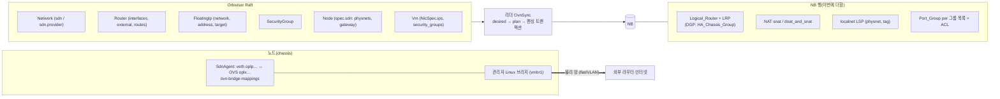

# SDN(OVN) 2 설계 — 외부(공급자) 네트워크, 라우터, 게이트웨이 HA, SNAT·유동 IP, DHCPv6·RA, OVN 보안 그룹 (계획 66)

작성일: 2026-11-20
상위 문서: `2026-11-20-sdn-ovn-design.md`(계획 65~67 전체, §16의 계획 66 스케치, §18의 계획 65 스테이지 보고와 리뷰 두 번), `2026-11-03-network-sdn-design.md`(계획 26 보안 그룹), `2026-11-18-folders-permissions-quotas-2fa-design.md`(계획 62 폴더·권한·할당량), `2026-11-17-install-media-cloud-init-design.md`(계획 57 cloud-init network-config)
기준 트리: 계획 65 끝(`4188afa4`). 이 문서는 구현 전 설계다. 스테이지 보고는 구현하면서 덧붙인다. 계획 65 설계의 §16·계획 65 계획 문서의 "다음 계획으로 넘길 사항"을 이 문서가 대신한다(계획 67 부분은 그대로 남는다).

## 1. 목적

계획 65의 SDN 네트워크는 **고립된 L2**다. VM은 서로 닿지만 밖으로 나가지 못하고 밖에서 들어오지 못하며, 보안 그룹은 SDN NIC에서 400이다(포트 보안만). 밖과 이으려면 VM에 단순 NIC를 따로 붙여야 했다. 이 계획은 "OpenStack OVN 기능처럼"(2026-11-11)의 나머지 핵심을 넣는다:

- **외부(공급자) 네트워크**: 노드의 물리 망(flat 또는 VLAN)에 붙는 SDN 네트워크(`localnet`). VM을 곧바로 붙일 수도, 라우터의 바깥쪽·유동 IP 풀로 쓸 수도 있다.
- **라우터**: SDN 네트워크(서브넷 게이트웨이)를 잇는 분산 논리 라우터, 정적 경로, 외부 게이트웨이.
- **게이트웨이 HA**: 관리자가 고른 게이트웨이 노드들 사이에서 라우터마다 우선순위를 정하고 BFD로 넘긴다.
- **SNAT·유동 IP(플로팅 IP)**: 사설 서브넷의 밖 나가기, 공인 주소 1:1(`dnat_and_snat`), 할 수 있으면 VM 노드에서 바로 나가는 분산 유동 IP.
- **DHCP 기본 경로·DHCPv6·RA**: 라우터에 붙은 서브넷만 기본 경로를 주고, IPv6는 SLAAC·DHCPv6(상태 있음·없음)를 RA로 알린다.
- **보안 그룹을 OVN ACL로**: 지금 단순 네트워크의 보안 그룹과 **같은 리소스·같은 뜻**을 SDN NIC에 OVN `Port_Group`·`ACL`로 건다.

원칙(계획 65 그대로): 원하는 상태는 Raft에만 있고 리더 `OvnSync`가 NB에 옮겨 쓴다. API는 OVN을 부르지 않는다. **이 기능을 쓰지 않는 클러스터는 바이트까지 지금과 같다**(Raft JSON, NB 행, nftables 규칙 글, cloud-init 씨앗). 기능 문자열 **`sdn-routing`** 하나가 새 칸·리소스를 가린다. svc01·svc02에는 OVN 꾸러미를 깔지 않는다.

| | Neutron ML2/OVS(L3 에이전트) | Neutron ML2/OVN | Proxmox VE 8 SDN | VMware NSX 4 | Orbivisor 계획 66 |
|---|---|---|---|---|---|
| 라우터 구현 | 네트워크 노드의 `qrouter-` 이름공간(Linux 라우팅·iptables), DVR이면 계산 노드에도 | OVN `Logical_Router`(흐름, 모든 chassis에 분산), 에이전트 없음 | 라우터 객체 없음. simple 영역은 노드의 브리지 게이트웨이, EVPN 영역은 VRF·출구 노드(FRR) | Tier-1/Tier-0 게이트웨이: 호스트의 DR(분산) + Edge 노드의 SR(서비스) | OVN 분산 라우터 + 분산 게이트웨이 포트(§9) |
| 외부 연결 | `br-ex`, 공급자 네트워크(physnet·VLAN) | `localnet` 포트 + `ovn-bridge-mappings` | 노드 브리지(관리자 구성) | Edge 업링크, VLAN 세그먼트 | `localnet` + 노드 physnet(관리자 Linux 브리지에 veth, §7) |
| 게이트웨이 HA | keepalived VRRP(L3 HA) 액티브·스탠바이 | `HA_Chassis_Group`/`Gateway_Chassis` 우선순위 + BFD | EVPN 출구 노드 여럿(BGP 경로) | Edge 클러스터 액티브·스탠바이(BFD) | `HA_Chassis_Group` 라우터마다, 우선순위 + HRW 순위로 흩음(§9.3) |
| SNAT | 라우터 이름공간 iptables | `NAT` `snat`(게이트웨이 chassis) | simple·EVPN 영역의 SNAT 선택(노드 iptables) | T0/T1 SR의 NAT | `NAT` `snat`(게이트웨이 chassis, §9.4) |
| 유동 IP | 라우터 이름공간 DNAT, DVR이면 계산 노드 `fip-` 이름공간 | `dnat_and_snat`, `enable_distributed_floating_ip`면 `external_mac`로 분산 | 없음 | NAT 규칙(SR, 중앙) | `FloatingIp` 리소스 → `dnat_and_snat`, VM 노드에 physnet이 있으면 저절로 분산(§9.5) |
| IPv6 | radvd·dnsmasq, NAT 없음 | `ipv6_ra_configs`·`dhcpv6_options`, NAT 없음 | (DHCP는 dnsmasq IPv4 위주) | SLAAC·DHCPv6 서버 | `ipv6_ra_configs`·`dhcpv6_options`, NAT 없음(§10) |
| 방화벽 | 보안 그룹(허용만, 상태 있음, 기본 막기) → iptables/OVS 흐름 | 보안 그룹 → `Port_Group` + `ACL`(허용만, `neutron_pg_drop`) | pve-firewall(SDN과 따로, 순서 있는 규칙) | 분산 방화벽(DFW): 범주별 **순서대로 처음 맞는 규칙** | 보안 그룹(계획 26 뜻 그대로: 순서대로 처음 맞는 것) → 그룹 목록마다 `Port_Group` + `ACL`(§11) |
| 테넌트 | 프로젝트, 공유 외부 네트워크 | 같음 | 없음 | 프로젝트·VPC | 네트워크 폴더(라우터·유동 IP·할당량, §12) |

## 2. 범위

| 계획 66에 넣는 것 | 넣지 않는 것 |
|---|---|
| 공급자 네트워크(`SdnNet.provider { physnet, vlan }` → `localnet`), 노드 physnet 연결(`NodeSpec.sdn.physnets`, veth·OVS 브리지·`ovn-bridge-mappings`), 스케줄러 physnet 조건 | 물리 NIC를 OVS 브리지로 옮기기(관리자 Linux 브리지에만 붙는다), `redirect-type=bridged`(§15) |
| `Router` 리소스: 인터페이스(SDN 네트워크의 서브넷 게이트웨이), 정적 경로, 외부 게이트웨이(공급자 네트워크 주소), SNAT 켜기·끄기 | 라우터끼리 잇기(`peer`), 공급자 네트워크를 인터페이스로, 외부 게이트웨이 둘 이상·ECMP, 정책 경로 |
| 게이트웨이 노드(`NodeSpec.sdn.gateway` 우선순위), 라우터마다 `HA_Chassis_Group`, BFD 넘김, 유지보수 노드 빼기 | 되돌아감(failback) 막기 — OVN이 늘 가장 높은 살아 있는 chassis로 간다(§9.3) |
| `FloatingIp` 리소스(외부 서브넷의 유동 IP 풀에서), VM NIC에 붙이기·떼기, 분산·중앙 자동 고르기 | 포트 포워딩(주소 하나의 포트를 여러 VM에), IPv6 NAT, BGP 광고 |
| DHCPv4 `router`(라우터에 붙은 서브넷만), cloud-init 고정 주소의 `gateway`, IPv6 `ipv6_mode`(SLAAC·DHCPv6 상태 있음·없음) → `ipv6_ra_configs`·`dhcpv6_options`, EUI-64 IPAM | 접두사 위임(PD), DHCP 릴레이, 서브넷 여러 개 |
| **SDN NIC의 보안 그룹**(계획 65의 400을 없앰) → OVN `Port_Group`·`ACL`, 단순 NIC와 같은 뜻 | 보안 그룹을 폴더에(§16), 원격 그룹 규칙, ACL 기록(log)·카운터 |
| 라우터·유동 IP의 네트워크 폴더 권한과 할당량 차원 `routers`·`floating_ips` | `networks`·`ips` 할당량(계획 67) |
| GitHub `ovn` 작업(노드 하나)에 실제 SNAT·유동 IP·DHCPv6·RA·보안 그룹 비교, **새 `sdn-multinode` 작업**(한 러너에 Orbivisor 노드 셋 — systemd 컨테이너, §14) | 부하 분산·QoS·토폴로지 화면·옮기기 도구·SB RBAC·알림(계획 67) |

**기능 하나**(`opl_types::node`, `FEATURES` 끝): **`sdn-routing`**(`SDN_ROUTING`). 가리는 것: `SdnNet.provider`, `Subnet.floating_pools`·`ipv6_mode`, `NodeSpec.sdn`, `NodeSdn.physnets`·`gateway`(노드 상태), `Kind::Router`·`Kind::FloatingIp`, `FolderQuota.routers`·`floating_ips`, SDN NIC의 `security_groups`. 모든 노드가 알릴 때만 쓰고 아니면 409 `cluster_upgrading`(`require_feature`, 검증보다 먼저 — 계획 58~65와 같다). 계획 65 설계가 이름을 미리 적어 둔 `sdn-routing`을 그대로 쓴다(나눠 둘 까닭이 없다 — 이 계획의 칸은 서로 엮여 있고 한 번에 켜진다).

## 3. 지금 있는 것 (계획 65 끝)

- **타입**: `NetworkSpec { bridge, vlan, vxlan, sdn: Option<SdnNet {}>, mtu, subnets: Vec<Subnet>, folder }`(`deny_unknown_fields`, 셋 중 하나, `VlanWithSdn`, `OvnBridge`), `Subnet { cidr, gateway, dhcp, dns_servers, pools, description }`(체계마다 하나, IPv6 `dhcp: true`는 400 `Dhcpv6`, `dhcp()` 기본은 IPv4 참), `NicSpec.ips`, `NodeStatus.sdn: Option<NodeSdn { chassis, ovn_version, ovs_version, encap_ip, central, error }>`, `Sdn` 리소스(`SdnSpec {}`). 순수 `opl_types::ipam::{reserved, allocate, server_mac, …}`, `opl_types::sdn::port_name`. 시험 하나가 `{"sdn": {"provider": "physnet1"}}`을 거절한다(이 계획이 모양을 바꾼다).
- **OvnSync**(`opl-api/src/ovn_sync/{mod,nb}.rs`): 순수 `desired(networks, vms, nodes, tag) -> NbState`(스위치·포트·DHCP_Options), `read_ops`·`parse_actual`, `plan(want, have) -> Vec<Batch>`(네트워크 하나·지울 스위치 하나·지울 DHCP 묶음 하나가 트랜잭션 하나), `fence`(NB_Global `wait` + 토큰 + 마지막 묶음만 `nb_cfg` 올림), `VmInputs`(논리 포트에 쓰이는 VM 칸이 같으면 깨지 않음), Node는 지움만 차례를 부른다. 주인 표시 `orbivisor:cluster`·`orbivisor:id`. 가짜 NB(`opl-driver/src/ovn/fake_ovsdb.rs`)는 쓰는 표·연산·`wait`·강한 참조만 흉내 낸다.
- **IPAM**(`opl-api/src/ipam.rs`): `assign`·`assign_new`·`check_requested`·`fill_shortages`, Raft 겹침 `("ip", "<네트워크 이름>/<주소>")`(`opl-cluster/src/exclusive.rs`, 지금은 `Vm`·`Folder`·`Snapshot`만 값을 낸다). 서브넷이 있는 네트워크의 주소 없는 NIC 포트는 `enabled=false`.
- **노드**: `SdnAgent`(`opld/src/sdn.rs`) — chassis 칸(`system-id`, `ovn-remote`, `ovn-encap-*`, `orbivisor-cluster` 태그), 중앙 단위, 스키마 변환, 오래된 포트 청소, `NodeStatus.sdn`(검사 루프). 노드 쪽 명령은 `OvnHost`(`opl-driver/src/ovn/host.rs`, `CommandRunner`).
- **보안 그룹**(계획 26, `opl_types::security_group`): 루트 리소스(쓰기 `network.config`, 실제로는 admin), 규칙 `in|out accept|drop [proto] [ports] [CIDR]` 200개, NIC당 그룹 8개. **뜻**: NIC의 그룹 순서 → 그룹 안 순서로 **처음 맞는 규칙**, 맞는 것이 없으면 들어오기 막기·나가기 보내기, `out accept`는 끝이 아니라 받는 쪽 `in` 검사로 넘김, 늘 허용(conntrack 응답, ARP, 이웃 찾기·RA 들어오기, DHCP 응답 67→68·547→546), 늘 막기(`invalid`, 보낸 MAC 위조), 없는 그룹을 건 NIC는 찾은 그룹의 규칙 뒤에 나가기 막기를 더한다(들어오기는 원래 기본 막기 — 가이드는 "모두 막는다"로 줄여 적음). 노드마다 방화벽 에이전트(`opld/src/firewall.rs` `firewall_nics` → `opl-driver/src/firewall.rs` `ruleset`)가 nftables `bridge opl_<태그>` 하나로 넣고, VM 켜기 직전 `FirewallGate`가 먼저 넣는다. SDN NIC는 건너뛰고 API가 400 `sdn_security_groups`(`ipam.rs:112`)다. 스케줄러·`vms.rs`는 그룹을 건 VM을 `status.firewall`인 노드에만(`firewall_unsupported`).
- **권한·폴더**(계획 62): `FolderKind::of`는 `Vm`·`Network`·`StoragePool`만 폴더에 둔다. `kind_privilege`: `Network`·`SecurityGroup` 쓰기는 `network.config`, `Network` 읽기는 `system.read`, 나머지는 `cluster.read`. 할당량(`FolderQuota`)은 VM 폴더만이고 상태 머신(`opl-cluster/src/folders.rs`)이 받아들이기 전에 센다.
- **CI `ovn` 작업**: 깨끗한 Ubuntu 24.04 러너 하나, orbivisord가 OVN 24.03.8·OVS 3.3.9를 설치, 노드 하나(중앙·chassis)와 127.0.0.2의 두 번째 ovsdb, 이름공간 "VM"(OVS 내부 포트에 LSP `iface-id`)으로 DHCP·ping·위조, QEMU VM 바인딩. **chassis 둘 사이의 Geneve, 두 chassis 마이그레이션, 중앙 셋의 실제 장애, 실제 `cluster/kick`은 보지 못했다**(리뷰가 여러 노드 시험이 필요하다고 함).

## 4. OVN에서 확인한 사실

OVN 24.03 판의 man 페이지(`ovn-nb(5)` **DB Schema 7.3.0**, OVN 24.03.10 — ovn.org `dist-docs-branch-24.03`, `ovn-northd(8)`, `ovn-controller(8)`, `ovn-architecture(7)`)와 `branch-24.03`의 `ovn-nb.ovsschema`(뿌리 표 여부)를 2026-11-20에 받아 옮겼다. 러너의 판은 24.03.8이다(같은 스키마 7.3.0). 아래 "탐침" 표시는 스테이지가 GitHub 러너에서 실제로 확인할 것이다.

- **뿌리 표**: `Logical_Router`·`HA_Chassis_Group`·`Port_Group`·`Address_Set`·`DHCP_Options`는 뿌리다. `Logical_Router_Port`(라우터가 정확히 하나 가리킴)·`Logical_Router_Static_Route`·`NAT`·`HA_Chassis`·`Gateway_Chassis`·`ACL`은 뿌리가 아니라 가리키는 행이 있어야 남는다(계획 65의 스위치·포트와 같은 강한 참조 다루기).
- **`Logical_Router_Port`**: `name`(표에서 하나, **스위치 포트와 같은 이름이면 안 되지만 스키마가 막지 못함**), `networks`(`"10.0.0.1/24"` 1개 이상, IPv6 링크 로컬은 MAC에서 저절로), `mac`, `enabled`(거짓이면 모든 트래픽 버림), `peer`(라우터끼리), **분산 게이트웨이 포트(DGP)**: `ha_chassis_group`(권하는 길) 또는 `gateway_chassis`(옛 길) — "한 번에 하나만". `status:hosting-chassis`는 northd가 지금 DGP를 가진 chassis 이름을 적는다. `options:gateway_mtu`(68~65535): 그보다 큰 패킷에 ICMPv4 Frag Needed·ICMPv6 Packet Too Big을 만든다. `options:redirect-type`(`bridged`|`overlay`): DGP에 `bridged`면 게이트웨이로 보내는 패킷이 터널 대신 localnet으로 가고, **모든 chassis에 `ovn-chassis-mac-mappings`가 필요**하며 DGP가 하나뿐일 때만 뜻이 있다. `options:reside-on-redirect-chassis`·`centralize_routing`(모든 라우팅을 게이트웨이로). 스위치 쪽 짝은 `type=router` LSP의 `options:router-port`, `options:nat-addresses=router`(NAT 주소의 GARP).
- **`ipv6_ra_configs`**: `address_mode` = `slaac`(RA의 접두사 정보로 주소) | `dhcpv6_stateful` | `dhcpv6_stateless`(주소는 RA, 나머지는 DHCPv6), `mtu`(1280 미만은 넣지 않음), `send_periodic`(기본 거짓), `max_interval`(기본 600초)·`min_interval`, `rdnss`(**서버 하나만**), `dnssl`, `router_preference`, `route_info`. ovn-controller가 RS에 답하고(주기적이면 스스로) 보낸다.
- **`DHCP_Options`(DHCPv6)**: 필수 `server_id`(이더넷 주소 — DUID-LL), `dns_server`(`{a, b}`), `domain_search`, `dhcpv6_stateless=true`(주소는 주지 않고 나머지만). LSP `dhcpv6_options`(약한 참조). 계획 65 DHCPv4의 `router`는 선택 칸이다.
- **`HA_Chassis_Group`/`HA_Chassis`**: 그룹의 chassis 가운데 **`priority`(0~32767)가 가장 높은 것이 주인**이고, 주인이 죽으면 다음 우선순위가 맡는다. DGP가 그룹을 가리키면 주인 chassis가 게이트웨이 일(SNAT·중앙 NAT·ARP 답)을 한다. `ovn-architecture(7)`: 게이트웨이 chassis가 여럿이면 그 게이트웨이로 보낼 수 있는 모든 chassis가 게이트웨이 chassis로 가는 **터널에 BFD를 켜고**, "BFD로 살아 있다고 보이는 가장 높은 우선순위"가 주인이다 — 그래서 **되돌아감이 늘 일어난다**(높은 chassis가 돌아오면 다시 넘어감). `chassis_name`은 SB `Chassis.name` = 계획 65의 노드 UUID다.
- **`NAT`**: `type` `snat`(`logical_ip`(주소나 망)의 보낸 주소를 `external_ip`로) | `dnat` | `dnat_and_snat`(1:1). `external_ip`·`logical_ip`는 문서상 **IPv4**다(IPv6 NAT를 쓰지 않는 까닭). **분산 처리**: 분산 라우터에서 `logical_port`와 `external_mac`이 **둘 다** 있어야 모든 chassis에서(그 포트가 있는 chassis에서) 처리하고, 없으면 게이트웨이 chassis에서 중앙 처리한다. `external_mac`은 게이트웨이 포트가 붙은 스위치에서 겹치지 않아야 하고, "`logical_port`의 MAC이 전체에서 하나라면 그 MAC을 써도 된다". `gateway_port`(DGP가 여럿일 때), `options:stateless`, `allowed_ext_ips`·`exempted_ext_ips`. northd는 DGP의 라우터 NAT의 `external_mac`을 그 `logical_port`가 있는 chassis의 상대 스위치 목적지 조회에 넣는다.
- **`Logical_Router_Static_Route`**: `ip_prefix`, `nexthop`(붙은 라우터 포트의 주소나 논리 포트 주소, 또는 `discard`), `policy`(기본 `dst-ip`), `output_port`, 가장 긴 접두사 우선, 같은 접두사·정책이면 ECMP.
- **`Port_Group`**: `name`은 **`[a-zA-Z_.][a-zA-Z_.0-9]*`**(하이픈 안 됨), `ports`(LSP 약한 참조), `acls`. 그룹마다 SB에 `<이름>_ip4`·`_ip6` 주소 묶음이 생긴다. "포트 그룹에 ACL을 거는 것은 그 포트들이 속한 모든 스위치에 거는 것과 같다".
- **`ACL`**: `priority` 0~32767(논리 흐름에서는 +1000), `direction` `from-lport`(포트에서 들어옴 — VM이 보냄)·`to-lport`(포트로 나감 — VM이 받음), `action` `allow-related`·`allow-stateless`·`allow`·`drop`·`reject`·`pass`, **`tier` 0~3**(24.03은 네 층 — 0층부터 보고 판정이 없으면 다음 층, `pass`는 다음 층으로), `label`, `options:apply-after-lb`. **`type=router`·`localnet` 포트에는 ACL을 맞출 수 없다.**
- **ACL이 실제로 하는 일**(`ovn-northd(8)` ls_in/out ACL 표): 한 층 안에서 **가장 높은 우선순위의 맞는 ACL 하나가 판정**한다(그래서 순서 있는 "처음 맞는 것"을 우선순위 내림차순으로 정확히 그릴 수 있다). ACL이 없는 스위치는 다 보낸다. 상태 있는 ACL이 데이터패스에 하나라도 있으면 그 스위치의 **모든 IP 트래픽이 conntrack을 지나고**, 맞는 ACL이 없는 트래픽은 우선순위 1 흐름이 보내며 커밋한다(`NB_Global options:default_acl_drop`이 거짓 — 기본 — 일 때). 우선순위 65532: 커밋된 연결의 **응답 방향**은 보냄(`ct_mark.blocked`가 아니면), 관련(related) 보냄, **`invalid`는 버림**, IPv6 **NS·NA·RS·RA·MLD는 다른 ACL과 상관없이 보냄**(양 방향). 이미 맺은 연결의 **요청 방향은 늘 ACL을 다시 보고**, `drop` ACL에 맞으면 `ct_mark.blocked`를 켜 그 연결의 응답도 막는다 — **규칙에서 허용을 빼면 맺은 연결이 끊긴다**. 우선순위 34000: OVN 자신의 DHCPv4·DHCPv6 응답은 사용자 ACL(최대 32767+1000)보다 먼저 보낸다.
- **`ovn-controller(8)`**: `external_ids:ovn-bridge-mappings` = `physnet1:br-eth0,physnet2:br-eth1`, localnet 포트는 br-int와 매핑된 브리지 사이의 patch 포트 짝으로 생긴다. `ovn-cms-options`는 CMS가 읽는 칸일 뿐 OVN은 쓰지 않는다(Neutron은 `enable-chassis-as-gw`로 게이트웨이 후보를 표시). `ovn-chassis-mac-mappings`는 `redirect-type=bridged`·VLAN 분산 라우팅용이다. `exit`은 "점잖게 끝냄"이고 끝낼 때 SB `Chassis` 행을 지우는지·흐름을 남기는지는 판마다 다르다 — **탐침**(§14: 게이트웨이 넘김 시험은 점잖은 멈춤과 프로세스 죽이기·노드 통째 죽이기를 모두 본다).
- **계획 65에서 옮김**: `requested-chassis`에 chassis가 둘이면(라이브 마이그레이션) 공급자 네트워크에서도 그동안 터널을 쓴다(MTU 영향 — §8). Geneve 머리 58바이트(오버레이 기본 MTU 1442).
- **탐침으로 볼 것**: 내부 라우터 포트(DGP가 아님)의 `gateway_mtu`가 밖 → 안 큰 패킷에 Frag Needed를 만드는지, 분산 유동 IP의 GARP가 VM의 chassis에서 나가는지(`nat-addresses=router`), 넘김 시간(BFD 기본값), `ovn-controller` 점잖은 멈춤 뒤 옛 게이트웨이가 ARP에 답하지 않는지.

## 5. 전체 구조

- 오버레이 SDN 네트워크(계획 65) ─ 라우터 인터페이스 ─ **분산 라우터**(모든 chassis에서 동서 라우팅) ─ DGP ─ 공급자 네트워크(`localnet`) ─ 노드 physnet ─ 물리 망. SNAT·중앙 유동 IP는 DGP를 가진 게이트웨이 chassis에서, 분산 유동 IP는 VM이 도는 chassis에서 물리 망으로 나간다.
- 보안 그룹은 VM NIC의 논리 포트(VIF)에만 걸린다. 라우터·localnet 포트에는 걸 수 없다(§4) — 라우터를 지나 들어오는 패킷은 DNAT 뒤 VM 포트의 `to-lport` ACL이 본다.
- 누가 무엇을 쓰나: 계획 65 그대로. API는 Raft만, 리더 `OvnSync`만 NB, 노드 `SdnAgent`는 로컬 OVS DB·veth·자기 단위만. SB에는 여전히 쓰지 않는다(지운 노드 chassis 청소만).

## 6. 타입 (opl-types)

모든 새 칸은 빈 값이면 쓰지 않는다(`skip_serializing_if`). 그래서 이 계획의 기능을 쓰지 않는 Raft JSON은 바이트 그대로다(serde 하위 호환 시험).

- **`SdnNet { provider: Option<Provider> }`**, `Provider { physnet: String, vlan: Option<u16> }`(`deny_unknown_fields`). `physnet`은 `[a-z][a-z0-9-]{0,30}`(OVN 매핑 문법의 `:`·`,`를 막는다), `vlan` 1~4094(없으면 flat). 검증 더하기: 공급자 네트워크의 `mtu` 기본은 **1500**(물리 망, 1280~9000), `subnets`의 `dhcp` 기본은 **거짓**(물리 망에 DHCP 서버가 이미 있을 수 있다 — §8), `vlan`(브리지용 칸)은 여전히 sdn과 못 쓴다(`VlanWithSdn` — 공급자 VLAN은 `provider.vlan`). `NetworkSpec::is_provider()`, `physnet()`. `bridge_name()`은 공급자도 `br-int`(VM tap은 늘 br-int).
- **`Subnet`에 더함**: `floating_pools: Vec<IpRange>`(공급자 네트워크의 IPv4 서브넷만, 16개까지, CIDR 안, 서로·`pools`·게이트웨이와 겹치지 않음 — 라우터 외부 주소와 유동 IP를 여기서 먼저 고른다, §8), `ipv6_mode: Option<Ipv6Mode>`(`slaac` | `dhcpv6-stateful` | `dhcpv6-stateless`, IPv6 서브넷만, `slaac`·`dhcpv6-stateless`는 `/64`만 — EUI-64). IPv6 `dhcp: true`는 여전히 400(`ipv6_mode`가 그 자리). 새 오류 `SubnetError::{FloatingPoolsWithoutProvider, FloatingPoolOverlap, Ipv6ModeOnIpv4, SlaacNeeds64}`.
- **`NodeSpec.sdn: Option<NodeSdnConfig>`**(`deny_unknown_fields`): `physnets: BTreeMap<String, String>`(physnet → 이 노드의 Linux 브리지 이름, 8개까지, 브리지 이름은 `valid_ifname`이고 `br-int`·Orbivisor 관리 이름이 아님), `gateway: Option<u16>`(게이트웨이 후보면 우선순위 1~1000, 기본 화면값 100). 계획 64의 `host_resources`처럼 노드 쓰기(`cluster.admin`)로 바꾼다.
- **`NodeSdn`에 더함**(노드 상태): `physnets: Vec<PhysnetState { name, bridge, ready: bool, error: Option<String> }>`, `gateway: bool`(`ovn-cms-options`에 `enable-chassis-as-gw`를 적었는지). 비면 쓰지 않는다.
- **`Router = Resource<RouterSpec, RouterStatus>`**, `Kind::Router`(`router`). `RouterSpec { folder: Option<Uuid>, description: Option<String>, external: Option<RouterExternal>, interfaces: Vec<RouterInterface>, routes: Vec<StaticRoute> }`(`deny_unknown_fields`). `RouterExternal { network: String, ips: Vec<IpAddr>, snat: Option<bool> }`(`ips`는 체계마다 하나, API가 채움 — `NicSpec.ips`와 같다, `snat` 기본 참). `RouterInterface { network: String }`(그 네트워크의 모든 서브넷 게이트웨이가 라우터 포트 주소). `StaticRoute { destination: Cidr, nexthop: IpAddr }`(64개까지). `RouterStatus {}` — 살아 있는 상태(게이트웨이 주인·순위)는 보기에서 읽는다(Raft에 쓰지 않음 — 계획 65의 `ips` 보기와 같은 까닭). 검증 `RouterSpec::validate`: 인터페이스 16개까지·같은 네트워크 두 번 안 됨, 경로의 `destination`·`nexthop` 체계가 같음, 외부가 있으면 기본 경로(`0.0.0.0/0`·`::/0`)는 사용자 경로로 줄 수 없음(`DefaultRouteWithExternal` — 외부 서브넷 게이트웨이로 저절로). 네트워크를 알아야 하는 검사(인터페이스가 오버레이 SDN이고 서브넷이 있음, 외부가 공급자, 서브넷이 서로 겹치지 않음, `nexthop`이 붙은 서브넷 안)는 API가 한다.
- **`FloatingIp = Resource<FloatingIpSpec, FloatingIpStatus>`**, `Kind::FloatingIp`(`floating-ip`). `FloatingIpSpec { network: String, address: Option<IpAddr>, target: Option<FipTarget>, folder: Option<Uuid>, description: Option<String> }`, `FipTarget { vm: Uuid, mac: MacAddr }`(NIC는 MAC으로 — 계획 65 포트 이름과 같은 까닭: 순서가 바뀌어도 같은 NIC). `address`는 API가 채우고 IPv4만이다(§4 NAT). `FloatingIpStatus {}`.
- **`Kind::ALL` 34 → 36.** `FolderKind::of(Kind::Router | Kind::FloatingIp) = Network`. `FolderKind::member_kind`(하나)를 `member_kinds() -> &[Kind]`로 바꾼다(폴더 비었는지 검사·옮기기가 셋 모두를 본다).
- **`FolderQuota`에 `routers`·`floating_ips`**(네트워크 폴더에만 — 검증이 폴더 종류마다 받는 차원을 본다, VM 차원은 VM 폴더만), `QuotaDimension::{Routers, FloatingIps}`, `FolderUsage`의 같은 칸(0이면 쓰지 않음).
- **순수 함수**:
  - `ipam::eui64(prefix: Ipv6 /64, mac) -> Ipv6Addr`(수정 EUI-64 — U/L 비트 뒤집기), `ipam::allocate_v6_mode(subnet, mac, used, want)`(SLAAC 계열이면 EUI-64만, 다른 주소를 원하면 `NotEui64`).
  - `ipam::allocate_from(subnet, pools: &[IpRange], …)`(유동 IP 풀 고르기 — 계획 65 `allocate`의 풀만 바꾼 꼴).
  - `sdn::router_mac(router, network) -> MacAddr`(`02:` + SHA-256 앞 5바이트, `server_mac`과 같은 꼴, 입력에 종류 표지를 넣어 둘이 겹치지 않게), `sdn::physnet_ifnames(tag, physnet) -> (veth_ovs, veth_bridge, ovs_bridge)`(`oplp<h8>o`·`oplp<h8>b`·`oplx<h8>`, h8 = SHA-256(태그‖physnet) 앞 8자 16진 — 15자 안), `network::is_managed_ifname`이 이 이름도 Orbivisor 것으로 안다.
  - `sdn::gateway_ranking(router: Uuid, candidates: &[(Uuid, u16)]) -> Vec<(Uuid, u16)>`(§9.3, 앞 5개, 우선순위 32767부터 내림).
  - `security_group::nic_policy(nic_groups: &[String], groups: &[SecurityGroup]) -> NicPolicy { groups: Vec<Uuid>, missing: bool, rules: Vec<Rule> }` — 지금 `opld/src/firewall.rs` `firewall_nics` 안의 펼치기(그룹 순서 → 규칙 순서, 없는 그룹이면 막기)를 옮긴다. nftables 쪽과 OVN 쪽이 **같은 함수**로 펼친다(§11). `NicPolicy::key()`(그룹 id 목록 + 없는 그룹 이름 — 같은 뜻의 NIC를 묶는 열쇠).
- **보기**: `RouterView`(스펙 + `live { hosting: Option<노드>, gateways: Vec<{node, priority, chassis_state}>, error }`, 외부 IPv6 접두사마다 "윗단 경로 필요: `fd00:20::/64 via 2001:db8::5`"), `FloatingIpView`(스펙 + `state: Unattached | Distributed { node } | Centralized { reason } | Unrouted { reason }`).
- **권한**: 새 권한 비트는 없다. `kind_privilege`: `Router`·`FloatingIp` 쓰기 `network.config`, 읽기 `system.read`(`Network`와 같은 갈래). 세부는 §12.
- **serde 하위 호환 시험**: 옛 `NetworkSpec`·`Subnet`·`NodeSpec`·`NodeStatus`·`FolderQuota`·`FolderUsage` JSON 바이트 그대로, 새 칸 왕복, `Kind` 문자열 둘, 계획 65의 `{"sdn": {"provider": "physnet1"}}`(문자열)은 여전히 400(모양이 객체).

## 7. 노드: physnet 연결과 게이트웨이 노드

- **연결 모양**: 관리자가 만든 Linux 브리지(`vmbr1` 따위 — 계획 25 이래 Orbivisor는 관리자 브리지를 고치지 않는다)에 veth 짝 하나로 OVS 브리지를 잇는다. `ip link add oplp<h8>b type veth peer name oplp<h8>o` → `oplp<h8>b`를 `master vmbr1`, MTU = 브리지 MTU, up → `ovs-vsctl --may-exist add-br oplx<h8> -- set Bridge oplx<h8> external_ids:orbivisor-cluster=<태그> external_ids:orbivisor-physnet=<physnet> -- --may-exist add-port oplx<h8> oplp<h8>o -- set Interface oplp<h8>o external_ids:orbivisor-cluster=<태그>` → `external_ids:ovn-bridge-mappings`에 `<physnet>:oplx<h8>`. ovn-controller가 localnet 포트를 위한 patch 포트를 br-int와 `oplx…` 사이에 만든다(§4). 명령 목록은 순수 함수(`physnet_commands`)로 단위 시험한다.
- **VLAN 인식 브리지**: `vmbr1`이 `vlan_filtering 1`이면 `bridge vlan add dev oplp<h8>b vid 2-4094`(트렁크, pvid는 브리지 기본 그대로 — flat 공급자는 태그 없는 프레임). 아니면 태그 프레임이 그대로 지난다. 그 판정은 `ip -d -j link show vmbr1`.
- **`ovn-bridge-mappings` 주인**: 쉼표 목록을 읽어 다리 이름이 `oplx`로 시작하고 OVS `Bridge`에 내 태그가 있는 항목만 Orbivisor 것으로 본다. 남의 항목은 그대로 두고 내 항목만 더하고 뺀다. 같은 physnet이 남의 다리에 매핑돼 있으면 그 physnet을 `ready: false, error: "physnet ext is mapped to br-ex by someone else"`로 알리고 덮지 않는다(계획 65 §7.4 "아무것도 몰래 지우지 않는다").
- **게이트웨이 표시**: `NodeSpec.sdn.gateway`가 있으면 `ovn-cms-options`에 `enable-chassis-as-gw`를 더한다(다른 옵션은 둔다). OVN은 이 칸을 쓰지 않지만 `ovn-sbctl show`·Neutron 관례로 사람이 보게 둔다. 실제 후보는 Raft가 정한다(§9.3).
- **언제**: `SdnAgent`의 지금 맞추기(시작, `Sdn`·`Node` watch — 이제 **내 `NodeSpec.sdn`이 바뀔 때**도, 60초마다). 이 노드가 chassis로 구성돼 있을 때만 한다. veth는 재부팅하면 사라지므로(OVS 브리지는 OVS DB에 남음) 시작 맞추기가 다시 만든다 — 그 사이(부팅 뒤 orbivisord가 뜰 때까지) 이 노드의 공급자 트래픽은 끊겨 있다(가이드).
- **빼기**: `physnets`에서 빠지면 매핑 항목 → OVS 브리지(내 태그) → veth 순으로 지운다. 그 physnet을 쓰는 VM이 이 노드에 돌고 있으면 API가 먼저 409 `physnet_in_use`(VM 목록)다. `cluster leave`는 계획 65처럼 내 칸만 지우는 데 매핑·`enable-chassis-as-gw`를 더한다.
- **보고**: `NodeSdn.physnets`(브리지가 없음·매핑 충돌·명령 실패면 `ready: false`와 까닭), `gateway`. 검사 루프가 다를 때만, `sdn-routing`을 모두 알릴 때만 쓴다.
- **스케줄러**: 공급자 네트워크 NIC가 있는 VM은 그 physnet이 `ready`인 chassis에만(`has_physnet`, `NoNode` 문구에 "has the physical networks (physnets) of its provider networks"). 마이그레이션 대상·HA 복구도 같은 `fits`.

## 8. 공급자(외부) 네트워크와 외부 IPAM

- **만들기**: `POST /networks {sdn: {provider: {physnet, vlan?}}, mtu?, subnets, folder?}`. 노드 자원(물리 망)이라 **루트 `cluster.admin`**(브리지 네트워크와 같다). 폴더는 `network.assign`을 나눠 주는 자리일 뿐이다(Neutron의 "공유 외부 네트워크"). 같은 `(physnet, vlan)`은 클러스터에 하나(Raft 겹침 `("physnet", "<physnet>/<vlan|flat>")` — `exclusive.rs`가 `Network`에서도 값을 낸다. 공급자가 아닌 네트워크는 값이 없어 지금 그대로). physnet이 `ready`인 노드가 하나도 없어도 만들 수는 있고 경고 헤더를 단다.
- **NB**: 계획 65의 `Logical_Switch` + **`localnet` LSP** `opl-ln-<네트워크 id>`(`type=localnet`, `addresses=["unknown"]`, `options:network_name=<physnet>`, `tag=<vlan>`, 주인 표시). VM NIC 포트·DHCP는 계획 65 그대로다(OVN DHCP는 그 VM의 chassis가 답한다).
- **VM을 곧바로 붙이기**: 된다(공급자 네트워크의 VM, Neutron과 같다). IPAM은 `pools`에서, `network.assign` 권한. 라이브 마이그레이션 동안 두 chassis 바인딩이면 OVN이 터널을 쓰므로 그 몇 초 동안 1442보다 큰 패킷은 버려진다(가이드 — 계획 65 §4).
- **DHCP 기본 끄기**: 공급자 서브넷의 `dhcp`는 기본 거짓이다. OVN DHCP는 자기 포트의 요청에만 답하지만, 물리 망에 DHCP 서버가 있으면 그 서버도 VM에 답하고 VM이 다른 주소를 받으면 포트 보안이 그 주소를 막는다. 켜려면 관리자가 물리 DHCP가 그 VLAN에 없음을 알고 `dhcp=on`을 준다.
- **서브넷의 뜻**: `gateway`는 **물리 라우터의 주소**(예약 — 계획 65 그대로 늘 예약), `pools`는 VM NIC 주소, **`floating_pools`는 라우터 외부 주소와 유동 IP**. 고르는 순서: 라우터 외부·유동 IP는 `floating_pools`가 있으면 거기서만, 없으면 `pools`(Neutron처럼 한 풀을 나눠 씀). 직접 준 주소(`ip=`)는 서브넷 안의 예약이 아닌 어디든. `floating_pools`를 둔 까닭은 관리자가 "공인 주소 몇 개만 유동 IP로"를 VM 직접 붙이기와 나누고 싶을 때가 많아서다 — 칸 하나로 끝난다.
- **겹침**: 쓰는 주소 = VM NIC `ips` + 라우터 `external.ips` + 유동 IP `address`. Raft 겹침 키는 셋 모두 `("ip", "<네트워크 이름>/<주소>")`(같은 키 공간 — 종류가 달라도 한 주소는 하나). 계획 65의 다시 고르기(5번, 409 `ip_in_use`)·`ip_exhausted`가 그대로 쓰인다.
- **보기**: `GET /networks/{key}/ips`의 할당 행에 `kind`(`nic`·`router`·`floating-ip`)와 대상(라우터 이름, 유동 IP가 붙은 VM). 서브넷마다 `floating` 크기·사용·남음.
- **지우기**: 라우터의 외부이거나 유동 IP가 있으면 409 `network_in_use`(이름들). 서브넷 빼기(`PATCH`)는 라우터 외부 주소·유동 IP가 그 서브넷 주소를 쓰면 409 `subnet_in_use`.

## 9. 라우터·게이트웨이 HA·SNAT·유동 IP

### 9.1 라우터 리소스와 NB

- 네트워크 폴더에 산다. 만들기 `POST /routers {name, folder?, external?, interfaces?, routes?}`, 바꾸기 `PATCH /routers/{key}`(보낸 칸만, 목록은 통째로, `If-Match`), 지우기는 인터페이스가 비어야 한다(409 `router_in_use`). API가 `external.ips`를 외부 네트워크의 체계마다 고른다(§8).
- **인터페이스 규칙**: 네트워크는 오버레이 SDN(공급자 아님)이고 서브넷이 하나 이상, **한 네트워크는 라우터 하나에만**(Raft 겹침 `("router-net", "<네트워크 이름>")` — 서브넷 게이트웨이 주소가 라우터 포트 하나의 주소이므로), 한 라우터의 인터페이스·외부 서브넷 CIDR끼리 겹치지 않음(400 — 폴더가 다른 네트워크는 같은 CIDR을 써도 되지만 같은 라우터에는 못 붙는다).
- **NB 행**(이름은 모두 `opl-` + id, 주인 표시 `orbivisor:cluster`·`orbivisor:id`):

| Raft | NB |
|---|---|
| `Router` | `Logical_Router` `opl-r-<라우터 id>`, `options:dynamic_neigh_routers=true`·`always_learn_from_arp_request=false`(외부 망이 커도 `MAC_Binding`이 그 크기만큼 자라지 않게), `external_ids`에 `orbivisor:name`·`folder` |
| 인터페이스(네트워크 N) | LRP `opl-lrp-<N id>`(`networks` = N의 서브넷마다 `"게이트웨이/접두사"`, `mac` = `router_mac(라우터, N)`, `options:gateway_mtu` = N의 MTU, IPv6 서브넷에 `ipv6_mode`가 있으면 `ipv6_ra_configs`(§10)) + N 스위치의 LSP `opl-rsp-<N id>`(`type=router`, `addresses=["router"]`, `options:router-port=opl-lrp-<N id>`) |
| `external`(공급자 E) | DGP `opl-gw-<라우터 id>`(`networks` = 외부 주소마다 `"주소/E 접두사"`, `mac` = `router_mac(라우터, E)`, `ha_chassis_group` = 아래 그룹) + E 스위치의 LSP `opl-rgw-<라우터 id>`(`type=router`, `options:router-port`, **`options:nat-addresses=router`** — 넘김 뒤 새 게이트웨이와 분산 유동 IP의 chassis가 GARP를 보낸다) |
| 정적 경로 | `Logical_Router_Static_Route`(`ip_prefix`, `nexthop`), 외부가 있으면 `0.0.0.0/0`(·`::/0`) → E 서브넷의 `gateway` 하나씩 더함 |

- **동서 라우팅은 분산**이다: 같은 라우터의 두 네트워크 사이 패킷은 보낸 VM의 chassis에서 라우팅되고 Geneve로 받는 VM의 chassis로 간다(게이트웨이를 지나지 않음). OVN 기본이고 `centralize_routing`·`reside-on-redirect-chassis`를 쓰지 않는다.
- **MTU**: 내부 LRP의 `gateway_mtu` = 그 네트워크 MTU(밖 1500 → 안 1442의 큰 패킷에 Frag Needed·PTB — **탐침**: 내부 포트에서도 뜻이 있는지. 없으면 DGP에 가장 작은 내부 MTU를 둔다). DHCP의 `mtu`(계획 65)와 RA의 `mtu`가 게스트에 알린다.

### 9.2 DHCP `router`와 기본 경로

- DHCPv4 `router` 옵션은 **라우터 인터페이스인 네트워크의 IPv4 서브넷에만** 넣는다(= 서브넷 게이트웨이, `server_id`와 같은 주소 — Neutron과 같다). 라우터가 없는 네트워크는 계획 65 그대로 `router`가 없다(단순 NIC와 섞인 VM의 기본 경로를 빼앗지 않음). 그래서 **라우터를 붙이고 떼는 일이 DHCP 행을 바꾼다**. 이미 켜진 게스트는 임대 갱신(최대 `lease_time` 86400초의 절반) 때 받는다 — 가이드에 "곧바로 원하면 게스트에서 DHCP를 다시".
- 기본 경로는 VM이 SDN NIC 둘 이상을 라우터 있는 네트워크에 가지면 둘이 된다(Neutron과 같은 한계, 가이드). 나중 할 일로 서브넷의 `default_route: false`(§16).

### 9.3 게이트웨이 HA

- **후보**: `NodeSpec.sdn.gateway`가 있고, 유지보수가 아니며, `NodeStatus.sdn.physnets`에 외부 네트워크의 physnet이 `ready`인 노드. **chassis 살아 있음(BFD)은 후보 조건이 아니다** — OVN이 BFD로 고르므로 Raft 상태(5초 검사 루프)로 앞질러 빼면 오히려 늦고 흔들린다. 유지보수 노드를 빼는 것은 계획된 넘김이다(`node drain`·유지보수 켜기 → 그 노드가 주인인 라우터가 다음 후보로 넘어감).
- **순위 `gateway_ranking(router, candidates)`**: (관리자 우선순위 내림, 그 안에서 **HRW 해시** SHA-256(라우터 id ‖ 노드 id) 내림) 순으로 앞 **5개**(`MAX_GATEWAYS`), `HA_Chassis.priority` = 32767, 32766, …. HRW는 같은 우선순위의 게이트웨이 노드에 라우터들을 고르게 흩고, **노드를 더하거나 빼도 그 노드가 이기거나 지던 라우터만 움직인다**(다른 라우터의 주인은 그대로 — 계획된 바꾸기가 모든 라우터를 흔들지 않음). 관리자 우선순위는 "이 노드를 먼저"를 정하는 손잡이다(예: 외부 회선이 좋은 노드 200, 나머지 100).
- **NB**: 라우터마다 `HA_Chassis_Group` `opl-ha-<라우터 id>`와 `HA_Chassis`(`chassis_name` = 노드 UUID, `priority`), DGP의 `ha_chassis_group`. `Gateway_Chassis`는 쓰지 않는다(§4 — 권하는 길, 한 번에 하나).
- **후보가 없으면**: DGP를 `enabled=false`로 쓰고 NAT 행을 쓰지 않는다. 그룹 없는 DGP는 localnet에 붙은 **평범한 분산 포트**가 되어 모든 chassis가 같은 라우터 MAC으로 물리 망에 답한다(물리 스위치의 MAC 흔들림) — 그래서 닫힌 채로 둔다. 보기 `live.error = "no gateway node has physnet ext ready"`, 경고 띠.
- **넘김**: 주인 chassis가 죽으면(BFD) 다음 우선순위가 DGP를 받고 GARP(`nat-addresses=router`)로 물리 망에 알린다. SNAT 연결 상태는 옮겨지지 않는다(conntrack은 chassis마다) — 맺은 SNAT 연결은 끊기고 새로 맺어야 한다(Neutron·NSX 액티브·스탠바이와 같다, 가이드). **되돌아감**: 높은 우선순위 노드가 돌아오면 OVN이 곧바로 그쪽으로 다시 넘긴다(두 번째 짧은 끊김). OVN에 되돌아감 막기가 없으므로 Orbivisor도 두지 않는다 — 대신 돌아온 노드를 유지보수로 둔 채 확인하고 푸는 길을 가이드에 적는다.
- **보기**: `GET /routers/{key}`의 `live`: NB DGP의 `status:hosting-chassis`(→ 노드 이름)와 그룹의 순위·각 chassis 상태. API 노드가 계획 65 `AppState.ovn`으로 NB를 읽고(`leader_only=false`), 못 읽으면 `live: null`·`live_error`.

### 9.4 SNAT

- `external.snat`(기본 참)이면 인터페이스 네트워크의 **IPv4 서브넷마다** `NAT { type: snat, external_ip: 라우터 외부 IPv4, logical_ip: 서브넷 CIDR }`. 게이트웨이 chassis에서 처리된다(분산 SNAT는 OVN에 없다).
- `snat: false`면 NAT 없이 라우팅만 한다 — 물리 라우터가 내부 CIDR을 라우터 외부 주소로 보내는 경로를 가져야 한다(보기가 그 경로를 보여 준다). IPv6는 늘 이 꼴이다(§10).

### 9.5 유동 IP

- **리소스**: `POST /floating-ips {network, address?, target?, folder?, name?}` — 이름이 없으면 주소의 점을 `-`로 바꾼 것(`203-0-113-120`). `address`는 `floating_pools`(없으면 `pools`)에서. 붙이기·떼기는 `PATCH {target: {vm, mac} | null}`. 지우기는 언제든(붙어 있으면 뗀다).
- **붙일 수 있는 NIC**: 그 VM NIC의 네트워크가 **라우터 인터페이스이고 그 라우터의 외부가 유동 IP의 네트워크**이며 NIC에 IPv4 주소가 있음. NIC 하나(IPv4 하나)에 유동 IP 하나(Raft 겹침 `("fip-nic", "<vm>/<mac>")`). 아니면 409 `fip_not_routable`(까닭). 붙은 뒤 경로가 깨지면(인터페이스를 뗌 — API가 그 네트워크의 유동 IP가 붙어 있으면 409 `fip_in_use`로 먼저 막지만, 다중 리소스 쓰기의 경합은 계획 65 m-4처럼 남는다) NAT를 쓰지 않고 `state: Unrouted`.
- **NB**: 라우터 행에 `NAT { type: dnat_and_snat, external_ip: 유동 IP, logical_ip: NIC IPv4, external_ids: orbivisor:fip=<id> }`. 같은 라우터의 SNAT보다 이 NIC에는 이것이 앞선다(OVN이 `/32` dnat_and_snat를 먼저 본다).
- **분산·중앙 고르기**(순수, `desired` 안): VM의 `requested-chassis`(계획 65 — 켜진 노드, 마이그레이션이면 둘)의 **모든 노드가 외부 physnet을 `ready`로 알리면** 분산: `logical_port` = NIC LSP, `external_mac` = **NIC MAC**(Raft가 클러스터에서 하나로 지킴 — §4의 "전체에서 하나인 MAC은 그대로"). 아니면(꺼진 VM, physnet 없는 노드, 이름공간 셈이 안 맞음) 중앙: 두 칸을 비워 게이트웨이 chassis가 한다. 그래서 **모든 노드에 외부 망을 깔지 않은 클러스터도 유동 IP가 된다**(중앙으로) — Neutron의 전역 스위치 `enable_distributed_floating_ip`는 모든 계산 노드에 외부 망이 있다고 가정해 없으면 끊긴다. 바뀌는 때는 VM이 노드를 옮길 때뿐이라 흔들리지 않는다.
- 마이그레이션 동안은 두 노드 모두 physnet이 있으면 분산 그대로이고 RARP 뒤 새 chassis가 `external_mac`을 맡는다(**탐침** — 여러 노드 작업, §14).
- VM을 지우면 API가 그 VM을 가리키는 유동 IP의 `target`을 지운다(VM을 지운 뒤 리비전 확인 쓰기, 실패하면 남겨 두고 `Unattached` 대신 "VM 없음"으로 보임 — 계획 65 N-2와 같은 꼴). 복제·복원·가져오기는 새 MAC이라 유동 IP를 물려받지 않는다.

## 10. DHCPv6·RA·cloud-init

- **`Subnet.ipv6_mode`**(IPv6 서브넷만): 없음 = 계획 65 그대로(cloud-init 고정 주소, RA·DHCPv6 없음). 있으면:

| `ipv6_mode` | 주소 고르기(IPAM) | NB | cloud-init(v1 `subnets[].type`) |
|---|---|---|---|
| `slaac` | **EUI-64**(MAC에서) | LRP `ipv6_ra_configs { address_mode: slaac, send_periodic: true, mtu, rdnss? }` | `ipv6_slaac` |
| `dhcpv6-stateless` | EUI-64 | RA `dhcpv6_stateless` + `DHCP_Options { cidr, server_id: server_mac, dns_server, dhcpv6_stateless: "true" }`, LSP `dhcpv6_options` | `ipv6_dhcpv6-stateless` |
| `dhcpv6-stateful` | 풀에서(계획 65 그대로) | RA `dhcpv6_stateful` + `DHCP_Options { cidr, server_id, dns_server }`, LSP `dhcpv6_options` | `ipv6_dhcpv6-stateful` |

- **RA는 라우터 포트가 보낸다**: 그래서 `ipv6_mode`의 RA 행은 **라우터 인터페이스인 네트워크에서만** 생긴다. 라우터가 없으면 DHCPv6 행만 쓰고(상태 있음은 클라이언트가 스스로 물으면 받는다) cloud-init은 고정 주소를 계속 쓴다(`ipv6_mode`를 줄 수는 있고 화면·CLI가 "라우터에 붙여야 RA가 나감"을 경고). `rdnss`는 서브넷 IPv6 DNS 서버의 첫 하나(OVN은 하나만 — §4).
- **EUI-64인 까닭**: SLAAC 게스트는 주소를 스스로 MAC에서 만든다. OVN 포트 보안은 LSP `addresses`에 있는 주소만 보내므로 IPAM이 같은 주소를 적어야 한다(Neutron과 같다). 게스트의 **임시 주소(RFC 4941)·안정 불투명 주소(RFC 7217)는 포트 보안이 막는다**(Neutron과 같은 한계, 가이드에 "SDN NIC에서는 EUI-64 주소 만들기를 쓴다"). **탐침**: Ubuntu 24.04 클라우드 이미지가 cloud-init `ipv6_slaac`에서 EUI-64를 쓰는지 실제 게스트로 보고, 아니면 network-config v2의 `ipv6-address-generation: eui64`로 옮기는 길을 스테이지 3이 정한다.
- **바꾸기**: `ipv6_mode`를 바꾸는 서브넷 `PATCH`는 그 서브넷의 IPv6 주소를 쓰는 NIC가 있으면 409 `subnet_in_use`(EUI-64와 풀 주소가 서로 다름 — 몰래 주소를 바꾸지 않는다). 새 서브넷을 `slaac`로 더하면 주소 없는 NIC 채우기(계획 65 N-4)가 EUI-64로 준다.
- **IPv6와 라우터**: 외부 네트워크에 IPv6 서브넷이 있으면 DGP가 IPv6 외부 주소를 받고 `::/0` → 외부 게이트웨이. **NAT66은 없다**: 내부 IPv6 접두사는 라우팅되므로 물리 라우터가 그 접두사를 라우터 외부 IPv6 주소로 보내는 정적 경로를 가져야 한다(보기·CLI가 줄로 보여 줌). 접두사 위임·BGP 광고는 나중(§16).
- **cloud-init 고정 주소의 `gateway`**: 라우터 인터페이스인 네트워크의 `dhcp: false` IPv4 서브넷과 `ipv6_mode` 없는 IPv6 서브넷은 `static`·`static6` 항목에 `gateway`를 적는다(계획 65 §9의 "게이트웨이는 66부터"). 계획 65 stage 4 규칙대로 **instance-id는 NIC 주소로만 셈하므로** 라우터를 붙여 network-config가 바뀌어도 instance-id가 그대로이고 이미 부팅한 게스트는 다시 적용하지 않는다(DHCP·RA NIC는 스스로 받는다). 가이드에 적는다. 라우터가 없는 VM의 씨앗은 바이트 그대로(시험).

## 11. 보안 그룹을 OVN ACL로

### 11.1 뜻을 정하기 — 세 후보

계획 65가 남긴 물음: 지금 뜻은 "NIC의 그룹 순서 → 그룹 안 순서, **처음 맞는 규칙**"이고 같은 그룹이 NIC마다 다른 자리에 올 수 있어, Neutron처럼 **그룹마다** `Port_Group` 하나 + ACL 우선순위 하나로는 그릴 수 없다.

| 후보 | 뜻 | 단순 NIC의 지금 그룹 | 설명하기 | NB 크기 |
|---|---|---|---|---|
| (b) **Neutron식**(허용만·상태 있음·기본 막기, 그룹의 허용 합집합) | 순서 없음. `drop` 규칙을 어떻게 할지 또 정해야 함(버리거나 "그룹 안 drop이 먼저") | 그대로 두면 **같은 그룹이 SDN과 단순에서 다른 뜻** — 단순까지 바꾸면 지금 그룹의 `drop` 규칙·순서가 뜻을 잃어 몰래 열리거나 막힌다 | "SDN에서는 순서·drop이 다르게" — 둘을 다 알아야 함 | 그룹 수만큼 |
| (a) **NIC마다 Port_Group**(포트 하나짜리, NIC의 펼친 규칙) | 정확히 지금 뜻 | 그대로 | 같은 뜻 | NIC 수 × 규칙 수 |
| (c) **그룹 목록마다 Port_Group**(채택) | 정확히 지금 뜻 | 그대로 | **같은 그룹은 어디서나 같은 뜻** | 서로 다른 그룹 목록 수 × 규칙 수 |

**(c)를 고른다.** NIC의 뜻은 그 NIC의 **그룹 목록**(순서 있음)이 정하므로 같은 목록의 NIC는 같은 규칙을 가진다. 목록마다 Port_Group 하나에 그 목록의 펼친 규칙을 우선순위 내림차순 ACL로 두면, 한 NIC의 포트는 꼭 한 Port_Group에만 들고 OVN은 한 층 안에서 가장 높은 맞는 ACL 하나로 판정하므로(§4) "처음 맞는 것"이 정확히 된다. 실제 클러스터의 목록 수는 작다(`[web]`, `[web, ssh]`, `[db]` …) — 최악(모든 NIC가 다른 목록)이 (a)와 같다. 가장 안전한 까닭: **지금 단순 네트워크 그룹이 한 글자도 바뀌지 않고**(nftables 규칙 글 바이트 그대로), 같은 그룹을 SDN NIC에 걸면 같은 뜻이다. NSX 분산 방화벽도 순서 있는 처음 맞는 규칙이라 VMware 사용자에게 익숙하다. Neutron식(허용만)은 "그룹을 더하면 늘 더 열린다"는 장점이 있지만 이미 drop·순서를 쓰는 사용자 그룹을 버리거나 두 뜻을 두어야 해서 고르지 않는다.

### 11.2 그리기

- **목록 Port_Group**: 이름 `opl_<태그>_<h16>`(태그는 16진 12자, h16 = SHA-256(`NicPolicy::key()`) 앞 16자 — §4 이름 문법에 맞음), `external_ids` `orbivisor:cluster`·`orbivisor:sg-list`(그룹 이름을 쉼표로 — 사람이 보는 칸), `ports` = 그 목록을 가진 모든 SDN NIC의 LSP. 그룹을 건 SDN NIC만 든다(그룹 없는 SDN NIC는 지금처럼 거르지 않음 — 단순 NIC와 같다).
- **ACL**(모두 층 0, 이 Port_Group의 `acls`, 주인 표시와 `orbivisor:sg`·`orbivisor:rule`):

| 우선순위 | 방향 | match | 동작 | 뜻(nftables 짝) |
|---|---|---|---|---|
| 32767 | to-lport | `outport == @PG && udp && ((udp.src == 67 && udp.dst == 68) \|\| (udp.src == 547 && udp.dst == 546))` | `allow-related` | DHCP 응답 늘 허용(물리 망 DHCP 서버 — OVN 자기 응답은 34000이 이미 보냄) |
| 32000 − i | `in`이면 to-lport, `out`이면 from-lport | `outport == @PG` 또는 `inport == @PG` + 규칙 조건 | `accept` → `allow-related`, `drop` → `drop` | 펼친 규칙 i번째(0부터, 목록 전체에서 최대 8×200 = 1600개 → 30401 이상) |
| 1000 | to-lport | `outport == @PG && ip` | `drop` | 들어오기 기본 막기 |
| 1001 | from-lport | `inport == @PG && ip` | `drop` | 없는 그룹이 낀 목록만: 찾은 그룹의 규칙 뒤 나가기도 막기(nftables가 그 NIC 규칙 끝에 더하는 `out drop`과 같다) |
| 1000 | from-lport | `inport == @PG && ip` | `allow-related` | 나가기 기본 보내기(관리자가 `NB_Global default_acl_drop`을 켜도 같은 뜻 — 명시) |

- **규칙 조건 바꾸기**(순수 `acl_match(rule)`, 사용자 글은 들어가지 않는다 — 모두 검증된 타입에서 만든다): 원격 CIDR은 `in`이면 `ip4.src == C`/`ip6.src == C`, `out`이면 `.dst`, 접두사 0이면 `ip4`/`ip6`. 프로토콜 `tcp`·`udp`·`icmp4`·`icmp6`, 없으면 `ip`. 포트 `tcp.dst == 22` 또는 `tcp.dst >= 8000 && tcp.dst <= 8080`. 
- **`out accept` = `allow-related` at from-lport**: 보낸 쪽 판정은 끝나고 받는 VM 포트의 to-lport ACL이 따로 본다 — 지금 nftables의 `return`(받는 쪽 검사로 넘김)과 같다. 같은 스위치의 그룹 VM 둘 사이는 둘 다 통과해야 한다.
- **층(tier)은 쓰지 않는다**(모두 층 0). 우선순위 띠만으로 정확하고, 층은 "관리자 정책이 테넌트 그룹보다 먼저"(NSX의 Emergency·Infrastructure 범주) 같은 두 번째 정책 층이 생길 때 쓴다(§16). 그때 OvnSync가 `tier` 칸만 다르게 쓰면 되고 NB는 파생물이라 옮기기가 없다.
- **크기 상한**: 목록 하나 ≤ 1600 규칙 + 5. 규모 시험: 포트 5천, 목록 50개 × 규칙 50(ACL 2500)의 전체 다시 맞춤 시간을 기록한다(계획 65 목표 2초와 함께).

### 11.3 실패하면 닫힘(트랜잭션 순서)

nftables 쪽은 "방화벽 없이 도는 순간이 없다"(켜기 직전 `FirewallGate`). OVN 쪽은 트랜잭션 순서로 같은 성질을 만든다:

1. **목록 Port_Group 묶음 먼저**: 새 목록의 Port_Group과 ACL을 만들고 규칙을 맞춘다(목록 하나가 트랜잭션 하나). `ports`는 여기서 건드리지 않는다.
2. **네트워크 묶음**(계획 65): 그룹을 건 NIC의 LSP를 넣거나 바꾸는 **같은 트랜잭션**에서 그 LSP를 목록 Port_Group의 `ports`에 `mutate insert`하고 옛 목록에서 `delete`한다. 목록 Port_Group이 아직 없으면(1이 실패) 이 트랜잭션이 통째로 실패해 **포트가 생기지 않는다** — ACL 없는 포트가 없다.
3. 라우터 묶음(§9), 4. 쓰이지 않는 목록 Port_Group 지우기.

그리고 계획 65 stage 5대로 VM 켜기·마이그레이션 받기는 `ovn-installed`(그 포트의 흐름이 다 깔림)를 기다리는데, northd는 NB의 한 스냅숏(포트·그룹·ACL이 한 트랜잭션)으로 SB를 만들므로 포트 바인딩과 ACL 흐름이 함께 온다. 켜진 VM의 그룹 바꾸기는 2의 한 트랜잭션이라 중간에 열리는 순간이 없다.

### 11.4 같은 그룹, 두 세계

같은 `SecurityGroup` 리소스를 단순 NIC와 SDN NIC가 함께 쓴다. 펼치기는 같은 `nic_policy`이고 뜻(순서·기본 정책·늘 허용·`out accept`의 넘김·없는 그룹)은 같다. 다른 것은 집행하는 곳이 주는 차이뿐이고 가이드에 표로 둔다:

| | 단순 NIC(nftables, 노드마다) | SDN NIC(OVN ACL, OvnSync) |
|---|---|---|
| 보낸 IP 위조 | 막지 않음(MAC만) | 막음(포트 보안 — 계획 65) |
| 규칙에서 허용을 빼면 | 맺은 연결은 conntrack 항목이 끝날 때까지 감 | **맺은 연결도 끊김**(요청 방향이 ACL을 다시 보고 `ct_mark.blocked` — §4) |
| IPv6 NS·NA·RS·RA·MLD | 들어오기는 늘 허용, 나가기는 규칙을 따름 | 양 방향 늘 허용(OVN 65532) |
| 노드 요구 | `status.firewall`(nftables) — 스케줄러·409 `firewall_unsupported` | chassis면 됨(위 둘은 단순 NIC에만) |
| 적용 시각 | 노드 에이전트 0.5초 모아, 60초 다시 | OvnSync 0.5초 모아, 60초 다시 |
| 없는 그룹 | 찾은 그룹의 규칙 뒤 들어오기·나가기 모두 막기 | 같음(우선순위 1001 `drop`) |

- **API**: SDN NIC의 `security_groups`가 된다(`require_feature(SDN_ROUTING)`, 아니면 409 `cluster_upgrading`). 400 `sdn_security_groups`와 복제 Task의 그룹 빼기(`ipam::strip_sdn_nic_config`의 그룹 부분)를 없앤다(기능이 모두 켜졌을 때만 — 섞인 클러스터는 계획 65 동작). `VmSpec::has_firewall()`은 `has_simple_firewall(networks)`가 되어 스케줄러·`firewall_unsupported`가 단순 NIC만 본다. 실행 중 바꾸기 규칙(그룹만 바꿈, `vm nic-sg`)은 그대로다.
- **방화벽 에이전트**: `firewall_nics`는 계속 SDN NIC를 건너뛰고 펼치기를 `nic_policy`로 바꾼다 — **nftables 규칙 글은 바이트 그대로**(고정 기대 글 시험).
- **보기**: 보안 그룹 화면·`security-group get`에 쓰는 NIC 수(단순·SDN).

## 12. 테넌트·권한·할당량, 버전 섞임, 다른 기능

**권한**(계획 62의 네트워크 폴더가 테넌트):

| 일 | 필요한 것 |
|---|---|
| 공급자 네트워크 만들기·바꾸기·지우기, 노드 `sdn`(physnet·게이트웨이) | 루트 `cluster.admin` |
| 라우터 만들기·바꾸기·지우기 | 라우터 폴더의 `network.config` |
| 라우터 인터페이스 더하기 | + 그 네트워크의 `network.assign`(NIC 붙이기와 같은 권한) |
| 라우터 외부 정하기 | + 외부 네트워크의 `network.assign` |
| 유동 IP 만들기·지우기 | 유동 IP 폴더의 `network.config` + 외부 네트워크의 `network.assign` |
| 유동 IP 붙이기·떼기 | 유동 IP의 `network.config` + 대상 VM의 `vm.config`(떼기는 앞의 것만) |
| 보기 | `system.read`(라우터·유동 IP·네트워크), 다른 폴더 VM은 계획 65 I-1처럼 이름을 감춤 |
| 보안 그룹 | 지금 그대로(루트, admin) — 폴더에 넣기는 §16 |

`authz_routes.rs` 경로표, `owners.rs`의 대상(`Router`·`FloatingIp` → `AuthzTarget::Object { kind, id, folder }`), 폴더 옮기기·지우기가 새 종류를 본다(`member_kinds`).

**할당량**: 네트워크 폴더의 `routers`·`floating_ips`(하위 트리의 리소스 수). 상태 머신(`folders.rs`)이 `vms`와 같은 꼴로 받아들이기 전에 센다(409 `quota_exceeded`). 유동 IP가 테넌트에게 가장 귀한 것(공인 주소)이라 이 둘만 이번에 넣는다 — 세기만 하면 되는 차원이라 싸다. `networks`·`ips`는 계획 67.

**버전 섞임·바이트 같음**:
- 모든 새 칸·리소스가 `require_feature(SDN_ROUTING)` 뒤다. `NodeSpec`·`NetworkSpec`·`Subnet`이 `deny_unknown_fields`라 옛 노드는 새 칸을 풀지 못하므로 기능 게이트가 막는다. `NodeSdn`의 새 칸은 모든 노드가 알릴 때만 쓴다.
- **OvnSync**: 라우터·공급자·`ipv6_mode`·SDN NIC 그룹이 없으면 `desired`가 계획 65와 **같은 행**을 낸다(계획 65 NB 고정물에 연산 0개 — 시험). 업그레이드가 NB를 건드리지 않는다.
- **차례를 부르는 것**: Router·FloatingIp·SecurityGroup의 바뀜·지움, VM의 `VmInputs`에 NIC `security_groups`를 더함, **Node는 지움 + 새 `NodeInputs`(게이트웨이 우선순위·유지보수·`ready` physnet 목록·이름)가 바뀔 때**(계획 65가 Node 바뀜을 부르지 않은 까닭 — 5초 검사 루프 — 을 지키며 게이트웨이 순위·분산 유동 IP에 필요한 것만).
- **트랜잭션 묶음**: (1) 목록 Port_Group마다 → (2) 네트워크마다(계획 65, localnet·라우터 스위치 포트·PG 멤버 포함) → (3) 라우터마다(LR·LRP·경로·NAT·HA 그룹 — HA 그룹은 뿌리라 라우터 묶음에서 함께 넣고 지움) → (4) 지울 PG·라우터·HA 그룹. 각 묶음은 펜싱 두 연산을 가진다. 1이 실패하면 그 목록을 쓰는 네트워크 묶음이 실패하고(§11.3) 다른 것은 간다.
- 주인 표시 없는 NB 행(관리자의 라우터·PG·ACL)은 보지도 않는다. `NB_Global options:default_acl_drop`은 건드리지 않는다(클러스터 전체 칸).

**다른 기능**:
- **라이브 마이그레이션·HA·비우기**: 포트는 계획 65 그대로 따라간다. 유동 IP는 분산·중앙이 노드 physnet에 따라 바뀐다(§9.5). 게이트웨이 노드 비우기는 유지보수 → 넘김.
- **노드 지우기**: 그 노드의 `HA_Chassis`가 다음 차례에 빠진다(계획 65의 SB chassis 청소와 함께).
- **복제·템플릿·가져오기·복원**: 유동 IP는 따라가지 않는다(새 MAC). SDN NIC 그룹은 이제 그대로 복사된다(그룹이 모두 있어야 함 — 단순 NIC와 같은 규칙).
- **원격 복제(계획 55)**: 라우터·유동 IP는 받는 클러스터로 가지 않는다(클러스터 자원). VM NIC의 그룹은 같은 이름의 그룹이 있어야 하는 지금 규칙 그대로.
- **macOS·위트니스**: physnet·게이트웨이가 될 수 없다(chassis가 아님). `NodeSpec.sdn`을 주면 400.

## 13. API·CLI·웹

- **API**(태그 `routers`·`floating-ips`·`networks`·`nodes`):
  - `GET|POST /routers`, `GET|PATCH|DELETE /routers/{key}`(`GET`은 `RouterView` — `?live=false`면 NB를 읽지 않음, 계획 65 웹 #10과 같다).
  - `GET|POST /floating-ips`, `GET|PATCH|DELETE /floating-ips/{key}`(`FloatingIpView`).
  - `POST /networks`의 `sdn.provider`, 서브넷의 `floating_pools`·`ipv6_mode`. `PUT /nodes/{key}`의 `spec.sdn`.
  - 오류: 400 `invalid_router`·`invalid_provider`·`invalid_subnet`(새 서브넷 오류), 409 `cluster_upgrading`·`sdn_not_ready`·`router_in_use`·`network_in_use`·`fip_in_use`·`fip_not_routable`·`physnet_in_use`·`physnet_conflict`(같은 physnet·VLAN)·`ip_in_use`·`ip_exhausted`·`subnet_in_use`·`quota_exceeded`. 경고 헤더 `orbivisor-warning`: physnet이 준비된 노드 없음, 게이트웨이 후보 없음, RA가 라우터 없이는 나가지 않음.
  - 감사: `router create r1 --external ext`, `router interface add r1 tenant-a`, `fip create ext → 203.0.113.120`, `fip attach 203-0-113-120 web1/52:54:…`.
- **CLI**(`orbivisorctl`):
  - `node sdn NODE [--physnet NAME=BRIDGE]… [--no-physnet NAME]… [--gateway [PRIORITY]|--no-gateway]`, `node get`의 SDN 줄(physnet·게이트웨이).
  - `network create ext --sdn --provider PHYSNET[:VLAN] [--mtu N] --subnet 203.0.113.0/24,gateway=203.0.113.1,floating=203.0.113.100-203.0.113.199 [--subnet 2001:db8::/64]`, `--subnet CIDR,ipv6-mode=slaac|dhcpv6-stateful|dhcpv6-stateless`. `network list`의 TYPE `sdn`·`provider`(VLAN/VNI 칸에 `ext:100`).
  - `router create NAME [--external NET[,ip=A[+B]][,snat=off]] [--folder F]`, `router interface add|remove NAME NET`, `router route add|remove NAME CIDR NEXTHOP`, `router external set NAME NET[…]|clear NAME`, `router list|get|delete`(`get`은 게이트웨이 표: NODE·PRIORITY·ACTIVE·CHASSIS, IPv6 윗단 경로 줄).
  - `fip create --network NET [--ip A] [--name N] [--folder F] [--attach VM[:NIC]]`, `fip attach FIP VM[:NIC]`(NIC는 순번 0부터 — 계획 65 CLI와 같다 — 또는 MAC), `fip detach FIP`, `fip list|get|delete`(STATE 칸: distributed n2·centralized·unrouted).
  - `vm create --nic tenant-a,sg=web` 이 SDN NIC에서도 된다. `vm get`의 NIC 줄에 유동 IP.
- **웹**(계획 61 규칙 — 사이드바 항목을 더하지 않는다):
  - **인프라 › 네트워크**의 보기: 네트워크 | 보안 그룹 | **라우터** | **유동 IP** | SDN. 라우터 목록(이름·폴더·외부·인터페이스 수·SNAT·지금 게이트웨이)과 서랍(인터페이스 더하기·빼기, 외부와 SNAT, 정적 경로 표, 게이트웨이 표 — 순위·주인 표시·chassis 상태, 경고 띠 "게이트웨이 노드 없음", IPv6 윗단 경로 안내). 유동 IP 목록(주소·대상 VM 링크·상태 칩)과 "만들기"·"붙이기" 대화상자(라우팅되는 NIC만 고를 수 있고 막힌 까닭).
  - **네트워크 만들기**: 종류 "외부(공급자)"(admin만 — physnet 고르기는 노드들이 알린 physnet, VLAN, MTU 기본 1500, 서브넷에 유동 IP 풀·DHCP 기본 끔), 서브넷 편집에 IPv6 모드.
  - **노드 상세**: "SDN" 카드에 physnet 표(이름 → 브리지, 준비·오류)와 게이트웨이 우선순위 편집(admin).
  - **VM 폼·상세**: SDN NIC의 보안 그룹 고르기를 연다(계획 65의 까닭 줄과 `toSpec`의 빼기를 없앰 — 기능이 켜졌을 때만). 하드웨어 NIC 표에 "유동 IP" 칸과 붙이기·떼기.
  - **보안 그룹 화면**: 쓰는 NIC 수(단순·SDN)와 §11.4의 차이를 도움말 한 줄로.
  - i18n en·ko `router.*`·`fip.*`·`sdn.physnet.*`.
- **문서**: `docs/guide/network.md`의 "SDN (OVN)" 절에 "외부 네트워크·physnet", "라우터와 게이트웨이 HA", "SNAT·유동 IP", "IPv6(SLAAC·DHCPv6)", "SDN NIC의 보안 그룹"(§11.4 표), "계획 66이 아직 하지 않는 것"·"한계" 고치기, 보안 그룹 절에 SDN NIC 한 단락. `docs/architecture.md` §11.4, `web-ui.md`, `development.md`(`sdn-multinode`), `docs/index.md`, README 한 줄.

## 14. 시험과 CI

- **순수(opl-types)**: serde 하위 호환(§6), `Provider`·`Subnet`(`floating_pools`·`ipv6_mode`)·`RouterSpec`·`NodeSdnConfig` 검증 표, `eui64`(RFC 4291 부록 A 예), `gateway_ranking`(같은 입력 → 같은 답, 우선순위가 앞섬, 노드 하나를 더하면 그 노드가 이긴 라우터만 바뀜 — 1000 라우터로 센다), `router_mac`·`physnet_ifnames`(15자, 겹치지 않음), `nic_policy`(지금 `firewall_nics` 시험을 옮김).
- **opl-cluster**: 겹침 키 `("ip", …)`가 Vm·Router·FloatingIp 사이에서 서로 막음, `("router-net", …)`, `("fip-nic", …)`, `("physnet", …)`. 할당량 `routers`·`floating_ips`(네트워크 폴더만, VM 폴더에 주면 400).
- **nftables 바이트 그대로**: 계획 65 끝의 `ruleset` 고정 기대 글이 `nic_policy`로 바꾼 뒤에도 같음.
- **OvnSync(opl-api, Mac, 가짜 NB)**: 가짜 NB 스키마에 `Logical_Router`·`Logical_Router_Port`·`Logical_Router_Static_Route`·`NAT`·`HA_Chassis_Group`·`HA_Chassis`·`Port_Group`·`ACL`을 더한다(뿌리 여부·강한/약한 참조는 §4 스키마대로). 바라는 상태 표: 라우터 하나·인터페이스 둘·외부·경로, 후보 없음 → DGP 꺼짐·NAT 없음, 유동 IP 분산/중앙/라우팅 안 됨, DHCP `router`는 붙은 서브넷만, RA·DHCPv6 행, 보안 그룹 목록 PG(같은 목록 NIC 둘이 PG 하나, 순서가 다른 목록은 다른 PG, 없는 그룹 → 나가기 막기 ACL(1001), 우선순위 띠). 다시 부르면 연산 0개, 남의 행 남음, **계획 65 고정물(라우터·그룹 없음)에 연산 0개**, PG 묶음이 실패하면 그 목록의 포트가 생기지 않음(§11.3), 켜진 VM의 그룹 바꾸기가 한 트랜잭션. 규모(§11.2).
- **OvnHost·에이전트(Mac, 가짜 실행기)**: `physnet_commands`(VLAN 인식 브리지·아님), 매핑 합치기(남의 항목 보존, 충돌 거절), 빼기 순서, `ovn-cms-options` 합치기, `NodeSdn.physnets` 보고.
- **API(`MockHypervisor`)**: 기능 게이트, 권한 행렬(§12 표), IPAM(유동 IP 풀 먼저, EUI-64, `ip_in_use` 종류 사이), 409들, 스케줄러 `has_physnet`과 단순 NIC만 보는 `firewall_unsupported`, 보안 그룹의 SDN NIC 받기(섞인 클러스터는 409), VM 지우기의 유동 IP 떼기, 할당량.
- **실제 OVN — `ovn` 작업(노드 하나, 지금 작업을 넓힘)**: 러너 호스트에 Linux 브리지 `oplext0`와 이름공간 `ext`(203.0.113.1/24, "물리 라우터·인터넷")를 만들고 노드 physnet `ext=oplext0`, 게이트웨이 표시.
  1. physnet 연결: veth·`oplx…`·매핑·patch 포트, `NodeSdn.physnets` ready. 공급자 네트워크에 이름공간 "VM"을 붙여 `ext`와 ping(localnet).
  2. 라우터 + SNAT: 오버레이 `t1` 10.10.0.0/24, 라우터 외부 `ext`. 이름공간 VM이 `udhcpc`로 **기본 경로**(router 옵션)를 받고 `ext`에 ping, `ext`의 `tcpdump`가 보낸 주소 = 라우터 외부 주소. DGP `status:hosting-chassis` = 이 노드.
  3. 유동 IP: `ext`에서 유동 IP로 ping·TCP, VM에서 나간 패킷의 보낸 주소 = 유동 IP, NAT 행의 `external_mac`·`logical_port`(분산). 떼면 SNAT로 돌아감.
  4. **보안 그룹 같은 뜻 비교**: 같은 그룹(순서가 중요한 규칙 포함 — `in drop tcp 8080 203.0.113.0/24`가 `in accept tcp 8080` 앞)을 **단순 브리지 네트워크의 이름공간 포트(nftables)**와 **SDN 이름공간 포트(OVN)**에 걸고 같은 탐침 표(들어오기 tcp 22·8080, 다른 보낸 주소, 나가기 25, 응답, ICMP)를 돌려 결과가 같은지 본다. 다른 것은 §11.4 표의 것만(허용을 빼면 맺은 연결 — 한쪽은 끊기고 한쪽은 남음을 그대로 확인). 그룹을 바꾸는 동안 열린 순간이 없는지(연속 탐침).
  5. DHCPv6·RA: IPv6 서브넷 `slaac`·`dhcpv6-stateful`, 이름공간에서 RA로 EUI-64 주소·기본 경로(`accept_ra=2`), 상태 있는 DHCPv6(busybox `udhcpc6`가 없으면 `dhcpcd` — 스테이지 3 탐침이 정함). 클라우드 이미지 게스트(있으면)가 `ipv6_slaac`로 EUI-64를 쓰는지.
  6. MTU: `ext`에서 DF 1500 바이트 ping → Frag Needed(§9.1 탐침).
- **새 `sdn-multinode` 작업 — 한 러너에 Orbivisor 노드 셋**:
  - **모양**: Ubuntu 24.04 러너(4 vCPU·16 GB) 위에 **privileged systemd 컨테이너 셋**(`ci/sdn-node/Dockerfile`: `ubuntu:24.04` + systemd·iproute2·nftables·qemu-system-x86·busybox·tcpdump — **OVN·OVS는 넣지 않는다**, orbivisord가 apt로 깐다). 컨테이너마다 자기 netns·mount ns·systemd(PID 1, `--cgroupns=host -v /sys/fs/cgroup:/sys/fs/cgroup:rw`)·OVS(`openvswitch-switch` 단위)·ovn-controller가 돌아 **진짜 chassis 셋**이 된다. 호스트는 `modprobe openvswitch geneve`만 하고(커널 모듈은 공유, 데이터패스는 netns마다), `/dev/kvm`을 넘긴다(`--device /dev/kvm`). 망: 도커 사용자 망 `oplmgmt`(노드 주소·Raft·OVN·Geneve), 호스트 Linux 브리지 `oplext0` + 컨테이너마다 veth(컨테이너 안 `vmbr1`에 매달기) + 호스트 이름공간 `ext`(물리 라우터). 시험 몸통은 `opld/tests/sdn_multinode.rs`(기능 `sdn-multinode-it`)가 `docker exec`·orbivisorctl(노드 주소로)로 몬다.
  - **할 수 있다는 근거**: OVN 자신의 `ovn-fake-multinode`가 같은 꼴(컨테이너마다 ovs-vswitchd·ovn-controller, 커널 데이터패스, 한 호스트)이고 OVN 저장소의 GitHub Actions 작업이 Ubuntu 러너에서 그것을 돌린다. 우리는 그 위에 systemd를 더할 뿐이다(Orbivisor 설치 Task·에이전트가 `systemctl`·apt를 그대로 쓰게 — **시험만을 위한 코드 길이 없다**).
  - **고르지 않은 길**: (1) 러너 둘 — GitHub 러너끼리는 망이 닿지 않고 VPN·비밀이 필요하다. (2) 컨테이너 없이 이름공간과 OVS 여러 벌 — systemd·apt·`/etc/openvswitch`·`/run/openvswitch`가 공유돼 에이전트에 시험 전용 경로(`ovs_rundir`, 단위 대신 직접 띄우기)가 필요하다(시험이 운영과 다른 코드를 본다). (3) 러너 안 VM 셋(KVM) — 가장 실제에 가깝지만 이미지 준비·부팅·바이너리 나르기가 무겁고 VM 안 QEMU는 TCG다. **대안으로 남긴다**: 스테이지 6의 첫 탐침이 컨테이너 길을 막는 것(systemd 부팅, 컨테이너 안 `ovs-ctl`의 `modprobe`, 컨테이너 사이 Geneve, `/dev/kvm`)을 찾으면 같은 시험 몸통을 `OPL_MULTINODE=vms`(클라우드 이미지 VM 셋, 호스트 브리지)로 돌린다 — 시험은 노드 띄우기만 `Fleet` 트레이트로 나눈다.
  - **보는 것**:
    1. `cluster init` c1, `join` c2·c3. `sdn init c1`, `sdn central add c2`, `c3` → **실제 OVN Raft 셋**(`cluster/status` 서버 셋), `sdn chassis install --all`. SB `Chassis` 셋, 컨테이너 사이 Geneve 터널.
    2. physnet `ext=vmbr1`은 셋 모두, 게이트웨이 c2(200)·c3(100). `ext` 공급자 네트워크(flat, `floating=…100-…199`), 오버레이 `t1`·`t2`, 라우터 r1(외부 ext, 인터페이스 t1·t2).
    3. **chassis 사이 동서**: c1의 이름공간 VM(t1)과 c3의 이름공간 VM(t2)이 라우터를 지나 ping(분산 라우팅 — 게이트웨이 c2를 지나지 않음을 c2의 `oplext0` 쪽 veth·Geneve 캡처로 확인).
    4. **SNAT**: c1 VM → `ext` ping, `ext`가 본 보낸 주소 = r1 외부 주소, 그 패킷이 **c2의 veth**로 나옴(주인 게이트웨이). DGP `status:hosting-chassis` = c2.
    5. **분산 유동 IP**: c1 VM에 유동 IP — `ext` → 유동 IP 패킷이 **c1의 veth**로 들고 남(게이트웨이를 지나지 않음), `ext`의 이웃 표에서 유동 IP의 MAC = VM NIC MAC. c1에서 physnet을 빼면 → 중앙으로 바뀌고 패킷이 c2로 지남, 다시 넣으면 분산.
    6. **게이트웨이 넘김(점잖게)**: c1 VM → `ext` 연속 ping(0.2초)을 두고 **c2에서 `systemctl stop ovn-controller`** → `hosting-chassis`가 c3로, ping이 다시 닿기까지의 시간을 적고 상한(15초)을 본다, `ext`의 이웃 표가 GARP로 바뀜. c2 `start` → 되돌아감(c2) 시간도 적는다.
    7. **게이트웨이 넘김(죽음)**: 주인 게이트웨이 c2에서 `kill -9`로 `ovs-vswitchd`·`ovn-controller`를 죽이고(BFD가 끊김), 다음에 **`docker kill c2`**(노드 통째 — Orbivisor Raft 투표 멤버·OVN 중앙 하나·게이트웨이 주인이 함께 죽음) → c3로 넘김, Orbivisor Raft·OVN NB/SB 정족수 유지(2/3), OvnSync 쓰기 계속(새 유동 IP 하나가 붙어 닿음).
    8. **죽은 중앙 내쫓기**(계획 65가 못 본 것): `sdn central remove c2` → c1·c3의 `sdn-central-kick`이 실제 `cluster/kick`, `cluster/status` 서버 둘.
    9. **두 chassis 라이브 마이그레이션**(계획 65가 못 본 것): 게스트 없는 QEMU VM(KVM)을 c1 → c3로 옮기며 NB `requested-chassis = "c1,c3"`·`activation-strategy=rarp`, 끝에 SB `Port_Binding.chassis` = c3. 그 VM에 붙인 분산 유동 IP가 c3의 veth로 옮겨 감.
    10. **보안 그룹 여러 chassis**: c1 VM과 c3 VM에 그룹을 걸고(`out accept`가 받는 쪽 `in`에 막힘), `ext`에서 유동 IP로 들어오는 탐침이 그룹대로.
  - 시간: 빌드 3~4분, 이미지 1분, 컨테이너 셋의 apt 병렬 2분, 시험 10분 안팎. `timeout-minutes: 60`. push.sh의 시스템 작업 목록에 더한다.
- **할 수 없는 것과 대신**: 실제 물리 VLAN 스위치(브리지 VLAN 필터만 본다), 실제 하드웨어 장애 시간(BFD 기본값의 넘김 시간을 기록만), 대규모(라우터·ACL 수천)는 가짜 NB 규모 시험.
- **svc01·svc02**: **꾸러미를 깔지 않는다.** 일반 시험 묶음 전체와 배포 확인 — 새 바이너리, 기능 `sdn-routing`을 알림, `router list`는 빈 목록, `router create x`·`network create e --sdn --provider ext`는 409 `sdn_not_ready`, `node sdn svc01 --physnet ext=vmbr0`도 같은 409(SDN이 준비되지 않음), `dpkg -l ovn-central openvswitch-switch`가 앞뒤로 없음, 보안 그룹 VM의 `nft list table bridge opl_<태그>`가 배포 앞뒤로 같음, 단순 네트워크·VXLAN·방화벽 VM이 그대로 켜지고 옮겨짐.
- **웹**: vitest(라우터 서랍·게이트웨이 표·경고, 유동 IP 붙이기 대화상자의 막힘 까닭, 공급자 네트워크 만들기, 노드 physnet 편집, SDN NIC 그룹 고르기, msw), Playwright 한 줄기(라우터 보기의 빈 상태와 SDN 설정 전 막힘).

## 15. 견준 길

- **라우터 구현: L3 에이전트(Neutron ML2/OVS — 이름공간·iptables·keepalived) / OVN 고유(채택).** 에이전트 길은 네트워크 노드에 프로세스·이름공간·VRRP 상태가 생기고 Orbivisor가 그것을 노드마다 맞춰야 한다. OVN은 라우터·NAT·HA를 NB 행으로 받고 흐름으로 집행하며 BFD 넘김까지 한다 — 계획 65의 "NB에 쓰기만"과 같은 길이고 ML2/OVN이 L3 에이전트를 없앤 까닭과 같다.
- **라우터 모양: 분산 라우터 + DGP(채택) / 게이트웨이 라우터(`options:chassis`, l3gateway) + 잇는 스위치(ovn-kubernetes 꼴) / 모두 중앙(`centralize_routing`).** DGP는 동서를 분산하고 HA 그룹을 바로 받는다(§4). 게이트웨이 라우터는 chassis 하나에 묶여 HA를 스스로 만들어야 하고 라우터가 둘씩 든다.
- **HA: `HA_Chassis_Group`(채택) / `Gateway_Chassis`.** man이 앞의 것을 권하고 둘을 함께 쓰지 말라 한다.
- **게이트웨이 그룹: 라우터마다 + HRW(채택) / 외부 네트워크마다 그룹 하나 / Neutron의 "가장 덜 쓴 chassis" 스케줄러.** 그룹 하나면 모든 라우터의 주인이 한 노드다(게이트웨이 노드가 여럿이어도 하나만 일함). 덜 쓴 것 고르기는 상태(지금 배치)가 필요해 Raft에 쓰거나 리더마다 달라진다. HRW는 상태 없이 고르게 흩고 노드 더하기·빼기에 조금만 움직인다.
- **유동 IP 분산: 전역 스위치(Neutron) / 늘 중앙 / VM 노드에 physnet이 있으면 저절로(채택).** §9.5. 스위치가 없으니 설정 실수(외부 망 없는 계산 노드)로 끊기는 일이 없다.
- **유동 IP: 리소스(채택) / NIC 칸(`NicSpec.floating_ip`).** 공인 주소는 VM보다 오래 산다(VM을 바꿔 끼워도 같은 주소), 테넌트 할당량·권한이 주소에 붙는다(Neutron·NSX와 같다). NIC 칸이면 VM을 지울 때 주소를 잃는다.
- **physnet 연결: 관리자 Linux 브리지에 veth(채택) / 물리 NIC를 OVS 브리지로 옮기기(Neutron 관례) / OVS만 쓰는 노드.** NIC를 옮기면 관리자의 망 설정(주소·본딩·VLAN)을 Orbivisor가 빼앗고 잘못되면 노드가 끊긴다(계획 25 이래 "관리자 브리지를 고치지 않는다"). veth 한 단은 성능 대가가 있지만 되돌리기 쉽다. NIC 직접은 나중(§16).
- **physnet 설정 자리: Raft `NodeSpec.sdn`(채택) / `opld.toml [sdn] physnets`(계획 65 스케치).** 게이트웨이 순위·분산 유동 IP·스케줄러가 클러스터에서 그 정보를 써야 하고, API·웹에서 바꾸며 검증할 수 있다. 노드 파일은 고친 뒤 다시 시작해야 하고 리더가 모른다.
- **`redirect-type`: overlay(기본, 채택) / bridged.** bridged는 모든 chassis에 `ovn-chassis-mac-mappings`와 physnet이 필요하다(§4). 우리 내부 네트워크는 오버레이라 게이트웨이로 가는 길도 Geneve가 자연스럽다.
- **보안 그룹 뜻: §11.1.** 층(tier)을 쓰지 않는 까닭도 거기에.
- **IPv6: 라우팅 + 윗단 정적 경로(채택) / NAT66·NPTv6 / 접두사 위임·BGP.** OVN NAT는 IPv4이고(§4) NAT66은 IPv6의 뜻을 거스른다. 접두사 위임·BGP는 바깥 장비가 있어야 한다(§16).
- **공급자 DHCP 기본: 끔(채택) / 켬(Neutron).** §8 — 물리 망의 DHCP 서버와 다투는 것이 더 흔하고 더 알아채기 어렵다.
- **여러 노드 시험: §14의 고르지 않은 길.**

## 16. 나중 할 일

- **계획 67**(그대로): 부하 분산, QoS, 토폴로지 화면, 단순 → SDN 옮기기 도구, 네트워크 폴더 할당량 `networks`·`ips`, SB RBAC, 알림 `sdn_sync_failed`·`ovn_central_degraded`·`chassis_down` — 여기에 **`gateway_failover`**(라우터의 주인이 바뀜 — NB `status:hosting-chassis`를 OvnSync가 보고) 알림을 더한다.
- **보안 그룹을 폴더에**(테넌트가 자기 그룹을 씀): 읽기 권한 갈래(`SecurityGroup` 읽기가 지금 루트 `cluster.read`)를 폴더 대상과 함께 바꾸고, 다른 폴더 그룹을 NIC에 걸 수 있는지 정해야 한다. 이번에는 admin이 만든 그룹을 테넌트가 VM에 거는 지금 모양으로 둔다.
- 원격 그룹 규칙(`remote_group` → 그룹마다 멤버 PG의 `$…_ip4`), ACL 기록(`log`·`meter`)·카운터, 관리자 정책 층(ACL `tier`, NSX 범주처럼).
- 라우터끼리(`peer`), 공급자 네트워크를 인터페이스로, 외부 게이트웨이 여럿·ECMP·BFD 다음 홉, 정책 경로.
- 포트 포워딩(OVN NAT는 포트를 바꾸지 않는다 — Neutron은 부하 분산기로), 유동 IP QoS.
- BGP·EVPN 광고(유동 IP·내부 접두사, OVN 동적 라우팅이나 ovn-bgp-agent), IPv6 접두사 위임.
- 서브넷 `default_route: false`(SDN NIC 여럿인 VM), DNS(`DNS` 표).
- physnet에 물리 NIC를 직접(OVS로 옮김), `redirect-type=bridged`.
- 계획 65에서 넘긴 것: "포트가 바인딩되지 않음" 경고를 화면에, 웹의 `--fill`.

## 17. 스테이지 나누기

각 스테이지는 커밋 하나이고, 혼자 컴파일되고 시험된다. 새 API는 스테이지 5에서 연다. 그 전에는 새 칸이 기능 게이트와 API 검증에 막혀 쓰이지 않는다(시험은 계획 65처럼 `sdn-it` 빌드의 제어 소켓 고리로 클러스터에 바로 쓴다 — 스테이지 5가 고리를 지운다). 실제 OVN 시험(`ovn` 작업)은 스테이지 2부터 스테이지마다 늘어나고, 여러 노드 작업은 API·CLI가 생긴 뒤인 스테이지 6에서 생긴다.

1. **feat(types,cluster): SDN 라우팅 타입 — 공급자 네트워크, 유동 IP 풀·IPv6 모드, Router·FloatingIp 리소스, 노드 physnet·게이트웨이, 라우터·유동 IP 할당량과 Raft 겹침 키, 기능 sdn-routing** — `SdnNet.provider`·`Subnet.floating_pools`·`ipv6_mode`, `NodeSpec.sdn`·`NodeSdn.physnets`·`gateway`, `router.rs`·`floating_ip.rs`, `Kind` 36, `FolderKind::of`·`member_kinds`, `FolderQuota.routers`·`floating_ips`(네트워크 폴더만, `folders.rs` 세기), `exclusive.rs`의 `ip`(세 종류)·`router-net`·`fip-nic`·`physnet`, 순수 `eui64`·`router_mac`·`physnet_ifnames`·`gateway_ranking`·`nic_policy`(방화벽 에이전트가 쓰도록 옮김, nftables 글 바이트 그대로), 권한 갈래, serde 하위 호환, `schema.d.ts`.
2. **feat(driver,opld): 노드 physnet 연결과 게이트웨이 표시 — veth·OVS 브리지·ovn-bridge-mappings·ovn-cms-options, NodeStatus.sdn.physnets, 스케줄러 physnet 조건** — `opl-driver/src/ovn/physnet.rs`(`physnet_commands`, 매핑 합치기), `SdnAgent`의 맞추기·빼기·`cluster leave`, 검사 루프 보고, `has_physnet`, `ovn` 작업의 `oplext0`·`ext` 이름공간과 공급자 네트워크 ping(시험 고리로 네트워크를 만듦).
3. **feat(api,types): OvnSync 라우팅 — localnet 포트, Logical_Router·라우터 포트·정적 경로, HA_Chassis_Group 게이트웨이 순위, SNAT, 분산·중앙 유동 IP, DHCP router·DHCPv6·RA, cloud-init 게이트웨이와 IPv6 모드** — `ovn_sync/nb.rs`의 `desired`·`plan`(라우터 묶음, 순서), `NodeInputs`, 가짜 NB 표 여덟, `cloud_init::render_sdn`의 `gateway`·`ipv6_slaac`·`ipv6_dhcpv6-*`, `ovn` 작업의 SNAT·유동 IP·MTU·DHCPv6·RA(탐침 결과를 §18에).
4. **feat(api,opld): SDN NIC 보안 그룹을 OVN ACL로 — 그룹 목록 Port_Group, 처음 맞는 규칙의 우선순위 띠, 실패하면 닫히는 트랜잭션 순서, 단순 NIC만 보는 방화벽 조건** — `ovn_sync/acl.rs`(`acl_match`, 목록 PG), 묶음 순서(§11.3), `VmInputs`의 그룹, `has_simple_firewall`, 400 `sdn_security_groups`·복제의 그룹 빼기 없애기(기능 뒤), `ovn` 작업의 nftables·OVN 같은 뜻 비교.
5. **feat(api,cli): 라우터·유동 IP·공급자 네트워크·노드 SDN API와 CLI — 외부 IPAM과 유동 IP 풀, EUI-64 할당, 폴더 권한과 할당량, router·fip·node sdn 명령** — `opl-api/src/routing.rs`, `ipam.rs`(세 종류 할당·EUI-64·`ipv6_mode` 바꾸기 409), 경로표·오류 코드·감사, VM 지우기의 유동 IP 떼기, `/networks/{key}/ips`의 종류, OpenAPI·`schema.d.ts`, oplctl `router`·`fip`·`node sdn`·`network create --provider`, 시험 고리 지우고 `ovn` 작업을 API·CLI로.
6. **test(ci): 여러 노드 OVN 시험 — 한 러너의 systemd 컨테이너 셋, 실제 Geneve·SNAT·분산 유동 IP·게이트웨이 넘김·중앙 내쫓기·두 chassis 마이그레이션** — `ci/sdn-node/Dockerfile`, `ci.yml` `sdn-multinode` 작업, `opld/tests/sdn_multinode.rs`(기능 `sdn-multinode-it`, `Fleet` 트레이트), 첫 탐침의 결과(컨테이너 길이 되는지·넘김 시간)를 §18에. 막히면 같은 몸통을 VM 셋으로.
7. **feat(web): 라우터·유동 IP 보기, 공급자 네트워크 만들기, 노드 physnet·게이트웨이 편집, SDN NIC 보안 그룹과 유동 IP(web)** — 인프라 › 네트워크의 두 보기와 서랍·대화상자, 네트워크 만들기, 노드 상세 SDN 카드, VM 폼·상세, 보안 그룹 화면, i18n, vitest·Playwright.
8. **docs: 네트워크 가이드의 외부 네트워크·라우터·게이트웨이 HA·유동 IP·IPv6·SDN 보안 그룹, 아키텍처, 설계 문서 스테이지 보고, 계획 66 실행 기록** — `docs/guide/network.md`·`web-ui.md`·`development.md`, `docs/architecture.md` §11.4·§19, `docs/index.md`, README 한 줄, `docs/superpowers/plans/2026-11-20-plan66-sdn-routing.md`.

## 18. 스테이지 보고 (설계와 다른 것·결정)

### 스테이지 1 (opl-types·opl-cluster)

- **physnet 장치 이름을 `oplp<h8>o`·`oplp<h8>b`·`oplp<h8>x`(OVS 브리지)로 바꿨다**(§6·§7은 OVS 브리지 `oplx<h8>`). h8이 모두 숫자면(약 2.3%) `oplx<h8>`이 VXLAN 장치 `oplx<vni>`(VNI ≤ 16777215 — 예 `oplx12345678`)와 같은 이름이 되고 `is_managed_ifname`도 둘을 가르지 못한다. 셋이 접두사 `oplp<h8>`를 같이 쓰고 끝 글자(o·b·x)로 가른다(13자). 해시 입력은 `<태그>/<physnet>`. 스테이지 2의 매핑 주인 판단은 "다리 이름이 `oplx`로 시작"이 아니라 `sdn::is_physnet_ifname`이고 `x`로 끝나며 OVS `Bridge`에 내 태그가 있는 항목이다.
- **`NicPolicy.missing`은 `bool`이 아니라 없는 그룹 이름 `Vec<String>`**: `key()`가 이름을 넣으므로(§6) 칸에 이름이 있어야 한다. `key()` = 찾은 그룹 id를 순서대로 + `missing:<이름>`, 쉼표로. `opld` `firewall_nics`가 `nic_policy`로 펼치고, 옮기기 전 글을 그대로 적어 둔 고정 시험(`firewall::tests::the_ruleset_text_is_unchanged` — 그룹 순서·없는 그룹·포트 범위·원격 CIDR)이 바이트 그대로를 본다.
- **공급자 서브넷의 DHCP 기본 거짓은 `NetworkSpec::subnet_dhcp(&Subnet)`**: `Subnet::dhcp()`는 네트워크를 모르므로 그대로 두고(계획 65 호출자의 뜻 그대로) 새 함수를 더했다. **스테이지 3(OvnSync `desired`의 DHCP 행, cloud-init `render_sdn`)은 공급자 네트워크에서 이 함수를 써야 한다.**
- **서브넷 오류 둘을 더했다**: `FloatingPoolsOnIpv6`(IPv6 서브넷의 유동 IP 풀), `TooManyFloatingPools`(16개). 유동 IP 풀 하나의 검사(서브넷 안·뒤집힘·망 주소·브로드캐스트·게이트웨이)는 풀과 같은 `PoolOutside`·`PoolReversed`·`PoolReserved`·`GatewayInPool`을 쓰고, 유동 IP 풀끼리·풀과의 겹침이 `FloatingPoolOverlap`이다. `FloatingPoolsWithoutProvider`는 네트워크를 알아야 해서 `NetworkSpec::validate`가 서브넷 번호를 붙여 낸다. `NetworkError::BadPhysnet`, `Provider::key()`(`<physnet>/<vlan|flat>`)를 더했다. `SdnNet`은 이제 `Copy`가 아니다.
- **라우터·유동 IP 검증**(`router.rs`·`floating_ip.rs`): 설명 200자, 같은 목적지 경로 두 번은 400 `DuplicateRoute`(ECMP는 범위 밖), 외부 주소는 체계마다 하나(`ExternalIps`), 유동 IP 주소는 IPv4만(`NotIpv4`). 보기(`RouterView`·`FloatingIpView`)와 `ipam::allocate_from`·`allocate_v6_mode`는 쓰는 곳과 함께 스테이지 5에 둔다(§17 스테이지 1 목록 밖). `eui64`·`router_mac`(입력 `"router"` ‖ 라우터 id ‖ 네트워크 id)·`physnet_ifnames`·`gateway_ranking`(반환 `(노드, HA_Chassis.priority)`)·`nic_policy`는 넣었다. `NodeSdn::physnet_ready(name)`, `NodeSdnConfig::validate`(physnet 8개, 브리지는 `valid_ifname`이고 `br-int`·Orbivisor 장치 이름이 아님, 게이트웨이 1~1000), `sdn::valid_physnet`.
- **할당량**: `FolderKind::quota_dimensions()`가 트리마다 받는 차원을 정하고 `FolderSpec::validate`가 다른 차원을 400 `FolderError::QuotaDimension`("quota routers cannot be set on a vm folder")으로 막는다. 스토리지 폴더의 할당량은 그대로 `QuotaOnNonVm`이고 문구만 "a quota can only be set on a vm or network folder"로 바뀌었다. 상태 머신의 `QuotaCheck`는 셀 종류(`members`)를 가진다: VM 쓰기·볼륨 늘리기는 VM, 라우터·유동 IP 쓰기는 그 둘(몫은 늘 하나 — `FolderUsage::of_network_member`, 만들기와 할당량 조상이 늘어나는 옮기기만 본다), 폴더 옮기기는 셋 모두.
- **Raft 겹침**: `exclusive_values`가 Router(`router-net` 인터페이스마다, 외부 주소의 `ip`), FloatingIp(`ip`, 대상이 있으면 `fip-nic` `<vm>/<소문자 MAC>`), Network(공급자만 `physnet`)를 낸다. `check_exclusive`는 지금처럼 같은 종류를 훑고, 쓰는 스펙에 `ip`가 있으면 **다른 두 종류(`SHARED_IP_KINDS`)도 훑어 `ip`만 견준다**(라우터·유동 IP가 없는 클러스터는 빈 범위 둘 — VM 쓰기 비용은 그대로). 거절은 지금의 `InUse { kind: 쓰는 종류, field: "ip", holder: 다른 종류의 리소스 }`다.
- **`member_kinds()`**: `FolderKind::member_kind`를 없앴다. API의 두 자리(`folders.rs` `require_move_inside`, `permissions.rs`의 전파 grant 층)는 "폴더 안의 객체" 대상의 종류로 트리의 주 종류(`member_kinds()[0]`)를 쓴다(권한 판단에 종류는 쓰이지 않고 폴더만 쓰인다).
- **임시 API 막기(스테이지 5 전, `sdn::routing_not_yet` — 옛 노드가 있으면 409 `cluster_upgrading`, 아니면 400 "… are not available yet (SDN routing)")**: `POST /networks`의 `sdn.provider`와 서브넷 `floating_pools`·`ipv6_mode`(기존 `require_feature(SDN)` 다음), `PATCH /networks/{key}`의 같은 서브넷 칸, `PUT /nodes/{key}`의 `spec.sdn`(저장된 값과 다를 때 — **칸이 없으면 저장된 값을 그대로 둔다**, `host_resources`와 같은 꼴. 스테이지 5가 `{}`로 지우는 길을 정한다), 폴더 만들기·바꾸기의 할당량 `routers`·`floating_ips`, `POST /folders/{id}/members`의 `router`·`floating-ip` 항목(`FolderKind::of`가 이제 둘을 네트워크 트리로 알아 `unreachable!`에 닿지 않게). SDN NIC의 `security_groups`는 계획 65의 400 `sdn_security_groups` 그대로다(스테이지 4). 시험 `crates/opl-api/tests/sdn_routing.rs`. `Kind::Router`·`FloatingIp`를 쓰는 API 길은 아직 없다(owners·`grant_target`·경로표는 스테이지 5).
- **권한**: `kind_privilege`의 `Router`·`FloatingIp`는 읽기 `system.read`, 쓰기 `network.config`(`Network`와 같은 갈래). `RoleAuthorizer`와의 동치 시험이 그대로 지난다(operator는 쓰기 없음). `Kind::ALL` 36.
- 컴파일 고치기: `NodeSpec`·`Subnet`·`SdnNet`·`NodeSdn`·`FolderUsage` 리터럴(Linux 전용 파일 포함 — 모두 빈 값), opld 기능 목록 시험 셋. `schema.d.ts`를 다시 만들었다(Router·FloatingIp는 아직 OpenAPI에 없다).
- **API 라우트 표를 16 MiB 스택 스레드에서 만든다**(`opl_api::api_parts` — `router`·`openapi`가 쓴다): 새 스키마(노드 `sdn`, 공급자 등)를 더하자 디버그 빌드의 `opl-api` 시험(`migrate_checks_the_nodes`, 2 MiB 시험 스레드)이 utoipa 스키마 만들기(`ApiDoc`·`TaskOp` compose) 안에서 스택을 넘었다. 깊은 재귀가 아니라 큰 프레임이 쌓인 것이라 만들기 한 번만 넉넉한 스레드로 옮겼다(시작 때 한 번, 동작은 같다).

### 스테이지 2 (opl-driver·opld·스케줄러)

- **`opl-driver/src/ovn/physnet.rs`**: 순수 `physnet_commands`(읽은 상태에 맞춰 빠진 것만 — veth 만들기, Linux 브리지에 매달기·MTU·up, VLAN 인식 브리지면 매달 때 `bridge vlan add … vid 2-4094`, OVS 브리지·포트와 `orbivisor-cluster`·`orbivisor-physnet` 표시), `merge_mappings`(남의 항목은 차례 그대로, 내 항목은 뒤에 physnet 순, 남이 가진 physnet은 `conflicts`), `merge_cms_options`(`enable-chassis-as-gw` 낱말만), `OvnHost::reconcile_physnets`. 매핑 주인은 스테이지 1 보고대로 `is_physnet_ifname`·`x`로 끝남·OVS `Bridge`에 내 태그 — 태그가 같아도 이름 모양이 아니면(예: `br-ex`) 남의 것이다. 원하는 그대로인 항목(`ext:oplp…x`)도 내 것으로 본다(같은 값이라 다툼이 없다).
- **장치 목록에 `-d`를 쓰지 않는다**: §7은 `ip -d -j link show vmbr1`로 판정한다고 적었지만 Ubuntu iproute2(fan 패치)가 VXLAN 장치의 `-d` JSON을 깨뜨리고 전체 `-d` 목록이 죽기도 한다(계획 25 `net.rs`와 같은 까닭). `ip -j link show`(전체)와 `ip -j -d link show type bridge`(브리지만 — `vlan_filtering`)를 읽는다.
- **빼는 차례를 매핑 → veth → OVS 브리지로 했다**(§7은 매핑 → 브리지 → veth). veth는 이름(태그를 넣은 해시)으로만 알 수 있어, 브리지를 먼저 지우고 멈추면 남은 veth를 다음 차례가 찾지 못한다. veth를 먼저 지우면 도중에 멈춰도 내 표시가 있는 OVS 브리지가 남아 다시 뺀다.
- **veth에 alias를 달지 않는다**: VXLAN 에이전트(`net.rs` `stale_devices`)가 alias `opl:<태그>`인 관리 이름 장치 가운데 모르는 것을 지우므로, 같은 alias를 달면 physnet veth를 지운다. 오래된 OVS 포트 청소(`stale_ports`)도 physnet veth(`oplp<h8>o` — br-int가 아닌 내 OVS 브리지의 포트)를 건너뛴다.
- **흔들지 않기**: Linux 브리지가 잠시 없거나 명령이 실패해도 이미 있는 내 OVS 브리지의 매핑·장치는 지우지 않고 `ready: false`와 까닭만 알린다(빼기는 `NodeSpec.sdn`에서 빠질 때만). VLAN 트렁크는 veth를 (다시) 매달 때만 연다(관리자가 나중에 `vlan_filtering`을 켜면 다음 매달기까지 열리지 않음 — 가이드).
- **chassis가 아닌 노드**에 `NodeSpec.sdn.physnets`가 있으면 아무것도 만들지 않고 physnet마다 `ready: false, error: "this node is not an SDN (OVN) chassis"`로 알린다. OVS를 읽지 못하면 physnet마다 그 오류와 `NodeSdn.error`.
- **`ovn-cms-options`에 주인 표시를 두지 않았다**: Orbivisor chassis(거절 검사를 지난 노드)의 칸이라 `NodeSpec.sdn.gateway`가 없으면 `enable-chassis-as-gw` 낱말을 뺀다(다른 옵션은 그대로). `NodeSdn.gateway`는 쓴 뒤의 칸에 그 낱말이 있는지다.
- **`cluster leave`**: §7의 "매핑·`enable-chassis-as-gw`를 더한다"보다 넓혀 physnet veth·OVS 브리지도 뺀다(`unconfigure_chassis`가 `reconcile_physnets(None)`을 먼저 — 관리자 브리지에 veth를 남기지 않는다. 실패는 경고만).
- **노드 상태**: 검사 루프가 `sdn`을 모두 알 때 쓰는 것은 그대로이고, `sdn-routing`을 모르는 노드가 있으면 `physnets`·`gateway`만 비워 쓴다(`sdn::routing_ready`). 에이전트 맞추기 입력에 `NodeSpec.sdn`을 더해 설정이 바뀌면 1초 안에 맞춘다.
- **스케줄러**: `Inventory::missing_physnet` — 공급자 네트워크 NIC의 physnet이 `NodeStatus.sdn.physnets`에서 `ready`가 아니면 `node "n" does not have physnet "ext" ready for the VM's provider network`, `NoNode` 문구에 "has the physical networks (physnets) of its provider networks". 409 `physnet_in_use`(그 physnet을 쓰는 VM이 이 노드에 돌 때 노드 `sdn` 바꾸기 거절)는 노드 SDN API와 함께 스테이지 5에 둔다.
- **실제 시험(`ovn` 작업)**: 시험 고리 `POST /v1/test/node-sdn`(`opld/src/sdn_hook.rs`, `sdn-it`만 — 스테이지 5가 지운다)으로 `NodeSpec.sdn`을 쓴다. Linux 브리지 `oplext0`·이름공간 `ext`(203.0.113.1)를 만들고 남의 매핑(`lab:br-lab`)·옵션(`foo=bar`)을 둔 채 physnet `ext=oplext0`·게이트웨이 100 → 노드 상태 ready, 매핑·옵션 합침, OVS 브리지 표시, veth의 master, 관리자 브리지 포트가 veth 하나만 늘었는지, patch 포트. **공급자 네트워크 ping은 Orbivisor 네트워크가 아니라 손으로 만든 NB 스위치**(주인 표시 없음 — OvnSync가 보지 않음, `localnet` `network_name=ext` + 이름공간 포트)로 본다: Orbivisor 공급자 네트워크의 `localnet` 포트는 OvnSync가 쓰는 스테이지 3 일이라 이 스테이지에는 없다(그래서 네트워크를 만드는 고리도 두지 않았다). veth를 지우면(재부팅 흉내) 다시 생기고 ping이 돌아오는지, 빼면 내 매핑 항목·낱말·OVS 브리지·veth 짝만 사라지고 `oplext0`·남의 항목은 남는지 본다.

### 스테이지 3 (OvnSync 라우팅·cloud-init)

- **`nb::desired_routing(networks, vms, nodes, routers, floating_ips, tag)`**: 계획 65의 `desired`는 라우터·유동 IP가 빈 이것을 부른다(같은 행 — `a_plan65_nb_needs_no_operations`가 계획 65 NB에 연산 0개와, 포트를 넣는 연산에 새 칸 `type`·`tag`·`dhcpv6_options`가 없음을 본다. 새 칸은 바꿀 때만 늘 쓴다). `NbState.routers`, 행 타입 `RouterRow`·`RouterPortRow`·`RouteRow`·`NatRow`·`HaGroupRow`, `PortRow.kind`·`tag`·`dhcpv6`. `read_ops`는 `NB_Global` 뒤(4~9번)에 라우터·라우터 포트·경로·NAT·HA 그룹·HA chassis를 태그 조건으로 읽는다.
- **주인 표시를 자식 행에도 단다**: 라우터 포트·정적 경로·NAT·`HA_Chassis`도 `orbivisor:cluster`를 가지고, OvnSync는 표시가 있는 자식만 견준다 — 관리자가 우리 라우터에 넣은 경로 따위는 그대로 둔다(시험). 경로·NAT·HA chassis는 내용(HA chassis는 chassis 이름)으로 짝짓고 같은 행은 두며(우선순위만 바뀌면 `update`), 다른 것만 넣고 뺀다.
- **지우는 라우터 포트는 곧바로 `delete`한다**: OVSDB는 참조 검사를 가비지 정리보다 먼저 하므로, 라우터에서 빠져 고아가 된 DGP가 아직 HA 그룹을 가리키면 같은 트랜잭션의 그룹 지우기가 실패한다. 그래서 빠지는 우리 포트는 라우터의 `ports`에서 빼면서 명시적으로 지우고, 지울 라우터 묶음(라우터 id마다 하나 — 라우터·그 우리 포트·HA 그룹)도 같다. 가짜 NB도 같은 차례(강한 참조 검사 → 정리)라 이 경우를 시험한다.
- **인터페이스를 다른 라우터로 옮기면 라우터 포트를 지우고 새로 넣는다**(이름 `opl-lrp-<네트워크 id>`가 같다). 라우터 MAC이 `router_mac(라우터, 네트워크)`라 어차피 바뀌고, uuid로만 지우므로 옛 라우터 묶음과 차례가 어떻든 서로 막지 않는다(두 차례 모두 시험).
- **게이트웨이 후보가 없으면** DGP `enabled=false`(설계대로)에 더해 **HA 그룹 행을 두지 않고**(빈 그룹 대신) 공급자 스위치의 짝 `opl-rgw-…`도 쓰지 않는다 — 물리 망에 라우터가 아예 보이지 않는다. 기본 경로는 그대로 둔다(후보가 생기면 곧바로 쓴다). NAT(SNAT·유동 IP)는 후보가 있을 때만이다.
- **공급자 네트워크의 DHCP `router`·cloud-init `gateway`**: 설계는 "라우터 인터페이스인 네트워크"만 적었지만 공급자 네트워크의 서브넷 게이트웨이는 물리 라우터라서, 관리자가 DHCP를 켜면 `router`를 주고 고정 주소 cloud-init에도 `gateway`를 적는다(공급자 네트워크에 곧바로 붙인 VM이 밖에 닿게 — Neutron과 같다). 라우터가 없는 오버레이는 계획 65 그대로(`router` 없음, 씨앗 바이트 그대로).
- **DHCPv6 행**은 `ipv6_mode`가 `dhcpv6-*`인 IPv6 서브넷마다(라우터와 상관없이): `server_id` = 네트워크 `server_mac`, `dns_server`(IPv6만), 상태 없음이면 `dhcpv6_stateless=true`. NIC 포트의 `dhcpv6_options`는 NIC IPv6 주소의 서브넷이 그런 서브넷일 때. **RA**(`ipv6_ra_configs`)는 라우터 인터페이스 포트에만: `address_mode`, `send_periodic=true`, `mtu`(1280 이상), `rdnss`(첫 IPv6 DNS).
- **유동 IP NAT의 조건**(순수, `router_nat`): 대상 VM(템플릿 아님)의 MAC이 같은 NIC가 이 라우터의 인터페이스 네트워크에 있고 그 서브넷의 IPv4 주소가 있을 때만(아니면 행 없음 = `Unrouted`, 보기는 스테이지 5). 분산은 VM의 chassis 노드(켜짐·마이그레이션이면 둘)가 모두 외부 physnet을 `ready`로 알릴 때, 꺼진 VM·physnet 없는 노드는 중앙. 같은 NIC 주소에 유동 IP가 둘이면(Raft가 막음) 먼저 온 것만.
- **`NodeInputs`**: 게이트웨이 우선순위·유지보수·`ready` physnet 이름(설계의 "이름"은 NB에 쓰이지 않아 뺐다). OvnSync는 Node 쓰기를 이것으로 걸러 5초 검사 루프의 상태 쓰기로는 깨지 않는다. Router·FloatingIp의 쓰기·지우기도 차례를 부른다.
- **cloud-init**: `SdnSubnets`가 네트워크마다 `SdnNicNetwork { spec, routed }`가 되었다(DHCP 판단을 `NetworkSpec::subnet_dhcp`로 하려고 서브넷 대신 스펙을 넘긴다). `routed`(라우터 인터페이스인 오버레이)면 IPv4 고정 주소·`ipv6_mode` 없는 IPv6 주소에 `gateway`, `ipv6_mode`가 있으면 v1 `ipv6_slaac`·`ipv6_dhcpv6-stateless`·`ipv6_dhcpv6-stateful`(라우터가 없으면 RA가 없으므로 고정 주소 그대로). instance-id는 계획 65대로 NIC 주소로만 세므로 라우터를 붙여도 그대로다(시험). reconciler(`resolve.rs`)가 라우터 목록으로 `routed`를 정한다.
- **시험 고리 `POST /v1/test/put {kind, name, spec}`**(`sdn-it`만, 스테이지 5가 지운다): 공급자 네트워크·라우터·유동 IP를 스펙 검증만 하고 이름으로 만들고·바꾸고·지운다.
- **실제 시험(`ovn` 작업, GitHub 탐침)**: physnet 절이 손으로 만든 NB 스위치 대신 Orbivisor 공급자 네트워크 `ext`(OvnSync의 `opl-ln-…` localnet, DHCP 없음)에 손으로 넣은 남의 포트로 `ext` 이름공간과 ping하고, 그 포트를 OvnSync가 두는지 본다. 새 `routing_section`: 오버레이 둘을 잇는 라우터 r1(외부 `ext` 203.0.113.50, 게이트웨이 = 이 노드 100) — DGP `status:hosting-chassis`가 노드 UUID가 되는 데 약 1초, udhcpc가 `router`로 기본 경로를 받고 동서 ping, `ext`(10.x 경로 없음)로 SNAT ping과 tcpdump의 보낸 주소 203.0.113.50, 중앙 유동 IP 203.0.113.120(밖에서 ping, 나가는 보낸 주소 = 유동 IP, 떼면 SNAT로 돌아감), RA(`slaac`)로 EUI-64 주소 `fd00:60::ff:fe00:6606`과 `default via fe80::… mtu 1442`, 라우터 포트에 ping6, busybox 1.36.1 `udhcpc6`가 상태 있는 DHCPv6로 `fd00:70::50`(주소를 줄이지 않고 찍음)을 받았다. 분산 유동 IP의 데이터 길은 켜진 VM이 있어야 해서 노드 하나에서는 보지 않는다(행은 OvnSync 시험, 길은 스테이지 6).
- **MTU 탐침(§9.1)**: `ext`에서 DF 1500바이트 ping을 유동 IP로 보내면 **Frag Needed 없이 버려졌다**(내부 라우터 포트의 `gateway_mtu`=1442가 OVN 24.03에서 밖 → 안 방향에 ICMP를 만들지 않는다 — northd는 DGP의 `gateway_mtu`로 DGP로 **나가는** 패킷만 잰다). DGP에 가장 작은 내부 MTU를 두는 대안도 같은 까닭(나가는 방향만)으로 밖 → 안을 돕지 못해 두지 않았다. 내부 포트의 `gateway_mtu`는 남겨 둔다(안 → 밖이 아닌 다른 내부망으로 가는 큰 패킷의 PMTUD, 해가 없음). 밖에서 들어오는 연결은 TCP라면 안쪽 VM이 MSS 1402를 알리므로 대개 괜찮고, UDP·DF 큰 패킷은 버려진다 — 가이드(스테이지 8)에 "물리 망 MTU를 오버레이 + 58로 올리거나 공급자 MTU를 줄이는" 길을 적는다.
- **스테이지 2 시험 고침**: `ovs-vsctl get Bridge … external_ids:orbivisor-cluster`는 식별자 같은 태그를 따옴표 없이 찍는다(스테이지 2 시험은 처음 돌면서 여기서 실패했다) — 따옴표를 떼고 견준다. 같은 까닭으로 `ovn-nbctl --bare get`의 UUID 값(`hosting-chassis`)도 따옴표를 뗀다. CI `ovn` 작업에 `tcpdump`를 더했다(이미 있지만 명시).
- **cloud-init EUI-64 게스트 탐침은 하지 않았다**: 클라우드 이미지 게스트가 `ipv6_slaac`로 EUI-64를 쓰는지는 IPAM이 EUI-64를 주는 스테이지 5에서 본다(그때까지 v1 `ipv6_slaac` 그대로).
