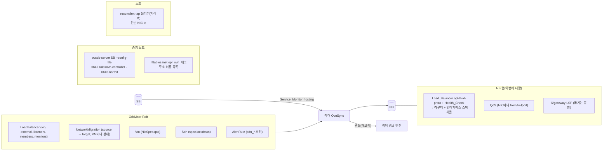

# SDN(OVN) 3 설계 — 부하 분산, QoS, 2.5D 네트워크 토폴로지, 단순 → SDN 옮기기 도구, OVN 접근 잠금, SDN 경보 (계획 67)

작성일: 2026-11-21
상위 문서: `2026-11-20-sdn-ovn-design.md`(계획 65~67 전체, §16의 계획 67 스케치), `2026-11-20-sdn-ovn-plan66-design.md`(계획 66, §16 나중 할 일, §18 스테이지 보고와 리뷰 두 번), `2026-11-18-dashboard-metrics-notifications-design.md`(계획 60 경보 엔진), `2026-11-18-folders-permissions-quotas-2fa-design.md`(계획 62 폴더·권한·할당량), `2026-11-18-ui-ux-redesign-design.md`(계획 61 화면 규칙), `2026-11-11-availability-scale-design.md`(계획 54 핫플러그)
기준 트리: 계획 66 끝(`0ee750b3`). 이 문서는 구현 전 설계다. 스테이지 보고는 구현하면서 덧붙인다. 계획 65 설계의 §16(계획 67 부분)과 계획 65·66 계획 문서의 "다음 계획으로 넘길 사항" 가운데 이 계획이 맡는 것을 이 문서가 대신한다.

## 1. 목적

계획 65·66으로 SDN 네트워크는 서브넷·IPAM·DHCP, 분산 라우터, 게이트웨이 HA, SNAT·유동 IP, IPv6, 보안 그룹까지 갖췄다. 남은 것은 "OpenStack OVN 기능처럼"(2026-11-11)의 **서비스와 운영**이다:

- **부하 분산(LB)**: OVN 내장 `Load_Balancer`로 VIP 하나를 VM NIC(또는 주소) 여럿에 L4로 나눈다. 건강 검사로 죽은 멤버를 빼고, 라우터 바깥의 유동 IP 범위에서 받은 **바깥 VIP**로 물리 망에도 연다. 에이전트·서비스 VM이 없다(Octavia OVN 공급자와 같은 자리).
- **QoS**: NIC마다 보내기·받기 속도 제한과 DSCP 표시. SDN NIC는 OVN `QoS` 행, 단순 NIC는 tap의 tc(속도만).
- **2.5D 네트워크 토폴로지**: 네트워크·라우터·게이트웨이·유동 IP·VM·LB를 한 그림으로. 진짜 3D(WebGL·three.js)가 아니라 **3D처럼 보이는 2D**(아이소메트릭 SVG) — 사용자가 계획 70 "3D 클러스터 보기"에 정한 모양(2026-11-20 "UI 3D까지는 필요 없고 3D같은 2D임")을 여기서 먼저 쓰고 그림 조각을 계획 70과 나눈다.
- **단순 → SDN 옮기기 도구**: 브리지·VLAN·VXLAN 네트워크의 VM NIC를 SDN 네트워크로 — 주소를 그대로 가져가고, VM마다 끈 채·다시 켜며·**라이브**(tap만 옮김)로, 옮기는 동안 두 쪽 L2를 잇는 임시 다리(OVN `l2gateway`), 미리 보기 계획, 되돌리기.
- **OVN 접근 잠금**: SB RBAC(`ovn-controller` 역할 — chassis는 자기 행만 쓴다), northd만 쓰는 특권 포트, 중앙·chassis의 **주소 허용 목록**(클러스터에서 지운 노드는 인증서가 살아 있어도 붙지 못한다), Raft 포트는 중앙끼리만.
- **SDN 경보**: 계획 60 경보 엔진에 SDN 조건 — 중앙 정족수 잃음·중앙 꺼짐, chassis 꺼짐, 게이트웨이 후보 없음, 게이트웨이 넘김(이벤트), 동기화 실패·멈춤, physnet 준비 안 됨, LB 멤버 죽음.
- 계획 66이 넘긴 것 가운데 다섯(§2): 여러 chassis 보안 그룹 시험, 라우터·유동 IP의 실시간 갱신(watch), 네트워크 주인의 라우터 떼기 웹 단추, VM 주인의 유동 IP 떼기, 네트워크 폴더 할당량 `networks`.

원칙(계획 65·66 그대로): 원하는 상태는 Raft에만 있고 리더 `OvnSync`가 NB에 옮겨 쓴다. API는 OVN을 부르지 않는다. **이 기능을 쓰지 않는 클러스터는 바이트까지 지금과 같다**(Raft JSON, NB 행, nftables 글, tap 명령, cloud-init 씨앗, OVN 단위 파일). svc01·svc02에는 OVN 꾸러미를 깔지 않는다.

| | Neutron + Octavia(OVN 공급자) | Neutron + Octavia(Amphora) | Proxmox VE 8 SDN | VMware NSX 4 / NSX ALB(Avi) | Orbivisor 계획 67 |
|---|---|---|---|---|---|
| LB 구현 | OVN `Load_Balancer`(흐름, 분산), 에이전트 없음 | 프로젝트마다 HAProxy 서비스 VM(액티브·스탠바이) | **없음**(사용자가 HAProxy VM을 직접) | NSX ALB: Service Engine VM(L4~L7, WAF, GSLB, 따로 라이선스). NSX 내장 LB는 4.x에서 사라지는 중 | OVN `Load_Balancer`(§7) — OVN 공급자와 같은 자리 |
| 계층 | L4(TCP·UDP·SCTP), 알고리즘 `SOURCE_IP_PORT`만 | L4·L7(HTTP 규칙, TLS 종료) | — | L4~L7 | L4(TCP·UDP), 해시 + 선택 출발지 고정(§7.1) |
| 건강 검사 | OVN 서비스 모니터(TCP SYN·UDP), 서브넷마다 `ovn-lb-hm` 포트 주소 | HAProxy 검사(HTTP 포함) | — | SE 검사(HTTP 포함) | OVN 서비스 모니터(§7.3), LB·멤버 네트워크마다 검사 주소 |
| 바깥 VIP | VIP 포트에 플로팅 IP(공급자가 LB VIP로 더함) | 플로팅 IP | — | VIP를 T1/T0에 광고 | 라우터 바깥의 유동 IP 범위에서 받은 **바깥 VIP**(§7.4) |
| QoS | QoS 정책: `bandwidth_limit`(보내기·받기), `dscp_marking`, `minimum_bandwidth` → OVN `QoS` | 같음 | NIC `rate`(MB/s, tc) — DSCP 없음 | vDS 트래픽 셰이핑(포트 그룹), NSX 세그먼트 QoS 프로필(CoS·DSCP·속도) | NIC `qos`(보내기·받기 Mbit/s·버스트·DSCP), SDN은 OVN `QoS`, 단순은 tc(DSCP 빼고, §8) |
| 토폴로지 화면 | Horizon "네트워크 토폴로지"(D3 그래프) | 같음 | SDN 트리만 | NSX 토폴로지 보기 | 2.5D 아이소메트릭 SVG(§12) |
| 옮기기 | 도구 없음(포트를 새로 만들어 붙임) | 같음 | VM NIC의 브리지(VNet) 바꾸기 — 실행 중이면 tap을 옮김 | NSX Migration Coordinator(VDS → NSX), 포트 그룹 바꾸기는 실행 중에도 | 미리 보기 계획 + 주소 옮기기 + 라이브 tap 옮기기 + `l2gateway` 다리 + 되돌리기(§9) |
| 제어 평면 보호 | OVN 문서의 SB RBAC(chassis 인증서 CN = chassis 이름) — 배포 도구마다 다름 | 같음 | 해당 없음 | NSX Manager 인증서·방화벽 | SB RBAC + northd 전용 포트 + 주소 허용 목록(§10) |
| 경보 | 없음(외부 감시) | 없음 | 없음 | NSX 알람(정족수·Edge·터널) | 계획 60 엔진의 SDN 조건 여덟(§11) |

## 2. 범위

| 계획 67에 넣는 것 | 넣지 않는 것 |
|---|---|
| `LoadBalancer` 리소스(네트워크 폴더): IPv4 VIP(라우터 인터페이스인 오버레이 네트워크), 리스너(TCP·UDP, 포트), 멤버(VM NIC 또는 주소, 포트), 건강 검사(TCP·UDP), 출발지 고정(`affinity_timeout`), 바깥 VIP(라우터 바깥의 유동 IP 범위) | L7(HTTP 규칙·TLS 종료·쿠키 고정), SCTP, IPv6 VIP, 라우터 없는 네트워크의 VIP, 공급자 네트워크에 VIP를 곧바로(§7.6), LB끼리 VIP 나누기, `Load_Balancer_Group` |
| NIC `qos`: 보내기·받기 속도(Mbit/s)·버스트·DSCP(SDN), 단순 NIC는 tap의 tc 속도(보내기·받기), 실행 중 바꾸기 | 최소 대역폭 보장(`minimum_bandwidth` — 스케줄러 자원 셈이 필요), 단순 NIC의 DSCP, 네트워크 기본 QoS·QoS 정책 리소스, 유동 IP QoS |
| 2.5D 네트워크 토폴로지(인프라 › 네트워크의 보기 — 사이드바 항목 없음), `GET /network-topology`, 아이소메트릭 그림 조각을 계획 70과 나눔 | 끌어 놓아 잇기(그림에서 라우터 인터페이스 만들기 따위), 노드·랙 배치(계획 70) |
| `NetworkMigration` 리소스와 `network-migrate` Task: 미리 보기 계획, 주소 옮기기(준 주소·게스트 에이전트·cloud-init 고정 주소), VM마다 끔·다시 켬·라이브, `l2gateway` 다리, 되돌리기, 끝내기(+ 라우터 붙이기) | VXLAN 장치 자체를 OVN으로 바꾸기, SDN → 단순 옮기기(되돌리기만), 공급자 네트워크 다리(같은 L2면 필요 없음 — §9.5) |
| OVN 잠금(`SdnSpec.lockdown`, `sdn lockdown on|off`, `sdn-lockdown` Task): SB 역할 포트(`role=ovn-controller`)·northd 전용 포트, 중앙·chassis의 nftables 주소 허용 목록, SB chassis 청소를 중앙 에이전트로 | NB RBAC(OVN에 없다), 클러스터 CA 바꾸기·인증서 폐기 목록(CRL — Orbivisor 전체 일), Geneve 암호화(IPsec), `Port_Binding` 가로채기 막기(OVN 24.03 RBAC가 허용 — §10.6) |
| SDN 경보 조건 여덟(리더가 평가), 화면의 "SDN 경보 켜기" 묶음 | 새 알림 통로(계획 60 SMTP·webhook 그대로) |
| 네트워크 폴더 할당량 `networks`·`load_balancers`(바깥 VIP는 `floating_ips`로도 셈), 권한(§13) | 할당량 `ips`(§13 — 고르지 않은 까닭) |
| GitHub `ovn` 작업에 실제 LB·건강 검사 넘김·QoS 측정(iperf3)·옮기기·잠금, `sdn-multinode`에 여러 chassis LB·보안 그룹·옮기기 다리·지운 노드 끊기·경보 | 실제 하드웨어 속도·물리 스위치의 DSCP 처리 |

**계획 66에서 넘어온 것 — 고른 것과 아닌 것:**

| 넘어온 것 | 결정 |
|---|---|
| 여러 chassis에 걸친 보안 그룹 시험(계획 66 §14 10번) | **넣음** — `sdn-multinode`(§14 시험과 CI) |
| 라우터·유동 IP의 실시간 갱신 | **넣음** — `WATCHABLE`에 `Router`·`FloatingIp`·`LoadBalancer`(보기의 OVN 상태는 따로 읽음), 웹의 10·30초 다시 읽기를 watch로 |
| 네트워크 주인의 라우터 떼기 웹 단추(`DELETE /networks/{key}/router`) | **넣음** — 네트워크 서랍 |
| 대상 VM의 `vm.config`만으로 유동 IP 떼기(권한을 거둔 뒤 남은 유동 IP) | **넣음** — `PATCH /floating-ips/{key} {target: null}`이 유동 IP의 `network.config` **또는** 대상 VM의 `vm.config`(떼기만) |
| Port_Group/ACL 실패 격리(계획 66 리뷰 1 M-2·M-3) | **경보로 보이기만** — `SdnSync.failed`(실패한 묶음 이름)와 `sdn_sync_failed` 경보(§11). 닫힌 쪽 실패(M-2)는 뜻이고, 좁히는 쓰기 실패(M-3)는 다시 하기가 고친다 — 둘 다 사람이 빨리 아는 것이 빠졌던 것 |
| 비 IP 프레임(계획 66 리뷰 1 M-1) | 넣지 않음 — 모든 목록 ACL이 바뀌고 같은 뜻 비교를 다시 해야 한다(§16) |
| 게이트웨이 표의 chassis 상태, "포트 바인딩 안 됨" 화면 경고, 웹 `--fill`, `vm get`의 NIC 유동 IP, SDN NIC 그룹 고르기의 기능 판정 | 넣지 않음(§16). chassis 상태는 `sdn_chassis_down` 경보와 토폴로지의 노드 표시가 대신한다 |
| `NetworkSheet.tsx` 리비전 충돌 주석(409 → 412) | 넣음(웹 스테이지의 한 줄) |

**기능 하나**(`opl_types::node`, `FEATURES` 끝): **`sdn-services`**(`SDN_SERVICES`) — 계획 65 설계가 이름을 미리 적어 둔 그대로. 가리는 것: `Kind::LoadBalancer`·`Kind::NetworkMigration`, `NicSpec.qos`, `SdnSpec.lockdown`, `AlertCondition`의 SDN 조건, `FolderQuota.networks`·`load_balancers`, `NodeStatus.qos`(§8.2), `GET /network-topology`(읽기라 막지 않음 — 옛 노드가 섞여도 된다). 모든 노드가 알릴 때만 쓰고 아니면 409 `cluster_upgrading`(`require_feature`, 검증보다 먼저). **나누지 않는 까닭**(`sdn-lb`·`sdn-qos`·`sdn-lockdown` 따위): 잠금은 중앙 에이전트가 단위 파일을 다시 쓰는 일이라 옛 에이전트가 하나라도 있으면 서로 되돌린다 — 모든 노드가 새 빌드여야 하는 조건은 셋 모두 같고, 따로 켤 까닭(부분 업그레이드)이 없다. 계획 66 `sdn-routing`과 같은 판단이다.

## 3. 지금 있는 것 (계획 66 끝)

- **타입**: `NetworkSpec { bridge, vlan, vxlan, sdn: Option<SdnNet { provider }>, mtu, subnets, folder }`, `Subnet { cidr, gateway, dhcp, dns_servers, pools, floating_pools, ipv6_mode, description }`, `NicSpec { network, model, mac, security_groups, ips }`(`deny_unknown_fields`), `Router`·`FloatingIp`(네트워크 폴더), `NodeSpec.sdn { physnets, gateway }`, `NodeSdn { chassis, …, central: CentralHealth { nb, sb, northd_active }, physnets, gateway }`, `SdnSpec {}`·`SdnStatus { phase, centrals, sync: SdnSync { term, index, at, error, nb_cfg, hv_cfg }, departed, … }`. `Kind::ALL` 36. 할당량 `FolderQuota { vcpus, memory_mib, disk_bytes, vms, dedicated_vcpus, routers, floating_ips }`. Raft 겹침 `ip`(VM·Router·FloatingIp 한 공간 — `SHARED_IP_KINDS`), `router-net`, `fip-nic`, `physnet`.
- **OvnSync**(`opl-api/src/ovn_sync/{mod,nb,acl}.rs`): `desired_all(networks, vms, nodes, routers, floating_ips, security_groups, tag)`, 묶음 차례 목록 Port_Group → 네트워크 → 라우터 → 지울 스위치 → 지울 라우터 → 지울 Port_Group → 지울 DHCP, 펜싱(토큰·`wait`·`nb_cfg`), 자식 행 주인 표시, `NodeInputs`·`VmInputs`. 리더가 SB에 쓰는 유일한 일은 지운 노드의 `Chassis`·`Chassis_Private` 지우기(`mod.rs` 4번). 가짜 NB(`opl-driver/src/ovn/fake_ovsdb.rs`)에 표 열여섯.
- **OVN 단위**(`opl-driver/src/ovn/units.rs`): `ovsdb-server … --remote=pssl:PORT:ADDR --remote=punix:…`(명령줄 — 역할을 줄 수 없다), northd는 모든 중앙의 `ssl:…:6641`·`:6642`. ovn-controller는 OVS `SSL` 표의 노드 인증서(CN = 노드 UUID = chassis 이름)로 `ssl:…:6642`. OVS·OVN 서버는 상대 인증서의 CA만 본다(이름은 보지 않음). 평문 없음, 로컬 `punix`는 root만.
- **경보(계획 60)**: `AlertRule { condition: AlertCondition(태그 kind, deny_unknown_fields), for_secs, severity, targets, repeat_secs, send_resolved, nodes, vms }`, `Evaluator::{Node, Leader}`(리더 평가는 `NodeOffline`·`BackupJobFailed` — 상태는 `AlertRule.status.active`), `SubjectKind::{Node, Vm, Pool, Task, BackupJob}`, 이벤트 조건(`is_event`). `opl-api/src/alerts/engine.rs`.
- **핫플러그(계획 54)**: `hotplug::Step::{RemoveNic, AddNic, …}`, 실행 중 NIC의 네트워크 바꾸기는 `DeviceError::Changed` → 409. tap 이름 `op<VM id 끝 10자리>n<번호>`, 단순 NIC는 Linux 브리지(`master`), SDN NIC는 `br-int`(`iface-id`), VXLAN·SDN의 virtio NIC는 QEMU `host_mtu`가 켤 때 고정.
- **게스트 에이전트(계획 59)**: `GuestInfo.interfaces[] { name, mac, addresses[{ip, prefix}] }`(부를 때 읽음).
- **웹**: 인프라 › 네트워크의 보기 네트워크 | 네트워크 폴더 | 라우터 | 유동 IP | SDN(`web/src/routing/*`, `web/src/sdn/*`), 그림은 `uplot`(차트)뿐 — 그래프·3D 의존성 없음.
- **CI**: `ovn`(러너 하나, OVN 24.03.8·OVS 3.3.x를 orbivisord가 apt로), `sdn-multinode`(한 러너의 privileged systemd 컨테이너 셋 = 진짜 chassis 셋·NB/SB Raft 셋, `ci/sdn-node/Dockerfile`, `opld/tests/sdn_multinode.rs`).

## 4. OVN에서 확인한 사실

OVN 24.03 판의 man 페이지(`ovn-nb(5)` **DB Schema 7.3.0**, `ovn-sb(5)` **20.33.0**, `ovn-northd(8)`, `ovn-architecture(7)` — ovn.org `dist-docs-branch-24.03`, OVN 24.03.10), `branch-24.03`의 `ovn-nb.ovsschema`(뿌리 여부·참조), `northd/{ovn-northd,en-global-config,lb}.c`, OVS `branch-3.3`의 `ovsdb-server(1)`을 2026-11-21에 받아 옮겼다. 러너는 OVN 24.03.8·OVS 3.3.x다(같은 스키마). "탐침"은 스테이지가 GitHub 러너에서 확인할 것이다.

- **`Load_Balancer`(뿌리)**: `name`, `vips`(`"VIP[:포트]"` → `"백엔드[:포트],…"`, 한 VIP의 백엔드는 같은 주소 체계), `protocol`(`tcp`·`udp`·`sctp`, 한 행에 하나 — 비면 tcp), `health_check`(`Load_Balancer_Health_Check` **강한** 참조, 그 표는 뿌리가 아님), `ip_port_mappings`, `selection_fields`(`ip_src` 따위 — 쓰면 `dp_hash` 대신 느린 `hash`), `options:affinity_timeout`(초, 최대 65535 — 같은 클라이언트를 같은 백엔드로), `options:reject`(살아 있는 백엔드가 없으면 TCP RST·ICMP 도달 불가), `options:hairpin_snat_ip`(기본은 VIP), `options:neighbor_responder`(`reachable` 기본 — LB를 붙인 라우터가 **라우터 서브넷 안의 VIP에 ARP·ND로 답함**), `options:add_route`, `options:ct_flush`(기본 거짓). `Logical_Switch.load_balancer`·`Logical_Router.load_balancer`는 **약한** 참조(LB 행이 뿌리라 혼자 산다).
- **스위치에 붙인 LB**: man은 "스위치에 붙이면 VIP는 그 스위치 서브넷과 **다른** 서브넷이어야 하고 클라이언트는 라우터 MAC으로 보낸다"고 적는다. 스위치 LB의 DNAT는 클라이언트 포트의 ingress(클라이언트 chassis — 분산)에서, 되돌리기는 그 포트 conntrack 영역에서 한다. 그래서 **VIP의 ARP를 라우터가 답하게**(LB를 라우터에도 붙여 `neighbor_responder=reachable`) 하면 같은 서브넷 클라이언트도 라우터 MAC으로 보내고 스위치 LB가 DNAT한다 — §7.2의 모양. **탐침**: DGP 없는 라우터에서도 VIP ARP 답이 나오는지, 같은 서브넷 클라이언트 → VIP → 같은 서브넷 백엔드(라우터를 지나 되돌아옴)가 되는지.
- **라우터에 붙인 LB**: DNAT 흐름은 "게이트웨이 라우터나 **게이트웨이 포트가 있는 라우터**에, **게이트웨이 chassis에서만**" 깔린다(`lr_in_dnat`, IPv6 VIP는 빠짐 — man). 바깥 VIP는 DGP의 게이트웨이 chassis에서 DNAT되는 **중앙** 처리다. `lb_force_snat_ip`는 쓰지 않는다(바깥 클라이언트 주소를 백엔드가 본다).
- **건강 검사**: `Load_Balancer_Health_Check { vip: "VIP:포트", options: interval·timeout·success_count·failure_count }`. northd는 `vips`의 백엔드마다 `ip_port_mappings["백엔드"] = "논리포트:검사출발주소"`가 있는 것만 검사하고(없는 백엔드는 늘 씀), SB `Service_Monitor { ip, protocol(tcp·udp), port, logical_port, src_mac, src_ip, chassis_name, status: online|offline|error }`를 만든다. 그 포트를 바인딩한 chassis의 ovn-controller가 TCP SYN(→ ACK면 online)·UDP(ICMP 오면 offline)를 보낸다. 흐름의 백엔드는 `online`이거나 상태가 빈 것만. **SB 문서는 `Service_Monitor.ip`가 IPv4만이라고 적는다**(northd 코드는 IPv6 꼴도 다루지만 문서를 따른다). **SCTP·템플릿 LB는 건강 검사가 없다**(northd 경고). 출발 MAC은 `NB_Global options:svc_monitor_mac` — **비어 있으면 northd가 무작위로 정해 적는다**(`en-global-config.c`) — OvnSync는 이 칸을 건드리지 않는다. northd는 검사 출발 주소에 대한 ARP를 그 MAC으로 답한다(`ls_in_arp_rsp`).
- **`QoS`(뿌리 아님 — `Logical_Switch.qos_rules`의 강한 참조)**: `priority`(0~32767, 높은 것 하나만 — 같으면 정해지지 않음), `direction`(`from-lport`·`to-lport`, `outport`는 to-lport에서만), `match`, `action { dscp: 0~63 | mark }`, `bandwidth { rate: kbps, burst: kbit }`(넘으면 버림 — 미터 폴리싱). 한 행에 DSCP와 속도를 함께 쓸 수 있다. NB `Meter`·`Meter_Band` 표는 ACL 기록·CoPP용이고 QoS 속도에는 쓰지 않는다. LSP `options:qos_max_rate`·`qos_burst`(bit/s, 셰이핑)는 쓰지 않는다(§15). **탐침**: 실제 iperf3 속도가 `rate`의 ±15% 안인지, 커널 데이터패스 미터가 러너·컨테이너에서 되는지.
- **`l2gateway` LSP**: "물리 망으로 가는 연결". `options:network_name`(그 chassis의 `ovn-bridge-mappings` 이름), `options:l2gateway-chassis`(**한 chassis에 묶임**), `tag`(VLAN). `localnet`과 달리 한 chassis만 물리 망에 붙어 고리가 생기지 않는다 — §9.5의 옮기기 다리.
- **`NB_Global options:ignore_lsp_down`**: 기본 참(바인딩 안 된 포트의 주소에도 ARP 답).
- **SB RBAC**(`ovn-architecture(7)` "Role-Based Access Controls", `ovn-northd.c`): northd가 `RBAC_Role "ovn-controller"`와 `RBAC_Permission`을 늘 맞춘다. 역할이 붙은 연결의 클라이언트 id는 **TLS 인증서 CN**이고, 24.03의 허용은 — `Chassis`(id = `name`, 넣기·지우기, `nb_cfg`·`external_ids`·`encaps`·`other_config`·`transport_zones` 바꾸기), `Chassis_Private`(id = `name`), `Encap`(id = `chassis_name`), `Service_Monitor`(id = `chassis_name`, `status`만), `IGMP_Group`·`BFD`(id = `chassis_name`), 그리고 **id 검사 없이** `Port_Binding`(`chassis`·`additional_chassis`·`up`·`options` 따위 — 행 넣기·지우기는 안 됨), `MAC_Binding`·`FDB`·`Controller_Event`. 읽기는 막지 않는다(RBAC는 바꾸기만). 역할은 **연결 방법(remote)마다** 붙는다: DB의 `Connection.role` 또는 OVS 3.3의 **`ovsdb-server --config-file`**의 `"remotes": {"pssl:6642:ADDR": {"role": "ovn-controller"}, …}`(OVS `branch-3.3` `ovsdb-server(1)` — `--remote`와 함께 쓸 수 없고, 바꾸면 `ovsdb-server/reload`). **탐침**: 러너 OVS 3.3.x의 `--config-file` 역할, 역할 포트에서 다른 chassis의 `Chassis` 행 바꾸기가 거절되는지, 건강 검사 `status` 쓰기가 역할 포트로 되는지.
- **ovsdb 클러스터와 northd**: 팔로어의 `punix` 소켓에는 leader-only 클라이언트(northd·`ovn-nbctl` 기본)가 붙지 못한다(계획 66 가이드) — 그래서 northd는 네트워크 포트로 모든 중앙에 붙어야 하고, 특권 SB 포트가 따로 필요하다(§10.2).
- **Geneve 수신**: OVN은 chassis마다 `remote_ip`를 정한 터널 포트를 만든다. SB `Encap`에 없는 주소에서 온 Geneve는 어느 터널 포트에도 맞지 않는다 — 지운 노드의 `Chassis`·`Encap`을 지우면(계획 65) 그 노드의 터널이 사라진다.

## 5. 전체 구조



- **LB·QoS**는 OvnSync의 새 행이다(네트워크·라우터 묶음 안). 단순 NIC의 tc는 노드 reconciler·드라이버(nftables 방화벽처럼 노드 일).
- **옮기기**는 Task(`network-migrate`)가 VM 스펙을 차례로 바꾸고, 라이브면 노드가 tap을 Linux 브리지에서 `br-int`로 옮긴다. 다리(`l2gateway`)는 OvnSync(NB)와 고른 노드의 `SdnAgent`(veth·매핑 — 계획 66 physnet 길)가 만든다.
- **잠금**은 중앙의 `SdnAgent`가 SB 단위·설정 파일을 바꾸고, 모든 노드의 `SdnAgent`가 nftables 허용 목록을 맞춘다. 리더 OvnSync는 이제 SB에 **쓰지 않는다**(chassis 청소를 중앙 에이전트가 로컬 소켓으로).
- **경보**는 리더가 Raft(노드 상태·`SdnStatus`·라우터)와 OvnSync가 차례마다 읽은 관찰(DGP `hosting-chassis`, `Service_Monitor`)로 평가한다.
- 누가 무엇을 쓰나: API는 Raft만, 리더 OvnSync만 NB, 중앙 에이전트만 SB(로컬 `punix`, chassis 청소), ovn-controller는 역할 포트로 자기 행만.

## 6. 타입 (opl-types)

모든 새 칸은 빈 값이면 쓰지 않는다(`skip_serializing_if`) — 이 계획의 기능을 쓰지 않는 Raft JSON은 바이트 그대로다(serde 하위 호환 시험).

- **`LoadBalancer = Resource<LoadBalancerSpec, LoadBalancerStatus>`**, `Kind::LoadBalancer`(`load-balancer`). `LoadBalancerSpec`(`deny_unknown_fields`):
  - `folder: Option<Uuid>`, `description: Option<String>`(200자).
  - `network: String` — VIP 네트워크(오버레이 SDN, IPv4 서브넷, **라우터 인터페이스** — 검사는 API).
  - `vip: Option<Ipv4Addr>` — API가 그 서브넷 `pools`에서 채운다(직접 주면 풀 안).
  - `external: Option<LbExternal { network: String, ip: Option<Ipv4Addr> }>` — 바깥 VIP. `network`는 VIP 네트워크 라우터의 바깥(공급자) 네트워크, `ip`는 API가 `floating_pools`(없으면 `pools`)에서(직접 주면 그 범위 안 — 밖은 루트 `cluster.admin`, 계획 66 리뷰 1 #2와 같다).
  - `listeners: Vec<LbListener>`(1~16): `LbListener { protocol: LbProtocol(tcp|udp), port: u16, members: Vec<LbMember>(0~64), health: Option<LbHealth> }`. 같은 `(protocol, port)` 두 번은 400.
  - `LbMember { vm: Option<Uuid>, mac: Option<MacAddr>, ip: Option<Ipv4Addr>, port: u16 }` — `(vm, mac)` 둘 다(NIC 멤버 — 주소는 OvnSync가 NIC의 IPv4에서) 또는 `ip` 하나(주소 멤버 — 건강 검사 없음). 리스너 안에서 같은 멤버 두 번은 400.
  - `LbHealth { interval_secs: u16 = 5, timeout_secs: u16 = 3, rise: u8 = 2, fall: u8 = 3 }`(1~300·1~interval·1~10·1~10) → `interval`·`timeout`·`success_count`·`failure_count`.
  - `affinity_secs: Option<u32>`(1~65535 → `options:affinity_timeout`).
  - `monitors: Vec<LbMonitor { network: String, ip: Ipv4Addr }>` — 건강 검사 출발 주소, **멤버 네트워크마다 하나**(API가 그 서브넷 풀에서 채움, 사용자가 주지 않음 — 라우터 `external.ips`와 같은 꼴). 건강 검사가 있는 NIC 멤버의 네트워크만.
  - `LoadBalancerStatus {}` — 멤버 건강·VIP 상태는 보기에서 읽는다(Raft에 쓰지 않음 — 계획 66 라우터 보기와 같은 까닭).
- **`NicSpec.qos: Option<NicQos>`**(`deny_unknown_fields`): `out_mbps: Option<u32>`(VM이 보냄, 1~100000), `in_mbps: Option<u32>`(VM이 받음), `burst_kbit: Option<u32>`(없으면 속도 kbit/s의 80% — Neutron 기본과 같다, 1~10⁷), `dscp: Option<u8>`(0~63, VM이 보내는 IP 패킷에 — SDN NIC만). 셋 다 없으면 400(빈 `qos`는 `None`으로). 보안 그룹처럼 NIC 칸이다(§15).
- **`NetworkMigration = Resource<NetworkMigrationSpec, NetworkMigrationStatus>`**, `Kind::NetworkMigration`(`network-migration`). `NetworkMigrationSpec { folder, source: String, target: String, vms: Vec<Uuid>(비면 그때 그 네트워크에 NIC가 있는 모든 VM), mode: MigrationMode(auto|offline|restart|live), addresses: Vec<MigrationAddress { vm, mac, ip: Vec<IpAddr> }>, bridge: Option<bool>(없으면 대상이 오버레이면 참), bridge_node: Option<Uuid>, allow_mtu_shrink: bool }`. `NetworkMigrationStatus { phase: Planned|Running|Paused|Moved|Finished|RollingBack|RolledBack|Failed, vms: Vec<VmMove>, bridge: Option<MigrationBridge { node, physnet }>, task: Option<Uuid>, error }`, `VmMove { vm, nic: usize, mac, mode(정한 것), ips, address_source: given|guest-agent|cloud-init|ipam, from: NicOrigin { network, security_groups, cloud_init: Option<CloudInitNet> }, state: Pending|Moving|Moved|Failed|RollingBack|RolledBack, error, at }`.
- **`SdnSpec.lockdown: bool`**(기본 거짓, 거짓이면 쓰지 않음 — `SdnSpec {}`이 `deny_unknown_fields`라 기능 게이트 뒤). `SdnStatus.lockdown: Option<LockdownState { applied: Vec<Uuid>(설정을 바꾼 중앙), pending: bool, error }>`. `SdnSync.failed: Vec<String>`(실패한 묶음 — `network tenant-a`, `port-group web,ssh` 따위, 비면 쓰지 않음).
- **노드 상태**: `NodeStatus.qos: bool`(tc가 있음 — macOS는 거짓, 거짓이면 쓰지 않음), `NodeSdn.lockdown: Option<LockdownNodeState { firewall: bool, allowed: usize, error }>`.
- **경보**: `AlertCondition`에 `SdnQuorumLost`·`SdnCentralDown`·`SdnChassisDown`·`SdnGatewayUnavailable`·`SdnGatewayFailover`(이벤트)·`SdnSyncFailed`·`SdnPhysnetNotReady`·`SdnLbMemberDown`(모두 `Evaluator::Leader`), `SubjectKind`에 `Sdn`·`Router`·`LoadBalancer`(§11).
- **`Kind::ALL` 36 → 38.** `FolderKind::of(LoadBalancer | NetworkMigration) = Network`, `member_kinds()`가 둘을 더한다.
- **할당량**: `FolderQuota.networks`·`load_balancers`(네트워크 폴더만), `QuotaDimension::{Networks, LoadBalancers}`, `FolderUsage`의 같은 칸. LB의 몫은 `load_balancers` 1 + 바깥 VIP가 있으면 `floating_ips` 1(`FolderUsage::of_network_member`가 둘을 낼 수 있게 바꿈).
- **Raft 겹침**: `ip`에 LB의 `vip`·`external.ip`·`monitors[].ip`(`SHARED_IP_KINDS`에 `LoadBalancer` — 넷), `lb-listener` `<VIP 네트워크>/<vip>/<proto>/<port>`(같은 VIP·포트), 옮기기의 `migration-source` `<source>`(한 네트워크에 옮기기 하나)·`migration-vm` `<vm id>`(끝나지 않은 옮기기만 — `Finished`·`RolledBack`이면 값을 내지 않음).
- **순수 함수**:
  - `lb::vips(spec, resolved_members) -> BTreeMap<String, String>`(`"VIP:포트"` → `"B:포트,…"`, 바깥 VIP 줄 포함), `lb::health_rows`·`ip_port_mappings(spec, nic_ports)`.
  - `qos::nic_rows(port, qos) -> Vec<QosRow>`(SDN), `qos::tc_commands(tap, qos, actual) -> Vec<Vec<String>>`(단순 — 읽은 상태에 맞춰 빠진 것만).
  - `migration::plan(input) -> MigrationPlan`(§9.2 — VM마다 방식·주소·막는 까닭·경고, 미리 보기와 Task가 같은 함수), `migration::address_for(nic, target_subnets, given, guest, cloud_init)`.
  - `sdn::migration_physnet(tag, migration) -> String`(`mig<h8>` — 계획 66 `valid_physnet`에 맞고 관리자 physnet과 겹치지 않게 `mig` 접두사를 관리자에게 막음).
  - `lockdown::allow_sets(nodes, sdn) -> AllowSets { members: Vec<IpAddr>, centrals: Vec<IpAddr>, encaps: Vec<IpAddr> }`.
  - `alert::sdn::evaluate(rule, inputs) -> Vec<(AlertSubject, bool)>`(§11).
- **권한**: 새 권한 비트 없음. `kind_privilege`: `LoadBalancer`·`NetworkMigration` 쓰기 `network.config`, 읽기 `system.read`.
- **serde 하위 호환 시험**: 옛 `NicSpec`·`SdnSpec`·`SdnStatus`·`SdnSync`·`NodeStatus`·`NodeSdn`·`FolderQuota`·`FolderUsage`·`AlertRule` JSON 바이트 그대로, 새 칸 왕복, `Kind` 문자열 둘, `SubjectKind` 셋.

## 7. 부하 분산

### 7.1 리소스

- 네트워크 폴더에 산다. `POST /load-balancers {name, labels?, spec}`, `PATCH /load-balancers/{key}`(보낸 칸만, `listeners`는 통째로, `If-Match`), 지우기는 언제든.
- **VIP 네트워크 규칙**: 오버레이 SDN, IPv4 서브넷이 있음, **어떤 라우터의 인터페이스**(§7.2의 까닭). 아니면 400 `lb_network_not_routed`. 라우터를 떼면(라우터 `PATCH`·`DELETE /networks/{key}/router`) 그 네트워크에 VIP가 있는 LB가 있으면 409 `lb_in_use`(유동 IP의 `fip_in_use`와 같은 꼴).
- **멤버 규칙**: NIC 멤버는 그 NIC의 네트워크가 **VIP 네트워크이거나 같은 라우터의 다른 인터페이스**이고 그 NIC에 IPv4가 있다. 주소 멤버는 그 라우터 인터페이스 서브넷 가운데 하나 안. 아니면 400 `lb_member_unreachable`(까닭). 붙은 뒤 깨지면(NIC를 뺌, VM을 지움) 멤버는 스펙에 남고 OvnSync가 빼며 보기가 `missing`(까닭)이다 — Octavia가 멤버를 `ERROR`로 두는 것과 같다(몰래 스펙을 바꾸지 않는다).
- **알고리즘**: OVN 기본(`dp_hash` — 5튜플 해시). 출발지 고정이 필요하면 `affinity_secs`. `selection_fields`는 쓰지 않는다(느린 `hash` — §4).
- **바깥 VIP**: `external`(§7.4).

### 7.2 NB 그리기

| Raft | NB |
|---|---|
| LB의 프로토콜 하나(tcp·udp) | `Load_Balancer` `opl-lb-<LB id>-<proto>`, `protocol`, `vips`(안 VIP와 바깥 VIP의 그 프로토콜 리스너마다 `"VIP:포트" = "백엔드:멤버포트,…"`), `options { affinity_timeout?, reject: "true" }`, `external_ids { orbivisor:cluster, orbivisor:id, orbivisor:name }` |
| 건강 검사가 있는 리스너 | `Load_Balancer_Health_Check { vip: "VIP:포트" }` — 안 VIP와 바깥 VIP에 하나씩(northd가 `vip` 글을 그대로 맞춤), 주인 표시 |
| 건강 검사가 있는 NIC 멤버 | `ip_port_mappings["멤버 IPv4"] = "<NIC LSP 이름>:<그 네트워크의 monitor 주소>"` |
| 붙이기 | VIP 네트워크 라우터의 `Logical_Router.load_balancer`와 **그 라우터의 모든 인터페이스 스위치**의 `Logical_Switch.load_balancer`(약한 참조 — 라우터·네트워크 묶음이 넣고 뺀다) |

- **왜 라우터에도 붙이나**: VIP는 VIP 네트워크 서브넷 안의 주소다. 스위치에만 붙이면 같은 서브넷 클라이언트가 VIP에 ARP를 보내도 답이 없다(§4 — man의 "다른 서브넷"). 라우터에 붙이면 `neighbor_responder=reachable`로 라우터가 VIP ARP에 **라우터 MAC**으로 답하고, 클라이언트 스위치의 LB가 클라이언트 chassis에서 DNAT한 뒤 라우터를 지나 백엔드로 간다(같은 서브넷 백엔드면 라우터가 같은 포트로 돌려보냄). 되돌리기는 클라이언트 포트 conntrack이 한다(egress가 클라이언트 chassis에서 돈다). 다른 인터페이스 네트워크의 클라이언트는 자기 스위치의 LB가 DNAT한다 — **안쪽 트래픽은 분산**이고 게이트웨이를 지나지 않는다. 이것이 Octavia OVN 공급자가 LB를 라우터와 그 모든 스위치에 붙이는 까닭과 같다. **탐침**(§4): DGP 없는 라우터의 VIP ARP, 같은 서브넷 되돌아옴. 막히면 대안(스테이지 2가 고름): VIP 네트워크에 VIP 자리 LSP(`opl-lbv-<id>`, `addresses = "<lb_vip_mac> <VIP>"`, 바인딩 없음 — Octavia의 VIP 포트, `ignore_lsp_down` 기본 참으로 ARP 답)를 두고 같은 서브넷 클라이언트가 되는지 본다. 둘 다 안 되면 "같은 서브넷 클라이언트는 VIP에 닿지 못함"을 한계로 적는다.
- **묶음**: LB 행은 뿌리라 **라우터 묶음**에서 넣고 바꾸고(같은 라우터의 붙이기와 한 트랜잭션), 지울 LB 묶음에서 지운다. 스위치의 `load_balancer` 약한 참조는 네트워크 묶음이 넣는다 — LB 행이 아직 없으면 그 `mutate`가 참조할 uuid가 없으므로 네트워크 묶음은 **이름으로 LB를 찾는 `wait` + 읽은 uuid**로 쓰고, 없으면 그 차례는 붙이지 않는다(다음 차례). 묶음 차례: 목록 Port_Group → **LB** → 네트워크 → 라우터 → 지울 것(LB를 먼저 만들어 같은 차례 안에 붙는다).
- 바뀐 것만 쓴다: `vips`·`ip_port_mappings`·`options`는 통째로 견주고, 건강 검사 행은 `vip`으로 짝짓는다. 멤버 NIC 주소가 바뀌면(드묾) 그 LB가 다시 쓰인다. **차례를 부르는 것**: `LoadBalancer` 쓰기·지우기, VM의 `VmInputs`(NIC 주소는 이미 들어 있음).
- **LB가 없는 클러스터·네트워크**: `desired`가 계획 66과 같은 행 — 계획 66 고정물에 연산 0개(시험).

### 7.3 건강 검사

- 출발 주소(`monitors`)는 **LB와 멤버 네트워크마다 하나**를 IPAM에서 잡는다(Raft `ip` — 다른 NIC·라우터·유동 IP와 겹치지 않음). 라우터 포트 주소를 쓰지 않는 까닭: northd가 검사 출발 주소에 `svc_monitor_mac`으로 ARP를 답하므로 라우터 포트와 다툰다(§4). 네트워크마다 하나를 여러 LB가 나눠 쓰는 길(Octavia의 `ovn-lb-hm` 포트)은 그 주소의 주인 리소스가 따로 있어야 해서 고르지 않았다 — LB 할당량이 주소 수도 묶는다. `/networks/{key}/ips`에 `kind: lb-vip`·`lb-monitor` 행으로 보인다.
- **보안 그룹**: 검사 패킷은 멤버 포트로 들어오는 보통 IP 패킷이라 멤버 NIC의 보안 그룹이 `in tcp <포트> <monitor 주소>`(또는 그 서브넷)를 허용해야 한다(Octavia와 같다). API는 만들기·바꾸기 때 멤버 NIC의 `nic_policy`(계획 66 순수 함수)로 "검사 주소 → 멤버 포트"와 "아무 주소 → 멤버 포트"(클라이언트)가 막히는지 셈해 경고 헤더를 단다(막지는 않음 — 일부러 닫아 둘 수 있다). 보기의 멤버 줄에도 같은 경고.
- **넘김**: 멤버가 `failure_count`번 실패하면 SB `Service_Monitor.status = offline` → northd가 그 백엔드를 흐름에서 뺀다(새 연결만 — 맺은 연결은 conntrack에 남아 그 멤버로 가다 끊긴다). `success_count`번 되면 다시 넣는다. 살아 있는 멤버가 없으면 `reject`로 RST·ICMP(조용히 버리지 않음 — 클라이언트가 빨리 안다). 기본값(5초·3번)이면 약 15초.
- **보기**: `GET /load-balancers/{key}`의 멤버마다 `health: online|offline|error|unchecked|missing`(SB `Service_Monitor`를 `ip·port·protocol·logical_port`로 짝지음 — API 노드가 역할 포트로 읽음, `?live=false`면 읽지 않음). UDP 검사는 "ICMP가 오지 않으면 online"이라 약하다(가이드).

### 7.4 바깥 VIP

- `external { network }`: VIP 네트워크의 라우터 바깥이 그 공급자 네트워크여야 한다(아니면 400 `lb_network_not_routed` "the router of … has no external on …"). 주소는 유동 IP 범위에서(§6). 같은 `Load_Balancer` 행의 `vips`에 바깥 VIP 줄이 더해진다(멤버 같음).
- 데이터 길: 물리 망 → DGP(게이트웨이 chassis, `HA_Chassis_Group` 주인) → **라우터 LB DNAT(게이트웨이 chassis에서만 — §4)** → 분산 라우팅으로 멤버 chassis → 멤버. 되돌아오는 길은 바깥으로 가므로 DGP로 보내져 같은 chassis에서 되돌린다. 바깥 클라이언트 주소가 그대로 멤버에 보인다(SNAT 없음 — `lb_force_snat_ip`를 쓰지 않음).
- **ARP·GARP**: 바깥 VIP는 DGP 서브넷 안이라 `neighbor_responder=reachable`로 게이트웨이 chassis가 답한다. 넘김 뒤 새 게이트웨이의 GARP에 바깥 VIP가 드는지 — **탐침**(`nat-addresses=router`는 NAT 주소만 알릴 수 있다). 들지 않으면 물리 망의 ARP 캐시가 만료될 때까지(보통 수십 초) 끊긴다 — 그때는 공급자 스위치의 짝 포트 `opl-rgw-<라우터 id>`의 `nat-addresses`를 `router` 대신 명시 목록(`"<라우터 MAC> <바깥 주소…> <바깥 VIP…> is_chassis_resident(\"cr-opl-gw-<라우터 id>\")"`)으로 써서 새 게이트웨이가 VIP도 GARP하게 한다(스테이지 2가 탐침으로 정함).
- 게이트웨이 후보가 없으면 DGP가 꺼져 있으므로(계획 66) 바깥 VIP도 닿지 않는다 — 보기 `external_state: unrouted {reason}`, 경보 `sdn_gateway_unavailable`.

### 7.5 다른 기능과

- **보안 그룹**: 클라이언트의 `from-lport` ACL은 DNAT **앞**(목적지 = VIP)을, 멤버의 `to-lport` ACL은 DNAT **뒤**(목적지 = 멤버, 출발지 = 클라이언트·바깥 주소)를 본다. `options:apply-after-lb`는 쓰지 않는다. 가이드 표.
- **유동 IP와 LB**: 같은 멤버 NIC에 유동 IP를 붙여도 된다(다른 주소).
- **라이브 마이그레이션·HA**: 멤버 포트를 따라 검사 chassis가 바뀐다(`Service_Monitor.chassis_name`을 northd가 고침). 맺은 연결의 conntrack은 옮겨지지 않는다(그 멤버 VM이 옮겨 가면 클라이언트 chassis의 DNAT 항목은 그대로라 이어짐 — 탐침에서 기록만).
- **복제·템플릿·가져오기·원격 복제**: LB는 따라가지 않는다(클러스터 자원, 멤버는 MAC으로 가리키고 복제본은 새 MAC).

### 7.6 넣지 않은 모양

- **공급자 네트워크에 VIP를 곧바로**: 공급자 스위치는 물리 망과 `localnet`으로 이어져 모든 physnet chassis가 같은 패킷을 받을 수 있다 — 스위치 LB가 여러 chassis에서 같은 연결을 DNAT하고 ARP 답의 주인이 없다. 바깥 VIP(라우터 경유, 게이트웨이 chassis 하나)가 그 자리다.
- **라우터 없는 네트워크의 VIP**: §7.2 — 같은 서브넷 클라이언트의 ARP 답이 없다. VIP 자리 포트 대안이 탐침으로 되면 스테이지 2가 이 제한을 풀 수 있다(§18).
- **IPv6 VIP**: SB `Service_Monitor`가 IPv4만이고 라우터 LB DNAT가 IPv6 VIP를 빼므로(§4) 건강 검사·바깥 VIP의 뜻이 갈린다. IPv4가 되면 나중.

## 8. QoS

### 8.1 SDN NIC — OVN `QoS`

- NIC마다 행 최대 둘(그 NIC 스위치의 `qos_rules`, 우선순위 2000 고정 — 포트마다 match가 달라 겹치지 않음, 주인 표시 `orbivisor:cluster`·`orbivisor:port`):

| 칸 | 행 |
|---|---|
| `out_mbps` 또는 `dscp` | `direction = from-lport`, `match = inport == "<LSP>"`(DSCP만이면 `inport == "<LSP>" && ip`), `bandwidth { rate: out_mbps × 1000, burst }`(있으면), `action { dscp }`(있으면) |
| `in_mbps` | `direction = to-lport`, `match = outport == "<LSP>"`, `bandwidth { rate: in_mbps × 1000, burst }` |

- 속도 제한은 **폴리싱**(넘으면 버림 — §4)이다. TCP는 버림을 보고 속도를 줄이므로 대개 제한 근처로 수렴하고, UDP는 넘는 만큼 잃는다(가이드). 버스트 기본 = 속도의 80%(kbit).
- 행은 그 네트워크 묶음(계획 65 — 포트와 한 트랜잭션)에서 쓴다. 포트를 지우면 같은 묶음이 행을 뺀다. QoS가 없는 NIC·클러스터는 행이 없다(계획 66 고정물 연산 0개).
- **공급자 NIC**도 같다(VM 포트의 ingress·egress 파이프라인). 유동 IP·LB 트래픽도 그 NIC 포트를 지나므로 함께 제한된다.

### 8.2 단순 NIC — tap의 tc

- **고른 것: 단순 NIC도 속도 제한을 받는다(DSCP는 SDN NIC만).** 까닭: Proxmox가 NIC `rate`(tc)를 주고, 옮기기 도구가 옮기기 전과 뒤의 같은 `qos` 칸이 같은 뜻이길 원한다(보안 그룹의 "같은 리소스·같은 뜻"과 같은 길). 단순 NIC의 DSCP는 tc `pedit`+`csum`이나 nftables bridge `ip dscp set`이 필요해 둘째 집행기를 하나 더 들이는 일이라 400 `qos_dscp_needs_sdn`.
- **명령**(드라이버 `opl-driver/src/net.rs`, 순수 `qos::tc_commands`): tap에 `tc qdisc replace dev T clsact` → VM 보냄(tap의 ingress) `tc filter replace dev T ingress pref 49152 matchall action police rate <out>mbit burst <b>k conform-exceed drop`, VM 받음(tap의 egress) `tc filter replace dev T egress pref 49152 matchall action police rate <in>mbit burst <b>k conform-exceed drop`. OVN과 같은 폴리싱이라 두 세계의 뜻이 같다. 우선순위 49152는 Orbivisor 것으로 보고 다른 필터는 건드리지 않는다. 칸이 빠지면 그 필터를, 둘 다 빠지면 `clsact`를 지운다(우리 필터만 있을 때).
- **언제**: tap을 만들 때(켜기·마이그레이션 받기·핫플러그 붙이기), 실행 중 `qos` 바꾸기(reconciler가 VM 스펙 변경을 보고 — 장치 변경이 아니라 계획 54 `Plan`의 바로 할 단계 `SetNicQos(index)`), 노드 재시작 뒤 다시 붙기(읽어 맞춤).
- **노드 능력**: `NodeStatus.qos`(`tc -V`가 있고 `clsact`를 만들 수 있음 — 검사 루프). macOS 노드는 거짓. 스케줄러·`vms.rs`가 단순 NIC에 `qos`가 있는 VM을 `qos`가 참인 노드에만(409 `qos_unsupported`, `firewall_unsupported`와 같은 꼴).
- **QoS 없는 VM의 tap 명령은 바이트 그대로**(시험).

### 8.3 바꾸기·옮기기·다른 기능

- 실행 중 바꾸기가 된다(SDN은 NB 한 차례, 단순은 tc 한 번). 감사 `vm nic-qos web 0 out=100 in=200 dscp=46`.
- 라이브 마이그레이션: SDN은 포트를 따라감(OVN), 단순은 받는 노드가 tap을 만들며 넣는다.
- 옮기기 도구(§9): `qos` 칸이 그대로 따라가고 DSCP가 있는 단순 NIC는 없다(400이었으므로).
- 템플릿·복제·가져오기·원격 복제: NIC 칸이라 따라간다.

## 9. 단순 → SDN 옮기기 도구

### 9.1 모양

`NetworkMigration` 리소스 하나가 "네트워크 S의 VM NIC들을 SDN 네트워크 T로"이고, `network-migrate` Task가 실행한다. 단계는 **계획 → 시작 → (VM마다 옮김) → 끝내기**, 언제든 **되돌리기**. 미리 보기(dry-run)는 리소스를 만들지 않고 같은 계획을 돌려준다.

- **원본 S**: 단순 네트워크(브리지·VLAN·VXLAN). **대상 T**: 서브넷이 있는 SDN 네트워크(오버레이 또는 공급자). 한 S에 진행 중인 옮기기 하나(Raft `migration-source`), 한 VM은 한 옮기기에만(`migration-vm`).
- 옮기는 것은 **NIC 스펙**(`network`, `ips`, cloud-init NIC 항목)뿐이다. MAC·모델·보안 그룹·`qos`는 그대로(보안 그룹은 계획 66의 같은 뜻으로 OVN ACL이 된다). 원본 네트워크는 지우지 않는다(끝낸 뒤 사용자가).

### 9.2 미리 보기 계획 (dry-run)

`POST /network-migrations?dry_run=true`(같은 본문) 또는 CLI `network migrate S --to T --dry-run`. 순수 `migration::plan`이 VM마다(그 S에 NIC가 있는 모든 VM 또는 `vms`) NIC마다 낸다:

| 칸 | 뜻 |
|---|---|
| `mode` | 정한 방식(§9.4): `offline`(꺼짐) · `live` · `restart` · `blocked` |
| `address` | 옮겨 갈 주소와 출처: `given`(사용자 `addresses`) → `guest-agent`(게스트 에이전트가 이 MAC에 보고한, T 서브넷 안의 주소) → `cloud-init`(이 NIC의 고정 주소) → `ipam`(T 풀의 새 주소 — 주소가 바뀜) |
| `blockers` | 템플릿 VM, VM 노드가 chassis가 아님, T 서브넷 밖·예약 주소, 다른 VM과 같은 주소(단순 네트워크에는 IPAM이 없어 겹칠 수 있다), Raft에 이미 있는 주소(`ip_in_use`), 같은 VM의 다른 NIC가 T에 이미 있음, 다른 옮기기 중, 실행 중인데 `mode: offline`을 줌, 권한 없음(§13) |
| `warnings` | 주소가 바뀜(`ipam`), MTU가 줄어듦(§9.4), 게스트 에이전트 없음(주소를 모름), 원본에 보안 그룹이 없음(SDN에서도 거르지 않음 — 같은 뜻), DHCP 다툼(§9.5), 예상 끊김(라이브 1초 안팎 · 다시 켬 = 끄기 + 켜기) |
| `bridge` | 다리가 필요한지와 고른 노드(§9.5) |

계획은 화면의 표·CLI 표가 되고, 막힌 VM은 시작해도 건너뛴다(다른 VM은 간다). 리소스를 만들 때 계획을 `status.vms`에 적고, Task가 VM마다 **그때 다시** 계획해(게스트 주소·전원이 바뀌었을 수 있음) 다르면 그 VM을 `failed`(까닭)로 둔다.

### 9.3 주소 옮기기

- 대상 서브넷이 원본 L2의 주소를 담아야 한다(보통 같은 CIDR로 T를 만든다 — 마법사가 원본 이름·CIDR을 채워 줌). T 서브넷의 `gateway`가 원본 망의 물리 라우터 주소와 같으면 다리 동안 그 라우터가 그대로 기본 경로다(§9.5). 그 주소는 늘 예약이라 VM에 가지 않는다.
- IPAM 쓰기는 계획 65의 `check_requested`·Raft `ip` 겹침 그대로(경합이면 그 VM만 실패).
- **cloud-init**: 원본 NIC에 cloud-init 고정 주소가 있으면 그 항목을 지운다(SDN NIC의 cloud-init 주소는 IPAM이 정함 — 계획 65 400 `cloud_init_sdn_nic`). 주소가 같으면 instance-id가 그대로라(계획 65: NIC 주소로만 셈) 게스트는 다시 적용하지 않고 지금 설정을 쓴다. 지운 항목은 `VmMove.from.cloud_init`에 두어 되돌리기가 되살린다.
- 주소를 모르고(`ipam`) 게스트가 고정 주소면 옮긴 뒤 포트 보안이 그 주소를 막는다 — 계획이 `warnings`로, 화면이 붉게 알린다. 그런 VM은 `--ip VM:NIC=A`로 주거나 게스트 에이전트를 켠 뒤 한다.

### 9.4 VM마다 방식

| 방식 | 언제(auto가 고름) | 하는 일 | 끊김 |
|---|---|---|---|
| `offline` | VM이 꺼짐 | 스펙만 바꾼다(리비전 확인 쓰기). | 없음 |
| `live` | 켜짐, VM 노드가 chassis, **게스트가 볼 MTU가 줄지 않음**(원본 MTU — 브리지면 브리지 MTU, VXLAN이면 `host_mtu` — ≤ T의 MTU) 또는 `allow_mtu_shrink`, 주소를 앎(`ipam`이 아님) | 스펙을 바꾸면 reconciler가 새 핫플러그 단계 `RelinkNic(index)`: tap을 Linux 브리지에서 떼고(`nomaster`) `br-int`에 `iface-id`·`orbivisor-cluster`로 붙이고 MTU를 맞춘 뒤 **`ovn-installed`를 기다린다**(10초, 계획 65 받기 기다림과 같은 함수). 그 다음 QMP `set_link` 끔 → 켬(게스트가 링크를 다시 보고 DHCP를 다시 묻게 — DHCP 게스트는 MTU 1442도 받음). QEMU 장치는 그대로다(게스트에 NIC 빠짐·꽂힘 없음). | 보통 1초 안 |
| `restart` | 켜짐, `live`가 안 됨 | 게스트 끄기(ACPI, VM의 `acpi_timeout`) → 스펙 바꾸기 → 켜기. `host_mtu`가 새 MTU로 켜진다. | 끄기 + 켜기 |
| `blocked` | 막는 까닭이 있음 | 건너뜀 | — |

- `mode`를 주면 그 방식만 쓴다(`live`인데 안 되면 그 VM은 `blocked` — 몰래 다시 켜지 않는다). `auto`가 기본이다.
- **`RelinkNic`**: 지금 계획 54의 NIC 바꾸기 금지(`DeviceError::Changed`)에서 한 경우만 연다 — **같은 순번 NIC의 `network`만 바뀌고 MAC·모델이 같으며 두 네트워크가 단순·SDN 사이**(되돌리기 SDN → 단순 포함). 그 밖의 네트워크 바꾸기는 여전히 409다(VMware의 "포트 그룹 바꾸기"를 일반으로 여는 일은 나중 — §16). API는 실행 중 VM의 이 변경을 **옮기기 Task만** 하게 한다(일반 `PUT`은 409 `nic_network_live` "use network migrate").
- **실패하면 그 VM만 되돌린다**: `ovn-installed`가 오지 않으면 노드가 tap을 원래 브리지로 돌리고 Task가 스펙을 되돌린다(`VmMove.state = failed`). `restart`의 켜기 실패는 스펙을 되돌리고 원본에서 다시 켠다.
- **동시성**: 기본 한 번에 VM 하나(`parallel`, 1~8). VM마다 상태를 `status.vms`에 적어 리더가 바뀌거나 Task가 죽어도 이어서 한다(`Moving`인 VM은 실제 스펙·tap을 보고 마저 하거나 되돌림). `pause`는 지금 VM이 끝난 뒤 멈춘다.

### 9.5 옮기는 동안의 L2 다리 (`l2gateway`)

VM을 하나씩 옮기면 옮긴 VM과 남은 VM이 서로 다른 L2에 있게 된다(같은 서브넷인데 닿지 않음). 대상이 **오버레이**면 Task가 첫 VM 앞에 다리를 놓는다:

- **NB**: T 스위치에 `l2gateway` LSP `opl-l2gw-<옮기기 id>`(`addresses = ["unknown"]`, `options { network_name: mig<h8>, l2gateway-chassis: <다리 노드 UUID> }`, 원본이 VLAN이면 `tag`). OVN은 모르는 MAC을 이 포트로 보내고, 물리 쪽에서 온 프레임은 아는 VIF MAC으로 보낸다(§4). 한 chassis에만 묶여 고리가 없다.
- **다리 노드**: 원본 브리지가 있는 chassis(`NodeStatus.bridges`에 그 브리지 — VXLAN이면 `oplv<vni>`, 브리지면 그 이름) 가운데 옮길 VM이 가장 많은 노드, 또는 `bridge_node`. 그 노드의 `SdnAgent`가 계획 66 physnet 길 그대로 veth(`oplp<h8>{o,b}`)·OVS 브리지(`oplp<h8>x`)·`ovn-bridge-mappings`의 `mig<h8>:oplp<h8>x`를 만든다 — 원본은 `NodeSpec.sdn`이 아니라 **진행 중인 `NetworkMigration`**이다(관리자 설정을 건드리지 않음). VLAN 인식 브리지는 계획 66처럼 트렁크.
- **DHCP `router`**: 다리가 있는 동안 T의 IPv4 서브넷은 **공급자 네트워크처럼** DHCP `router` = 서브넷 게이트웨이(원본 망의 물리 라우터)를 준다 — 옮긴 DHCP 게스트가 임대 갱신에서 기본 경로를 잃지 않게(계획 66은 라우터 없는 오버레이에 `router`를 주지 않는다). cloud-init 고정 주소 게스트는 원래 설정 그대로다.
- **라우터 붙이기 막기**: 다리 동안 T를 라우터 인터페이스로 붙이면 라우터 포트가 서브넷 게이트웨이 주소를 가져 물리 라우터와 다툰다 — 409 `network_migrating`. 끝내기가 라우터를 함께 붙인다(§9.7).
- **DHCP 다툼**: 원본 망에 DHCP 서버가 있으면 그 응답도 다리를 건너 옮긴 VM에 온다. OVN DHCP가 같은 chassis에서 먼저 답하므로 보통 OVN 것을 받지만, 다른 주소를 받으면 포트 보안이 막는다 — 계획 `warnings`와 가이드("원본 DHCP 서버에 같은 주소로 예약하거나 옮기기 동안 끄기").
- **대상이 공급자 네트워크**이고 원본과 같은 L2(같은 physnet 브리지·VLAN)면 다리를 놓지 않는다(놓으면 고리). 다른 L2면 다리를 놓지 않고 경고("옮긴 VM과 남은 VM이 서로 닿지 않음").
- **한계**: 다리 노드 하나가 지나는 길이다(넘김 없음 — 그 노드가 죽으면 다리가 끊기고 경보 `sdn_physnet_not_ready`가 `mig…`로 뜬다). 다리 동안 남은 VM ↔ 옮긴 VM 트래픽은 다리 노드를 지난다.

### 9.6 되돌리기

- `POST /network-migrations/{key}/rollback {vms?}`: `Moved`·`Failed`인 VM을 거꾸로(SDN → 원본) 옮긴다. 방식은 그 VM이 지금 켜졌으면 `live`(원본 브리지로 tap을 되돌림 — MTU가 줄지 않으면, 아니면 `restart`), 꺼졌으면 `offline`. `from`의 네트워크·보안 그룹·cloud-init 항목을 되살리고 IPAM 주소를 놓는다(Raft `ip` 겹침이 풀림).
- 원본 네트워크가 지워졌으면 400(되돌릴 곳 없음). 다리는 마지막 VM이 돌아간 뒤 걷는다. 모두 되돌리면 `RolledBack`.
- `Finished` 뒤에는 되돌리기가 없다(그 뒤로는 VM 편집·새 옮기기가 할 일).

### 9.7 끝내기

- `POST /network-migrations/{key}/finish {router?}`: 다리를 걷고(NB `l2gateway` 행 → 노드 매핑·veth), `router`가 있으면 같은 Task가 곧바로 T를 그 라우터 인터페이스로 붙인다(물리 라우터에서 OVN 라우터로 기본 경로 넘김 — DHCP 게스트는 다음 갱신, 고정 주소 게스트는 게이트웨이가 같은 주소라 바로). 원본에 아직 NIC가 남은 VM이 있으면 경고만.
- `Finished`가 된 리소스는 기록으로 남는다(`network-migration list`). 지우기는 언제든(진행 중이면 먼저 `pause`).

## 10. OVN 접근 잠금

### 10.1 무엇을 막나

계획 65는 "클러스터 CA mTLS"였다: 이 클러스터 노드 인증서가 있으면 NB·SB·Raft 포트에 붙어 **무엇이든** 쓸 수 있다. 남은 위험은 셋이다.

1. **chassis 하나가 망가지면** 다른 chassis의 SB 행(터널 주소, chassis 정보)을 바꿔 망을 흔든다 — SB RBAC가 막는 것.
2. **클러스터에서 지운 노드**는 인증서가 여전히 CA로 맞아 NB·SB에 붙는다(계획 65 경미 지적) — Orbivisor에는 인증서 폐기 목록이 없다.
3. NB·Raft 포트가 모든 노드에 열려 있다 — 중앙끼리만 쓰는 Raft 포트와 northd만 쓰는 쓰기 길을 좁힐 수 있다.

**막지 않는 것**: 지금 클러스터의 **멤버 노드**가 NB를 쓰는 것(OvnSync는 어느 노드든 리더가 되면 NB를 쓴다 — 멤버 노드는 이미 Orbivisor Raft를 쓸 수 있으므로 같은 믿음), OVN 24.03 RBAC가 id 검사 없이 허용하는 `Port_Binding`·`MAC_Binding`·`FDB` 쓰기(§10.6).

### 10.2 SB 역할 포트와 northd 전용 포트

- SB `ovsdb-server`를 명령줄 `--remote` 대신 **`--config-file=/etc/opl/ovn/sb.json`**(Orbivisor가 쓰는 파일, 0600)로 띄운다:

```json
{"remotes": {
   "pssl:6642:<노드 주소>": {"role": "ovn-controller"},
   "pssl:6645:<노드 주소>": {},
   "punix:/run/opl/ovn/sb.sock": {}},
 "databases": {"/var/lib/opl/ovn/sb.db": {}}}
```

- **6642(역할 포트)**: ovn-controller(모든 chassis)와 **읽기만 하는 클라이언트**(OvnSync의 바인딩·`Service_Monitor` 읽기, API 보기). 클라이언트 id = 인증서 CN = 노드 UUID = chassis 이름(계획 65 그대로) — chassis는 **자기 `Chassis`·`Encap`·`Chassis_Private`·`Service_Monitor` 상태만** 쓴다.
- **6645(특권 포트, 새 `SB_ADMIN_PORT`)**: northd만. northd 단위의 `--ovnsb-db`가 모든 중앙의 `ssl:…:6645`로 바뀐다. 이 포트는 §10.3 허용 목록이 **중앙 주소만** 받는다.
- **`punix`**: 중앙 노드의 root(에이전트·문제 풀기).
- **SB에 쓰는 Orbivisor 일 옮기기**: 리더 OvnSync의 "지운 노드의 `Chassis`·`Chassis_Private` 지우기"(계획 65 `mod.rs` 4번)는 역할 포트에서 거절된다(id가 다름). 그래서 **중앙 노드의 `SdnAgent`**가 로컬 `punix`(특권)로 한다: 자기 SB 서버가 Raft 리더일 때만(`cluster/status`), Raft 노드 목록에 없는 노드 UUID의 행을 지운다(지우는 쿼리는 이름 조건이라 두 중앙이 겹쳐도 해가 없다). leader-only가 아닌 직접 트랜잭션이라 팔로어 소켓 문제(§4)가 없다 — 리더 판단은 청소를 한 곳에서 하려는 것뿐이다. 이 옮김은 잠금과 상관없이 기능이 켜지면 늘 한다(길이 둘이면 둘 다 시험해야 함). OvnSync는 이제 SB에 쓰지 않는다.
- NB는 그대로 `--remote`(NB에는 RBAC가 없다 — §4). NB·SB 단위 파일은 잠금이 꺼져 있으면 **바이트 그대로**다(잠금을 켜야 SB 단위·`sb.json`·northd 원격이 바뀜 — 시험).

### 10.3 주소 허용 목록 (nftables)

- 잠금이 켜지면 모든 chassis·중앙 노드의 `SdnAgent`가 nftables 표 **`inet opl_ovn_<태그>`**(입력 훅, 우선순위 `filter - 10`, 정책 accept — 우리 포트만 거름)를 맞춘다:

| 노드 | 포트 | 받는 출발 주소 |
|---|---|---|
| 중앙 | TCP 6641(NB)·6642(SB 역할) | **멤버 집합**: Raft 노드 가운데 위트니스·macOS가 아닌 노드의 클러스터 주소와 underlay 주소(`NodeStatus.underlay` — 다중 홈 노드가 다른 주소로 나갈 수 있음) |
| 중앙 | TCP 6643·6644(Raft)·6645(SB 특권) | **중앙 집합**: `SdnStatus.centrals[].address`(+ 그 노드들의 underlay) |
| chassis | UDP 6081(Geneve) | 멤버 집합의 `encap` 주소(`NodeSdn.encap_ip`) |

  그 밖의 출발 주소에서 이 포트로 오는 것은 `drop`(맺은 연결도 — 우리 표의 `drop`은 다른 표의 `accept`와 상관없이 끝이다). 집합은 nftables `set`(`ipv4_addr`·`ipv6_addr`)이라 노드가 바뀌면 원소만 바꾼다(규칙 글은 그대로).
- **지운 노드**: 노드가 Raft에서 빠지면 1초 안(`Node` watch) 모든 에이전트가 집합에서 그 주소를 뺀다 → 그 노드의 NB·SB 연결은 다음 패킷부터 버려지고 ovsdb의 비활성 탐침(기본 5초)으로 닫힌다. 다시 붙지 못한다. 그 노드의 `Chassis`·`Encap`은 중앙 에이전트가 지워(§10.2) 다른 chassis의 터널도 사라진다(§4 Geneve 수신). **인증서는 여전히 CA로 맞지만 쓸 길이 없다** — 같은 주소를 다시 쓰는 다른 기계는 Orbivisor 노드로 합류해야 집합에 든다.
- **잠기지 않게**: 표는 위 포트만 보고 SSH·Orbivisor API·gRPC는 건드리지 않는다. 노드 자기 주소·루프백은 늘 받는다. 집합을 읽지 못하면(Raft 읽기 실패) 표를 바꾸지 않는다(마지막 것 유지 — 비우지 않음).
- 이 표는 계획 26 방화벽(`bridge opl_<태그>`, VM 트래픽)과 다른 표·다른 계열이다.

### 10.4 켜고 끄기 (`sdn-lockdown` Task)

- `sdn lockdown on|off`(`POST /sdn/lockdown {enabled}`, 루트 `cluster.admin`, `require_feature(SDN_SERVICES)`) → `SdnSpec.lockdown`을 쓰고 `sdn-lockdown` Task(중앙 Task와 같은 `SdnStatus.pending` 자리 — 중앙 더하기·빼기와 동시에 돌지 않음)가 **중앙을 하나씩** 바꾼다: (1) 다른 중앙의 NB·SB가 정족수를 가졌는지(`cluster/status`) 본 뒤, (2) 그 노드의 `sb.json`·SB 단위·northd 단위를 쓰고 SB를 다시 띄움(Raft 멤버 하나가 잠깐 빠짐 — 정족수 유지), (3) 다시 따라잡을 때까지 기다림, (4) `SdnStatus.lockdown.applied`에 그 중앙. 모든 중앙이 끝나면 각 노드 에이전트가 nftables 표를 맞춘다(그 전에 걸면 바뀌지 않은 northd가 6645에 붙지 못하는 순간이 없게 — 차례: 포트 열기 → northd 옮기기 → 거르기).
- **미리 확인**(`POST /sdn/lockdown?dry_run=true`, CLI `--dry-run`): 허용 집합과, 지금 중앙 6641·6642에 붙어 있는 상대 주소(`ss -tn state established '( sport = :6641 or sport = :6642 )'` — 중앙 에이전트가 읽어 보고) 가운데 집합 밖인 것을 보인다(NAT·다른 출발 주소로 붙은 노드를 미리 찾음). 집합 밖에 멤버 노드가 있으면 경고와 함께 막는다(`--force`로만).
- **새 클러스터**: `sdn init`은 잠금을 켠 채로 세운다(`SdnSpec.lockdown = true`, 첫 중앙부터 `sb.json`). 계획 65·66으로 세운 클러스터는 관리자가 켤 때까지 그대로다(업그레이드가 OVN 단위를 바꾸지 않는다).
- **끄기**는 거꾸로(거르기 걷기 → 중앙마다 명령줄 `--remote`로 되돌림).
- 중앙 더하기(`sdn-central-add`)는 잠금 상태를 따른다. 잠금 중 더한 중앙의 주소는 Task가 집합에 넣은 **뒤** `join-cluster`한다.

### 10.5 보기

- `GET /sdn`의 `lockdown { enabled, applied: [중앙], pending, error, allowed: {members, centrals}, nodes: [{node, firewall, error}] }`, `sdn status`의 한 줄 "lockdown: on (3/3 centrals, firewall on 5/5 nodes)".
- 경보: 잠금이 켜졌는데 어떤 노드의 표가 맞지 않으면(`NodeSdn.lockdown.firewall = false`) `sdn_sync_failed`의 한 까닭으로 보인다.

### 10.6 남는 것

- **`Port_Binding`·`MAC_Binding`·`FDB`는 id 검사가 없다**(OVN 24.03 northd — §4): 망가진 chassis가 남의 포트를 자기 것으로 바인딩할 수 있다. OVN이 막지 않는 것이라 Orbivisor도 막지 못한다(가이드에 적음). 탐지는 `network ips`의 NODE가 VM 노드와 다른 것으로 보인다 — 나중에 OvnSync가 견주어 경보로(§16).
- NB를 쓰는 것은 여전히 모든 멤버 노드다. 클러스터 CA 바꾸기·인증서 폐기는 Orbivisor 전체 보안 일이다(§16).
- Geneve는 암호화하지 않는다(IPsec은 나중).

## 11. SDN 경보

계획 60 엔진에 조건을 더한다. 모두 **리더가 평가**하고(`Evaluator::Leader`, 상태는 `AlertRule.status.active`), `for_secs`·`repeat_secs`·`send_resolved`·`severity`·`targets`는 지금 그대로다. 입력은 Raft(노드 상태·`SdnStatus`·라우터·LB)와 리더 OvnSync가 차례마다 읽어 메모리에 두는 **관찰**(`SdnObservations { hosting: 라우터 → chassis, monitors: LB 멤버 → 상태, at }` — 같은 프로세스라 Raft에 쓰지 않음).

| 조건(`kind`) | 대상 | 참일 때 | 입력 |
|---|---|---|---|
| `sdn_quorum_lost` | `sdn` | NB 또는 SB에서 리더를 알리는 중앙이 없거나, `leader`·`follower`인 중앙이 과반 미만(오프라인 노드의 보고는 `down`으로 셈) | `NodeSdn.central`, 노드 `online` |
| `sdn_central_down` | 노드 | 중앙 노드의 NB·SB 중 하나가 `down`·`candidate`이거나 노드가 오프라인 | 같음 |
| `sdn_chassis_down` | 노드 | chassis로 구성된 온라인 노드의 `NodeSdn.chassis`가 `down`·`configuring` | `NodeSdn.chassis` |
| `sdn_gateway_unavailable` | 라우터 | 바깥이 있는데 게이트웨이 후보가 없음(계획 66 `gateway_error`), 또는 모든 후보가 오프라인 | Raft(`gateway_ranking` 입력) |
| `sdn_gateway_failover` | 라우터 | (이벤트) 관찰한 DGP `hosting-chassis`가 바뀜 — 문구에 옛·새 노드 | 관찰(리더가 바뀌면 첫 관찰은 견주지 않음) |
| `sdn_sync_failed` | `sdn` | `SdnSync.error`가 있음, 또는 `Ready`인데 `sync.at`이 300초 넘게 낡음(펜싱으로 멈춤 포함), 또는 잠금 표가 맞지 않는 노드가 있음 — 문구에 `SdnSync.failed`(실패한 묶음: 계획 66 M-2·M-3을 여기서 안다) | `SdnStatus` |
| `sdn_physnet_not_ready` | 노드 | 설정한 physnet(옮기기 다리 `mig…` 포함)이 `ready: false` — 문구에 까닭 | `NodeSdn.physnets` |
| `sdn_lb_member_down` | LB | 건강 검사 멤버 가운데 `offline`·`error`가 있음(멤버마다가 아니라 LB마다 하나 — 문구에 멤버 목록) | 관찰 |

- 대상 종류 `SubjectKind::{Sdn, Router, LoadBalancer}`(`Sdn`의 id는 `Sdn` 리소스 id). 규칙의 `nodes` 거르기는 노드 대상 조건에만 쓰인다(`vms`는 400 — 지금 `VmsFilter` 규칙과 같다).
- SDN이 설정 전이면 모든 조건이 거짓이다(경보 없음). 리더가 바뀌면 관찰 기반 조건(`gateway_failover`·`lb_member_down`)은 첫 OvnSync 차례까지 평가하지 않는다(거짓으로 해제하지 않음 — 지금 `NodeOffline`의 리더 바뀜 다루기와 같은 꼴).
- **"SDN 경보 켜기"**(웹·CLI `alert rule add-sdn-defaults --target T`): 권하는 묶음을 한 번에 만든다 — `sdn_quorum_lost` critical 0초, `sdn_central_down`·`sdn_chassis_down` warning 60초, `sdn_gateway_unavailable` critical 30초, `sdn_gateway_failover` info, `sdn_sync_failed` warning 120초, `sdn_physnet_not_ready` warning 60초, `sdn_lb_member_down` warning 30초. 만든 뒤는 보통 규칙이다.

## 12. 2.5D 네트워크 토폴로지

### 12.1 자리와 모양

- **인프라 › 네트워크**의 보기에 **"토폴로지"**를 더한다(네트워크 | 네트워크 폴더 | 라우터 | 유동 IP | 부하 분산 | 토폴로지 | SDN — 사이드바 항목 없음, 계획 61). 경로 `/networks/topology`, **늦게 읽는 조각**(lazy route chunk) — 첫 화면 번들에 그림 코드가 실리지 않는다.
- **진짜 3D가 아니다**: WebGL·three.js·react-three-fiber·캔버스 그래프 라이브러리를 쓰지 않는다. **SVG 하나 + 아이소메트릭 투영**(`iso(x, y, z) = ((x − y)·cos 30°, (x + y)·sin 30° − z)`), 면마다 세 단계 밝기(위·왼·오른)와 CSS 그림자·그라디언트로 깊이를 낸다. 그림 조각(`IsoSlab`·`IsoBlock`·`IsoPrism`·`IsoLink`, 투영·깊이 정렬)은 `web/src/components/iso/`에 두어 **계획 70 "3D처럼 보이는 2D 클러스터 보기"가 그대로 쓴다**.
- **층**(z 높이):

| 층 | 무엇 | 모양 |
|---|---|---|
| 바닥(z=0) | 오버레이 SDN 네트워크 | 얇은 판(slab), 이름·CIDR 글, 폴더 색 띠. 같은 라우터의 네트워크는 나란히 |
| 판 위 | VM | 작은 블록(전원 색: 켜짐·꺼짐·실패), 판마다 격자로 쌓음. 30개를 넘으면 "+N" 블록 하나(누르면 서랍의 목록) |
| 판 위 | LB | 육각 기둥(VIP 글), 멤버 VM으로 점선 — 멤버 건강 색(살아 있음·죽음·검사 없음) |
| 가운데(z=높이) | 라우터 | 큰 블록, 인터페이스 네트워크 판으로 기둥선, 위에 게이트웨이 칩(활성 노드 이름, 후보 없음이면 경고 색) |
| 뒤 위(먼 y) | 공급자 네트워크 | 긴 판("물리 망" 표시, physnet·VLAN), 라우터의 바깥 포트에서 선 |
| 공급자 판 위 | 유동 IP·바깥 VIP | 꼬리표(tag) 모양, 대상 VM·LB로 가는 휜 선(분산이면 실선, 중앙이면 게이트웨이를 지나는 점선) |
| 옆 따로 | 단순 네트워크 | 회색 판(브리지·VLAN·VXLAN), VM 블록. 옮기기 중이면 대상 판으로 화살표와 진행 수 |

- **배치**는 순수 함수 `layoutTopology(graph, opts) → Scene { items, links, bounds }`(vitest): 라우터를 x축에 늘어놓고 그 인터페이스 네트워크를 라우터 아래 y로 펼치며, 라우터 없는 오버레이·단순 네트워크는 뒤 열에 둔다. 같은 입력이면 같은 그림(이름 순 — 새로 고칠 때 흔들리지 않음). 그리기는 깊이 순(x + y, z)으로 SVG 원소 순서를 정한다(z-index 없음).
- **크기**: 네트워크 200·라우터 50·VM 2000(접힘 포함)에서 배치 50 ms 안·SVG 원소 5000 안(시험 기록). 넘으면 폴더 거르기를 권하는 띠.

### 12.2 다루기

- **누르기**: 원소마다 지금 있는 서랍을 연다(네트워크 서랍·라우터 서랍·유동 IP 줄·LB 서랍·VM 상세 링크). 겹친 것은 위의 것.
- **가리키기·초점**: 그 원소와 이어진 길(VM → 네트워크 → 라우터 → 공급자, LB → 멤버)을 밝히고 나머지를 흐리게.
- **키보드**: 원소마다 `<g role="button" tabindex>`와 `aria-label`("라우터 r1, 인터페이스 2개, 활성 게이트웨이 n2"), 화살표가 이웃 원소로(층 안 왼오른, 층 사이 위아래), Enter가 서랍. 같은 정보를 **"목록으로 보기"** 전환(트리 목록 — 화면 읽기 프로그램과 인쇄용)이 준다.
- **보기 움직이기**: 끌어 옮기기, Ctrl+휠·두 손가락 확대, 단추(+, −, 맞추기). `viewBox`만 바꾼다. `prefers-reduced-motion`이면 움직임 없음.
- **거르기**: 네트워크 폴더(하위 포함), "단순 네트워크 감추기", "VM 감추기"(큰 클러스터).
- **휴대폰**: 폭에 맞추고 끌어 옮기기, 서랍은 아래에서. 16px 여백, 가로 스크롤 없음(계획 61).
- **테마**: 색은 지금 디자인 토큰(밝음·어둠), 면 밝기는 토큰에서 셈.

### 12.3 자료

- **`GET /network-topology?folder=&live=true`**: `{ networks[{id, name, kind: bridge|vlan|vxlan|sdn|provider, folder, cidrs, mtu, physnet?, migration?}], routers[{id, name, folder, interfaces[network id], external?{network, ips}, gateway{node?, state: active|no-candidate|unknown}}], load_balancers[{id, name, network, vip, external_ip?, members[{vm?, ip, health}]}], floating_ips[{id, address, network, vm?, state}], vms[{id, name, power, node?, nics[{network, ips}]}], hidden{networks, routers, load_balancers, floating_ips, vms} }`. 읽을 수 없는 것은 빼고 `hidden`에 센다(계획 66 I-1·M-4와 같은 감추기 — 노드 이름은 루트 `cluster.read`가 없으면 비움). `live=true`면 NB DGP `hosting`·SB `Service_Monitor`를 한 번씩 읽는다(목록 보기처럼 `live=false`가 기본인 화면 갱신은 watch로, 살아 있는 상태는 30초마다).
- 화면은 이 응답 하나로 그리고 `Network`·`Vm`·`Router`·`FloatingIp`·`LoadBalancer` watch 사건이 오면 다시 읽는다(1초 모아).

## 13. 테넌트·권한·할당량, 버전 섞임, 다른 기능

**권한**(계획 62 네트워크 폴더가 테넌트):

| 일 | 필요한 것 |
|---|---|
| LB 만들기·바꾸기·지우기 | LB(만들기는 폴더)의 `network.config` + VIP 네트워크의 `network.assign` |
| LB 멤버(NIC) 더하기 | + 그 VM의 `vm.config`(남의 VM으로 트래픽을 보내지 않게 — 유동 IP 붙이기와 같다), 주소 멤버는 그 서브넷 네트워크의 `network.assign` |
| LB 바깥 VIP | + 공급자 네트워크의 `network.assign`(범위 밖 주소는 루트 `cluster.admin`) |
| NIC `qos` | VM의 `vm.config`(NIC 칸 — 보안 그룹과 같다) |
| 옮기기 만들기·시작·끝내기·되돌리기 | 원본 네트워크의 `network.config` + 대상의 `network.assign` + 옮길 VM마다 `vm.config`(막힌 VM은 계획에 "권한 없음"), 리소스는 원본 네트워크의 폴더에 |
| 잠금 켜고 끄기 | 루트 `cluster.admin` |
| SDN 경보 규칙 | 지금 경보 규칙 그대로(루트 `cluster.admin`) |
| 토폴로지 보기 | `system.read` — 읽을 수 있는 것만 그림 |
| 유동 IP 떼기 | 유동 IP의 `network.config` **또는** 대상 VM의 `vm.config`(계획 66 리뷰 2 I-2의 남은 꼴) |

**할당량**: 네트워크 폴더의 `networks`(하위 트리의 네트워크 수 — 계획 65가 약속), `load_balancers`, 그리고 LB 바깥 VIP가 `floating_ips`를 하나 쓴다(공인 주소는 어떤 리소스가 잡든 같은 귀한 것). 상태 머신(`folders.rs`)이 계획 66과 같은 꼴로 센다(409 `quota_exceeded`). **`ips`는 넣지 않는다**: 오버레이 주소는 테넌트 자기 네트워크의 것이라 셀 까닭이 없고, 공유 공급자 망의 주소는 `floating_ips`(유동 IP·라우터 바깥은 라우터 수로·LB 바깥 VIP)와 공급자 NIC 주소(관리자가 준 `network.assign`)로 이미 묶인다 — 셀 폴더(VM 폴더인가 네트워크 폴더인가)도 갈려 뜻이 흐려진다.

**버전 섞임·바이트 같음**:
- 새 칸·리소스·조건은 모두 `require_feature(SDN_SERVICES)` 뒤다(`NicSpec`·`SdnSpec`·`AlertCondition`·`FolderQuota`가 `deny_unknown_fields`라 옛 노드는 풀지 못한다). `NodeStatus.qos`·`NodeSdn.lockdown`은 모든 노드가 알릴 때만 쓴다.
- **OvnSync**: LB·QoS·다리가 없으면 `desired`가 계획 66과 **같은 행**(계획 66 NB 고정물에 연산 0개). SB 청소를 중앙 에이전트로 옮긴 것만 행동이 바뀐다(옛 리더가 남은 섞인 클러스터에서는 옛 리더가 하던 대로 — 둘 다 같은 쿼리라 겹쳐도 해가 없다).
- **OVN 단위**: 잠금이 꺼져 있으면 바이트 그대로(시험). 켜기는 관리자의 명령이다.
- **tap·nftables·cloud-init**: QoS 없는 VM의 tap 명령, 계획 26 nftables 글, cloud-init 씨앗이 바이트 그대로(시험).
- **차례를 부르는 것**: `LoadBalancer`·`NetworkMigration`(다리 칸)의 쓰기·지우기, `VmInputs`에 NIC `qos`.
- **트랜잭션 묶음**: 목록 Port_Group → **LB** → 네트워크(QoS 행·`l2gateway`·LB 붙이기 포함) → 라우터(LB 붙이기) → 지울 스위치 → 지울 라우터 → **지울 LB** → 지울 Port_Group → 지울 DHCP.

**다른 기능**:
- **라이브 마이그레이션·HA**: QoS는 따라간다(§8.3), LB 멤버 검사 chassis는 northd가 바꾼다. 옮기기 `live`는 VM이 그 사이 다른 노드로 옮겨지면 실패하고 다시 계획한다(Task가 VM 쓰기를 리비전 확인으로).
- **노드 지우기**: 잠금 집합에서 빠짐(§10.3), 그 노드가 옮기기 다리 노드면 옮기기가 `Paused`(까닭)가 되고 `bridge_node`를 바꿔 이어 간다.
- **VM 지우기**: 그 VM을 가리키는 LB 멤버는 남고 `missing`(§7.1), 진행 중 옮기기의 그 VM은 건너뜀.
- **원격 복제(계획 55)**: LB·옮기기는 가지 않는다. NIC `qos`는 따라간다(받는 쪽에 기능이 없으면 받기가 409 `cluster_upgrading`).
- **macOS·위트니스**: 단순 NIC `qos`는 `NodeStatus.qos`가 거짓이라 그 노드에 놓이지 않는다. 잠금 표는 chassis·중앙만.

## 14. API·CLI·웹, 시험과 CI

- **API**(태그 `load-balancers`·`network-migrations`·`sdn`·`networks`·`alerts`):
  - `GET|POST /load-balancers`, `GET|PATCH|DELETE /load-balancers/{key}`(`LoadBalancerView` = 리소스 + `vip_state`·`external_state`(`ready | unrouted {reason}`) + 멤버마다 `address`·`health`·`warning` + `live_error`, `?live=false`).
  - NIC `qos`는 VM 스펙(`POST /vms`, `PUT /vms/{key}`), 실행 중 바꾸기 그대로.
  - `GET|POST /network-migrations`(`?dry_run=true`는 계획만 — 201 대신 200 `MigrationPlan`), `GET|DELETE /network-migrations/{key}`, `POST /network-migrations/{key}/{start|pause|resume|finish|rollback}`(202 Task).
  - `POST /sdn/lockdown {enabled}`(`?dry_run=true`), `GET /sdn`의 `lockdown`.
  - `GET /network-topology`(§12.3).
  - 경보 조건 여덟은 지금 `/alert-rules`로, `POST /alert-rules/sdn-defaults {targets}`.
  - `WATCHABLE`에 `Router`·`FloatingIp`·`LoadBalancer`·`NetworkMigration`(폴더 거르기 — 계획 62 watch 거르기 그대로).
  - 오류: 400 `invalid_load_balancer`·`lb_network_not_routed`·`lb_member_unreachable`·`invalid_qos`·`qos_dscp_needs_sdn`·`invalid_migration`, 409 `cluster_upgrading`·`sdn_not_ready`·`lb_in_use`·`ip_in_use`·`ip_exhausted`·`quota_exceeded`·`qos_unsupported`·`network_migrating`·`nic_network_live`·`migration_in_progress`·`sdn_busy`. 경고 헤더: 멤버 보안 그룹이 검사·클라이언트를 막음, 바깥 VIP의 게이트웨이 후보 없음, 옮기기 계획의 경고 수.
  - 감사: `lb create web-lb tenant-a vip 10.10.0.50 tcp/80 → web1,web2`, `lb external web-lb ext 203.0.113.130`, `vm nic-qos web1 0 out=100 in=200 dscp=46`, `network migrate lan → t-lan (3 VMs, live 2, restart 1)`, `network migrate lan rollback web1`, `sdn lockdown on`.
- **CLI**(`orbivisorctl`):
  - `lb list|get|create|delete`, `lb create NAME --network NET [--vip A] [--external NET[,ip=A]] [--affinity SECS] [--folder F] --listener tcp/80[:8080]`… , `lb member add|remove LB tcp/80 VM[:NIC]|IP[:PORT]`, `lb health set LB tcp/80 [--interval S --timeout S --rise N --fall N]|--off`. `lb get`은 멤버 표(MEMBER·ADDRESS·PORT·HEALTH·WARNING).
  - `vm create --nic NET,qos-out=100,qos-in=200,dscp=46`, `vm nic-qos VM NIC [out=N] [in=N] [burst=N] [dscp=N] | --clear`.
  - `network migrate SOURCE --to TARGET [--vm V]… [--mode auto|offline|live|restart] [--ip VM[:NIC]=A[+B]]… [--no-bridge|--bridge-node N] [--allow-mtu-shrink] [--parallel N] [--dry-run]`(계획 표: VM·NIC·MODE·ADDRESS·SOURCE·BLOCKER/WARNING), `network migration list|get|start|pause|resume|finish [--router R]|rollback [VM…]|delete`.
  - `sdn lockdown on|off [--dry-run] [--force]`, `sdn status`의 잠금 줄.
  - `alert rule add-sdn-defaults --target T`, `alert rule add … --condition sdn_chassis_down …`.
  - `folder quota set network:/T --networks N --load-balancers N`, `folder members move … lb/NAME`, `grant … --on load-balancer/NAME`.
- **웹**(계획 61 규칙 — 사이드바 항목을 더하지 않는다):
  - **인프라 › 네트워크**의 보기에 **부하 분산**(목록: 이름·VIP·바깥 VIP·리스너·멤버 건강 막대, 서랍: 리스너 표·멤버 더하기(NIC 고르기 — 막힌 까닭을 고를 수 없는 선택지에)·건강 검사·보안 그룹 경고·바깥 VIP)과 **토폴로지**(§12).
  - **VM 폼·상세**: NIC 줄에 "QoS"(보내기·받기 Mbit/s·DSCP — 단순 NIC는 DSCP 칸이 막히고 까닭), 하드웨어 표에 QoS 칩.
  - **옮기기 마법사**(네트워크 서랍의 "SDN으로 옮기기" — 단순 네트워크만): ① 대상 고르기 또는 "같은 CIDR로 새 SDN 네트워크 만들기" ② 계획 표(VM마다 방식·주소·출처·막힘·경고, 주소 고쳐 넣기, 방식 바꾸기) ③ 시작 → 진행(VM마다 상태, 멈춤·되돌리기) ④ 끝내기(라우터 고르기). 진행 중 옮기기는 네트워크 목록에 칩.
  - **SDN 보기**: 잠금 카드(켜짐·중앙마다 적용·노드마다 표, 미리 확인 결과와 켜기·끄기 — admin), "SDN 경보 켜기" 단추(대상 고르기).
  - **경보 규칙 화면**: 조건 고르기에 SDN 묶음.
  - 계획 66 넘김: 네트워크 서랍의 **"라우터에서 떼기"** 단추(네트워크 `network.config`, 라우터 이름 없이), 유동 IP 떼기를 VM 상세에서도(VM 주인), 라우터·유동 IP·LB 화면이 watch, 네트워크 폴더 할당량 탭에 `networks`·`load_balancers`, `NetworkSheet.tsx` 주석.
  - i18n en·ko `lb.*`·`qos.*`·`migration.*`·`topology.*`·`sdn.lockdown.*`·`alerts.sdn.*`.
- **문서**: `docs/guide/network.md`의 "SDN (OVN)"에 하위 절 "부하 분산", "QoS", "단순 네트워크를 SDN으로 옮기기", "OVN 접근 잠금"(§10 — "보안" 절을 고침), "SDN 경보", "토폴로지"와 Octavia·Proxmox·NSX 견주기, "계획 67이 아직 하지 않는 것"·"한계". `docs/guide/alerts.md`(있으면 — 경보 가이드)에 SDN 조건 표, `docs/architecture.md` §11.5·§19, `web-ui.md`, `development.md`(CI 절), `docs/index.md`, README 한 줄.

**시험과 CI**:

- **순수(opl-types)**: serde 하위 호환(§6), `LoadBalancerSpec`·`NicQos`·`NetworkMigrationSpec` 검증 표, `lb::vips`(안·바깥 VIP, 프로토콜마다 행, 포트 바꾸기), `ip_port_mappings`, `qos::nic_rows`(DSCP만·속도만·둘 다), `qos::tc_commands`(없음 → 있음 → 바꿈 → 뺌, 남의 필터 보존), `migration::plan`(방식 고르기 표 — 꺼짐·MTU·chassis 아님·주소 출처 차례·겹침·템플릿), `allow_sets`, SDN 경보 평가 표(정족수 3중 1·2 죽음, 오프라인 보고, 관찰 없음).
- **opl-cluster**: `ip` 겹침이 LB의 셋(VIP·바깥·검사)과 VM·라우터·유동 IP 사이, `lb-listener`, `migration-source`·`migration-vm`(끝난 옮기기는 값 없음), 할당량 `networks`·`load_balancers`와 바깥 VIP의 `floating_ips`.
- **OvnSync(가짜 NB)**: 가짜 NB에 `Load_Balancer`·`Load_Balancer_Health_Check`·`QoS`와 `Logical_Switch.load_balancer`·`qos_rules`, `Logical_Router.load_balancer`(뿌리·참조는 §4). 바라는 상태 표: LB 하나·프로토콜 둘 → 행 둘, 라우터와 모든 인터페이스 스위치에 붙음, 바깥 VIP 줄, 건강 검사 행·매핑, 사라진 멤버 빠짐, QoS 행(포트와 한 트랜잭션), 다리 `l2gateway` 행과 DHCP `router`. 다시 부르면 연산 0개, **계획 66 고정물에 연산 0개**, LB 묶음이 실패해도 네트워크 묶음은 감(붙이기만 미룸), 지울 LB가 붙은 스위치의 약한 참조와 함께 사라짐.
- **OvnHost·에이전트(가짜 실행기)**: `sb.json`·SB·northd 단위 고정 글(잠금 켬·끔 — 끔은 계획 66 글 바이트 그대로), nftables `inet opl_ovn_<태그>` 글과 집합 바꾸기, 중앙 에이전트의 SB chassis 청소(리더일 때만), 다리 physnet 만들기·걷기(계획 66 `physnet_commands` 재사용), `ss` 출력 파싱.
- **reconciler·driver**: `RelinkNic`(브리지 → br-int, 거꾸로, `ovn-installed` 시간 초과면 되돌림), tc 명령(Mock `IpRoute`), QoS 없는 VM 명령 바이트 그대로.
- **API(`MockHypervisor`)**: 기능 게이트, 권한 행렬(§13 표), LB 검증·409, NIC 멤버의 `vm.config`, 보안 그룹 경고 헤더, 옮기기 상태 머신(시작 → VM마다 → 끝내기·되돌리기·멈춤·이어서·리더 바뀜), `nic_network_live`, `qos_unsupported`, 잠금 Task 차례(정족수 확인, 중앙 하나씩), 경보 평가와 기본 묶음, watch 새 종류, 토폴로지 감추기.
- **실제 OVN — `ovn` 작업(노드 하나, 넓힘)**: 러너 apt에 `iperf3`.
  1. **LB**: 오버레이 `t1`·`t2`(라우터 r1, 바깥 `ext`), 이름공간 "VM" 셋(API VM 포트 — 멤버 b1·b2는 `t1`, 클라이언트 c는 `t2`, 같은 서브넷 클라이언트 c0는 `t1`)에서 `nc`/busybox httpd. VIP `10.10.0.50:80` → c·c0에서 여러 번 붙어 두 멤버가 모두 답하는지(§7.2 탐침 — DGP 없는 라우터의 ARP도: 바깥을 뗀 라우터로 한 번), `affinity`면 같은 멤버.
  2. **건강 검사 넘김**: b1의 듣기를 멈춤 → SB `Service_Monitor` b1 `offline`까지 시간(기본 5초·3번 — 상한 30초), 그동안 새 연결 성공률을 기록하고 offline 뒤 모두 b2, 되살리면 다시 둘. 둘 다 죽이면 RST(`reject`). 보기의 `health`.
  3. **바깥 VIP**: `ext` 이름공간에서 `203.0.113.130:80` → 멤버, 멤버가 본 출발 주소 = `ext` 주소(SNAT 없음).
  4. **QoS**: SDN 이름공간 둘 사이 iperf3 TCP — `out_mbps=50`이면 측정 50 Mbit/s ±15%, `in_mbps=30`이면 받기 쪽, 실행 중 바꿈 → 새 값. DSCP 46: 받는 쪽 tcpdump의 `tos 0xb8`. **단순 NIC tc**: Linux 브리지 이름공간 포트(veth를 tap 자리로)에 드라이버의 `tc_commands`로 같은 측정.
  5. **옮기기**: 단순 브리지 네트워크 `lan`(Linux 브리지 `oplmig0`, 이름공간 셋 — 그중 하나는 QEMU VM(게스트 없음)의 tap)과 같은 CIDR의 SDN `t-lan`. 미리 보기 계획 확인 → 시작 → 다리(`l2gateway` 행, 노드 매핑 `mig…`, veth) → QEMU VM `live`(tap이 `br-int`로, `ovn-installed`, QEMU PID 그대로), 이름공간 VM 하나는 `offline`(스펙만) → 다리 동안 옮긴 쪽 ↔ 남은 쪽 ping → 되돌리기 하나(tap이 `oplmig0`로) → 끝내기(다리 걷힘, 매핑·veth 사라짐).
  6. **잠금(노드 하나)**: `sdn lockdown on` → `ss -ltn`에 6642·6645, `sb.json`, northd 원격 6645, 노드 인증서로 역할 포트에서 **다른 chassis 이름의 `Chassis` 행 넣기·바꾸기가 RBAC 오류**(가짜 이름을 CN으로 둔 이 CA의 인증서를 시험이 서명), 자기 행은 됨, 건강 검사 `status`가 여전히 바뀜(§4 탐침), 허용 목록 밖 주소(`127.0.0.3`에서 `ovsdb-client` — `ip addr add`)는 6641·6642에서 시간 초과, `off`로 되돌리면 단위 글이 계획 66 그대로.
- **`sdn-multinode`(넓힘)**: 컨테이너 이미지에 `iperf3`.
  1. **여러 chassis 보안 그룹**(계획 66 §14 10번): c1 VM과 c3 VM에 그룹(`out accept tcp 22`인 c1 → `in`이 막는 c3 = 막힘, 허용 그룹 = 됨), `ext`에서 유동 IP로 들어오는 탐침이 그룹대로.
  2. **여러 chassis LB**: 멤버 c1·c3, 클라이언트 c2, 안 VIP와 바깥 VIP(게이트웨이 c2). c3 멤버 VM의 듣기를 죽여 넘김 시간, `docker kill c3`(멤버 노드 통째) 뒤 c1만 답하는 데까지 시간 기록. 게이트웨이 넘김 뒤 바깥 VIP가 다시 닿는 시간(§7.4 GARP 탐침).
  3. **QoS 여러 chassis**: c1 → c3 iperf3(Geneve 너머) 측정.
  4. **옮기기 다리 여러 노드**: VXLAN 단순 네트워크(c1·c2·c3), c1의 VM을 `live`로 옮기고 c3의 남은 이름공간에서 ping(다리 노드 c1 — 패킷이 c1 veth로 지남), 다리 노드를 c2로 골라 한 번 더.
  5. **잠금과 지운 노드**: `sdn lockdown on`(중앙 셋을 하나씩 — 그동안 OvnSync 쓰기 계속, 시간 기록) → c3를 Orbivisor 클러스터에서 지움(`node remove` — c3 컨테이너는 살아 있음) → c3 안에서 노드 인증서로 `ovsdb-client --db ssl:c1:6641 list-dbs`·`:6642`가 시간 초과, c3의 ovn-controller가 다시 붙지 못함, SB에 c3 `Chassis` 없음, c1·c2는 그대로 동작. c3 주소에서 6643·6644·6645도 막힘(중앙이 아니므로 — c3가 중앙이었다면 먼저 `sdn central remove`).
  6. **경보**: 호스트에 작은 webhook 받는 HTTP 서버, SDN 기본 묶음 → c2 `systemctl stop ovn-controller` → `sdn_chassis_down` firing(60초 — 시험은 `for_secs` 5로), 게이트웨이 넘김 → `sdn_gateway_failover` 이벤트, 중앙 둘 죽임 → `sdn_quorum_lost`, LB 멤버 죽임 → `sdn_lb_member_down`, 되살림 → resolved.
  - 시간: 지금 약 6분 + 시험 약 6분. `timeout-minutes: 60` 그대로.
- **할 수 없는 것과 대신**: 실제 NIC 속도(컨테이너·veth라 높은 속도의 정확도는 기록만), 물리 스위치의 DSCP 처리, 실제 게스트 OS의 링크 다시 보기·DHCP 다시 묻기(게스트 없는 VM — `ovn` 작업의 클라우드 이미지 게스트가 있으면 `live` 옮기기 뒤 ping 한 번을 본다).
- **svc01·svc02**: **꾸러미를 깔지 않는다.** 일반 시험 묶음과 배포 확인 — 기능 `sdn-services`를 알림, `lb list` 빈 목록, `lb create`·`network migrate … --to <없는 SDN>`·`sdn lockdown on`은 409 `sdn_not_ready`, **단순 NIC `qos`는 svc 노드에서 실제로 된다**(TCG VM 하나에 `qos-out=50` → `tc filter show dev <tap> ingress`에 police, 지우면 사라짐 — 끝나면 원래대로), `dpkg -l ovn-central openvswitch-switch`가 앞뒤로 없음, 기존 VM의 tap 명령·nftables 표가 배포 앞뒤로 같음, `GET /network-topology`가 단순 네트워크 `lan`과 VM을 보임.
- **웹**: vitest(`layoutTopology` 순수 시험 — 같은 입력 같은 그림, 층·깊이 차례, 접힘 "+N", 키보드 이웃 찾기; LB 서랍·멤버 막힘 까닭; QoS 칸; 옮기기 마법사 계획 표·진행; 잠금 카드; 경보 기본 묶음; msw), axe 검사(토폴로지·목록 보기), Playwright 한 줄기(토폴로지 보기가 단순 네트워크만 있는 클러스터에서 그려지고 목록 보기로 바뀜, SDN 설정 전 LB 빈 상태), 번들 크기 기록(토폴로지 조각 gzip 25 KB 목표, 첫 화면 번들 증가 i18n뿐).

## 15. 견준 길

- **LB: OVN 내장(채택) / HAProxy 서비스 VM(Octavia Amphora, NSX ALB) / 노드의 IPVS·HAProxy 프로세스.** 서비스 VM은 이미지·업그레이드·HA 쌍·자원 셈이 생기고 L7을 주는 대신 계획 하나를 통째로 먹는다. 노드 프로세스는 노드마다 상태를 맞춰야 하고 HA가 따로다. OVN LB는 NB 행뿐이고 분산·건강 검사·HA(게이트웨이 HA를 그대로)를 이미 한다 — "NB에 쓰기만"(계획 65)과 같은 길. L7은 사용자가 LB 뒤에 HAProxy VM을 두면 된다(가이드).
- **LB 붙이기: 라우터 + 모든 인터페이스 스위치(채택) / VIP 스위치만 / 게이트웨이 라우터(ovn-kubernetes 꼴).** §7.2 — 스위치만이면 같은 서브넷 ARP가 없고, 게이트웨이 라우터는 계획 66의 분산 라우터 모양을 바꾼다.
- **바깥 VIP: LB의 칸(채택) / 유동 IP 리소스를 VIP에 붙이기(Neutron 꼴).** 유동 IP의 `target`은 `{vm, mac}` 구조라 LB를 받으려면 모양이 바뀌고(옛 JSON), OVN에서는 어차피 `dnat_and_snat`이 아니라 LB `vips` 줄이다 — 같은 유동 IP 범위·할당량(`floating_ips`)을 쓰면 테넌트에게 보이는 뜻은 같다.
- **건강 검사 출발 주소: LB·네트워크마다(채택) / 네트워크마다 하나를 나눔(Octavia `ovn-lb-hm`) / 라우터 포트 주소.** §7.3.
- **QoS 모양: NIC 칸(채택) / QoS 정책 리소스(Neutron).** 정책 리소스는 여러 NIC가 같은 값을 나눌 때 좋지만 권한·폴더·지우기 검사가 하나 더 생긴다. NIC 칸은 보안 그룹·MAC과 같은 자리이고 VM 권한(`vm.config`)으로 끝난다. 템플릿이 같은 값을 퍼뜨린다. 정책 리소스는 필요해지면 NIC 칸 위에 얹을 수 있다(§16).
- **QoS 집행: OVN `QoS` 행(채택) / LSP `qos_max_rate`(셰이핑) / 노드에서 tc.** `qos_max_rate`는 셰이핑(대기열)이라 지연이 늘고 OVN 문서가 적는 대상이 공급자 쪽 나가기 위주라 두 방향을 같은 뜻으로 주기 어렵다. `QoS` 행은 두 방향·DSCP를 한 행에 주고 Neutron ML2/OVN이 쓰는 길이다. 단순 NIC의 tc도 **같은 폴리싱**으로 맞췄다.
- **단순 NIC QoS: 넣음(속도만, 채택) / SDN만.** §8.2 — Proxmox와 견줄 때 빠지면 안 되고, 옮기기 앞뒤의 같은 뜻.
- **옮기기 단위: VM NIC를 옮김(채택) / 네트워크를 통째로 바꿈(VXLAN 장치 → OVN).** 통째로는 모든 VM을 한 번에 끊고 되돌리기가 어렵다. NIC 단위는 VM마다 실패·되돌림이 가능하고 다리가 그 사이를 잇는다(NSX Migration Coordinator의 "단계별·되돌리기"와 같은 뜻).
- **라이브: tap 옮기기(채택) / NIC 빼고 새로 꽂기(핫플러그) / 다시 켜기만.** 빼고 꽂기는 게스트에 NIC가 사라졌다 생겨 이름·설정이 바뀔 수 있다. tap 옮기기는 게스트에 링크가 잠깐 끊긴 것으로만 보인다(Proxmox가 실행 중 브리지를 바꿀 때 하는 일과 같다). 대가는 `host_mtu`가 켤 때 정해진다는 것 — MTU가 줄면 `restart`를 고른다.
- **다리: OVN `l2gateway`(채택) / `localnet`(모든 chassis) / 리눅스 브리지 사이 veth를 손으로.** `localnet`은 원본 브리지가 있는 모든 chassis가 붙어 고리가 생긴다. `l2gateway`는 한 chassis에만 묶이고 OVN이 모르는 MAC을 그리로 보낸다 — 이 쓰임을 위한 포트 종류다. 계획 66 physnet 길(veth·OVS 브리지·매핑)을 그대로 써서 노드 코드가 늘지 않는다.
- **잠금: SB RBAC + 특권 포트 + 주소 허용 목록(채택) / 클러스터 CA를 바꿔 지운 노드 인증서를 죽임 / OVN 전용 CA와 노드마다 인증서를 다시 서명.** CA 바꾸기는 Orbivisor gRPC·마이그레이션 TLS까지 모든 노드 인증서를 바꾸는 큰 일이고, OVS에는 CRL이 없다. 주소 허용 목록은 Raft 멤버십을 곧바로 따르고(1초) 되돌리기 쉽다. 대가: 주소를 흉내 낼 수 있는 공격자가 **같은 CA의 인증서**까지 가져야 한다(둘 다 필요) — 지운 노드는 인증서는 있지만 멤버 주소가 아니다.
- **역할 설정 자리: `--config-file`(채택) / SB `Connection` 행(`db:` 원격).** `Connection` 행은 클러스터 전체가 같은 행을 보므로 모든 서버가 모든 중앙 주소에 들으려 한다(계획 65가 명령줄을 고른 까닭). 설정 파일은 서버마다 자기 주소다.
- **경보 평가: 리더(채택) / 노드마다.** SDN 상태는 클러스터 전체의 것(정족수·게이트웨이·동기화)이고 관찰은 리더 OvnSync에만 있다.
- **토폴로지: 2.5D SVG(채택) / 힘 배치 그래프(Horizon의 D3) / WebGL 3D.** 사용자가 정한 모양(§1). 힘 배치는 새로 고칠 때마다 흔들리고 층(물리 망 → 라우터 → 네트워크 → VM)의 뜻이 사라진다. 층 배치는 결정적이고 계획 70과 그림 조각을 나눈다.

## 16. 나중 할 일

- L7(HTTP 규칙·TLS 종료 — 서비스 VM이나 노드 프록시), IPv6 VIP·건강 검사(OVN이 IPv6 `Service_Monitor`를 문서로 받을 때), SCTP, 공급자 네트워크 VIP, LB끼리 VIP 나누기, `Load_Balancer_Group`(LB가 수천일 때 붙이기 비용 줄이기).
- QoS 정책 리소스·네트워크 기본 QoS, 최소 대역폭 보장(스케줄러 자원), 유동 IP QoS, 단순 NIC DSCP.
- 실행 중 NIC 네트워크 바꾸기를 일반으로(`RelinkNic`을 단순 ↔ 단순에도 — VMware "포트 그룹 바꾸기").
- OVN 잠금 다음: `Port_Binding` 주인 견주기 경보(바인딩 chassis ≠ VM 노드), 클러스터 CA 바꾸기·인증서 폐기, Geneve IPsec, NB 읽기 전용 원격(팔로어 API 읽기).
- 계획 66 리뷰 1 M-1(OVN 기본 막기를 `!arp && !rarp`로 — 단순 NIC와 같게, 같은 뜻 비교를 다시).
- 계획 66에서 남은 것: 보안 그룹을 폴더에, 원격 그룹 규칙, ACL 로그·카운터·관리자 정책 층, 라우터끼리·ECMP·정책 경로·포트 포워딩, BGP·EVPN, IPv6 접두사 위임, 서브넷 `default_route: false`, DNS, physnet에 물리 NIC 직접, 바깥 → 안 PMTUD, 게이트웨이 표의 chassis 상태, "포트 바인딩 안 됨" 화면 경고, 웹 `--fill`, `vm get`의 NIC 유동 IP, 웹의 기능 판정 API, SDN 끄기와 OVN 지우기, 중앙 자동 교체.
- 계획 70: 이 계획의 `web/src/components/iso/`로 노드·랙·VM 2.5D 보기, 토폴로지와 같은 다루기 규칙.

## 17. 스테이지 나누기

각 스테이지는 커밋 하나이고, 혼자 컴파일되고 시험된다. 새 API는 스테이지 5에서 연다. 그 전에는 새 칸이 기능 게이트와 API 검증에 막혀 쓰이지 않고, 실제 시험은 계획 65·66처럼 `sdn-it` 빌드의 제어 소켓 고리(`POST /v1/test/put` — 스테이지 2에서 되살려 스테이지 5가 지움)로 클러스터에 바로 쓴다. 실제 OVN 시험(`ovn` 작업)은 스테이지 2부터 늘고, 여러 노드 작업의 새 절은 API·CLI가 생긴 뒤인 스테이지 6에서 생긴다. 탐침 결과(§4·§7.2·§7.4의 탐침)는 그 스테이지가 §18에 적는다.

1. **feat(types,cluster): SDN 서비스 타입 — LoadBalancer·NetworkMigration 리소스, NIC QoS, SDN 잠금 칸, SDN 경보 조건, 네트워크·부하 분산 할당량과 Raft 겹침 키, 기능 sdn-services** — `load_balancer.rs`·`network_migration.rs`·`qos.rs`, `NicSpec.qos`, `SdnSpec.lockdown`·`SdnStatus.lockdown`·`SdnSync.failed`, `NodeStatus.qos`·`NodeSdn.lockdown`, `AlertCondition` 여덟·`SubjectKind` 셋, `Kind` 38, `FolderKind::of`·`member_kinds`, `FolderQuota.networks`·`load_balancers`(`folders.rs` 세기, 바깥 VIP의 `floating_ips`), `exclusive.rs`의 `ip`(LB 셋)·`lb-listener`·`migration-source`·`migration-vm`, 순수 `lb::vips`·`ip_port_mappings`·`qos::nic_rows`·`tc_commands`·`migration::plan`·`allow_sets`·`migration_physnet`, 임시 API 막기, 권한 갈래, serde 하위 호환, `schema.d.ts`.
2. **feat(api,driver): OvnSync 부하 분산과 QoS — Load_Balancer·건강 검사·ip_port_mappings, 라우터와 인터페이스 스위치 붙이기, 바깥 VIP, NIC QoS 행, 단순 NIC의 tc 속도 제한** — `ovn_sync/lb.rs`·`qos.rs`, 묶음 차례(LB 묶음), `desired_all`의 LB·QoS, 가짜 NB 표 셋과 참조 칸, `opl-driver/src/net.rs` tc(`clsact`·police), `NodeStatus.qos` 검사, 스케줄러 `qos_unsupported`, reconciler `SetNicQos`, 시험 고리, `ovn` 작업의 LB·건강 검사 넘김·바깥 VIP·QoS 측정(§4·§7.2·§7.4 탐침 결과를 §18에).
3. **feat(driver,opld,api): OVN 접근 잠금 — SB RBAC 역할 포트와 northd 전용 포트, 중앙·chassis 주소 허용 목록, 지운 노드 끊기, 중앙 에이전트의 chassis 청소, sdn-lockdown Task** — `units.rs`의 `sb.json`·`--config-file`·northd 원격, `opl-driver/src/ovn/lockdown.rs`(nftables `inet opl_ovn_<태그>` 글·집합), `SdnAgent`의 표 맞추기·SB 청소(리더일 때, `punix`), OvnSync의 SB 쓰기 빼기, `sdn-lockdown` Task(중앙 하나씩·정족수 확인), `sdn-init`의 잠금 기본, `ss` 읽기, `ovn` 작업의 RBAC 거절·허용 목록 밖 시간 초과·끄기 바이트 그대로.
4. **feat(api,reconciler,driver): 단순 → SDN 옮기기 — 미리 보기 계획, 주소 옮기기, 끔·다시 켬·라이브 tap 옮기기, l2gateway 다리, 되돌리기와 끝내기, network-migrate Task** — `opl-api/src/tasks/network_migrate.rs`(VM마다 상태·이어서 하기·멈춤), 게스트 에이전트 주소 읽기, `hotplug::Step::RelinkNic`과 드라이버 tap 옮기기(`ovn-installed` 기다림·실패하면 되돌림·`set_link`), OvnSync의 `l2gateway` 행과 다리 동안 DHCP `router`, `SdnAgent`의 다리 physnet, `nic_network_live`·`network_migrating`, `ovn` 작업의 옮기기 절.
5. **feat(api,cli): 부하 분산·QoS·옮기기·잠금·토폴로지 API와 CLI — 폴더 권한과 할당량, Router·FloatingIp·LoadBalancer watch, 네트워크 주인의 떼기와 VM 주인의 유동 IP 떼기, lb·vm nic-qos·network migrate·sdn lockdown 명령** — `opl-api/src/load_balancers.rs`(`LoadBalancerView`·SB `Service_Monitor` 읽기·보안 그룹 경고), `network_migrations.rs`(`?dry_run`), `sdn.rs` 잠금, `topology.rs`, 경로표·오류 코드·감사, `WATCHABLE` 넷, 유동 IP 떼기 권한, `/networks/{key}/ips`의 `lb-vip`·`lb-monitor`, OpenAPI·`schema.d.ts`, oplctl `lb`·`vm nic-qos`·`network migrate`·`network migration`·`sdn lockdown`·`folder quota --networks --load-balancers`, 시험 고리 지우고 `ovn` 작업을 API·CLI로.
6. **feat(api,ci): SDN 경보와 여러 노드 시험 — 중앙 정족수·chassis·게이트웨이·동기화·physnet·부하 분산 멤버 경보, sdn-multinode의 여러 chassis 보안 그룹·부하 분산 넘김·QoS 측정·옮기기 다리·잠금과 지운 노드** — `alerts/engine.rs`의 리더 SDN 평가, `SdnObservations`(OvnSync → 경보), `POST /alert-rules/sdn-defaults`·CLI `alert rule add-sdn-defaults`, `ci/sdn-node/Dockerfile`의 `iperf3`, `opld/tests/sdn_multinode.rs`의 새 절 여섯(webhook 받는 서버), 넘김·측정 시간을 §18에.
7. **feat(web): 2.5D 네트워크 토폴로지, 부하 분산 보기, NIC QoS, 옮기기 마법사, OVN 잠금·SDN 경보, 네트워크 주인의 라우터 떼기(web)** — `web/src/components/iso/`(투영·깊이·조각 — 계획 70과 나눔), `web/src/topology/`(늦게 읽는 조각, `layoutTopology`, 키보드·목록 보기), `web/src/lb/`, VM 폼·상세 QoS, 옮기기 마법사, SDN 잠금 카드·경보 기본 묶음, 라우터·유동 IP·LB watch, 네트워크 서랍 떼기 단추, VM 상세 유동 IP 떼기, 할당량 칸, `NetworkSheet.tsx` 주석, i18n, vitest·axe·Playwright, 번들 크기.
8. **docs: 네트워크 가이드의 부하 분산·QoS·옮기기·OVN 잠금·SDN 경보·토폴로지, 아키텍처, 설계 문서 스테이지 보고, 계획 67 실행 기록** — `docs/guide/network.md`(보안 절을 잠금으로 고침, Octavia·Proxmox·NSX 견주기, "계획 67이 아직 하지 않는 것"·"한계"), 경보 가이드의 SDN 조건, `web-ui.md`·`development.md`, `docs/architecture.md` §11.5·§19, `docs/index.md`, README 한 줄, `docs/superpowers/plans/2026-11-21-plan67-sdn3.md`.

## 18. 스테이지 보고 (설계와 다른 것·결정)

### 스테이지 1 (opl-types·opl-cluster)

- **`exclusive_values`가 상태도 본다**(`exclusive_values(kind, spec, status)`): 옮기기의 VM 목록은 `spec.vms`가 비면 만들 때 적는 `status.vms[].vm`에만 있고, 끝난 단계(`Finished`·`RolledBack`)도 상태에 있다. 그래서 `migration-vm`은 `spec.vms ∪ status.vms[].vm`(NIC 여럿인 VM은 한 번)이고, 끝난 옮기기는 `migration-source`·`migration-vm`을 모두 내지 않는다(§6은 `migration-vm`만 적었지만 §9.1 "진행 중인 옮기기 하나"와 같게 원본도 놓는다). 상태 머신은 만들기·스펙 바꾸기에서만 겹침을 보므로(`UpdateStatus`는 보지 않음) **스테이지 4·5는 VM을 상태 쓰기로만 더하지 않는다**(계획은 만들 때 적고, 다시 계획은 VM을 늘리지 않는다).
- **`lb-listener`는 안 VIP만**(`<VIP 네트워크>/<vip>/<proto>/<port>`): 바깥 VIP는 `ip`로 이미 하나뿐이다. VIP를 아직 고르지 않은 스펙은 값이 없다.
- **`SHARED_IP_KINDS` 넷**(VM·라우터·유동 IP·LB): LB의 VIP·바깥 VIP·건강 검사 주소가 같은 `ip` 키다. LB를 쓰거나 다른 종류가 주소를 쓸 때 LB 범위를 훑는다(LB가 없는 클러스터는 빈 범위 하나).
- **할당량**: `FolderUsage::of_network_member(kind, external_vip)`(네트워크 1·라우터 1·유동 IP 1·LB 1 + 바깥 VIP면 유동 IP 1, 옮기기 0)와 JSON 판 `of_network_member_value(kind, spec)`. 상태 머신은 네트워크·라우터·유동 IP·LB 쓰기를 같은 갈래로 보고, **몫이 느는 바꾸기**(LB에 바깥 VIP를 붙임)도 본다(계획 66은 만들기와 옮기기만). 폴더 옮기기는 VM·네트워크·라우터·유동 IP·LB를 센다. API `quota::direct_usage`(폴더 사용량 보기)도 네트워크·LB를 세므로 네트워크 폴더의 사용량 응답에 `networks`·`load_balancers`가 0이 아니면 나온다(`FolderUsage`는 0이면 쓰지 않음 — 옛 응답 모양 그대로).
- **NIC QoS**: `NicQos::validate`는 `out_mbps`·`in_mbps`·`dscp`가 모두 없으면 `Empty`, 속도 없이 `burst_kbit`만이면 `BurstWithoutRate`. `VmSpec::validate`가 NIC마다 부른다(`ValidationError::NicQos`). `hotplug::same_nic`은 `qos`를 보지 않으므로 실행 중 `qos` 바꾸기는 장치 변경(409)이 아니다 — 스테이지 2의 `SetNicQos`가 할 일이다.
- **`qos::tc_commands`는 바꿀 때 지우고 다시 넣는다**(§8.2의 `tc filter replace`가 아님): matchall 분류기는 제자리 바꾸기를 받지 않는다(같은 우선순위에 다시 넣으면 `EEXIST`). 없을 때는 `filter add`, 다를 때 `filter del` + `filter add`, 모두 빠지면 남의 필터가 없을 때만 `qdisc del … clsact`(있으면 우리 우선순위 필터만 지움). **버스트는 바이트로 적는다**(`burst <kbit×125>`): tc 크기 단위 `k`는 킬로바이트, `kbit`은 1024비트라 OVN의 kbit(1000비트)와 맞추려면 바이트가 정확하다. 읽은 상태는 `TcState { clsact, ingress, egress, foreign }`(스테이지 2 드라이버가 `tc -j`로 채움). 스테이지 2가 실제 tc로 확인한다.
- **LB 순수 함수**: `vips(spec, protocol, resolve)`·`health_rows(spec, protocol)`·`ip_port_mappings(spec, protocol, resolve)` — 행이 프로토콜마다라 프로토콜을 받고, NIC 멤버는 `resolve(vm, mac) -> Option<MemberNic { ip, network }>`(OvnSync가 VM 스펙에서)로 푼다. 남은 멤버가 없는 리스너는 빈 백엔드 `""`(`reject`로 거절). `nb_name(id, proto)`, `LoadBalancerSpec::protocols()`·`monitor_for(network)`. `listeners`는 늘 쓴다(1~16 — 비울 수 없음). 멤버 겹침은 `(vm, mac, ip, port)`가 모두 같을 때(같은 NIC의 다른 포트는 됨), 포트 0은 400 `ZeroPort`.
- **옮기기 스펙에 `parallel: Option<u8>`(1~8)을 더했다**(§9.4·§14 CLI `--parallel`이 쓰지만 §6 목록에 없었다). `bridge: false`인데 `bridge_node`면 400.
- **`network_migration::plan`의 판단**: 꺼진 VM은 `mode`와 상관없이 `offline`(끊을 것이 없다 — `mode: live`라고 막지 않음). chassis가 아닌 노드는 **`live`만** 막는다(`auto`는 `restart` — 다시 켜기는 스케줄러가 chassis를 고른다. §9.2 막는 까닭 목록의 "VM 노드가 chassis가 아님"은 `mode: live`일 때의 까닭으로 둔다). 원본 MTU는 VXLAN이면 그 MTU, 브리지·VLAN은 1500으로 본다(브리지 MTU는 노드마다라 Raft에 없음). 주소 검사는 대상 CIDR 안·예약(망·브로드캐스트·게이트웨이) 밖(풀 밖도 된다 — 계획 65 `check_requested`와 같은 뜻). VM의 다른 NIC가 이미 대상에 있으면 막고, 같은 VM의 원본 NIC 둘은 둘 다 계획한다. 입력은 `PlanInput { spec, source, target, vms: [PlanVm { vm, running, guest, allowed }], nodes, taken: 주소 → 주인, busy }`, 출력 `MigrationPlan { nics: [PlannedNic], bridge: PlannedBridge { needed, node, error, warnings } }`(`Serialize` — 스테이지 5 dry-run 응답). 다리 노드는 원본 브리지(`bridge_name()`)가 있는 `ready` chassis 가운데 옮길(막히지 않은) VM이 가장 많은 노드, 같으면 작은 id.
- **`sdn::migration_physnet(tag, id)`**: h8 = SHA-256(`<태그>/migration/<옮기기 id>`). 관리자 physnet에서 막는 것은 **정확히 그 모양**(`^mig[0-9a-f]{8}$`, `NodeSdnError::ReservedPhysnet`)이다 — `mig` 접두사 전부를 막으면 `migration` 같은 이름의 지금 설정이 깨진다.
- **`sdn::allow_sets(nodes, sdn)`**(§6의 `lockdown::allow_sets`를 `sdn.rs`에 뒀다): macOS는 `hypervisor == "qemu-hvf"`, 클러스터 주소는 `NodeSpec.address`의 호스트가 IP일 때만(이름이면 underlay만), 주소는 IPv4 대응 IPv6를 IPv4로 바꾸고 이름 순·겹침 없이.
- **`SdnSpec`은 이제 칸이 있다**(`lockdown`): `SdnSpec {}` 리터럴을 `SdnSpec::default()`로 바꿨다(시험·`sdn init`).
- **경보**: `AlertCondition::is_sdn()`. 노드 거르기(`nodes`)는 대상이 노드인 SDN 조건(`central_down`·`chassis_down`·`physnet_not_ready`)만 받고 나머지는 400 `NodesFilter`. 리더 엔진(`leader_rules`)은 모르는 리더 조건을 `_ => continue`로 건너뛰므로 평가는 스테이지 6까지 없다. 경보 보기의 대상 주인(`alerts::subject_owner`): 라우터·LB는 그 객체(네트워크 폴더), SDN은 루트. 순수 `alert::sdn::evaluate`는 §17 스테이지 1 목록 밖이라 스테이지 6에 둔다.
- **임시 API 막기(스테이지 5 전, `sdn::services_not_yet` — 옛 노드가 있으면 409 `cluster_upgrading`, 아니면 400 "… are not available yet (SDN services)")**: NIC `qos`(`vms::check_nic_qos` — VM 만들기·바꾸기의 `prepare`, 백업 복원, 스냅샷에서 새 VM), 경보 규칙의 SDN 조건(`check_rule`, 형식 검사보다 먼저), 폴더 할당량 `networks`·`load_balancers`(`require_quota_feature`), `POST /folders/{id}/members`의 `load-balancer`·`network-migration` 항목. `SdnSpec.lockdown`을 쓰는 API 길은 아직 없다(`sdn init`은 기본값). 시험 `crates/opl-api/tests/sdn_services.rs`. `Kind::LoadBalancer`·`NetworkMigration`의 경로·owners·watch는 스테이지 5.
- **권한**: `kind_privilege`의 LB·옮기기는 읽기 `system.read`, 쓰기 `network.config`. `FolderKind::of`가 둘을 네트워크 트리로 아니 `GrantTarget::Object`도 받지만 `grant_target`이 객체를 찾지 못해(아직 만들 길이 없음) 만들 수 없다.
- 컴파일 고치기: `NicSpec`(`qos: None`)·`NodeStatus`(`qos: false`)·`NodeSdn`·`SdnSync`·`FolderUsage` 리터럴(Linux 전용 파일 포함 — 모두 빈 값), opld 기능 목록 시험, `opl-types` 노드 기능 시험. `schema.d.ts`를 다시 만들었다. 웹은 새 경보 대상 종류 때문에 `alertHref`(`tasks/target.ts`)에 `sdn` → `/sdn`, `router` → `/routers`, `load_balancer` → `/networks`(부하 분산 보기는 스테이지 7)를 더했다(타입 검사가 빠진 갈래를 막음).

### 스테이지 2 (OvnSync 부하 분산·QoS, 단순 NIC tc)

- **LB 묶음은 네트워크 묶음 앞**(§7.2 마지막 문단·§13 차례): LB마다 한 묶음이 `Load_Balancer` 행(프로토콜마다)과 그 건강 검사 행을 맞추고, **새로 넣는 행은 같은 트랜잭션에서 이미 있는 스위치·라우터에 붙인다**(named-uuid). 이미 있는 LB 행의 붙이기·떼기는 스위치·라우터 묶음이 읽은 uuid로 한다(§7.2의 "이름으로 찾는 `wait`"은 쓰지 않았다 — 읽은 uuid로 충분하고 행이 없으면 그 묶음은 붙이지 않을 뿐). 새 스위치·라우터와 새 LB가 한 차례에 함께 생기면 어느 쪽도 상대 uuid를 몰라 `lb::deferred`가 참이고, OvnSync가 **같은 차례에 곧바로 한 번 더** 맞춘다(다음 60초를 기다리지 않게 — 이때만 `nb_cfg`가 두 번 오른다). 바라지 않는 LB는 라우터 묶음 뒤에 지운다(약한 참조는 OVSDB가 비움).
- **붙일 곳이 없는 LB는 행을 쓰지 않는다**: VIP가 없거나 VIP 네트워크가 어느 라우터의 인터페이스도 아니면(라우터를 뗀 뒤 남은 LB — API는 스테이지 5에서 막음) NB 행이 없다. 바깥 VIP 줄은 라우터 바깥이 `external.network`일 때만, 주소 멤버는 라우터 인터페이스 서브넷 안일 때만, NIC 멤버는 그 NIC가 라우터 인터페이스 네트워크에 있고 그 서브넷 IPv4가 있을 때만(스펙은 그대로).
- **건강 검사 행은 우리 LB에 붙은 것을 모두 우리가 정한다**: 우리 LB 행의 `health_check`에 관리자가 넣은 행이 있어도 뺀다(그 LB의 검사 뜻은 Raft가 정함). 스위치·라우터의 `load_balancer`·`qos_rules`에 있는 남의 행은 둔다.
- **QoS 행 주인 표시는 `orbivisor:port`**(논리 포트 이름), 견주기는 행 내용(방향·우선순위·match·action·bandwidth·표시) 그대로 — 같으면 두고 다르면 넣고 뺀다. `action`·`bandwidth`는 OVSDB 정수 맵이라 쓸 때 정수로 바꾼다.
- **NB 읽기에 칸·표를 더했다**: `Logical_Switch.load_balancer`·`qos_rules`, `Logical_Router.load_balancer`, 그리고 `Load_Balancer`·`Load_Balancer_Health_Check`·`QoS`(태그 조건). 쓰기는 LB·QoS가 없으면 계획 66과 같다(새 스위치·라우터 넣기에 새 칸을 쓰지 않음 — 시험).
- **단순 NIC tc**: 런타임 정의 `NicBackend::Tap.qos`(속도가 있는 단순 NIC만, 없으면 바이트 그대로)를 드라이버가 tap을 만들 때(켜기·마이그레이션 받기·핫플러그 붙이기) `clsact` + matchall police로 건다. 실행 중 바꾸기는 `HostNet::set_tap_qos`가 tc 상태를 읽어(`tc -j qdisc show`, 필터는 **글** `tc filter show` — iproute2 6.x JSON은 police의 속도·버스트를 내지 않는다) 다른 것만 지우고 다시 넣는다. 커널은 버스트를 틱으로 들고 있어 되읽은 값이 조금 다르므로 2%(또는 16 kbit) 안이면 같은 것으로 본다. **노드 재시작 뒤 다시 맞추기는 하지 않는다**(§8.2 "읽어 맞춤"): tc는 tap과 함께 커널에 남고, opld는 다시 붙을 때 런타임 스펙을 다시 읽지 않는다 — 어긋나면 `vm hotplug`가 맞춘다.
- **`SetNicQos(index)` 단계**: `hotplug::plan`이 그대로 남는 NIC(떼고 붙이는 NIC는 붙일 때의 QoS)의 `qos`가 기록과 다르면 낸다. `hardware_changed`가 `qos`를 보므로 실행 중 `PUT`이 핫플러그 Task를 만든다. 드라이버는 단순 tap만 바꾸고 SDN·user NIC는 할 일이 없다(OvnSync가 `VmInputs`의 NIC `qos`로 다시 맞춤). **실패하면 스펙의 `qos`는 되돌리지 않는다**(보안 그룹처럼 장치가 아님 — `undo_devices`가 스펙의 `qos`를 둠): 기록은 옛 값, 보류 `nics[i].qos`(`failed`)로 남고 `vm hotplug`가 다시 한다.
- **`NodeStatus.qos`**: 노드가 시작할 때 시험 장치(`oplqosprobe` dummy)에 `clsact`를 넣어 보고(`HostNet::probe_qos`), 모든 노드가 `sdn-services`를 알 때만 등록(`record_node` — 아니면 적힌 값을 둠)과 검사 루프(다르면 다시 씀)가 쓴다. 스케줄러(`node_fits`)와 VM 쓰기(`check_qos_node`, 409 `qos_unsupported`)가 속도가 있는 단순 NIC(`VmSpec::has_simple_qos`)를 `qos`가 참인 노드에만 둔다.
- **시험 고리**: `sdn-it` 빌드의 `POST /v1/test/put`(계획 66과 같은 자리)에 `load-balancer`(만들기·바꾸기·지우기)와 `vm`(있는 VM 스펙 통째로 — NIC `qos`)을 되살렸다. 스테이지 5가 지운다.
- **탐침 결과(GitHub `ovn` 작업, OVN 24.03.8, 노드 하나)**: (§7.2) 라우터 + 모든 인터페이스 스위치에 붙인 모양으로 다른 서브넷 클라이언트는 30번 중 두 멤버가 16·14, **같은 서브넷 클라이언트도 VIP에 닿는다**(라우터가 VIP ARP에 답하고 라우터를 지나 되돌아옴 — VIP 자리 LSP 대안은 필요 없다). **DGP 없는 라우터**(바깥을 뗌)에서도 두 클라이언트 모두 닿는다(§7.6 "라우터 없는 네트워크"는 그대로 넣지 않음). 건강 검사(간격 2초·fall 2): 듣기를 멈춘 멤버가 `offline`까지 3.6~3.7초, 그동안 새 연결 16 중 7~9 성공, 되살리면 2.0초에 `online`, 둘 다 죽으면 곧바로 `refused`(`reject`). (§7.4) 바깥 VIP가 `ext`에서 닿고 멤버가 본 출발 주소는 `ext` 주소(SNAT 없음). 출발지 고정 60초면 10번 모두 같은 멤버. 게이트웨이 넘김 뒤 바깥 VIP의 GARP는 노드 하나라 볼 수 없어 스테이지 6(`sdn-multinode`)으로 넘긴다. (§4 QoS) 커널 데이터패스 미터가 러너에서 된다: `out_mbps=50` → 50.0, `in_mbps=30` → 30.1, 실행 중 20으로 → 20.1 Mbit/s, DSCP 46이 받는 쪽에 보인다. 단 **폴리싱 버스트(기본 속도의 0.8초분)가 처음 몇 초를 부풀려** 5초 측정은 57.7이었다 — 시험은 앞 3초를 뺀다(`iperf3 -O 3`). 단순 NIC tc: 40 → 38.8, 25 → 24.1, 바꾼 15 → 14.5 Mbit/s, 같은 값 다시 맞추기는 police 번호 그대로(지우고 넣지 않음), 바꾸면 그 훅만 다시 넣음, 남의 필터가 있으면 `clsact`를 둔다(`linux-kvm`의 `net-it`도 실제 tc로 같은 것을 본다).

### 스테이지 3 (OVN 접근 잠금)

- **중앙을 바꾸는 것은 Task가 아니라 각 중앙의 SDN 에이전트다**(§10.4는 Task가 중앙을 하나씩 바꾼다고 적었다). Task는 한 노드에서만 돌아 다른 중앙의 단위를 쓸 수 없으므로, `sdn-lockdown` Task(요청 받은 노드에서 돈다 — OVN을 부르지 않아 macOS API 노드도 된다)는 `SdnSpec.lockdown`을 쓰고 `LockdownState.pending`을 세운 뒤 기다리기만 한다: `switching-centrals`(모든 중앙의 `applied`가 원하는 대로 — 잠긴 중앙 수가 300초 동안 그대로면 기다리는 중앙과 그 노드의 `NodeSdn.error`로 실패), `applying-firewall`(chassis·중앙 노드가 `NodeSdn.lockdown.firewall`을 알림 — 120초 넘으면 경고로 성공, 꺼진 노드는 다시 켜질 때 맞춘다). 그새 다른 요청이 반대로 바꾸면 실패. 각 중앙의 에이전트는 **자기 차례**(`lockdown_turn`: 다른 중앙 Task 자리가 없음 — 잠금 Task의 자리는 됨, SDN `Ready`, `applied`가 원하는 것과 다른 첫 중앙(목록 차례)이 나, 다른 중앙이 모두 온라인이고 알린 NB·SB 역할이 리더·팔로어)에 `sb.json`·단위를 쓰고 SB를 다시 띄워 `wait_member` 뒤 `applied`에 적는다. `applied`는 "이 중앙의 SB가 실제로 잠근 모양으로 돈다"는 사실 기록이라 Task가 죽어도(다시 해도) 에이전트가 끝까지 간다. 에이전트의 맞추기 입력(`Inputs`)에 잠금·`applied`·허용 집합·노드 목록·중앙들의 온라인·역할을 넣어 앞 중앙이 끝나면 곧바로 다음 중앙이 움직인다.
- **멈췄다 다시 와도 이어서 한다**: 차례에서는 파일을 쓴 뒤 `ovsdb-server/list-remotes`에 6645가 있는지로 돌고 있는 SB의 모양을 보고, 파일이 이미 같아도(쓴 뒤 다시 띄우기 전에 멈춤) 모양이 다르면 다시 띄운다. 차례가 아닐 때는 `applied`대로 쓴다(내 SB를 바꾼 뒤 적기 전에 멈추면 다음 차례에 바뀐 모양을 보고 적기만 한다).
- **northd 원격은 중앙마다**: 잠긴 중앙(`applied`)의 SB는 `:6645`, 아닌 중앙은 `:6642`(`northd_args(centrals, locked)`) — 하나씩 바꾸는 동안 northd가 잠긴 서버의 역할 포트에 붙어 쓰기를 거절당하지 않게. `applied`가 바뀌면 모든 중앙의 northd 단위가 바뀌어 다시 뜬다(짧은 northd 멈춤뿐, 데이터 길 영향 없음).
- **허용 목록은 모든 중앙이 잠긴 뒤**(`all_locked`)에만 건다(§10.4 차례 그대로). 끄기는 `SdnSpec.lockdown`이 거짓이 되는 순간 표를 지우고 중앙을 하나씩 되돌린다. 잠금을 켠 적이 없는 클러스터(`SdnStatus.lockdown`이 없음)는 nft를 부르지 않는다. chassis도 중앙도 아닌 노드는 표를 걸지 않고 알리지도 않는다.
- **표 모양**: 집합 `members4/6`·`centrals4/6`·`geneve4/6`(빈 집합은 원소 줄 없음), 규칙은 포트 묶음마다 `accept`(집합) + `drop`, 글 전체를 `nft -f -`로(표 만들기·지우기·정의 — 원자적). 집합만 바꾸는 대신 글을 통째로 넣는다(같은 원자성, 코드 하나). **Geneve는 `encaps ∪ members`**(§10.3은 `encap_ip`만): 새 chassis가 터널 주소를 알리기 전에도 막히지 않게 — 멤버 주소라 받아도 같은 믿음이다. **루프백은 `127.0.0.1`·`::1`만** 받는다(§10.3 "루프백은 늘 받는다"를 좁힘): `fib saddr type local`이나 `iif lo`면 127.0.0.0/8 전체가 붙어 허용 목록 시험(127.0.0.3)을 할 수 없다. 노드 자기 주소로 나가는 로컬 연결은 출발 주소가 그 주소라 멤버 집합에 든다.
- **빠른 길**: 에이전트가 `Sdn`·`Node` 사건을 받으면 1초 모으기 전에 지금 건 표의 집합만 다시 셈해 다르면 곧바로 넣는다(`quick_firewall`) — 지운 노드가 끊기는 것과 중앙 더하기 Task가 자리를 잡자마자 그 노드가 중앙 집합에 드는 것(`allow_sets`가 `pending`의 `sdn-central-add` 노드의 중앙 주소·underlay를 더함 — 합류가 다른 중앙의 6643·6644에 닿게)이 이 길이다.
- **세우기·더하기·빼기**: `sdn init`은 모든 노드가 `sdn-services`를 알면 `SdnSpec.lockdown = true`로 `Sdn`을 만든다(옛 노드가 있으면 거짓). 첫 세우기·중앙 더하기는 `SdnSpec.lockdown`이면 SB를 처음부터 잠근 모양으로 띄우고 `applied`에 든다. 중앙 빼기·내쫓기는 `applied`에서도 뺀다.
- **chassis 청소**: 중앙 에이전트가 자기 SB가 Raft 리더이고 모든 노드가 `sdn-services`를 알 때 로컬 `punix`로 `ovsdb-client transact`(읽기 → 이름 조건 지우기, `Chassis`·`Chassis_Private`)를 한다. 리더 OvnSync는 같은 조건이면 SB에 쓰지 않는다(옛 노드가 섞인 동안은 둘 다 — 같은 이름 조건). `SyncOutcome::Synced.chassis_deleted`는 그 경우 늘 0이다.
- **`ss` 읽기**: 중앙의 6641·6642 상대 주소를 `NodeSdn.peers`(새 칸, 비면 쓰지 않음, `sdn-services`를 모두 알 때만)로 알린다 — §10.4 미리 확인(스테이지 5 dry-run)의 입력. `CentralHealth`는 `Copy`라 칸을 거기 두지 않았다. `NodeSdn.lockdown`·`peers`는 검사 루프가 `services_ready`일 때만 쓴다.
- **API·CLI를 이 스테이지에 열었다**(§17은 새 API를 스테이지 5에): `POST /sdn/lockdown {enabled}`(루트 `cluster.admin`, `require_feature(SDN_SERVICES)`, 준비된 SDN, 중앙 Task 자리 — `is_central_op`에 `sdn-lockdown`), `orbivisorctl sdn lockdown on|off [--no-wait]`. 여러 노드 시험이 CLI로 돌아 시험 고리보다 이것이 짧다. `?dry_run`·`--force`·`GET /sdn`의 `lockdown` 보기·`sdn status`의 잠금 줄은 스테이지 5가 더한다. 새 `TaskOp::SdnLockdown { enabled }`(웹 Task 문구 en·ko 한 줄씩).
- **RBAC 시험은 노드 인증서로 한다**(§14 6번의 "가짜 이름을 CN으로 둔 인증서"는 CA 키가 Raft에만 있어 시험이 서명할 수 없다): 로컬 소켓으로 만든 남의 chassis(`opl-fake-chassis`) 바꾸기·남의 이름으로 chassis 넣기·`SB_Global` 쓰기가 역할 포트에서 거절, 자기 `Chassis` 행은 됨, 특권 포트 6645는 됨, `ovn-nbctl --wait=hv sync`(ovn-controller가 역할 포트로 `Chassis_Private.nb_cfg`를 씀, northd가 6645로 일함). NB는 RBAC가 없어(§4) 보지 않는다.
- **`ovn` 작업은 잠금을 끄고 이전 절을 돈다**: 세운 직후 잠금 모양을 보고 `sdn lockdown off`(계획 66 글 바이트 그대로) — 두 번째 중앙 시험의 127.0.0.2 서버는 Orbivisor 중앙이 아니라 허용 목록이 Raft 포트를 막는다. 끝 절에서 다시 켜 RBAC·허용 목록(127.0.0.3 출발은 6641·6642·6645 시간 초과)을 보고 끈다. `sdn-multinode`는 잠금을 켠 채(세우기·중앙 더하기 둘·라우팅·마이그레이션) 돌고, 새 절이 VM ping을 띄운 채 끄기·켜기(잃은 패킷 0), 끝 절이 죽인 c2를 orbivisord 없이 다시 띄워 `cluster remove-node` 뒤 c2 인증서가 끊기는 시간을 잰다.
- **탐침 결과(GitHub, OVN 24.03.8·OVS 3.3)**: `--config-file`로 뜬 SB의 `ovsdb-server/list-remotes`는 `pssl:6642:…`·`pssl:6645:…`·`punix:…`를 보인다(DB 파일 `{}`만으로 클러스터 DB를 연다). 역할 포트에서 남의 `Chassis` 바꾸기·`SB_Global` 쓰기가 `RBAC rules for client "<노드 UUID>" role "ovn-controller" prohibit mutate operation on table …`로 거절, 자기 행·6645는 됨, `--wait=hv` 따라잡음. 노드 하나 켜기 3.1초·끄기 5.1초, 127.0.0.3 출발은 시간 초과. 중앙 셋: 끄기 6.2초(ping 40/40), 켜기 10.5초(ping 61/61 — 잃은 패킷 0). 지운 노드 c2의 인증서는 `cluster remove-node` 뒤 1.1초에 c1·c3의 6641·6642에 붙지 못한다.
