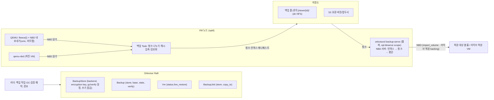

# 백업 저장소 2 설계 — 중복 제거 청크 저장소, 검증, 클라이언트 쪽 암호화, S3 호환 저장소, 라이브 복원 (계획 68)

작성일: 2026-11-23
상위 문서: `2026-11-04-backup-design.md`(계획 27·28 백업·백업 작업·보존), `2026-11-09-incremental-backup-design.md`(계획 40·41 dirty bitmap 증분·증분 복제), `2026-11-06-enterprise-design.md` §5·§6(원격 클러스터·원격 복제, 계획 37·38), `2026-11-18-folders-permissions-quotas-2fa-design.md`(계획 62 폴더·권한·할당량), `2026-11-18-dashboard-metrics-notifications-design.md`(계획 60 경보 엔진), `2026-11-18-vtpm-secure-boot-guest-agent-design.md`(계획 59 fs-freeze·TPM 상태), `2026-11-10-storage-migration-design.md`(계획 42 NBD·`blockdev-mirror`)
기준 트리: 계획 67 끝(`04833c3c`). 이 문서는 구현 전 설계다. 스테이지 보고는 구현하면서 §18에 덧붙인다. 격차 분석(2026-11-16)의 "백업 저장소 2(중복 제거·검증·암호화·S3·라이브 복원)" 줄을 이 문서가 대신한다.

## 1. 목적

계획 27·28·40·41로 백업은 "dir·NFS 백업 풀에 디스크마다 압축 qcow2 + 매니페스트", dirty bitmap 증분(부모 체인), Proxmox식 보존, 원격 클러스터로 파일째 복제까지 왔다. Proxmox Backup Server(PBS)·Veeam과 견주면 빠진 것은 **저장 방식과 운영**이다:

- **중복 제거 청크 저장소**: 디스크를 고정 4 MiB 청크로 나누고 내용 해시로 한 번만 둔다. 같은 템플릿에서 나온 VM 백 대, 매일의 전체 백업이 바뀐 청크만큼만 공간을 쓴다. 백업마다 **완전한 인덱스**를 두어 증분 체인이 없다 — 아무 백업이나 지울 수 있고 복원은 체인을 따라가지 않는다(계획 40 §7 "체인 중간 백업은 지울 수 없다"가 사라진다).
- **검증**: 청크를 다시 읽어 해시·인증 태그를 맞춰 보는 예약 작업, 백업마다 결과 기록, 깨진 청크는 옆으로 치워 다음 백업이 다시 올리게(스스로 낫기), 실패하면 경보.
- **클라이언트 쪽 암호화**: 청크·VM 설정·펌웨어 상태를 노드에서 AES-256-GCM으로 암호화해 내보낸다. 저장소(S3 업체, NFS 서버, 백업 디스크를 훔친 사람)는 평문도 키도 보지 못한다. 중복 제거는 같은 키 안에서 그대로 된다. 복구 키(종이 키)와 저장소 안 암호 문구 escrow로 클러스터를 잃어도 연다.
- **S3 호환 객체 저장소**: AWS S3·MinIO·Ceph RGW·Wasabi 따위를 저장소 백엔드로 바로 쓴다. 로컬 저장소에서 S3로 백업을 옮겨 두는 **저장소 사이 복사**(계층)와, 다른 클러스터가 같은 버킷을 **읽기 전용으로 붙여** 복원하는 DR 길.
- **라이브 복원**(PBS live-restore, Veeam Instant Recovery): 디스크를 다 받기 전에 VM을 켠다. 읽지 않은 블록은 백업에서 그때그때 읽고, 뒤에서 대상 볼륨으로 다 옮긴 뒤 갈아탄다.
- 가비지 수집(GC)·보존·옛 백업(계획 27/40 qcow2, 매니페스트 v1·v2)과 증분 체인·원격 복제(계획 38·41)와의 공존·옮기기. 파일 단위 복원(계획 69)은 이 형식이 어떻게 받치는지만 적는다(§12.7).

원칙: **이 기능을 쓰지 않는 클러스터와 옛 백업은 바이트까지 지금과 같다**(Raft JSON, 백업 풀의 qcow2·매니페스트 v1·v2, 복제 프로토콜, VM 명령줄). 데이터는 조용히 지우지 않는다(GC는 어떤 인덱스도 가리키지 않는 청크만, 깨진 청크는 옆으로 옮길 뿐, 저장소 리소스를 지워도 저장소 안 데이터는 남는다).

2026-11 공개 문서로 아는 것(제품 판마다 다를 수 있다):

| | Proxmox VE 8 + PBS 4 | Veeam B&R 12 | vSphere 8 | Orbivisor 지금(계획 27~41) | Orbivisor 계획 68 |
|---|---|---|---|---|---|
| 저장 형식 | 청크 저장소: VM 이미지는 고정 4 MiB(`.fidx`), 파일 보관은 내용 정의 청크(`.didx`), SHA-256, zstd | 작업 안 블록 중복 제거 + 압축, ReFS·XFS 블록 복제 | 백업 제품 없음(VADP로 제3자, VDP는 끝남) | 디스크마다 압축 qcow2, 중복 제거 없음 | 고정 4 MiB 청크 저장소, SHA-256, lz4(§7) |
| 증분 | dirty bitmap, 스냅샷마다 완전한 인덱스 | CBT(VMware)·자체 추적 | CBT | dirty bitmap, **부모 체인** | dirty bitmap, **완전한 인덱스**(체인 없음, §8.3) |
| 검증 | 검증 작업(예약·새 스냅샷), 깨진 청크 이름 바꿈 | 저장소 건강 검사, SureBackup(부팅 시험) | — | 없음 | 검증 작업(예약·새 백업), 깨진 청크 옆으로, 경보(§10.5) |
| 암호화 | 클라이언트 AES-256-GCM, 키 파일 + RSA 마스터 키, 종이 키 | AES-256, 암호 문구, Enterprise Manager 키 복구 | — | 없음 | 클라이언트 AES-256-GCM, 복구 키 + 저장소 안 암호 문구 escrow(§9) |
| 객체 저장소 | PBS 4 S3 백엔드(기술 미리 보기, 로컬 캐시) | 용량·보관 계층(SOBR), Object Lock 불변 | — | 없음 | S3 백엔드 바로(§7.7), 저장소 사이 복사(§12.5) |
| 즉시 복원 | live-restore(PBS에서 켜며 옮김) | Instant Recovery(vPower NFS) | — | 없음 | 라이브 복원: 오버레이 + NBD + `blockdev-mirror` 갈아타기(§11) |
| GC | atime 표시·쓸기(24시간 5분 유예) | 보존이 지움 | — | 지울 때 파일째 | 표시·쓸기 + Raft 쓰기 잠금 + 늦은 표시(§10.2) |
| 다른 곳 사본 | 동기화 작업(끌기·밀기), 테이프 | 백업 사본 작업 | — | 원격 클러스터로 파일 복제 | 원격 복제가 없는 청크만, S3 읽기 전용 붙이기(§12) |

## 2. 범위

| 계획 68에 넣는 것 | 넣지 않는 것 |
|---|---|
| `BackupStore` 리소스(루트): 백엔드 둘 — 백업 풀 안(`{풀 루트}/store/{id}/`) 또는 S3 호환(경로·가상 호스트 방식, 사용자 CA), 암호화, 읽기 전용, GC·검증 일정 | 한 저장소에 여러 클러스터가 쓰기(이름공간), 테이프, 클라우드 업체별 API(Azure Blob·GCS 네이티브 — S3 호환 끝점은 됨) |
| 저장소 형식 v1: 고정 4 MiB 청크, SHA-256(암호화면 HMAC), lz4, 청크 객체·고정 인덱스·매니페스트 v3(§7) | 내용 정의 청크(파일 보관 — 계획 69가 필요하면), zstd |
| 저장소로 백업: 실행 중 VM은 fleecing + NBD 내보내기를 opld가 읽음, 증분은 같은 dirty bitmap을 NBD 메타 문맥으로, 꺼진 VM은 `qemu-nbd`(§8) | 꺼진 VM의 증분 읽기(늘 전체를 읽고 새 청크만 씀 — §17), 디스크 안 제외 영역 |
| 보통 복원(헬퍼 NBD 서버 + 지금의 `import_volume`), 지우기, 보존, 백업 작업의 `store`, 새 백업 검증 | 기존 VM 위에 덮어 복원 |
| 클라이언트 쪽 암호화: 키 계층, 결정적 nonce, 복구 키, 저장소 안 escrow, 평문으로 남는 것(§9) | 키 바꾸기(다시 암호화), 외부 KMS·HSM, 백업마다 다른 키 |
| GC(표시·쓸기, 동시 백업에 안전, Bloom 필터)와 검증 작업, 리더 예약, 경보 둘(§10) | S3 Object Lock 불변(§16), 깨진 청크를 다른 사본에서 자동으로 고치기 |
| 라이브 복원: 새 VM, 모든 풀 종류, opld·헬퍼·QEMU가 죽었을 때 이어 가기, 취소(§11). 옛 qcow2 백업도(백업 풀을 읽는 노드) | 라이브 복원 중 HA·마이그레이션·스냅샷·디스크 핫플러그, 기존 VM 디스크에 라이브로 |
| 옛 백업 그대로 두기, 옛 백업 → 저장소 옮기기(`backup convert`, 체인 포함), 저장소 사이 복사(계층), 원격 복제(없는 청크만), S3 읽기 전용 붙이기·가져오기(scan)·넘겨받기(§12) | 옛 백업 자동 옮기기·지우기, 증분 체인 병합 |
| 폴더 할당량 `backup_bytes`, 권한·감사(§13) | 저장소마다의 할당량·청구 |
| API·CLI·웹, 순수·가짜 S3·실제 QEMU 시험, GitHub `backup-s3` 작업(MinIO 컨테이너) | 실제 AWS·Wasabi에서 CI(돈과 비밀 — 가이드에 손 확인 절차) |

**기능 하나**(`opl_types::node`, `FEATURES` 끝): **`backup-store`**(`BACKUP_STORE`). 가리는 것: `Kind::BackupStore`, `BackupSpec.store`·`source`, `BackupStatus`의 새 칸, `BackupJobSpec.store`·`copy_to`, 복원의 `live`, `TaskOp`의 새 일곱, `AlertCondition` 둘, `FolderQuota.backup_bytes`, `NodeStatus.backup_stores`, 받는 쪽의 저장소 사본. 모든 노드(위트니스·관찰 노드 포함)가 알릴 때만 쓰고 아니면 409 `cluster_upgrading`(`require_feature`, 검증보다 먼저). 나누지 않는 까닭: 저장소 백업을 읽는 코드(복원·GC·검증·지우기)가 모든 노드에 있어야 어떤 기능이든 안전하다 — 따로 켤 부분 업그레이드가 없다.

## 3. 지금 있는 것 (계획 67 끝)

- **타입**(`crates/opl-types/src/backup.rs`): `BackupSpec { vm, vm_name, pool, vm_spec, job, origin, incremental, max_chain }`(`deny_unknown_fields`), `BackupStatus { phase(pending|ready|failed|receiving), created_at, disks, uefi_vars, error, node, replicas, received_at, parent, full_reason, tpm_state }`(`#[serde(default)]`), `BackupManifest`(버전 1 = 전체, 2 = 증분, `:16-19`), `backup_dir(root, id) = {root}/backups/{id}`(`:249`). `BackupJobSpec { vms, pool, schedule, keep, enabled, replicate, full_every }`(`backup_job.rs:20-41`). `Kind::ALL` 38(`resource.rs:83`), `WATCHABLE` 23(`opl-api/src/watch.rs:24`).
- **백업 Task**(`crates/opl-api/src/tasks/backup.rs`): 전체는 실행 중이면 임시 스냅샷(`take_tags` — qcow2 내부 스냅샷, 블록 풀은 멈춤·`snapshot_many`·재개)을 `export_volume`(`qemu-img convert -c -U`)로(`full_disks`, `:396`), 증분은 `blockdev-backup sync=bitmap`으로 로컬 qcow2에(`incremental_disks`, `:464`), 게스트 에이전트 fs-freeze(`:486`), UEFI 변수·TPM 상태 복사, `choose_parent`(`:218`)의 전체 이유. 공유 LVM처럼 스냅샷이 안 되는 디스크는 실행 중 백업 409 `vm_running`.
- **복원**: `read_manifest`·`read_chain`, `import_volume`/`import_chain`(`qemu-img convert`, 체인은 `json:` backing 명시), 새 VM은 `clone::create_vm`.
- **원격 복제**(`tasks/replicate.rs`, `backup_receive.rs`): 백업마다 `POST /backups/receive` → 파일마다 `PUT /backups/{key}/files/{name}`(SHA-256 응답 확인, `send_file` `:710`) → `complete`(`:684`), 체인은 앞에서부터, `replica_parent_missing`. HTTP는 hyper + rustls(`remote_client.rs:1-27`, 원격 CA 하나만 믿음).
- **QMP**(`crates/opl-qemu/src/qmp.rs`): `blockdev_add_qcow2`(`:672`, backing null), `blockdev_add_nbd`(`:683`, inet + TLS), `blockdev_mirror`(`:699`, `sync: full`, `copy-mode: background`), `nbd_server_start`(`:721`, inet + TLS만), `block_export_add_nbd`(`:737`, **쓰기 가능**, 비트맵 없음), `block_export_del`(`:754`), `transaction`(비트맵 더하기·증분 백업), `query_jobs`·`job_cancel`·`block_job_cancel`·`job_dismiss`. 계획 42가 로컬 디스크 마이그레이션에 쓴다.
- **명령줄**(`crates/opl-qemu/src/cmdline.rs:209-220`): 디스크 i는 `-blockdev <원본>,node-name=disk{i}-file` + `-blockdev driver=<qcow2|raw>,file=disk{i}-file,node-name=disk{i}` + `-device …,drive=disk{i}`. 오류 정책(`rerror`·`werror`)은 주지 않는다(QEMU 기본).
- **Task 실행기**(`crates/opl-api/src/tasks.rs:706-711`): opld가 다시 뜨면 진행 중 Task는 실패 — `NodeUpgrade`·`NetworkMigrate`만 이어 간다. 같은 대상(VM·백업·풀…)의 Task는 차례로(`by_target`).
- **곁 프로세스**: swtpm은 `systemd-run --scope opl-tpm-{id}.scope`로 opld와 따로 산다(`crates/opl-driver/src/tpm.rs:257,289`). QEMU도 `opl-vm-<id>.scope`(`qemu.rs:180`).
- **비밀**: 원격 토큰은 Raft 스펙에 평문이고 API는 `token_id`만 보인다(`opl-api/src/remotes.rs:2`). 경보: 리더 평가 `NodeOffline`·`BackupJobFailed`(`opl-types/src/alert.rs:3,366`). 권한: `backup.create|restore|delete|job`, `Kind::Backup` 쓰기 = `BackupCreate`(`authz.rs:316-350`), 백업의 주인은 VM(지웠으면 `vm_spec.folder`, `authz/owners.rs:435`).
- **의존성**(`Cargo.toml`): `ring`(SHA-256·HMAC·HKDF·AES-GCM, CPU 가속), `sha2`, `argon2`, `data-encoding`(base32), `getrandom`, `roxmltree`(XML), `hyper`·`hyper-util`·`tokio-rustls`·`rustls`, `Cargo.lock`에 `rustls-native-certs`(lettre가 씀). `reqwest`는 `native-tls`(Linux에서 OpenSSL) — S3에는 쓰지 않는다. **압축 crate가 없다**(zstd·lz4·flate2 모두 없음). 꾸러미 `Depends`에 `qemu-utils`(`packaging/deb/control.in:6` — `qemu-img`·`qemu-nbd`).
- **웹**: 보호 영역(`/protect`)에 백업·백업 작업·원격 복제 탭(`docs/guide/web-ui.md:33`), `web/src/backups/*`.
- **CI**: `check (ubuntu)`의 `storage-it`, `linux-kvm`의 `qemu-it`(KVM), 서비스 컨테이너를 띄우는 꼴은 `ldap` 작업(slapd)이 있다.

## 4. 확인한 사실 (코드·QEMU·NBD·S3)

QEMU QMP 스키마(`qapi/block-core.json`, `qapi/block-export.json`, 8.2·10.0), NBD 프로토콜 문서(`nbd/doc/proto.md`), AWS S3 API 참고서(SigV4, `PutObject`·`GetObject`·`HeadObject`·`DeleteObject`·`ListObjectsV2`·`CopyObject`)를 이 설계의 근거로 삼는다. 지원 QEMU는 Debian 13(10.0), CI Ubuntu 24.04(8.2), macOS Homebrew. **"탐침"**은 스테이지가 실제 QEMU·MinIO에서 확인해 §18에 적을 것이다.

- **fleecing(시점 고정 읽기)**: 백업 대상 qcow2(`fleece{i}`)를 backing = 살아 있는 디스크 노드 `disk{i}`로 `blockdev-add`하고 `blockdev-backup { device: disk{i}, target: fleece{i}, sync: none }`을 걸면, 게스트가 아직 복사되지 않은 블록을 쓸 때마다 옛 내용이 먼저 `fleece{i}`로 간다(copy-before-write). `fleece{i}`를 읽으면 작업을 건 시점의 디스크다(바뀐 블록은 fleece에서, 나머지는 backing인 살아 있는 디스크에서). libvirt의 pull 방식 백업이 이 길이다. 작업은 취소할 때까지 끝나지 않는다. **탐침**: QEMU 8.2·10.0·Homebrew에서 시점 내용(`qemu-img compare`), 여러 디스크를 `transaction` 하나로.
- **fleece가 차면**: `blockdev-backup`이 안에서 만드는 copy-before-write 필터는 대상 쓰기 실패 때 **게스트 쓰기를 실패시킨다**(`on-cbw-error`의 기본 `break-guest-write` — 필터를 직접 `blockdev-add`하면 `break-snapshot`을 고를 수 있지만 돌고 있는 디스크 위에 필터를 끼울 `blockdev-replace`가 우리가 지원하는 판에 없다). 그래서 §8.5의 공간 지킴이가 차기 전에 작업을 끊는다. **탐침**: 작은 tmpfs의 fleece로 지킴이가 게스트 오류 없이 끊는지, 끊지 않으면 무엇이 보이는지.
- **NBD 내보내기**: `nbd-server-start`의 `addr`은 `{type: unix, data: {path}}`도 받고 `tls-creds` 없이 뜬다(QEMU 하나에 서버 하나 — 계획 42 마이그레이션의 inet+TLS 서버와는 VM 큐로 겹치지 않는다). `block-export-add { type: nbd, node-name, name, writable: false, bitmaps: [...] }`의 `bitmaps`는 6.0부터 `BlockDirtyBitmapOrStr`(`{node, name}`)를 받아 **다른 노드의 비트맵**도 내보낸다. 클라이언트는 `NBD_OPT_SET_META_CONTEXT`로 `base:allocation`(구멍·0)과 `qemu:dirty-bitmap:<이름>`(비트 1 = 바뀜)을 고르고 `NBD_CMD_BLOCK_STATUS`로 범위를 묻는다. **탐침**: `disk{i}`의 비트맵을 `fleece{i}` 내보내기에 붙이기, 비트맵 세분(기본 64 KiB).
- **비트맵 얼리기**: `block-dirty-bitmap-disable`·`-enable`·`-merge`는 `transaction` 안에서 된다(4.0+). 시점에 부모 비트맵을 끄고 새 비트맵을 더하면 부모 비트맵은 "부모 백업 시점 → 이 시점" 바뀜을 정확히 담는다.
- **`qemu-nbd`**(`qemu-utils`, Homebrew에도 있음): `--read-only --socket=PATH --image-opts …`로 꺼진 볼륨·옛 백업 qcow2 체인을 내보낸다. `file.locking=off`로 지금 `-U`와 같은 뜻. **탐침**: Homebrew `qemu-nbd`가 macOS에서 유닉스 소켓을 연다.
- **NBD 클라이언트 재연결**: QEMU `nbd` 블록 드라이버의 `reconnect-delay`(초, 4.2+)는 서버가 끊기면 그 시간 동안 요청을 붙잡고 다시 붙는다. **탐침**: 헬퍼를 죽이고 같은 소켓으로 다시 띄우면 게스트 읽기가 오류 없이 이어지는지, 300초를 넘기면 오류가 `rerror=stop`으로 VM을 멈추는지.
- **갈아타기**: `blockdev-mirror { device: <원본 노드>, target: <노드>, sync: full, copy-mode: write-blocking }`은 따라잡은 뒤 `ready`, `job-complete`면 원본 노드의 모든 부모(장치의 BlockBackend 포함)가 대상 노드로 바뀐다. `write-blocking`은 게스트 쓰기를 대상에도 같이 써서 반드시 수렴한다. 대상 노드는 다른 부모가 없어야 한다(명령줄에서 `-blockdev`로 만들고 장치에 붙이지 않으면 됨). **탐침**: 대상의 노드 이름이 `disk{i}`이면 갈아탄 뒤 지금 코드(스냅샷·비트맵·마이그레이션·`block_resize`)가 그대로 도는지.
- **장치 오류 정책**: `virtio-blk-pci`·`scsi-hd`·`ide-hd`의 `rerror`·`werror` 속성(`stop`이면 VM이 `io-error` 이유로 멈추고 `cont`로 이어 감)은 `-blockdev`와 함께 쓴다. 실행 중 바꿀 수 없다.
- **S3**: SigV4(`AWS4-HMAC-SHA256`, 본문 `x-amz-content-sha256`), 2020-12부터 AWS는 강한 읽은-뒤-쓰기 일관성. `CopyObject`를 같은 키로 `x-amz-metadata-directive: REPLACE`면 데이터 전송 없이 `LastModified`가 새로 된다. `DeleteObjects`(여럿)는 `Content-MD5`(또는 새 checksum 헤더)가 필요하다 — §7.7에서 하나씩 지운다. `PutObject`의 `If-None-Match: *`(조건부 쓰기)는 AWS(2024-08)·MinIO가 받고 모르는 구현은 무시하거나 501 — 소유자 잠금에만 쓰고 없으면 읽고 견준다. 한 PUT은 5 GB까지(청크·인덱스는 그 아래 — multipart 쓰지 않음). **탐침**: MinIO의 `CopyObject` 자기 복사·`If-None-Match`·`ListObjectsV2` 쪽수.
- **ring**: `aead::AES_256_GCM`(nonce 12바이트, 태그 16), `hmac::HMAC_SHA256`, `hkdf::HKDF_SHA256`, `digest::SHA256` — x86 AES-NI·SHA-NI, aarch64 Crypto 확장을 쓴다. `lz4_flex`(MIT, 순수 Rust, `safe-encode`·`safe-decode`)만 새 의존성이다(§15).

## 5. 전체 구조



- **저장소는 리소스**(`BackupStore`), 데이터는 저장소 안에만. Raft에는 백업마다 리소스(지금처럼)와 저장소 상태만 둔다 — 인덱스(디스크 1 TiB에 8 MiB)는 Raft에 넣지 않는다.
- **읽기는 pull**: QEMU(실행 중) 또는 `qemu-nbd`(꺼짐)가 유닉스 소켓 NBD로 내보내고 opld의 Task가 읽는다. QEMU는 저장소를 모른다.
- **복원 쪽은 헬퍼 하나**: `orbivisord backup-serve`가 백업 디스크를 읽기 전용 NBD로 내보낸다. 보통 복원은 그것을 `qemu-img convert`(지금의 `import_volume`)로, 라이브 복원은 QEMU가 backing으로 읽는다. 계획 69(파일 단위 복원)도 이 헬퍼를 쓴다.
- **누가 무엇을 쓰나**: 백업 Task만 새 청크·인덱스·매니페스트를 쓴다. GC Task만 청크를 지운다. 백업 지우기 Task만 스냅샷 디렉터리를 지운다. 검증 Task만 깨진 청크를 옆으로 옮긴다. 읽기 전용으로 붙인 저장소에는 아무도 쓰지 않는다.

## 6. 타입 (opl-types)

모든 새 칸은 빈 값이면 쓰지 않는다(`skip_serializing_if`) — 이 계획의 기능을 쓰지 않는 Raft JSON은 바이트 그대로다(serde 하위 호환 시험).

- **`BackupStore = Resource<BackupStoreSpec, BackupStoreStatus>`**, `Kind::BackupStore`(`backup-store`), 루트 종류(폴더 없음 — 백업 풀과 달리 VM 디스크를 두지 않고, 테넌트가 고르는 것은 백업 대상이지 저장소 설정이 아니다). `BackupStoreSpec`(`deny_unknown_fields`):
  - `backend: StoreBackend` — `{"pool": "bk"}`(백업 풀 이름 — `backups`를 켠 dir·NFS 풀, 경로 `{풀 루트}/store/{저장소 id}/`) 또는 `{"s3": S3Target}`.
  - `S3Target { endpoint: String(https URL, 시험만 `http`+`insecure_http: true`), region: String = "us-east-1", bucket: String, prefix: Option<String>(끝에 `/`를 붙여 씀), path_style: bool(MinIO·RGW는 참), ca_pem: Option<String>(사용자 CA — 없으면 시스템 루트), access_key_id: String, secret_access_key: String, insecure_http: bool }`. `secret_access_key`는 원격 토큰처럼 Raft에만 있고 API 보기·watch·감사에서 뺀다.
  - `encryption: Option<StoreEncryption { fingerprint: String, key: String(base64 32바이트) }>` — `key`도 API에서 빠진다(§9.4).
  - `read_only: bool` — 다른 클러스터가 주인인 저장소를 복원용으로 붙임(§12.6). 백업·지우기·GC 막힘.
  - `gc: JobSchedule`(계획 28의 `{at, days}`, 기본 매일 05:00 UTC), `verify: Option<VerifyPolicy { schedule: JobSchedule, reverify_days: u32 = 30, mode: VerifyMode(full|metadata) = full, verify_new: bool }>`(없으면 예약 검증 없음 — CLI·웹의 만들기 기본은 매주 일요일 06:00), `max_streams: u8 = 8`(S3 동시 요청, 1~64).
- **`BackupStoreStatus`**: `phase: Initializing|Ready|Failed`, `store_id: Option<Uuid>`(저장소 `store.json`의 id — 만든 저장소는 리소스 id, 붙인 저장소는 남의 것), `owner: Option<StoreOwner { cluster, ca_fingerprint }>`, `usage: Option<StoreUsage { snapshots, chunks, stored_bytes, logical_bytes, measured_at }>`(GC가 셈), `gc: Option<GcRun { task, started_at, marker_at(저장소 시계), phase: Mark|Wait|Sweep }>`, `sweeping: bool`, `committing: Vec<Uuid>`(매니페스트를 쓰는 중인 백업 — §10.2 쓰기 잠금), `sweep_epoch: u64`, `last_gc: Option<GcResult { started_at, finished_at, removed_chunks, removed_bytes, kept_young, error }>`, `next_gc`, `last_verify: Option<VerifyResult { started_at, finished_at, snapshots, chunks, bad, error }>`, `next_verify`, `bad_chunks: u64`, `error`.
- **`BackupSpec`**: `pool`은 `#[serde(default, skip_serializing_if = "String::is_empty")]`(옛 JSON에는 늘 있으므로 바이트 그대로), **`store: Option<String>`**(둘 중 정확히 하나 — 검증), `source: Option<BackupSource { backup: Uuid, kind: convert|copy }>`(옮기기·복사로 만든 백업의 원본).
- **`BackupStatus`**(저장소 백업에만): `base: Option<Uuid>`(바뀌지 않은 청크를 가져온 앞 백업 — 계획 40의 `parent`와 달리 복원은 이것을 따라가지 않는다), `store_stats: Option<StoreBackupStats { logical_bytes, read_bytes, new_chunks, new_bytes, reused_chunks, zero_chunks }>`(`new_bytes` = 이 백업이 저장소에 처음 쓴 저장 바이트), `verify: Option<BackupVerify { at, state: Ok|Failed, bad_chunks, error }>`(커밋 중 표시는 백업이 아니라 저장소의 `committing`에 둔다). 저장소 백업의 `disks[].file`은 인덱스 이름(`disk0.fidx`), `stored_bytes`는 `new_bytes`를 디스크마다 나눈 값.
- **`BackupJobSpec`**: `pool` 같은 규칙, **`store: Option<String>`**, `copy_to: Option<CopyTarget { store: String, keep: Option<Keep> }>`(§12.5). `full_every`는 저장소 작업에서 "n번마다 디스크 전체를 읽기"(§8.3).
- **`VmStatus.live_restore: Option<LiveRestore { backup, task, phase: Starting|Copying|Pivoting|Paused|Stopped|Failed, done_bytes, total_bytes, started_at, error }>`**.
- **`TaskOp`** 새 일곱: `BackupStoreInit`, `BackupStoreGc`, `BackupStoreVerify { backups: Vec<Uuid> }`(비면 일정대로 고름), `BackupStoreScan`, `BackupConvert { store }`, `BackupCopy { store }`, `BackupLiveRestore { backup, name, pool, folder }`(대상은 미리 정한 새 VM id — 지금 복원과 같다). 마지막 셋 중 `BackupLiveRestore`만 이어 가는 Task(`tasks.rs:706`의 목록에 더함).
- **`AlertCondition`**: `BackupVerifyFailed`(리더, `SubjectKind::Backup` — 마지막 검증이 실패인 백업마다 활성), `BackupStoreUnavailable`(리더, `SubjectKind::BackupStore` — 노드 보고에서 `for_secs` 동안 닿지 않음). `SubjectKind`에 `Backup`·`BackupStore`.
- **노드 상태**: `NodeStatus.backup_stores: Vec<NodeStoreState { store, ok, error, checked_at }>`(60초마다 `store.json` 읽기 — 이 노드가 그 저장소를 쓸 수 있을 때만, 비면 쓰지 않음).
- **할당량**: `FolderQuota.backup_bytes`, `QuotaDimension::BackupBytes`, `FolderUsage.backup_bytes`(§13).
- **Raft 겹침**: `backup-store-target` = `pool:<풀 id>` 또는 `s3:<끝점 호스트>/<버킷>/<접두사>`(한 곳에 저장소 하나).
- **`Kind::ALL` 38 → 39**, `WATCHABLE`에 `BackupStore`(비밀을 뺀 JSON — `network_migrations::redact_json`과 같은 꼴).
- **권한**: 새 권한 비트 없음. `kind_privilege`: `BackupStore` 쓰기 `storage.config`, 읽기 `system.read`(루트). 키 내보내기·escrow는 루트 `cluster.admin`(§13).
- **순수 함수**(opl-types 또는 새 crate의 순수 부분): `store_target_key(spec)`, `chunk_ranges(extents, chunk_bytes) -> Vec<u64>`(바뀐 범위 → 청크 번호), `merge_index(base, dirty, new)`, `gc::sweep_decision(listed, marked, young_cutoff)`, `verify::due(backups, policy, now)`, `prune`(지금 그대로).
- **serde 하위 호환 시험**: 옛 `BackupSpec`·`BackupStatus`·`BackupJobSpec`·`VmStatus`·`NodeStatus`·`FolderQuota`·`FolderUsage`·`AlertRule`·`TaskOp` JSON 바이트 그대로, 새 칸 왕복, `Kind` 문자열, `pool`·`store` 둘 다·둘 다 없음 거절.

## 7. 저장소 형식

### 7.1 청크 나누기 — 고정 4 MiB

VM 디스크는 블록 장치다. 앞에 바이트를 끼워 넣어 뒤가 밀리는 일이 없으므로 내용 정의 청크(CDC)가 주는 이득이 없고, 고정 청크는 (1) dirty bitmap 범위와 곧바로 맞고(바뀌지 않은 청크는 읽지도 않음), (2) 오프셋 → 청크가 나눗셈이라 라이브 복원·파일 단위 복원의 임의 읽기가 O(1)이다. PBS도 VM 이미지에 고정 4 MiB를 쓴다. 4 MiB는 청크 수(1 TiB = 262,144개 — 인덱스 8 MiB, GC Bloom 필터·S3 요청 수)와 중복 제거 세분 사이의 타협이다. 청크 크기는 `store.json`에 적고(늘 4 MiB) 바꾸지 않는다.

- 디스크의 마지막 청크는 짧을 수 있다(가상 크기가 4 MiB 배수가 아니면).
- **0 청크**: 내용이 모두 0이면 저장하지 않고 인덱스에 32바이트 0을 적는다. 구멍(`base:allocation`의 zero)도 같다.

### 7.2 청크 객체

```
0   "OPC1"                      매직
4   flags u8                    bit0 lz4, bit1 암호화
5   0 0 0                       예약
8   raw_len u32 LE              풀었을 때 길이(≤ 4 MiB)
12  본문
    평문 저장소:  payload(lz4 블록이거나 그대로)
    암호화 저장소: nonce(12) ‖ AES-256-GCM(payload) ‖ tag(16),  AAD = 0..12 바이트 ‖ 청크 id(32)
```

- **청크 id**: 평문 저장소는 `SHA-256(raw)`, 암호화 저장소는 `HMAC-SHA256(id_key, raw)`(§9.2). 16진 64자가 객체 이름이다.
- **압축**: lz4 결과가 원본보다 1/8 이상 작을 때만 쓴다(이미 압축된 데이터에 CPU를 쓰지 않음).
- 객체는 한 번 쓰면 바뀌지 않는다(같은 id = 같은 내용). 같은 청크를 두 백업이 동시에 써도 같은 바이트다(암호화도 nonce가 결정적이라 — §9.2).

### 7.3 고정 인덱스 (`disk{i}.fidx`)

```
0   "OPF1"   4 version u32 = 1   8 backup uuid(16)   24 virtual_bytes u64
32  chunk_bytes u32   36 flags u32 (bit0 암호화 id)   40 count u64   48..64 예약
64  청크 id × count (32바이트씩, 0 청크는 모두 0)
끝  SHA-256(앞의 모든 바이트) 32
```

인덱스는 평문이다(청크 id는 암호화 저장소에서 키가 든 HMAC이라 평문의 해시가 아니다 — §9.3). 매니페스트가 인덱스의 SHA-256을 담고 매니페스트는 인증된다.

### 7.4 매니페스트 v3 (`index.json`)과 블롭

```json
{ "version": 3, "store": "<저장소 id>", "backup": "<id>", "vm": "<id>", "created_at": 1763870400,
  "disks": [ { "name": "disk0", "virtual_bytes": 21474836480, "index": "disk0.fidx",
               "index_sha256": "…", "chunks": 5120, "zero_chunks": 3901 } ],
  "blobs": [ { "name": "config", "sha256": "…" }, { "name": "vars.fd", "sha256": "…" },
             { "name": "tpm2-00.permall", "sha256": "…" } ],
  "encryption": { "fingerprint": "ab:cd:…" },
  "auth": "<HMAC-SHA256(auth_key, auth를 뺀 정규 JSON) — 암호화 저장소만>" }
```

- **`config` 블롭**: 지금 매니페스트 v1·v2에 있던 `vm_name`·`vm_spec`·`uefi_vars`·`tpm_state`를 담은 JSON. 블롭은 청크와 같은 객체 형식(`OPC1`)이라 암호화 저장소에서는 암호화된다. VM 이름·스펙(cloud-init user-data 포함)이 저장소에 평문으로 남지 않는다.
- 매니페스트 버전은 3. 옛 v1·v2(풀 디렉터리)는 그대로 읽는다(§12.1). 읽는 쪽은 버전 3에서 모르는 칸을 무시한다(계획 69가 `catalog` 따위를 더할 자리).
- **쓰는 차례**: 청크 → 블롭 → 인덱스 → 매니페스트. 스냅샷은 매니페스트가 있을 때만 완전하다(커밋 지점). Raft `ready`는 매니페스트 뒤.

### 7.5 객체 배치

```
store.json                         형식·버전·저장소 id·청크 크기·압축·암호화 지문(만든 뒤 바뀌지 않음)
owner.json                         주인 클러스터 이름·CA 지문·하트비트 시각(§12.6)
keys/<지문>.json                   암호 문구로 감싼 키(선택, §9.4)
chunks/<id 앞 4자>/<id 64자>        청크
snapshots/<vm id>/<backup id>/     index.json, disk{i}.fidx, config, vars.fd, tpm2-00.permall
gc/<run>.start                     GC 기준 시각 표식
bad/<id>.<유닉스 초>                검증이 찾은 깨진 청크(지우지 않음)
```

- 로컬 백엔드는 `store init`이 `chunks/0000`~`ffff` 디렉터리 65,536개를 미리 만든다(PBS와 같다 — 청크 천만 개에서 디렉터리마다 약 150개). S3는 같은 키를 쓰고 디렉터리가 없다(접두사가 흩어져 S3의 접두사당 요청 한도를 나눈다).

### 7.6 로컬 백엔드 (백업 풀 안)

- 경로 `{풀 루트}/store/{저장소 id}/`(`pool_root` — NFS면 마운트를 확인하는 지금의 `check_pool_root`). 풀은 `backups`가 켜져 있어야 하고, 저장소가 있으면 풀 지우기·`backups` 끄기·`shared` 바꾸기가 409 `pool_in_use`(지금의 `check_no_backups` 옆).
- 쓰기: `{이름}.tmp.<무작위>`에 쓰고 `sync_all` → `rename` → 디렉터리 fsync(지금 매니페스트와 같은 쓰기 보장). 있음 확인은 `stat`, "만지기"는 `utimensat`(§10.2).
- 공유가 아닌 dir 풀의 저장소는 그 노드에서만 쓴다(지금 `status.node` 규칙과 같음 — 그 노드 밖 VM은 그 저장소로 백업하지 못함, 409 `store_not_on_node`). NFS 풀이면 모든 노드.

### 7.7 S3 백엔드

- **클라이언트는 직접 짠다**: hyper 1(HTTP/1.1, 연결 풀 `max_streams`개) + tokio-rustls(시스템 루트 `rustls-native-certs` 또는 `ca_pem` 하나) + SigV4 서명(ring HMAC, 본문 SHA-256을 `x-amz-content-sha256`에) + `roxmltree`(목록·오류 XML). 쓰는 연산은 여섯뿐이다: `PutObject`, `GetObject`, `HeadObject`, `DeleteObject`, `ListObjectsV2`(1000개씩 `continuation-token`), `CopyObject`(같은 키 — 만지기).
- **다시 하기**: 5xx·`SlowDown`·연결 오류는 지수 대기(0.2초부터, 최대 30초)로 60초 동안 다시. 4xx는 곧바로 실패(403은 "자격 증명이나 버킷 정책" 문구).
- **지우기는 하나씩**(`DeleteObject`, `max_streams` 병렬): `DeleteObjects`는 `Content-MD5`가 필요해 MD5 의존성을 들여야 한다. GC는 뒤에서 도는 일이라 병렬 하나씩으로 충분하다(§16).
- 일관성: 강한 읽은-뒤-쓰기를 요구한다(AWS·MinIO·Ceph RGW·Wasabi). 가이드에 적고, `store init`이 쓴 `store.json`을 곧바로 읽어 확인한다.
- 비용 메모: 백업 하나에 새 청크마다 `HEAD` + `PUT`, GC는 청크 수만큼 `LIST`(1000개당 하나)와 지울 것마다 `DELETE`, 검증 `full`은 모든 청크 `GET`(내보내기 비용) — `metadata`는 `HEAD`만.

## 8. 백업 읽기 — 데이터가 QEMU를 떠나는 길, 그리고 보통 복원

### 8.1 실행 중 VM: fleecing + 유닉스 소켓 NBD

VM 큐 안에서(지금처럼 시작·정지·마이그레이션과 겹치지 않음):

1. 디스크마다 노드 임시 공간(`[backup] scratch_dir`, 기본 `{data_dir}/backup-scratch`)에 `fleece-{백업 id}-{i}.qcow2`를 디스크 가상 크기로 만들고(`qemu-img create -f qcow2`), `blockdev-add { driver: qcow2, node-name: fleece{i}, file: …, backing: "disk{i}" }`.
2. fs-freeze(게스트 에이전트 `freeze_fs` — 지금의 `Freezer`) → `transaction` 하나: 디스크마다 `blockdev-backup { job-id: opl-fleece-{i}, device: disk{i}, target: fleece{i}, sync: none, auto-dismiss: false }`, 증분이면 `block-dirty-bitmap-disable { disk{i}, opl-{부모} }`, 늘 `block-dirty-bitmap-add { disk{i}, opl-{새 id}, persistent: <qcow2면 참> }` → thaw. 모든 디스크가 한 시점이다.
3. `nbd-server-start { addr: { type: unix, data: { path: {run_dir}/backup/{id}.sock } } }`(0600), 디스크마다 `block-export-add { type: nbd, id: opl-bk-{i}, node-name: fleece{i}, name: disk{i}, writable: false, bitmaps: [{ node: disk{i}, name: opl-{부모} }](증분만) }`.
4. opld가 읽는다(§8.4). 끝나면(성공·실패 모두) `block-export-del` → `nbd-server-stop` → `job-cancel opl-fleece-{i}` → `job-dismiss` → `blockdev-del fleece{i}` → 파일 지움. 성공이면 `opl-{부모}`를 지우고, 실패면 `block-dirty-bitmap-merge { target: opl-{부모}, bitmaps: [opl-{새}] }` + `enable` + 새 비트맵 지움(다음 시도도 같은 부모에서 증분 — 계획 40의 뜻 그대로).

이 길은 **저장소 쪽 스냅샷이 필요 없다**: 블록 풀(LVM-thin·ZFS·RBD)도 VM을 멈추지 않고, 지금 실행 중 백업을 409 `vm_running`으로 거절하던 **공유 LVM도 실행 중에 백업된다**. qcow2 내부 스냅샷도 만들지 않는다(VM 이미지에 임시 태그가 남는 일이 없다). 옛 풀 백업은 지금의 길(내부 스냅샷·`export_volume`) 그대로다.

### 8.2 꺼진 VM: `qemu-nbd`

`qemu-nbd --read-only --persistent --socket=… --image-opts <volume_source와 같은 원본, file.locking=off>`를 VM 잠금 안에서 띄워 읽는다(늘 전체 읽기, `base:allocation`으로 구멍은 건너뜀). 바뀌지 않은 청크는 §8.4에서 쓰지 않으므로 저장소 공간·전송은 증분과 같다 — 읽는 시간만 든다. qcow2면 내보낸 뒤 지금처럼 `set_backup_bitmap`(다음 실행 중 백업이 증분이 되게).

### 8.3 증분: 비트맵 문맥과 완전한 인덱스

- 부모 고르기는 계획 40 `choose_parent`와 같은 규칙(같은 VM·같은 **저장소**의 `ready` 백업, 비트맵 하나·일관·디스크 같음, `max_chain`)이고, 고른 백업을 `status.base`에 적는다. `full_reason`도 그대로.
- 읽기: `qemu:dirty-bitmap:opl-{base}` 문맥의 `BLOCK_STATUS`로 바뀐 범위를 받아 `chunk_ranges`로 청크 번호로 바꾼다. 바뀐 청크만 4 MiB씩 읽어 해시하고, 나머지 청크는 **base 인덱스의 id를 그대로 옮긴다**(`merge_index`). 결과 인덱스는 늘 완전하다 — 복원·지우기에 체인이 없다.
- base는 자식이 `pending`인 동안만 지우기가 막힌다(409 `backup_in_use` — 자식이 base 인덱스의 청크를 다시 쓰지 않고 가리키므로, §10.3). 자식이 `ready`가 되면 base는 언제든 지운다.
- 저장소 작업의 `full_every = n`은 "base를 따라 n번 연속 비트맵으로 읽었으면 다음은 전체를 읽는다"(Veeam의 active full과 같은 뜻 — 비트맵이 틀렸을 경우를 주기적으로 씻음). 저장 공간은 늘지 않는다.

### 8.4 읽기·쓰기 파이프라인 (opl-store)

```
NBD 읽기(4 MiB, 4개 동시) → 일꾼 N개(min(4, CPU/2)): 0 검사 → id 계산 → base의 같은 자리와 같으면 건너뜀
  → 이번 실행에 본 id면 건너뜀 → 있음 확인(로컬 stat / S3 HEAD) → 없으면 압축·암호화 → 올림(max_streams)
```

- 메모리 상한: 날아다니는 청크 (4 + 2N + max_streams) × 4 MiB(기본 약 100 MiB).
- 인덱스는 메모리에서 채우고 끝에 한 번 쓴다. 이 백업이 "있음 확인"으로 건너뛴(base에 없던) id 목록은 §10.3의 커밋 확인을 위해 기억한다.
- 결과: `store_stats`(읽은 바이트, 새 청크 수·저장 바이트, 다시 쓴 청크, 0 청크), `disks[].virtual_bytes`.
- 소스(NBD)는 커밋이 끝날 때까지 열어 둔다(§10.3에서 사라진 청크를 다시 읽어 올리기 위해).

### 8.5 fleece 공간 지킴이

fleece에는 백업하는 동안 게스트가 덮어쓴 블록의 옛 내용만 쌓인다(크기를 미리 알 수 없다). fleece가 들어 있는 파일시스템이 차면 §4대로 게스트 쓰기가 실패하므로:

- **미리 확인**: `scratch_dir`의 남은 공간이 `max(2 GiB, VM 디스크 가상 크기 합의 5%)`(`[backup] fleece_reserve_pct = 5`)보다 작으면 백업을 시작하지 않고 실패("not enough scratch space for fleecing on <노드>").
- **지켜보기**: 백업하는 동안 1초마다 남은 공간을 보고 `fleece_min_free_mib`(기본 1024)보다 작아지면 곧바로 `block-export-del`·`job-cancel`(copy-before-write가 빠짐) — 백업은 실패하고(비트맵은 §8.1의 실패 길로 되돌림) 게스트는 계속 쓴다.
- 1초에 1 GiB보다 빨리 쓰는 게스트라면 지킴이를 앞지를 수 있다 — 한계로 적는다(§17·가이드: `scratch_dir`을 넉넉한 곳에).

### 8.6 보통 복원

1. 헬퍼(§11.1의 `orbivisord backup-serve`)를 띄워 백업 디스크를 `{run_dir}/backup-serve/{task}.sock`에 읽기 전용 NBD(`disk{i}`)로 내보낸다.
2. 디스크마다 지금의 `import_volume`에 원본 `json:{"driver":"nbd","server":{"type":"unix","path":…},"export":"disk{i}"}`(새 `SourceFormat::Nbd`)를 준다 — 모든 풀 종류의 지금 길(`qemu-img convert`, 대상 형식은 `copy_format`)을 그대로 쓴다. 헬퍼는 0 청크를 `base:allocation`의 zero로 알려 `convert`가 쓰지 않는다.
3. `config` 블롭에서 VM 스펙, `vars.fd`·TPM 상태는 블롭에서 — 그 뒤는 지금 `restore`와 같다(`clone::create_vm`).

## 9. 암호화

### 9.1 키 계층

- **주 키** MK: 저장소마다 무작위 32바이트(`getrandom`). 같은 키를 다른 저장소에 가져올 수 있다(사본·DR — §12).
- 파생(HKDF-SHA256, salt 없음, `info`로 나눔): `data_key`(`"orbivisor-backup v1 data"`, AES-256-GCM), `id_key`(`"… id"`, 청크 id HMAC), `nonce_key`(`"… nonce"`), `auth_key`(`"… auth"`, 매니페스트 HMAC), `fp_key`(`"… fingerprint"`).
- **지문** = `HMAC-SHA256(fp_key, "orbivisor key fingerprint")` 앞 16바이트, `ab:cd:…` 꼴. `store.json`·매니페스트·리소스에 평문으로 둔다(키를 알려 주지 않는다).

### 9.2 청크 id와 nonce — 중복 제거를 지키며

- 청크 id = `HMAC-SHA256(id_key, raw)`. 같은 키 안에서 같은 내용은 같은 id → 중복 제거가 그대로 된다. 평문의 SHA-256이 아니므로 "알려진 파일의 해시"로 내용을 맞혀 볼 수 없다(PBS와 같은 뜻).
- **nonce = `HMAC-SHA256(nonce_key, 청크 id)` 앞 12바이트(결정적)**. id는 평문의 PRF이므로 nonce도 평문의 PRF다: 다른 평문이 같은 nonce를 쓸 확률은 2⁻⁹⁶ 생일 한계(청크 2⁴⁸개까지 무시할 만함), 같은 평문은 같은 (nonce, 암호문) — 이미 같은 id로 드러난 "같다"는 사실 밖에 새는 것이 없다(SIV와 같은 논리). 무작위 nonce(2³² 청크마다 키 한계)를 쓰지 않으므로 키 하나에 쓸 수 있는 청크 수에 실용 한계가 없고, 같은 청크를 동시에 써도 바이트가 같다.
- AEAD의 AAD에 청크 헤더와 id를 넣어 다른 id 자리에 옮겨 놓은 객체를 거절한다.

### 9.3 평문으로 남는 것

저장소를 가진 사람이 볼 수 있는 것: `store.json`(형식·청크 크기·지문), `owner.json`(클러스터 이름·CA 지문), 스냅샷 경로(VM id·백업 id), 매니페스트의 시각·디스크 수·가상 크기·청크 수·0 청크 수, 인덱스(키가 든 청크 id의 차례 — 디스크 안 어느 청크가 서로 같은지), 청크 객체 크기(압축률의 힌트), 객체를 쓴 시각. 볼 수 없는 것: 청크 내용, VM 이름·스펙·cloud-init, UEFI 변수, TPM 상태. 가이드에 이 목록을 그대로 적는다.

### 9.4 키 보관·복구(escrow)

- **클러스터 안**: MK는 `BackupStore.spec.encryption.key`(Raft)에 둔다 — 원격 토큰·S3 비밀 키와 같은 자리(§3). 위협 모델은 **저장소 쪽**(S3 업체·NFS 관리자·훔친 백업 디스크)이고, 클러스터 노드는 어차피 VM 평문을 가진다(PBS도 키를 PVE 클러스터 파일시스템에 둔다). API 보기·watch·감사·`Debug`에서 뺀다.
- **복구 키(종이 키)**: 만들 때 한 번 보인다 — `OPK1-` + base32(MK ‖ SHA-256(MK) 앞 2바이트) 네 자씩 묶음(약 60자). 웹은 인쇄용 화면(글과 QR — 그림은 웹에서 만듦)을 준다. 나중에 다시 보기는 루트 `cluster.admin`의 `POST /backup-stores/{key}/key/export`(감사에 남음).
- **저장소 안 escrow(선택)**: 관리자가 준 암호 문구로 `keys/<지문>.json = { kdf: argon2id, m: 65536 KiB, t: 3, p: 1, salt, nonce, wrapped: AES-256-GCM(KEK, MK), fingerprint }`를 쓴다(`argon2` crate). 클러스터를 통째로 잃어도 저장소와 암호 문구만으로 연다(§12.6). 암호 문구는 저장하지 않는다.
- **가져오기**: 저장소를 만들거나 붙일 때 `recovery_key` 또는 `escrow_passphrase`(저장소의 `keys/`를 풂)를 주면 그 MK를 쓴다. 지문이 `store.json`과 다르면 400 `store_key_mismatch`.
- 키를 잃으면 데이터를 되살릴 길이 없다. 만들기 응답은 복구 키를 늘 담고, CLI는 그것을 출력한 뒤 경고 줄을 남기며, 웹 마법사는 "저장했음" 확인 없이는 닫히지 않는다.

### 9.5 다른 클러스터·사본

같은 MK를 가진 저장소끼리는 암호문 청크를 **그대로** 옮긴다(id·바이트가 같음). 키가 다른 저장소 사이의 원격 복제는 거절한다(409 `store_key_mismatch` — 받는 쪽이 같은 키를 가져와야 함). 같은 클러스터 안 저장소 사이 복사(§12.5)는 키가 다르면 풀어서 다시 암호화한다(노드가 두 키를 다 가짐).

## 10. 가비지 수집·보존·검증

### 10.1 지우기와 보존

- 저장소 백업 지우기(`BackupDelete`): 매니페스트 → 인덱스·블롭 → 디렉터리 차례로 지우고 리소스를 지운다. 청크는 다음 GC가 거둔다. **체인이 없으므로 순서 제약이 없다** — 보존 규칙(`prune`)이 고른 대로 지우고 조상 보호를 하지 않는다(옛 풀 백업은 지금처럼 조상 보호).
- `base`인 백업은 자식이 `pending`일 때만 409 `backup_in_use`.
- 저장소 리소스 지우기는 백업이 남아 있으면 409 `store_in_use`. 지워도 **저장소 안 데이터는 그대로**다(버킷·디렉터리를 지우는 API는 없다 — 가이드가 손으로 지우는 길을 적는다).

### 10.2 GC 알고리즘 (표시·쓸기)

`backup-store-gc` Task(저장소 id 큐 — 같은 저장소의 GC·검증은 차례로, 백업과는 나란히). 읽기 전용 저장소와 주인이 아닌 저장소(`owner.json`이 이 클러스터가 아님)에서는 돌지 않는다.

1. **시작**: 표식 `gc/<run>.start`를 쓰고 그 `LastModified`(로컬은 mtime)를 **T0**로 읽는다 — 저장소 자신의 시계라 노드 시계 차이가 없다. Raft에 `status.gc = { task, started_at, marker_at: T0, phase: Mark }`를 쓴다(이 쓰기가 **L**). L 바로 뒤 로컬 상태에서 이 저장소의 `pending` 백업(받는 사본·옮기기·복사 포함)을 **W**로 적는다.
2. **표시**: `snapshots/` 아래 **모든 `.fidx`**(매니페스트 유무와 관계없이 — 넓게)를 읽어 0이 아닌 id를 Bloom 필터 B에 넣는다(§10.4).
3. **기다림**(`phase: Wait`): W의 백업이 모두 `pending`이 아니게 될 때까지(5초마다, 최대 24시간 — 넘으면 아무것도 지우지 않고 실패). 그 사이 끝난 W의 인덱스를 B에 더한다.
4. **쓸기 잠금**: Raft CAS로 `committing`이 비어 있을 때만 `sweeping = true`, `sweep_epoch += 1`, `phase: Sweep`. 잠금을 잡은 뒤 **늦은 표시** — 2번 뒤에 생긴 스냅샷(목록을 다시 읽어 새 것만)의 인덱스를 B에 더한다.
5. **쓸기**: `chunks/`를 나열한다. B에 (있을 수도) 있으면 남김(참조 청크·바이트를 셈 → `usage`), `LastModified ≥ T0 − 5분`이면 남김(`kept_young` — L 뒤에 올라온 청크), 나머지는 지운다. `bad/`·`keys/`·`snapshots/`는 건드리지 않는다. 하루 넘은 `*.tmp.*`(로컬)도 지운다.
6. **끝**: `sweeping = false`, `last_gc`, `usage`, `owner.json` 하트비트, 표식 지움.

### 10.3 동시 백업과의 안전

GC가 지우면 안 되는 청크는 "어떤 완성된(또는 완성될) 인덱스가 가리키는 청크"다. 백업 B가 쓰는 청크는 넷 중 하나다:

- **(가) B가 새로 올린 청크**: B가 W에 있으면 B는 쓸기 잠금 전에 끝나므로(3번) 커밋된 인덱스가 늦은 표시로 B에 든다. B가 L 뒤에 생겼으면 그 청크는 T0 뒤에 올라와 5번의 시각 규칙이 남긴다.
- **(나) base 인덱스에서 옮긴 id**: base는 B가 `pending`인 동안 지울 수 없고 base의 `.fidx`는 2번이 읽는다.
- **(다) "있음 확인"으로 건너뛴 남의 청크**(다른 VM·지운 백업의 것): 위험한 경우다. B는 매니페스트를 쓰기 전에 Raft CAS로 `committing`에 자기를 넣는다(`sweeping`이면 기다림). 이 커밋 구간은 쓸기와 겹치지 않는다(서로 상대가 비어야 들어감). B가 시작할 때 본 `sweep_epoch`와 커밋 때의 값이 다르거나 시작할 때 `sweeping`이 참이었으면(그 사이 쓸기가 있었거나 돌고 있었다) B는 (다)의 id를 모두 다시 `HEAD`(로컬 `stat`)하고 사라진 것은 아직 열려 있는 소스에서 다시 읽어 올린 뒤 매니페스트를 쓴다. 커밋이 쓸기 전에 끝났으면 늦은 표시가 B의 인덱스를 본다.
- **(라) 0 청크**: 저장하지 않는다.

Raft 상태 기계는 로그 차례로 적용되므로 L 뒤에 만들어진 백업의 Task는 자기 `pending` 리소스를 볼 때 이미 L(GC 시작)도 본다 — W 판정에 노드마다의 Raft 지연이 끼지 않는다. 죽은 Task가 `committing`·`sweeping`에 남으면 janitor가 그 Task가 끝났거나 실패했을 때 뺀다. 이 증명은 `opl-store`의 순수 모형 시험(백업·GC 걸음을 무작위로 섞는 proptest — 끝난 인덱스가 가리키는 청크가 늘 있음)으로 지킨다.

### 10.4 Bloom 필터

표시 집합을 정확한 집합으로 두면 청크 2억 6800만 개(고유 1 PiB)에 8.6 GB다. 크기를 앞 GC의 청크 수(없으면 인덱스 크기 합)에서 정해 오탐 1%(약 10비트/청크 — 같은 규모에서 약 335 MB)로 둔다. id가 이미 균일한 해시라 id의 조각 k개를 해시 함수로 쓴다. **오탐은 쓰레기를 남길 뿐 지우지 않는다**(안전한 쪽). 실행마다 조각을 고르는 씨앗을 바꿔 같은 쓰레기가 계속 남지 않게 한다.

### 10.5 검증

`backup-store-verify` Task(저장소 큐):

- **고르기**(`verify::due`): `verify.at`이 없거나 `reverify_days`보다 오래된 `ready` 백업, `mode`, 손으로 고른 백업(`backups`). `verify_new`면 백업이 `ready`가 된 뒤 스케줄러가 그 백업 하나를 곧바로 줄 세운다.
- **매니페스트**: 인증(`auth`, 암호화 저장소), `config` 블롭 풀기, 인덱스 SHA-256과 꼬리 해시, 디스크 수·크기가 리소스와 같은지.
- **청크**(`full`): 이번 실행에 확인한 id는 건너뜀(정확한 집합 — 한 실행의 대상만), 읽어 AEAD 태그·압축 풀기·id 다시 계산. `metadata`는 `HEAD`(있음·크기 ≥ 헤더)만.
- **깨진 청크**: `bad/<id>.<초>`로 옮긴다(로컬 `rename`, S3 `CopyObject` + `DeleteObject`) — 지우지 않는다. 그 id를 가리키는 모든 백업을 이 실행의 결과에서 `Failed`로. 다음 백업이 같은 내용을 만나면 "있음 확인"이 없다고 보고 다시 올려 **스스로 낫는다**(base에서 옮긴 id는 다시 읽지 않으므로 — 검증이 base의 청크를 깨졌다고 적은 VM은 다음 백업을 전체 읽기로 바꾼다: `full_reason = "a chunk of the base backup failed verification"`).
- **기록**: 백업마다 `status.verify { at, state, bad_chunks, error }`, 저장소 `last_verify`·`bad_chunks`. 경보 `backup_verify_failed`(백업마다, 다시 검증해 `Ok`이거나 백업을 지우면 풀림).
- 옛 풀 백업도 검증한다: `qemu-img check`와(받은 사본이면) 저장한 SHA-256 비교. 같은 `status.verify`.
- **예약**: 리더의 백업 작업 스케줄러(`backup_jobs.rs`) tick이 저장소마다 `next_gc`·`next_verify`를 보고 Task를 만든다(`next_run` 계산 그대로, 놓친 실행은 한 번). 노드 고르기: 로컬 백엔드는 풀을 쓸 수 있는 노드(공유가 아니면 그 노드), S3는 `backup_stores`가 `ok`인 온라인 노드 가운데 백업 Task가 가장 적은 노드.

## 11. 라이브 복원

### 11.1 헬퍼 `orbivisord backup-serve`

- 같은 바이너리의 하위 명령. 설정(저장소 백엔드·자격 증명·키·백업 id)은 **표준 입력의 JSON**으로 받는다(argv·환경에 비밀 없음). 디스크마다 읽기 전용 NBD 내보내기 `disk{i}`를 유닉스 소켓(0600) 하나에 연다.
- NBD 서버(`opl-store::nbd::server`, 순수 Rust): fixed newstyle 협상, `OPT_GO`·`OPT_INFO`·`OPT_LIST`, 구조화 응답, `base:allocation` 문맥(0 청크 = `NBD_STATE_HOLE|ZERO`), 명령 `READ`·`BLOCK_STATUS`·`FLUSH`(할 일 없음)·`DISC`. 쓰기 명령은 `EPERM`.
- 읽기: 오프셋 → 청크 번호 → id → 캐시(풀린 청크 LRU, `[backup] serve_cache_mib = 256`) → 저장소 GET(동시 `max_streams`, 같은 id 요청은 하나로 묶음). 연속 읽기를 보면 다음 4개 청크를 미리 읽는다(mirror·`convert`가 앞에서부터 읽는다). 저장소 오류는 §7.7의 다시 하기(60초) 뒤 `EIO`.
- Linux에서는 `systemd-run --scope --unit opl-bkserve-<id>`(swtpm과 같은 꼴, `tpm.rs:257`)로 띄워 **opld가 다시 떠도 산다**. macOS는 opld의 자식(재시작하면 죽음 → QEMU 재연결 시간 안에 Task가 다시 띄움).

### 11.2 QEMU 배선

새 VM의 디스크 i를 지금 모양(`disk{i}-file` → `disk{i}`) 위에 둘을 더해 만든다(`cmdline::LiveRestoreDisk`):

```
-blockdev driver=nbd,server.type=unix,server.path=<헬퍼 소켓>,export=disk{i},reconnect-delay=300,read-only=on,node-name=disk{i}-lrsrc
-blockdev driver=qcow2,file.driver=file,file.filename=<오버레이>,backing=disk{i}-lrsrc,node-name=disk{i}-lr
-blockdev <대상 볼륨 원본>,node-name=disk{i}-file
-blockdev driver=<qcow2|raw>,file=disk{i}-file,node-name=disk{i}          # 장치에 붙이지 않음
-device virtio-blk-pci,drive=disk{i}-lr,…,rerror=stop,werror=stop
```

- **오버레이**: `{data_dir}/live-restore/{vm id}/disk{i}.qcow2`(가상 크기, 헤더에 backing 없음 — backing은 명령줄에서만). 게스트가 쓴 블록만 담는다(mirror가 읽은 블록은 담지 않는다 — copy-on-read를 켜지 않음).
- **mirror**: VM이 켜지면 곧바로 디스크마다 `blockdev-mirror { job-id: opl-lr-{i}, device: disk{i}-lr, target: disk{i}, sync: full, copy-mode: write-blocking, auto-dismiss: false }`. mirror는 오버레이를 읽고(쓴 블록은 오버레이에서, 나머지는 NBD로 헬퍼에서) 대상에 쓰고, `write-blocking`이라 게스트 쓰기도 대상에 함께 간다. 0 범위는 헬퍼의 `base:allocation`으로 건너뛴다(새 볼륨은 0으로 시작).
- **갈아타기**: 모든 작업이 `ready`면 `job-complete`(디스크마다) → 장치가 대상 노드 `disk{i}`로 바뀐다. `concluded` 뒤 `job-dismiss`, `blockdev-del disk{i}-lr`·`disk{i}-lrsrc`, 헬퍼를 멈추고 오버레이를 지운다. 그 뒤 VM은 노드 이름까지 보통으로 켠 VM과 같다(장치의 `rerror=stop,werror=stop`만 다음 재시작까지 남음 — 해가 없는 정책).
- **진행**: `query-jobs`의 `current-progress`/`total-progress`를 `live_restore.done_bytes`·`total_bytes`에 30초마다(Raft 쓰기 줄이기).
- 펌웨어: `vars.fd`·TPM 상태는 작으므로 VM을 켜기 전에 블롭에서 다 받는다.

### 11.3 차례 (`BackupLiveRestore` Task — 이어 가는 Task)

1. API가 지금 복원처럼 검사하고 대상 VM id를 정한다. Task: 대상 볼륨을 만든다(복원과 같은 이름·형식, `Made`에 기록), 블롭을 받는다, VM 리소스를 만든다(`power: running`, HA는 스펙대로 두되 `live_restore`가 있는 동안 HA 관리자가 건너뜀), `status.live_restore = { phase: Starting }`.
2. 헬퍼를 띄우고 소켓이 답할 때까지 기다린다 → 오버레이를 만든다 → 하이퍼바이저가 라이브 복원 배선으로 VM을 켠다(reconciler는 `live_restore`가 있는 VM을 켜지 않는다 — 이 Task가 주인) → mirror 시작 → `Copying`.
3. 모두 `ready` → `Pivoting` → 갈아타기 → `live_restore = None`(이때부터 보통 VM: HA·마이그레이션·백업 됨).

### 11.4 죽거나 끊기면

| 무엇이 | 일어나는 일 |
|---|---|
| opld가 다시 뜸 | 헬퍼(scope)·QEMU·mirror는 그대로 돈다. 새 opld가 Task를 이어 가며(VM 상태의 단계·QMP `query-jobs`) 기다림을 계속한다. |
| 헬퍼가 죽음 | QEMU NBD 클라이언트가 `reconnect-delay`(300초) 동안 요청을 붙잡는다. Task가 헬퍼 pid를 지켜보다 같은 소켓으로 다시 띄운다. 300초를 넘기면 읽기 오류 → `rerror=stop`으로 VM이 멈춤 → `Paused`, 헬퍼가 돌아오면 Task가 `cont`. |
| 저장소가 끊김(S3 장애) | 헬퍼가 60초 다시 한 뒤 `EIO` → VM 멈춤(`Paused`, 까닭 "backup store unreachable") → 저장소가 돌아오면 Task가 `cont`. 이미 오버레이·대상에 있는 블록만 읽는 게스트는 그동안에도 돈다(멈추기 전까지). |
| QEMU가 죽음(노드는 삶) | 오버레이에 게스트가 쓴 것이 있다. Task가 같은 오버레이·헬퍼로 VM을 다시 켜고 mirror를 처음부터 다시 건다(대상은 덮어씀 — 게스트가 본 내용과 같음). |
| 노드가 죽음 | VM이 죽는다. 오버레이가 그 노드의 로컬 디스크에 있어 **다른 노드에서 HA로 되살리지 않는다**(`live_restore`가 HA를 막음). 노드가 돌아오면 Task가 이어 간다(QEMU가 죽은 경우와 같음). 노드를 영영 잃으면 VM을 취소하고 백업에서 다시 복원한다(라이브 복원 뒤 게스트가 쓴 것은 잃음 — 한계). |
| `vm stop` | 409 `vm_restoring`("wait for the live restore or cancel it"). `force-stop`은 받고 `Stopped`(오버레이·대상 유지), `vm start`가 이어 간다(QEMU가 죽은 경우와 같음). |
| 취소 | `POST /vms/{key}/live-restore/cancel { discard: true }`: VM을 끄고 VM·대상 볼륨·오버레이를 지운다(게스트가 쓴 것을 버리므로 `discard`가 없으면 400). |

라이브 복원 중에는 마이그레이션·스냅샷·백업·디스크 핫플러그·크기 바꾸기·템플릿으로 바꾸기가 409 `vm_restoring`(VM 큐의 `check_no_snapshot_task` 옆). CPU·메모리·NIC 핫플러그는 된다.

### 11.5 옛 백업의 라이브 복원

옛 풀 백업(qcow2, 체인)도 된다: 백업 풀을 읽는 노드에서 `disk{i}-lrsrc`를 NBD 대신 `driver=qcow2,read-only=on,file.filename=<백업 파일>` + 체인이면 `backing`을 명시한 json으로 연다(계획 40 `import_chain`과 같은 체인 명시). 헬퍼가 필요 없다. 공유가 아닌 dir 풀의 백업은 그 노드에서만.

## 12. 옛 백업·증분 체인·원격 복제·계층·DR

### 12.1 옛 백업은 그대로

풀 백업(`spec.pool`, 매니페스트 v1·v2, `disk{i}.qcow2`, 증분 체인)은 만들기·복원·지우기·보존·복제 모두 지금 코드 그대로다. 백업 작업이 `pool`을 쓰면 지금과 바이트까지 같다. 저장소로 바꾼 작업(`PATCH … {store}`)은 그 뒤의 백업만 저장소로 가고, 그 작업의 풀 백업은 보존 규칙이 계속 본다(작업의 백업을 "작업 + 대상"별로 나눠 `prune` — 풀 쪽은 더 늘지 않으므로 규칙대로 줄어든다, 체인은 조상 보호 그대로). 몰래 지우거나 옮기지 않는다.

### 12.2 옛 백업 → 저장소 옮기기 (`backup convert`)

`BackupConvert { store }` Task(백업 큐): 그 백업의 디스크를 `qemu-nbd`로 연다(증분이면 `read_chain`의 체인을 `--image-opts` json으로 — 계획 40의 체인 명시), §8.4 파이프라인으로 저장소에 쓴다. 새 Backup 리소스(`spec.store`, `spec.source = { backup, kind: convert }`, 같은 `vm`·`vm_spec`·`job`·`created_at` — 보존 규칙이 같은 시각으로 본다)를 만들고, **원본은 남긴다**(사용자가 지운다 — CLI·웹이 "원본 지우기"를 따로 묻는다). 체인은 부모부터 차례로 옮기면 dedup으로 공간이 체인과 비슷하다. `--all-in-pool P`는 풀의 `ready` 백업을 만든 차례로 하나씩 줄 세운다. 같은 원본을 같은 저장소로 두 번 옮기기는 409 `backup_exists`.

### 12.3 증분 체인과의 관계

저장소에는 체인이 없다(§8.3). 같은 VM을 풀과 저장소에 번갈아 백업하면 비트맵이 하나라 늘 전체 읽기다(계획 40 §7의 "두 풀에 번갈아"와 같은 한계 — 저장소는 공간이 늘지 않음).

### 12.4 원격 복제 (계획 38·41과 공존)

- 풀 백업의 복제는 그대로(파일·체인).
- 저장소 백업의 복제: 받는 쪽 원격의 **백업 저장소**(`ReplicateTarget.pool` 자리에 저장소 이름 — 받는 쪽이 이름으로 풀인지 저장소인지 가린다, 저장소면 `backup-store` 기능 필요). 차례: `POST /backups/receive { store, manifest(v3), origin }` → `POST /backups/{key}/chunks/missing`(id 4096개씩 → 받는 쪽에 없는 id) → 없는 청크마다 `PUT /backups/{key}/chunks/{id}`(청크 객체 바이트 그대로, 받는 쪽은 형식·크기만 보고 암호화 저장소면 내용은 풀지 않음 — 평문 저장소면 id를 다시 계산) → 인덱스·블롭 `PUT /backups/{key}/files/{name}`(SHA-256 응답 — 지금 길) → `complete`(받는 쪽이 모든 인덱스의 청크가 있는지 확인한 뒤 매니페스트를 씀).
- **증분 복제가 저절로 된다**: 원격에 이미 있는 청크는 보내지 않는다. 체인·`replica_parent_missing`이 필요 없다.
- 받는 쪽 저장소는 같은 키(지문)이거나 둘 다 평문이어야 한다(409 `store_key_mismatch`). 받은 사본은 받는 쪽의 `pending`(GC의 W)으로 시작하고 받는 동안의 청크는 §10.3 (가)처럼 지켜진다(받는 쪽 `complete`도 `committing`을 쓴다).
- 지우기 전파는 지금 그대로(원격 `DELETE /backups/{id}`).

### 12.5 저장소 사이 복사 (계층)

- `BackupCopy { store }` Task: 같은 클러스터의 다른 저장소로 스냅샷을 복사한다 — 없는 청크만(키가 같으면 객체 그대로, 다르면 풀어서 다시 암호화하고 인덱스를 새 id로). 새 리소스 `spec.source = { backup, kind: copy }`.
- 백업 작업 `copy_to: { store, keep? }`: 작업의 백업이 `ready`가 되면 스케줄러가 복사를 줄 세운다(복제와 같은 동시 제한 `max_concurrent`). 복사본의 보존은 `keep`(없으면 작업의 `keep`)으로 복사 대상 저장소 안에서 따로 고른다.
- 흔한 모양: 빠른 로컬 저장소에 7일, S3에 90일(Veeam SOBR 용량 계층과 같은 뜻 — 원본을 옮기는 것이 아니라 사본).

### 12.6 DR — 읽기 전용 붙이기·가져오기·넘겨받기

- **주인**: 저장소를 처음 만든 클러스터가 `owner.json`(클러스터 이름·CA 지문·저장소 리소스 id·하트비트)을 `If-None-Match: *`로 쓴다(되지 않는 구현이면 쓰기 전 읽어 비어 있는지 봄). 다른 클러스터의 주인 표식이 있으면 쓰기 모드로 만들기는 409 `store_owned_elsewhere`.
- **읽기 전용 붙이기**: DR 클러스터가 같은 S3 버킷(또는 NFS)을 `read_only: true`로 만들고 키를 가져온다(복구 키 또는 escrow 암호 문구). `POST /backup-stores/{key}/actions/scan` → `BackupStoreScan` Task가 `snapshots/`의 매니페스트마다 `ready` Backup 리소스를 만든다(`spec.origin = { cluster: owner.json의 이름, ca_fingerprint, backup }` — 지금 받은 사본과 같은 출처 칸, 이름 겹치면 번호). 다시 하면 새것만 더하고 저장소에서 사라진 것은 `failed`("snapshot is gone from the store")로 표시만 한다.
- 복원·라이브 복원은 읽기 전용 저장소에서 된다. 백업·지우기·GC·검증의 "옆으로 옮기기"는 409 `store_read_only`(검증은 결과만 적고 옮기지 않음).
- **넘겨받기**: 주 클러스터를 잃으면 `POST /backup-stores/{key}/actions/take-over`(`cluster.admin`): `owner.json`의 하트비트가 24시간보다 오래됐거나 `force`면 주인을 이 클러스터로 바꾸고 `read_only`를 끈다. 옛 주인이 아직 살아 있는데 넘겨받으면 두 클러스터의 GC가 서로의 진행 중 백업을 보지 못한다 — 그래서 하트비트 규칙과 확인 문구를 둔다(옛 주인은 다음 GC·백업 때 표식이 바뀐 것을 보고 저장소를 `Failed`, "store was taken over by cluster X"로 멈춘다).

### 12.7 파일 단위 복원(계획 69)을 위한 자리

고정 인덱스는 디스크의 아무 오프셋이나 청크 하나로 읽게 하고, `backup-serve` 헬퍼가 그것을 NBD로 내보낸다. 계획 69는 이 헬퍼를 그대로 쓰고(새 하위 명령 없이 내보내기를 오래 두는 모드), 파티션·파일시스템 읽기를 그 위에 얹는다(일회용 복원 VM 또는 사용자 공간 파서 — 계획 69가 정함). 매니페스트 v3는 모르는 칸을 무시하므로 계획 69가 디스크마다 `catalog` 블롭(파일 목록 색인)을 더해도 이 계획의 노드가 백업을 읽는다. 파일 보관(내용 정의 청크 `.didx`)이 필요하면 형식에 둘째 인덱스 종류로 더한다.

## 13. 테넌트·권한·할당량, 버전 섞임, 다른 기능

**권한**(계획 62 — 백업의 주인은 VM, 저장소는 루트):

| 일 | 필요한 것 |
|---|---|
| 저장소 만들기·바꾸기·지우기, GC·검증 지금, 연결 확인, scan | 루트 `storage.config` |
| 저장소 키 내보내기·escrow 쓰기, 넘겨받기 | 루트 `cluster.admin` |
| 저장소 읽기(비밀 뺀 보기) | 루트 `system.read` |
| 저장소로 백업 | VM `backup.create`(+ 할당량 `backup_bytes`). 백업 풀과 같게 저장소 자체 권한은 보지 않는다(계획 62 "고치지 않은 것" 그대로) |
| 백업 검증 지금·옮기기(convert)·복사 | 백업 `backup.create` |
| 보통 복원 | 지금 그대로(백업 `backup.restore` + 대상 폴더 `vm.create` + 풀 `storage.allocate` + 네트워크 `network.assign` + 할당량) |
| 라이브 복원 | 보통 복원 + 대상 폴더 `vm.power` |
| 라이브 복원 취소 | 새 VM `vm.delete` |
| 백업 작업의 `store`·`copy_to` | `backup.job`(루트) |
| 저장소 백업 원격 복제 | 지금 그대로 루트 `cluster.admin` |

**할당량**: `FolderQuota.backup_bytes` — VM 폴더 하위 트리 VM들의 백업이 차지한다고 보는 바이트: 저장소 백업은 `store_stats.new_bytes`(그 백업이 저장소에 **처음** 쓴 바이트), 풀 백업은 `stored_bytes` 합. dedup 때문에 정확한 "고유 공간"이 아니라 "그 백업이 더한 것"이다(설명 가능하고 백업을 지우면 줄어듦). 미리 알 수 없으므로 **만들 때 이미 넘었으면** 409 `quota_exceeded`(진행 중 백업 하나는 넘길 수 있음 — 가이드에 적음). 상태 머신(`folders.rs`)이 VM 폴더를 따라 센다(VM을 옮기면 백업 몫도 옮겨짐, 지운 VM의 백업은 `vm_spec.folder`).

**감사**: `backup-store create s3-dr (s3 https://s3.example.com/bk/orbi, encrypted ab:cd:…)`, `backup-store key export s3-dr`, `backup-store take-over s3-dr (from prod)`, `backup create web → store local-st (incremental, base web-20261122-030000)`, `backup restore web-… → web-2 (live)`, `vm live-restore cancel web-2 (discard)`, `backup convert web-… → store local-st`, `backup-store gc local-st (removed 1203 chunks, 4.1 GiB)`. 키·비밀은 적지 않는다.

**버전 섞임·바이트 같음**:
- 새 칸·리소스·Task·조건은 모두 `require_feature(BACKUP_STORE)` 뒤다. `BackupSpec`·`BackupJobSpec`이 `deny_unknown_fields`라 옛 노드는 저장소 백업을 풀지 못한다 — 그래서 기능 게이트가 쓰기 전에 막는다.
- 풀 백업 Task·복원·복제·보존의 출력(qcow2, 매니페스트 v1·v2, `PUT` 파일 목록)은 바이트 그대로(지금 시험 + 고정물).
- VM 명령줄: 라이브 복원이 아닌 VM은 지금과 같다(`rerror`·`werror`를 더하지 않음 — 시험).
- 받는 쪽: 저장소로 받기는 받는 클러스터 모든 노드의 `backup-store`가 필요(409 `cluster_upgrading`), 보내는 쪽은 원격 `/nodes`의 기능을 본다(계획 41 `check_remote_features`와 같은 꼴, 기능 이름 `backup-store`).

**다른 기능**:
- **HA**: 라이브 복원 중 VM은 HA 관리자가 건너뛴다(§11.4). 저장소 백업은 HA와 무관.
- **라이브 마이그레이션**: 백업 중은 지금처럼 VM 큐로 막힘. 라이브 복원 중 409.
- **스냅샷 되돌리기**: 계획 40처럼 비트맵을 지움 → 다음 저장소 백업은 전체 읽기(공간은 dedup).
- **템플릿·링크드 클론**(계획 58): QEMU가 보는 게스트 디스크(백킹 포함)를 읽으므로 백업은 늘 완전하고, 같은 템플릿의 클론끼리 청크가 겹쳐 dedup된다.
- **vTPM·UEFI**(계획 59): 블롭(암호화 저장소면 암호화). TPM 상태가 저장소에 평문으로 남지 않는 것은 풀 백업(`tpm2-00.permall` 0600 평문)보다 나아진 점.
- **설치 매체·cloud-init**(계획 57): 지금처럼 CD는 빼고(`drop_install_media`), cloud-init은 `config` 블롭에.
- **노드 지우기**: 그 노드만 쓰던 로컬 저장소(공유 아닌 dir 풀)의 백업은 지금 풀 백업과 같은 규칙(노드가 없으면 복원 불가, 리소스만 `force`로 지움).
- **macOS·위트니스**: macOS 노드는 로컬·S3 저장소 모두 된다(Homebrew `qemu-nbd`). 위트니스는 Task를 돌리지 않는다.

## 14. API·CLI·웹, 시험과 CI

- **API**(태그 `backup-stores`·`backups`·`backup-jobs`·`vms`·`alerts`):
  - `GET|POST /backup-stores`, `GET|PATCH|DELETE /backup-stores/{key}`. 만들기 본문 `{ name, spec: { backend, read_only?, gc?, verify?, max_streams? }, encryption?: { generate: true } | { recovery_key } | { escrow_passphrase }, escrow_passphrase?: String(만들 때 escrow도 씀) }` → 201 `{ store: BackupStoreView, recovery_key?(만들었을 때 한 번), task }`(202가 아니라 201 + 초기화 Task id — 저장소 `phase: Initializing`). `BackupStoreView`는 `secret_access_key`·`key`를 빼고 `encryption.fingerprint`·`s3.access_key_id`만. `PATCH`는 `gc`·`verify`·`max_streams`·S3 자격 증명(키·비밀 둘 다)·`ca_pem`만(백엔드·암호화는 바꾸지 못함 — 400).
  - `POST /backup-stores/{key}/actions/{gc|verify|check|scan|take-over}`(202 Task, `check`는 200 `{ ok, nodes: [...] }`), `POST /backup-stores/{key}/key/export`(200 `{ recovery_key }`), `POST /backup-stores/{key}/key/escrow { passphrase }`(204).
  - `POST /vms/{key}/backups { pool | store, name?, incremental? }`. `POST /backups/{key}/restore { …, live?: bool }`(라이브면 202 Task `backup-live-restore`). `POST /backups/{key}/actions/{verify|convert|copy}`(`convert`·`copy`는 `{ store }`). `POST /vms/{key}/live-restore/cancel { discard: true }`. `GET /vms/{key}`의 `status.live_restore`.
  - 받는 쪽: `POST /backups/receive { store, … }`, `POST /backups/{key}/chunks/missing`, `PUT /backups/{key}/chunks/{id}`(청크 크기 상한 4 MiB + 헤더·태그).
  - `WATCHABLE`에 `BackupStore`.
  - 오류: 400 `invalid_backup_store`·`store_key_required`·`store_key_mismatch`(가져온 키), 409 `cluster_upgrading`·`store_in_use`·`store_read_only`·`store_owned_elsewhere`·`store_not_on_node`·`store_not_ready`·`store_key_mismatch`(복제)·`backup_in_use`·`backup_exists`·`vm_restoring`·`quota_exceeded`·`pool_in_use`, 503 `store_unavailable`(API가 곧바로 저장소에 닿아야 하는 `check`·`export`의 escrow 읽기).
- **CLI**(`orbivisorctl`):
  - `backup-store create NAME (--pool P | --s3-endpoint URL --bucket B [--prefix X] [--region R] [--path-style] [--ca-file F] --access-key-id ID --secret-key-file F) [--encrypt [--escrow-passphrase-file F] | --recovery-key-file F | --escrow-unlock-file F] [--read-only] [--gc-at HH:MM] [--verify-at HH:MM --verify-days mon,… --reverify-days N --verify-mode full|metadata --verify-new]`(암호화면 복구 키를 출력하고 "store it now; it cannot be recovered without it"), `backup-store list`(열 `NAME BACKEND ENCRYPTED SNAPSHOTS STORED DEDUP LAST-GC LAST-VERIFY PHASE`), `get|set|delete|gc|verify|check|scan|take-over [--force]`, `backup-store key export|escrow`.
  - `backup create VM (--pool P | --store S) [--incremental]`, `backup list`의 `TARGET` 열(풀은 이름, 저장소는 `store:S`)·`VERIFIED` 열, `backup restore B --name N --pool P [--live] [--wait]`, `backup verify B`, `backup convert B --store S`·`backup convert --all-in-pool P --store S`, `backup copy B --store S`.
  - `backup-job create|set … (--pool P | --store S) [--copy-to S2 [--copy-keep-last N …]]`.
  - `vm live-restore status|cancel VM [--discard]`.
  - `folder quota set vm:/T --backup-bytes 2TiB`, 경보 `alert rule add … --condition backup_verify_failed|backup_store_unavailable`.
- **웹**(계획 61 규칙 — 사이드바 항목을 더하지 않는다):
  - **보호 › 백업 저장소** 탭(`/backup-stores`): 목록(이름·백엔드·암호화 배지와 지문·스냅샷 수·저장 크기·dedup 배율·마지막 GC·마지막 검증 상태), 만들기 마법사(① 백엔드: 백업 풀 고르기 / S3 끝점·버킷·자격 증명·CA, "연결 확인" ② 암호화: 끔 / 새 키 / 가져오기(복구 키·escrow 암호 문구) ③ 일정 ④ 복구 키 화면 — 인쇄·복사·"저장했음" 확인 없이는 닫히지 않음), 서랍(설정, 키 카드 — 지문·escrow 쓰기·복구 키 다시 보기(admin, 확인 대화상자), GC·검증 지금, 마지막 결과, 깨진 청크 수, 노드별 닿음, 읽기 전용이면 scan·넘겨받기).
  - **백업 만들기 대화상자**: 대상 고르기(백업 풀 | 저장소). **백업 표**: 대상 열, 검증 배지(확인됨·실패·안 함, 툴팁에 시각), 저장소 백업은 "증분"이 아니라 "새 데이터 <크기> / 논리 <크기>"와 base 링크, 동작에 "지금 검증"·"저장소로 옮기기"·"다른 저장소로 복사".
  - **복원 대화상자**: "라이브 복원(바로 켬)" 스위치와 설명(무엇이 일어나는지, HA는 끝난 뒤, 노드 고르기는 저장소에 닿는 노드만).
  - **VM 머리**: 라이브 복원 중 띠(진행 막대·단계·멈춤 까닭·취소 — 확인 대화상자 "게스트가 쓴 것을 버립니다"), 막힌 동작은 까닭과 함께 비활성.
  - **백업 작업 폼**: 대상(풀 | 저장소), "복사본 보내기"(저장소·보존).
  - 경보 규칙의 백업 묶음 둘, 폴더 할당량 탭의 `backup_bytes`, i18n en·ko `backupStores.*`·`liveRestore.*`·`backups.verify.*`.
- **문서**: `docs/guide/backup.md`에 절 "백업 저장소(중복 제거·암호화·S3)", "검증과 GC", "라이브 복원", "옛 백업 옮기기", "S3로 DR", PBS·Veeam 견주기, "계획 68이 아직 하지 않는 것"·"한계", 평문으로 남는 것 표(§9.3), 키 잃음 경고. `docs/architecture.md` §10.3·§4(스케줄러 표)·§19, `web-ui.md`, `development.md`(CI `backup-s3`), `docs/index.md`, README 한 줄.

**시험과 CI**:

- **순수(opl-types·opl-store)**: serde 하위 호환(§6), `BackupStoreSpec`·`S3Target`·`VerifyPolicy` 검증 표, 청크 객체 왕복(평문·lz4·암호화, 압축 안 하는 경우, 다른 id 자리의 객체 거절, 태그 1비트 바꿈 거절), 인덱스 왕복·꼬리 해시, 매니페스트 인증(칸 하나 바꿈 거절), 키 파생 고정 벡터(같은 MK → 같은 id·nonce·지문), 복구 키 부호화(체크섬 틀림 거절), escrow 감싸기·풀기·틀린 암호 문구, `chunk_ranges`·`merge_index` 표, Bloom 오탐률(10⁶개 표본 ≤ 1.2%), **GC 안전 모형 proptest**(백업 시작·청크 올림·있음 건너뜀·커밋·지우기·GC 각 걸음을 무작위로 섞어 수천 번 — 끝난 인덱스의 모든 id가 저장소에 있음, 그리고 아무도 가리키지 않는 오래된 청크는 두 번째 GC 뒤 없음), `verify::due`, SigV4 서명을 AWS 문서의 공개 시험 벡터(`get-vanilla`·`post-x-www-form-urlencoded` 따위 — 스테이지가 고른 것을 §18에)와 대조, `ListObjectsV2`·오류 XML 해석.
- **가짜 S3**(`opl-store`의 `fake-s3` 기능, axum — 이미 트리에 있음): 연산 여섯, SigV4 확인, 실패 주입(503·느림·연결 끊음·`If-None-Match` 모름), `LastModified` 시계 조종. 로컬·S3 백엔드가 같은 시험 묶음(백엔드 trait 시험)을 지난다.
- **NBD**: 우리 클라이언트 ↔ 우리 서버, 우리 클라이언트 ↔ `qemu-nbd`(`storage-it` — `base:allocation`·비트맵 문맥), `qemu-img convert`·`qemu-io` ↔ 우리 서버(`storage-it`).
- **driver·qemu(`qemu-it`, macOS HVF·CI KVM)**: fleecing transaction과 시점 내용(쓰는 중인 VM — `qemu-io`로 백업 중 쓰기를 넣고 읽은 내용이 시점과 같음), 비트맵 문맥이 바뀐 블록만 알림, 실패 뒤 비트맵 합치기, fleece 지킴이(작은 tmpfs — Linux만), 라이브 복원 배선·갈아타기 뒤 노드 이름 `disk{i}`·스냅샷·`block_resize`가 됨, `reconnect-delay` 재연결.
- **API(`MockHypervisor`·가짜 S3)**: 기능 게이트, 권한 행렬(§13 표, `insta`), 저장소 만들기 검증·비밀이 응답·watch·감사에 없음, 키 내보내기 admin, 백업 Task(전체·증분 base·이유, 새 청크 수, 0 청크), 복원, 지우기(체인 없음 — 가운데 지움), base 지우기 409(자식 pending만), 보존이 저장소 백업을 조상 보호 없이, 작업 `pool` → `store` 바꾼 뒤 풀 백업의 보존, GC(W 기다림·늦은 표시·`committing`·쓸기 뒤 다시 올림·janitor의 남은 잠금 치움), 검증(깨진 청크 → `bad/`·백업 `Failed`·경보·다음 백업이 다시 올림·base 청크면 전체 읽기), convert(체인), copy(같은 키·다른 키), 복제(두 `Env`: 없는 청크만·키 다름 409·옛 원격 409·받는 중 GC), scan·읽기 전용 막기·넘겨받기 규칙, 라이브 복원 상태 머신(시작·이어 가기·헬퍼 다시 띄움·`Paused`·`force-stop`·취소), `vm_restoring` 409들, 할당량 `backup_bytes`, 경보 둘.
- **opld E2E(`qemu-it`)**: (1) 로컬 저장소: 실행 중 VM 전체 → 게스트 디스크에 표식 → 증분(새 청크 수가 바뀐 청크 수와 같음) → 복원이 원본과 같음(`qemu-img compare`) → 첫 백업 지움 → GC가 청크를 거두고 둘째 복원은 그대로 → 청크 하나를 망가뜨림 → 검증이 잡고 경보 → 다음 백업이 고침. (2) 암호화 저장소: 저장소 파일에 표식 평문이 없음(`grep`), 복구 키로 새 저장소 리소스를 붙여 복원. (3) 라이브 복원: VM이 몇 초 안에 `running`, 끝난 뒤 대상 볼륨이 원본과 같음, 도중 헬퍼 `kill -9` → 이어 감, 도중 opld 다시 시작 → 이어 감, 도중 QEMU `kill -9` → 다시 켜고 끝냄. (4) 옛 풀 백업(체인) convert → 저장소 복원이 같음, 옛 백업 라이브 복원. (5) 공유 LVM 실행 중 백업이 이제 됨(`lvm_shared.rs`가 있는 CI 작업에서).
- **GitHub `backup-s3`(새 작업, 러너 하나, KVM)**: 태그를 못 박은 MinIO 컨테이너(`docker run` — 태그는 스테이지가 §18에), HTTP와 사용자 CA의 HTTPS 둘. `qemu-it` + `s3-it`: 위 E2E (1)~(3)을 S3로, GC와 백업 동시(백업 다섯 번을 돌리는 동안 GC 세 번 → 모든 백업 검증 통과), MinIO `docker pause` 20초를 백업·라이브 복원 도중에(다시 하기로 이어 감, 라이브 복원 VM은 멈추지 않음 — 60초 안), 90초 멈춤이면 VM `Paused` → 풀면 이어 감, 두 클러스터: prod가 S3에 쓰고 dr이 읽기 전용으로 붙여 escrow 암호 문구로 열고 scan·라이브 복원, 넘겨받기. 처리량(MB/s)과 라이브 복원 첫 부팅 시간을 §18에.
- **할 수 없는 것과 대신**: 실제 AWS·Wasabi·Ceph RGW(MinIO만 — 가이드에 손 확인 절차, Ceph RGW는 §16), 큰 저장소의 GC 시간(청크 수백만 — 가짜 S3로 백만 개 목록·Bloom 시간만 잼), 노드를 영영 잃은 라이브 복원(한계로 적음).
- **svc01·svc02**: S3가 없다. 일반 시험 묶음, 배포 확인 — 기능 `backup-store`를 알림, 기존 풀 백업 목록·매니페스트가 배포 앞뒤로 같음, 백업 풀 `bk`에 로컬 저장소를 만들어 TCG VM(작은 디스크) 백업 → 복원 → 검증 → GC → 라이브 복원 한 번 → 만든 것을 지움(저장소 디렉터리는 손으로), S3 저장소 만들기는 `check`가 닿지 않는다고 알림.
- **웹**: vitest(저장소 마법사 단계·복구 키 확인 없이 닫히지 않음, 서랍 키 카드, 백업 대상 고르기, 검증 배지, 라이브 복원 띠와 막힌 동작, 작업 폼 `copy_to`, msw), axe(저장소 목록·마법사), Playwright 한 줄기(로컬 저장소 만들기 → 목록), 번들 크기 기록(저장소 화면은 늦게 읽는 조각).

## 15. 견준 길

- **청크: 고정 4 MiB(채택) / 내용 정의(FastCDC·buzhash) / 작은 고정(64 KiB).** 블록 장치는 바이트가 밀리지 않아 CDC의 이득이 없고, 고정 청크는 비트맵·임의 읽기와 곧바로 맞는다(PBS VM 이미지와 같음). 64 KiB는 dedup이 좋아지지만 청크 수가 64배(S3 요청·GC·인덱스 크기)다.
- **QEMU에서 꺼내기: fleecing + NBD pull(채택) / `blockdev-backup`으로 로컬 임시 qcow2에 밀고 그것을 읽기(계획 40 길) / 저장소 쪽 스냅샷 + `qemu-nbd`(지금 전체 백업 길) / PBS처럼 QEMU에 백업 드라이버를 덧댐.** 임시 qcow2는 바뀐 데이터 전체를 한 번 더 쓰고 같은 크기의 공간이 든다. 저장소 스냅샷은 블록 풀에서 VM을 멈추고 공유 LVM은 아예 안 된다. 패치한 QEMU는 배포판 QEMU를 쓰는 원칙과 맞지 않는다. fleecing은 덮어쓴 옛 블록만 담고 모든 풀에서 같다 — 대가는 fleece가 차면 게스트 쓰기 오류라는 QEMU 동작이고 §8.5의 지킴이로 막는다.
- **형식: 자체 청크 저장소(채택) / PBS 형식 그대로 / restic·borg 형식 / qcow2 + 파일시스템 dedup(ZFS dedup·VDO).** PBS 형식을 따르면 PBS 도구로 읽는 매력이 있지만 문서가 부분적이고 암호화·서명 형식(키 파일·RSA 마스터 키)과 데이터스토어 잠금 규약까지 짊어진다. restic·borg는 파일 보관용이고 Rust 구현을 들이거나 짜야 한다. 파일시스템 dedup은 S3에 없고 메모리를 많이 먹는다.
- **해시: SHA-256(ring, 채택) / BLAKE3.** BLAKE3가 더 빠르지만 새 의존성이고, ring의 SHA-256은 SHA-NI·ARMv8 확장으로 GB/s급이라 lz4·네트워크보다 먼저 막히지 않는다.
- **압축: lz4_flex(순수 Rust, 채택) / zstd(C 라이브러리 묶음) / 없음.** zstd가 비율이 좋다(PBS 기본). 하지만 C 빌드 의존성이 들어오고 이 트리는 순수 Rust를 지켜 왔다. 헤더의 flags에 압축 종류가 있어 zstd를 나중에 더할 수 있다(§16).
- **nonce: 결정적(id의 PRF, 채택) / 무작위 / AES-GCM-SIV.** 무작위는 키마다 2³² 청크 한계가 있고 같은 청크를 동시에 쓰면 바이트가 다르다. AES-GCM-SIV는 ring에 없다. 결정적 nonce는 SIV와 같은 논리로 "같다" 밖에 새지 않는다(§9.2).
- **키 보관: Raft + 복구 키 + 저장소 안 escrow(채택) / 외부 KMS(Vault 따위) / 노드 로컬 파일.** KMS는 새 의존 서비스이고 그것이 죽으면 복원이 막힌다. 노드 로컬 파일은 노드마다 나눠 주는 일이 생긴다. Raft는 이미 비밀을 두는 곳(원격 토큰)이고 위협 모델이 저장소 쪽이다.
- **GC: 표시·쓸기 + Raft 쓰기 잠금 + 늦은 표시(채택) / PBS의 atime 만지기 / 참조 계수 / 저장소 전체 잠금(restic `prune`).** atime은 S3에 없고 만지기(자기 복사)는 청크마다 요청이다. 참조 계수는 백업이 죽을 때마다 틀어진다. 전체 잠금은 GC 동안 백업을 막는다. 쓰기 잠금은 짧은 커밋 구간과 쓸기만 서로 막는다.
- **S3 클라이언트: hyper + rustls + 직접 SigV4(채택) / `aws-sdk-s3` / `object_store` / `rust-s3` / reqwest.** AWS SDK는 의존성이 수십 개이고 빌드가 무겁다. `object_store`도 많이 끌고 온다. reqwest는 이 트리에서 native-tls(OpenSSL)다. 연산 여섯과 SigV4는 작고 AWS가 시험 벡터를 공개한다.
- **라이브 복원: 오버레이 + NBD + `blockdev-mirror` 갈아타기(채택) / 대상 qcow2를 오버레이로 + `block-stream` / Proxmox의 `alloc-track` 필터.** `block-stream`은 대상이 qcow2인 풀(dir·NFS)에서만 되고, 도중에 QEMU가 죽으면 대상 이미지 헤더가 헬퍼 소켓을 backing으로 가리킨다. `alloc-track`은 덧댄 QEMU다. mirror 갈아타기는 모든 풀에서 같고 대상 볼륨은 끝날 때까지 장치에 붙지 않아 깨끗하다. 대가는 로컬 오버레이(게스트가 쓴 만큼)와 그 노드에 묶임(HA 없음).
- **저장소 리소스: 새 `BackupStore`(채택) / 백업 풀 `backups` 표시를 넓힘.** S3는 풀이 아니고(VM 디스크를 두지 않음), 암호화 키·일정·GC 상태·주인 표식이 풀 스펙에 들어가면 풀 코드가 백업을 다 알아야 한다.
- **증분: 완전한 인덱스(채택) / 저장소 안에서도 체인.** 인덱스 하나가 1 TiB에 8 MiB라 매번 완전한 인덱스를 써도 싸고, 체인이 없어 지우기·보존·복원·복제가 단순해진다(계획 40·41의 체인 규칙 대부분이 저장소에는 필요 없다).

## 16. 나중 할 일

- **불변 백업**: S3 Object Lock(보존 모드)·로컬 `chattr +i` — 랜섬웨어 대비(Veeam의 강점). GC·지우기와의 관계(잠긴 청크는 기한 뒤에만)를 정해야 한다.
- 키 바꾸기(새 키로 다시 암호화하는 복사), 외부 KMS·HSM, 백업마다 다른 키, 복구 키 여러 개.
- 꺼진 VM의 증분 읽기(`qemu-nbd --bitmap`), 노드 로컬 "있는 청크" 캐시(S3 `HEAD` 줄이기), 대역폭 제한·노드 백업 QoS, zstd 압축 종류, S3 `DeleteObjects` 묶음 지우기, multipart(아주 큰 인덱스).
- fleece 지킴이 대신 QEMU 정책: 블록 작업에 `on-cbw-error: break-snapshot`이 열리거나 `blockdev-replace`가 들어오면 그것으로.
- 깨진 청크를 다른 저장소의 사본에서 자동으로 고치기, 부팅 검증(SureBackup처럼 라이브 복원으로 격리 네트워크에서 켜 보고 게스트 에이전트 응답 확인 — 계획 72 신뢰 증거와 함께).
- 한 저장소를 여러 클러스터가 쓰기(이름공간과 클러스터별 GC 합의), 테이프, PBS 데이터스토어로 내보내기, Ceph RGW를 `ceph` CI 작업에 S3로 더하기.
- 계획 69: 파일 단위 복원(§12.7), 파일 보관(`.didx`).

## 17. 스테이지 나누기

각 스테이지는 커밋 하나이고, 혼자 컴파일되고 시험된다. 새 API는 스테이지 6에서 연다. 그 전에는 새 칸이 기능 게이트와 API 검증에 막혀 쓰이지 않고, 실제 시험은 계획 65~67처럼 `backup-it` 빌드의 제어 소켓 고리(`POST /v1/test/put` — 스테이지 3에서 되살려 스테이지 6이 지움)로 클러스터에 바로 쓴다. 탐침 결과(§4의 탐침)는 그 스테이지가 §18에 적는다.

1. **feat(types,cluster): 백업 저장소 타입 — BackupStore 리소스, 저장소 백업·작업 칸, 라이브 복원 상태, 새 Task 일곱, 백업 경보 둘, 폴더 할당량 backup_bytes, Raft 겹침 키, 기능 backup-store** — `opl-types/src/backup_store.rs`, `BackupSpec.store`·`source`(`pool` 빈 값 생략), `BackupStatus.base`·`store_stats`·`verify`, `BackupJobSpec.store`·`copy_to`, `VmStatus.live_restore`, `TaskOp` 일곱, `AlertCondition`·`SubjectKind` 둘씩, `NodeStatus.backup_stores`, `FolderQuota.backup_bytes`(`folders.rs` 세기), `exclusive.rs`의 `backup-store-target`, `Kind` 39, 권한 갈래, 순수 `chunk_ranges`·`merge_index`·`verify::due`, 임시 API 막기, serde 하위 호환, `schema.d.ts`.
2. **feat(store): opl-store — 청크·인덱스·매니페스트 v3 형식, 암호화 키 계층·복구 키·escrow, 로컬과 S3 백엔드(SigV4), 가짜 S3, GC 표시·쓸기 엔진과 Bloom 필터, 검증 엔진** — 새 crate `crates/opl-store`(`format/`, `crypto.rs`, `backend/{local,s3,sigv4}.rs`, `fake_s3.rs`(기능 `fake-s3`), `gc.rs`, `verify.rs`, `bloom.rs`), 의존성 `lz4_flex`(deny.toml 확인), 백엔드 trait 공통 시험, GC 안전 모형 proptest, SigV4 공개 벡터.
3. **feat(store,qemu,driver,opld): NBD 클라이언트·서버, backup-serve 헬퍼, QEMU fleecing·유닉스 NBD 내보내기·비트맵 문맥, qemu-nbd 원본, 시험 고리** — `opl-store/src/nbd/{client,server}.rs`, `orbivisord backup-serve`(표준 입력 설정, scope), QMP `nbd_server_start_unix`·`block_export_add_nbd_ro(bitmaps)`·`block_dirty_bitmap_{disable,enable,merge}`·`blockdev_backup_none`, 하이퍼바이저 `fleece_begin`·`fleece_end`(실패하면 비트맵 합치기), 저장소 `nbd_source`(qemu-nbd), fleece 지킴이, `backup-it` 고리, `qemu-it` 탐침(시점 내용·남의 노드 비트맵·ENOSPC·재연결)을 §18에.
4. **feat(api): 저장소 백업·복원·지우기, 옛 백업 옮기기, 보존, GC·검증 Task와 리더 예약, 쓰기 잠금, 백업 경보** — `tasks/backup_store.rs`(백업 파이프라인·커밋 확인), `restore`의 저장소 길(`SourceFormat::Nbd`), `delete`, `BackupConvert`, `BackupStoreInit`·`Gc`·`Verify`·`Scan` Task, `backup_jobs.rs`의 저장소 tick·작업 `store`·대상별 `prune`, janitor의 잠금 치우기, `alerts/engine.rs`의 두 조건, opld의 저장소 닿음 보고, `storage-it`·`qemu-it` 시험(고리로).
5. **feat(api,driver,qemu,opld): 라이브 복원 — 오버레이·NBD backing·mirror 갈아타기, 헬퍼 지키기, opld 재시작 뒤 이어 감, 멈춤·취소, 옛 qcow2 백업도** — `cmdline::LiveRestoreDisk`(`rerror`·`werror`), 하이퍼바이저 `start_live_restore`·`pivot_live_restore`, `tasks/live_restore.rs`(이어 가는 Task), reconciler·HA의 `live_restore` 건너뜀, `vm_restoring` 409 자리, `qemu-it` 헬퍼·opld·QEMU 죽이기 시험.
6. **feat(api,cli,ci): 백업 저장소 API와 CLI — 저장소·키·작업 대상·라이브 복원·검증·옮기기·복사, 원격 복제의 없는 청크만 보내기, 읽기 전용 붙이기·scan·넘겨받기, GitHub backup-s3 작업** — `opl-api/src/backup_stores.rs`(`BackupStoreView`·비밀 빼기·복구 키), `backups.rs`·`backup_jobs.rs`·`vms.rs` 칸, `backup_receive.rs`의 저장소 받기(`chunks/missing`·`chunks/{id}`), `tasks/replicate.rs`의 저장소 길, `BackupCopy`·`copy_to`, 경로표·오류 코드·감사, `WATCHABLE`, OpenAPI·`schema.d.ts`, oplctl `backup-store`·`backup …`·`vm live-restore`, 시험 고리 지움, `.github/workflows/ci.yml`의 `backup-s3`(MinIO HTTP·HTTPS, 두 클러스터 DR, 멈춤 주입), 측정값을 §18에.
7. **feat(web): 백업 저장소 화면·마법사·키 카드, 백업 대상 고르기와 검증 배지, 라이브 복원 대화상자와 VM 띠, 작업 폼 복사본, 경보·할당량 칸** — `web/src/backupStores/`(늦게 읽는 조각), `web/src/backups/*` 고침, VM 머리 띠, i18n, vitest·axe·Playwright, 번들 크기.
8. **docs: 백업 가이드의 저장소·암호화·S3·검증·GC·라이브 복원·옮기기·DR, 아키텍처, 설계 문서 스테이지 보고, 계획 68 실행 기록** — `docs/guide/backup.md`, `docs/architecture.md`, `web-ui.md`·`development.md`, `docs/index.md`, README 한 줄, `docs/superpowers/plans/2026-11-23-plan68-backup2.md`.

## 18. 스테이지 보고 (설계와 다른 것·결정)

### 스테이지 1 (opl-types·opl-cluster)

- **`backup-store-target`은 풀 id가 아니라 풀 이름**(`pool:<이름>`): 스펙에는 풀 이름만 있고 상태 머신의 겹침 검사는 스펙 JSON만 본다. 리소스 이름은 클러스터에서 고유하고 바뀌지 않으므로 같은 뜻이다. S3는 `s3:<host[:port]>/<버킷>/<접두사>` — 호스트 소문자, 기본 포트(443·80)는 빼고, 접두사 끝 `/`도 뺀다(`store_target_key`·JSON 판 `store_target_key_value`).
- **`merge_index(base, count, dirty, new)`**: 디스크의 청크 수 `count`를 받고 `new[j]`가 `dirty[j]` 청크의 id다. base 인덱스의 청크 수가 `count`와 다르면(디스크 크기가 바뀜) 오류 — 마지막 짧은 청크의 내용이 달라지므로 부모 고르기(디스크 같음)가 그런 base를 주지 않는다. `chunk_ranges(extents, chunk_bytes)`는 `(오프셋, 길이)` 목록 → 오름차순·겹침 없는 청크 번호, `chunk_count(virtual_bytes, chunk_bytes)`를 더했다. `ChunkId = [u8; 32]`, `ZERO_CHUNK`, `CHUNK_BYTES`.
- **`verify::due(backups, store, policy, now)`**: `ready`이고 `spec.store == store`인 백업 가운데 검증한 적 없음 → 오래된 차례(같으면 id). `mode`는 고르기에 쓰지 않는다.
- **검증 규칙**(`BackupStoreSpec::validate`): 끝점은 `https://host[:port]`만(경로·질의·사용자 정보 없음, `http`는 `insecure_http`일 때만), 지역 1~32자 `[a-z0-9-]`, 버킷 3~63자 소문자·숫자·`.`·`-`(앞뒤는 영숫자, `..` 없음), 접두사 1~512자(앞 `/`·빈·`.`·`..` 조각·제어 문자 없음, 끝 `/`는 됨), `ca_pem`은 64 KiB 안의 `BEGIN CERTIFICATE`, 자격 증명은 인쇄 가능한 ASCII(1~128·1~256), 지문은 소문자 16진 16쌍 `:`, 키는 base64 32바이트, `reverify_days` 1~3650, `max_streams` 1~64. 일정 검사는 `JobSchedule::validate`로 빼서 백업 작업과 같이 쓴다.
- **비밀은 `Debug`에서 빠진다**: `BackupStoreSpec`·`S3Target`·`StoreEncryption`의 `Debug`를 손으로 짜 `secret_access_key`·`key`를 `<redacted>`로(`ca_pem`도 줄임). API 보기·watch·감사에서 빼기는 스테이지 6.
- **백업 작업 검증**: `pool`과 `store` 중 정확히 하나(`BackupJobError::Target`), `copy_to`는 저장소 작업에만(`CopyFromPool`), 대상은 작업의 저장소와 달라야(`CopyToSelf`). 백업은 `BackupSpec::target() -> BackupTarget::{Pool, Store}`(둘 다·둘 다 없음은 `BackupTargetError`).
- **할당량 `backup_bytes`**: `BackupStatus::backup_bytes()`(저장소 백업은 `store_stats.new_bytes`, 풀 백업은 `disks[].stored_bytes` 합)와 JSON 판. 상태 머신은 `backup_bytes` 할당량이 있는 폴더가 있을 때만 VM 쓰기·폴더 옮기기에서 백업을 훑는다: 있는 VM의 백업은 그 VM 몫(옮기면 따라감), 지운 VM의 백업은 `vm_spec.folder`. 바이트는 상태(Task가 씀)에만 있어 **백업 쓰기 자체는 막지 않는다** — "만들 때 이미 넘었으면 409"는 API(스테이지 4·6)가 한다. API `quota::direct_usage`(사용량 보기)와 `precheck`(VM 옮기기)도 같은 규칙으로 센다.
- **권한 갈래**: `kind_privilege` — `BackupStore` 읽기 `system.read`, 쓰기·조작 `storage.config`. 경보 대상 주인: `SubjectKind::Backup`은 백업의 주인(VM, 지웠으면 백업한 때의 VM 폴더), `BackupStore`는 루트.
- **경보 조건 둘**은 리더가 평가하고(이벤트가 아님 — `for_secs`를 받음) `nodes`·`vms` 거르기는 400. 리더 엔진은 모르는 리더 조건을 건너뛰므로 평가는 스테이지 4.
- **`NodeStatus.backup_stores`**: 노드가 다시 등록할 때(`bootstrap::record_node`) 지우지 않고 남긴다(보고 루프가 고친다). **`VmStatus.live_restore`**: reconciler가 끈 VM의 상태를 다시 쓸 때도 남긴다.
- **새 Task 일곱**: `TaskOp::needs_backup_store()`. 실행기(`tasks.rs perform`)는 아직 "backup store tasks are not available yet"로 실패한다 — 스테이지 4·5·6이 갈래를 채운다. `BackupLiveRestore`를 이어 가는 Task 목록에 넣는 것은 스테이지 5.
- **임시 API 막기(스테이지 6 전, `backups::store_not_yet` — 옛 노드가 있으면 409 `cluster_upgrading`, 아니면 400 "… are not available yet (backup stores)")**: 백업 작업의 `store`·`copy_to`(`backup_jobs::check_spec`), 경보 규칙의 `backup_verify_failed`·`backup_store_unavailable`(`check_rule`), 폴더 할당량 `backup_bytes`(`require_quota_feature`). 백업 만들기·복원 요청 본문은 따로 정의된 구조라 새 칸이 들어올 길이 없다. 시험 `crates/opl-api/tests/backup_store_types.rs`. `Kind::BackupStore`의 경로·owners·watch는 스테이지 6.

### 스테이지 2 (opl-store)

- **새 crate `crates/opl-store`**: `format/{chunk,index,manifest}.rs`(+ `format/mod.rs`의 `store.json`·`owner.json`·객체 이름), `crypto.rs`, `backend/{mod,local,mem,s3,sigv4}.rs`, `store.rs`(열린 저장소 — 형식대로 쓰고 읽기), `bloom.rs`, `gc.rs`, `verify.rs`, `fake_s3.rs`(기능 `fake-s3`, 시험 빌드에서는 늘 켜짐). Raft·Task는 모른다 — 스테이지 4가 걸음을 차례로 부른다. 메모리 백엔드(`MemBackend`, 시계 조종)를 더했다: 가짜 S3의 바탕이고 opl-api 시험에도 쓴다.
- **의존성**: `lz4_flex`는 0.14.2(MIT, `safe-encode`·`safe-decode`·`std`만 — `frame`을 끄면 `twox-hash`가 들어오지 않는다), `rustls-native-certs` 0.8.5(이미 잠금 파일에 있던 판)를 작업공간 의존성으로. `cargo deny check licenses` 통과.
- **블롭 암호화**: AAD의 자리 id = SHA-256(`"orbivisor blob " + 이름`)(`config`를 `vars.fd` 자리에 옮겨 놓지 못하게), nonce = HMAC(nonce_key, 자리 id ‖ HMAC(id_key, 내용)) 앞 12바이트 — 청크의 nonce 입력(32바이트)과 길이가 달라 겹치지 않는다(같은 nonce·다른 AAD로 GHASH 키가 새는 일을 막음). 매니페스트 `blobs[].sha256`은 **저장된 객체**의 해시(암호화 저장소면 암호문)다 — 키 없이도 무결성을 본다.
- **매니페스트 인증**: 정규 JSON = 키를 정렬한 빈칸 없는 JSON. 모르는 칸은 `#[serde(flatten)] extra`로 그대로 들고 다녀 인증에 들어간다(계획 69의 칸이 생겨도 옛 노드가 인증을 맞춘다). `read_manifest`는 매니페스트의 `store` id를 보지 않는다(복사·붙인 저장소의 사본) — VM·백업 id와 경로만 맞춘다. 평문 저장소에 `encryption`·`auth`가 있는 매니페스트, 암호화 저장소에 `auth`가 없는 매니페스트는 거절.
- **복구 키 길이**: base32(34바이트) 55자 + 네 자 묶음의 `-` 13개 + `OPK1-` = 73자(설계의 "약 60자"보다 길다). 읽을 때 대소문자·공백·`-`는 가리지 않고, SHA-256 앞 2바이트 체크섬이 틀리면 거절.
- **escrow**: AAD에 지문을 묶는다(감싼 키를 다른 지문의 파일로 옮겨 놓으면 풀리지 않음). 풀 때 저장소가 주는 argon2 비용은 메모리 1 GiB·16번·병렬 16까지만 받는다(남의 저장소로 노드 메모리를 다 쓰게 하지 않음). 풀린 키의 지문을 파일의 지문과 다시 견준다.
- **로컬 백엔드**: 없을 때만 쓰기는 임시 파일 + `hard_link`(대상이 있으면 실패 — NFS에서도 원자적). 스냅샷 객체를 지우면 빈 `snapshots/<vm>/<backup>`·`snapshots/<vm>` 디렉터리를 치운다. 나열은 디렉터리를 이름 차례(디렉터리는 `이름/`로 견줌)로 돌고 토큰은 마지막 키다. 쪽마다 `chunks/`(디렉터리 65,536개)를 다시 읽으므로 로컬 쪽 크기는 10,000(S3는 1,000). `prepare`(디렉터리 65,536개)는 macOS APFS 임시 디렉터리에서 지우기까지 약 13초.
- **S3 백엔드**: 다시 하기는 5xx(501 제외 — 모르는 기능은 다시 해도 같음)·429·연결·시간 넘김(요청 120초)·응답 도중 끊김. **인증서 검증 실패는 다시 하지 않는다**(곧바로 `Unavailable`). 없을 때만 쓰기는 늘 `HEAD` 먼저 → `If-None-Match: *` PUT → 412·409면 거짓, 501(또는 `NotImplemented` 400)이면 조건 없이 PUT — 부르는 쪽(`Store::claim_owner`)이 다시 읽어 견준다. `CopyObject`의 "200 안의 `<Error>`"도 실패로 본다. 가상 호스트 방식은 `버킷.호스트`로 연결·SNI. 받는 본문 한도 1 GiB(64 TiB 디스크의 인덱스 512 MiB). 연결은 `max_streams`개까지 다시 쓴다(세마포어 + 빈 연결 목록).
- **SigV4 공개 벡터**(`sigv4.rs` 시험): aws-sig-v4-test-suite의 `get-vanilla`·`get-vanilla-query-order-key-case`(서비스 `service`), S3 API 참고서 "Signature Calculations for the Authorization Header"의 GET Object(`Range`), PUT Object(`test$file.text` — 경로 부호화), GET Bucket(`max-keys=2&prefix=J`). 모두 맞는다. 가짜 S3도 같은 서명 함수로 요청을 확인한다(본문 해시 포함).
- **가짜 S3**: 경로 방식 버킷 하나. 실패 주입 `fail_next(n, 상태)`·`cut_next(n)`(응답 머리 뒤 본문 도중 끊음 — 본문이 있는 응답에만 보임)·`set_delay`·`set_conditional(Supported|Ignored|NotImplemented)`·`set_page_size`, 연산별 요청 수 `count`, 시계는 `objects().set_now/advance`. 사용자 CA HTTPS는 시험에서 rustls 프록시를 앞에 두어 확인했다(설계의 MinIO HTTPS는 스테이지 6).
- **Bloom**: id의 두 조각(0..8, 8..16)을 씨앗과 splitmix64로 섞어 이중 해싱(`h1 + i·h2`), 1% → 약 9.6비트/청크, k = 7, 최소 용량 1024. 용량 = 앞 GC 청크 수 × 1.25, 없으면 인덱스 크기 합(겹친 id까지). 10⁶개 표본 오탐 ≤ 1.2% 시험, 씨앗이 다르면 오탐이 거의 겹치지 않음 시험.
- **GC 엔진 API**(`gc.rs`): `start`(표식 쓰고 `HEAD`로 T0) → `Marker::mark`(아직 읽지 않은 `.fidx`만 — 기다림·늦은 표시에서 다시 부른다. 나열과 읽기 사이에 지워진 인덱스는 넘어가고, **읽지 못하는 인덱스는 오류로 GC를 멈춘다**) → `sweep`(순수 판정 `sweep_decision`: 표시 → 남김, `≥ T0 − 300` → `kept_young`, 하루 넘은 `*.tmp.*` → 지움, 청크 이름이 아니면 건드리지 않음) → `finish`. 시각은 모두 저장소 시계(T0)로 잰다. 죽은 실행이 남긴 `gc/*.start` 표식은 지우지 않는다(작음 — 스테이지 4가 하루 넘은 것을 치워도 된다).
- **GC 안전 모형 proptest**: 1,500 경우 × 최대 90걸음(백업 시작·청크 올림/있음 건너뜀·base에서 옮김·커밋(쓸기 중이면 기다림, epoch가 바뀌었으면 건너뛴 청크 다시 확인·올림)·실패·지우기(base는 자식 pending이면 막힘)·시계·GC 시작/기다림/잠금+늦은 표시/쓸기). 걸음마다 "커밋된 인덱스의 모든 id가 있음", 끝에 GC 한 번 뒤 "아무도 가리키지 않는 청크 없음". 커밋 확인을 빼면 1초 안에 잃는 순서를 찾는 것을 손으로 확인했다(돌연변이 시험).
- **검증 엔진**(`verify.rs` `Verifier`): 없는 청크도 깨진 것으로 세되 옮길 것이 없다. 깨진 청크는 `bad/<id>.<now>`로 `rename`(읽기 전용이면 옮기지 않음). 내용 문제(매니페스트·블롭·인덱스·디스크 불일치)는 보고서의 `error`, 저장소에 닿지 못함은 `Err`로 실행을 멈춘다. 한 실행 안의 깨진 id는 뒤에 검증하는 다른 백업에도 실패로 붙는다. `metadata`는 `HEAD`의 있음과 최소 크기(12 + 암호화면 28)만.
- **`Store` API**(스테이지 4가 쓸 것): `init`(prepare → `store.json` 없을 때만 → 곧바로 읽어 견줌, 같은 id면 이어 감)·`open`(키 지문 확인)·`read_info`·`unlock_escrow`, 청크 `chunk_id`·`encode_chunk`·`has_chunk`·`put_chunk`·`get_chunk(id, len)`·`get_chunk_object`·`missing_chunks`(커밋 확인), `put_blob`·`get_blob`, `put_index`·`read_index`(매니페스트·청크 크기·키 여부 대조)·`read_index_key`, `new_manifest`·`put_manifest`(인증)·`read_manifest`, `list_snapshots`·`delete_snapshot`(매니페스트 먼저), `read_owner`·`claim_owner`·`write_owner`, `write_escrow`·`write_escrow_file`. `ConfigBlob { vm_name, vm_spec, uefi_vars, tpm_state }`.
