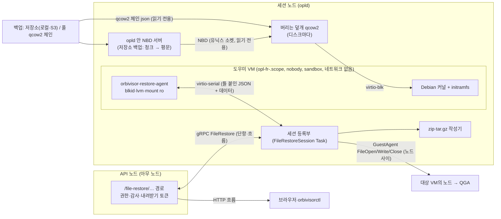

# 파일 단위 복원 설계 — 백업 안 파일 찾아보기·내려받기, 게스트 에이전트로 되돌려 쓰기, 일회용 도우미 VM (계획 69)

작성일: 2026-11-24
상위 문서: `2026-11-23-backup-store2-design.md`(계획 68 저장소·NBD·`backup-serve`, §12.7 "파일 단위 복원을 위한 자리"), `2026-11-04-backup-design.md`(계획 27·28 백업), `2026-11-09-incremental-backup-design.md`(계획 40·41 증분 체인), `2026-11-18-vtpm-secure-boot-guest-agent-design.md`(계획 59 게스트 에이전트), `2026-11-18-folders-permissions-quotas-2fa-design.md`(계획 62 권한), `2026-11-17-install-media-cloud-init-design.md`(계획 57 설치 매체·cloud-init 씨앗 ISO)
기준 트리: 계획 68 끝(`087c3e05`). 이 문서는 구현 전 설계다. 스테이지 보고는 구현하면서 §18에 덧붙인다. 격차 분석(2026-11-16)의 "파일 단위 복원(PBS file restore·Veeam FLR)" 줄을 이 문서가 대신한다.

## 1. 목적

계획 27~68로 백업은 "VM 디스크 통째로"는 다 된다: 풀 백업(qcow2·증분 체인), 저장소 백업(dedup·암호화·S3), 보통 복원·라이브 복원. 그러나 운영에서 가장 흔한 복원 요청은 **"어제 지운 설정 파일 하나"**, **"지난주 그 디렉터리"**다. 지금은 VM 전체를 새 VM으로 복원해 켜고, 콘솔로 들어가 파일을 꺼내야 한다 — 디스크 전체를 쓰고, 네트워크·IP가 겹치고, 몇십 분이 든다. Proxmox Backup Server의 file restore와 Veeam의 FLR(File-Level Recovery)은 이것을 **백업을 열어 파일 탐색기처럼 보고 골라 내려받기**로 해결한다. 빠진 것:

- **찾아보기**: 백업의 디스크 → 파티션(MBR·GPT)·LVM 논리 볼륨 → 파일시스템(ext4·XFS·Btrfs·NTFS·FAT·exFAT) → 디렉터리를 웹·CLI·API로 본다. 디스크를 복원하지 않는다 — 필요한 블록만 백업에서 읽는다(저장소는 4 MiB 청크 임의 읽기, 옛 풀 백업은 qcow2 체인 읽기).
- **내려받기**: 파일 하나는 그대로, 여러 파일·디렉터리는 **zip**(기본, Windows 탐색기가 바로 엶)이나 **tar.gz**(권한·소유자·심볼릭 링크 보존)로 흘려 보낸다.
- **VM으로 되돌려 쓰기**(선택): 실행 중인 VM 안으로 게스트 에이전트(QGA `guest-file-*`)를 통해 파일을 써 넣는다(Veeam "Restore to original location"). 에이전트가 없거나 막혀 있으면 내려받기만.
- **안전**: 백업 안 파일시스템은 **믿을 수 없는 입력**이다(테넌트가 만든 디스크, 랜섬웨어가 망가뜨린 디스크). 그것을 호스트 커널이나 opld 프로세스가 해석하지 않는다 — **일회용 도우미 마이크로 VM**이 읽기 전용으로 붙인 디스크를 마운트하고 좁은 통신 규약으로 답한다(PBS의 restore VM과 같은 길, §7).

원칙: **이 기능을 쓰지 않는 클러스터·백업은 바이트까지 지금과 같다**(Raft JSON, 백업 형식, VM 명령줄). 파일 단위 복원은 백업을 **읽기만** 한다 — 백업 데이터·매니페스트를 바꾸지 않고, 도우미 VM에는 쓰기 가능한 백업 장치가 하나도 없다. 암호화 저장소의 키는 opld를 떠나지 않는다(도우미는 opld가 푼 평문 블록만 NBD로 본다).

2026-11 공개 문서로 아는 것(제품 판마다 다를 수 있다):

| | Proxmox VE 8 + PBS 4 | Veeam B&R 12 | vSphere 8 | Orbivisor 지금(계획 68) | Orbivisor 계획 69 |
|---|---|---|---|---|---|
| VM 이미지 백업 찾아보기 | `proxmox-file-restore`: 일회용 restore VM(QEMU, 작은 커널 + initramfs, vsock), PVE 웹 "File Restore" | FLR: Windows 파일시스템은 마운트 서버(Windows), Linux·기타는 도우미 어플라이언스 VM | 없음(제3자 백업 제품) | 없음(VM 통째 복원뿐) | 일회용 도우미 마이크로 VM(§7), virtio-serial 통신(§9) |
| 파일시스템 | ext4·XFS·Btrfs·NTFS·FAT·ZFS, LVM | NTFS·ReFS·FAT(Windows), ext·XFS·Btrfs·LVM(어플라이언스) | — | — | ext2/3/4·XFS·Btrfs·NTFS·FAT·exFAT, MBR·GPT, LVM2(thin 포함) (§9.4) |
| 내려받기 | 파일 그대로, 디렉터리는 zip·tar.zst | 파일·폴더 복사, zip | — | — | 파일 그대로, zip(zip64·deflate)·tar.gz(pax) (§11) |
| VM 안으로 되돌리기 | 없음(내려받아 직접 올림) | 원래 위치로(VMware Tools·게스트 OS 자격 증명) | — | — | 게스트 에이전트 `guest-file-*`(자격 증명 없음, §12) |
| 미리 만든 파일 목록(카탈로그) | 파일 보관(pxar)만, VM 이미지는 그때 찾아봄 | 게스트 색인(선택) | — | — | 그때 찾아봄(카탈로그·검색은 §16) |
| 암호화 백업 | restore VM은 클라이언트가 푼 청크를 봄 | 암호 문구 | — | 저장소 키는 Raft | 키는 opld 안, 도우미는 평문 NBD만(§7.3) |

## 2. 범위

| 계획 69에 넣는 것 | 넣지 않는 것 |
|---|---|
| 파일 복원 세션: 백업 하나(저장소 백업·옛 풀 백업 전체·증분 체인, 받은 사본, 읽기 전용으로 붙인 저장소의 백업)를 도우미 VM에 붙여 연다. 같은 사용자·같은 백업은 세션 하나를 다시 쓴다 | 실행 중 VM 디스크·스냅샷·복제본(replica)을 찾아보기(§16) |
| 볼륨 찾기: MBR(확장·논리 포함)·GPT, 파티션 없는 디스크, LVM2(선형·줄무늬·미러·thin), 볼륨마다 파일시스템 종류·레이블·크기·마운트 가능 여부 | mdraid, Windows 동적 디스크·저장소 공간, LUKS·BitLocker(알아보고 "지원 안 함"으로 보임), ZFS·ReFS·HFS+·F2FS(§16) |
| 파일시스템: ext2/3/4, XFS(v4·v5), Btrfs(모든 하위 볼륨), NTFS(ntfs3), FAT12/16/32(vfat), exFAT — 읽기 전용, 저널은 버리는 덮개 위에서 재생(§9.4) | 파일시스템 고치기·`fsck` |
| 디렉터리 나열(쪽 나눔), 항목 정보(종류·크기·시각·모드·소유자·링크 대상), 파일 하나 내려받기, 여러 항목을 zip·tar.gz로 흘려 내려받기 | 백업 사이 차이 보기, 이름 검색(카탈로그 — §16), 미리 보기(텍스트·이미지 보기) |
| 게스트 에이전트로 실행 중 VM에 되돌려 쓰기: 파일(디렉터리는 에이전트가 `guest-exec`를 허락할 때), 충돌 정책 `keep`·`skip`·`overwrite`, 크기·개수 한도 | 권한·소유자·ACL·xattr 되돌리기, 꺼진 VM 디스크에 직접 쓰기, Windows 자격 증명으로 SMB 복사(Veeam 길) |
| 도우미 이미지: Debian 13 커널 + 우리 initramfs(정적 Rust 에이전트 + lvm2·blkid), 고정 잠금 파일로 재현 빌드, x86_64·aarch64, deb `orbivisor-restore-image`, Rocky·macOS는 빌드 스크립트 | RPM 꾸러미(Rocky는 소스 빌드 그대로), 이미지 자동 내려받기 |
| 자원·시간 한도(노드당 세션 수, 메모리, 부팅·유휴·최대 시간, 덮개 크기), 감사, 새 권한 `backup.file_restore`, 기능 게이트 | 폴더 할당량에 세지 않음(§13) |
| API·CLI·웹(보호 › 백업의 "파일 찾아보기" 화면), 순수·가짜 도우미·실제 QEMU 시험, GitHub `file-restore` 작업 | Windows 게스트의 실제 에이전트 시험(CI에 Windows 이미지 없음 — 손 확인 절차) |

**기능 하나**(`opl_types::node`, `FEATURES` 끝 — 지금 끝은 `BACKUP_STORE`, `node.rs:416`): **`file-restore`**(`FILE_RESTORE`). 가리는 것: `TaskOp`의 새 둘, 권한 `backup.file_restore`을 쓴 역할·grant, `NodeStatus.file_restore`, 새 경로 전부, 노드 사이 RPC `FileRestore`. 모든 노드(위트니스·관찰 노드 포함)가 알릴 때만 쓰고 아니면 409 `cluster_upgrading`(`require_feature`, 검증보다 먼저). 기능을 아는 것과 **이미지가 있는 것**은 다르다: 이미지는 노드마다 `NodeStatus.file_restore`로 알리고, 세션은 이미지가 있는 노드에서만 연다(없으면 409 `file_restore_unavailable` — 까닭에 "install orbivisor-restore-image").

## 3. 지금 있는 것 (계획 68 끝)

- **백업 읽기 길 둘**: 저장소 백업은 opld 안 NBD 서버(`opl-api/src/tasks/backup_store.rs:1102` `serve` — 디스크마다 내보내기 `disk{i}`, `StoreExport` + 풀린 청크 LRU `ChunkCache`, 유닉스 소켓)와 같은 몸통의 헬퍼 `orbivisord backup-serve`(`opl-store/src/nbd/serve.rs`, `opl-driver/src/backup_serve.rs` — 표준 입력 설정, `opl-bkserve-<id>.scope`, 라이브 복원만 씀). 옛 풀 백업은 qcow2 파일·체인(`tasks/backup.rs:885` `read_manifest`, `:908` `read_chain`), `qemu-nbd`로 내보내는 `opl_driver::nbd_chain_source`(`storage.rs:938`)와 QEMU가 json backing을 명시해 바로 여는 길(계획 68 §11.5, `cmdline.rs:93` `live_restore_source`).
- **NBD**(`opl-store/src/nbd/`): 순수 Rust 클라이언트·서버, `ExportSource` trait(`server.rs:35`), `base:allocation`, 연결 여럿(`CAN_MULTI_CONN`), 읽기 한도 32 MiB.
- **QEMU 띄우기**(`opl-driver/src/qemu.rs:521`): Linux systemd면 `systemd-run --scope opl-vm-<id>.scope`(`scope_args` `:4506`), 가속은 호스트 프로필(`opl-qemu/src/host.rs:83-99` — macOS HVF, Linux는 `/dev/kvm`이 없으면 TCG), aarch64 `virt`·x86 `q35`, QEMU는 root로 돌고 `-runas`·`-sandbox`를 쓰지 않는다.
- **게스트 에이전트**(계획 59, `opl-qemu/src/qga.rs`): 세션(`Session::connect`·`execute`, 답 상한 1 MiB `:26`, 명령 5초 `:30`), `guest-info`·`guest-get-osinfo`·`guest-get-fsinfo`·네트워크(`guest_info` `:190`), 종료, fs-freeze(`:291`), 비밀번호(`:307`). **파일 명령(`guest-file-*`)·`guest-exec`는 아직 없다.** 채널은 한 번에 한 연결이라 VM마다 에이전트 잠금(`VmHandle::agent`, `qemu.rs:288`)을 짧게 쥔다(`qemu/agent.rs` 머리 주석). 노드 사이는 RPC `GuestAgent`(`opl-peer/src/guest.rs:14` `GuestAgentOp::{Info, SetPassword}`), 노드 캐시는 `opld/src/guest.rs`. 비밀번호 설정 API(`opl-api/src/guest.rs:253`)는 VM 쓰기 권한·`guest_agent_unavailable` 409·`node_unreachable` 503 꼴.
- **노드 사이 흐름**: 콘솔은 gRPC 양방향 흐름(`opl-peer/src/client.rs:473` `console`, `server.rs:795`)으로 VM 노드에 중계한다. 내려받기 흐름(파일을 HTTP 응답으로 보내는 곳)은 아직 없다(`Content-Disposition`은 `remote_proxy.rs`의 중계뿐).
- **권한**(`opl-types/src/authz.rs:66-112`): 비트 순서 목록 끝은 `cluster.admin`, 내장 역할(`:249`) — 계획 62 규칙 "새 권한은 operator에 넣지 않는다"(계획 64 `vm.dedicated`도 그렇게). 백업의 주인은 VM(지웠으면 `vm_spec.folder`, `authz/owners.rs`). `PrivSet`은 모르는 이름을 버린다(옛 노드).
- **Task**: 같은 대상의 Task는 차례로(`by_target`), 이어 가는 Task는 `NodeUpgrade`·`NetworkMigrate`·`BackupLiveRestore`뿐(`opl-api/src/tasks.rs:758`). 복원·라이브 복원 Task는 백업의 줄에 선다(`tasks.rs:673`).
- **꾸러미**: deb 하나 `orbivisor`(`packaging/deb/control.in` — `Architecture: amd64`, `Depends`에 `qemu-system-x86`·`qemu-utils`·`ovmf`), 설치 ISO는 Debian 판을 `packaging/iso/debian.lock`(판·URL·SHA-256)으로 못 박는다. svc01·svc02(Rocky 10 aarch64)는 소스 빌드. **압축 crate는 `lz4_flex`뿐**(flate2·zip 없음, `Cargo.toml`), 라이선스 허용 목록 `deny.toml`(MIT·Apache·BSD·ISC·Zlib).
- **ISO 쓰기**(`opl-qemu/src/iso9660.rs:38` `build`): cloud-init 씨앗용 작은 ISO9660+Joliet 작성기(파일 몇 개, 디렉터리 없음).
- **웹**: 보호 › 백업(`web/src/backups/BackupTable.tsx`·`VmBackups.tsx`), 백업 저장소(`web/src/backupStores/`), 늦게 읽는 조각 규칙.
- **CI**: `linux-kvm`(KVM, root, `qemu-it`), `backup-s3`(SeaweedFS), `package`(deb 빌드·설치 시험), `check (ubuntu)`의 `storage-it`.

## 4. 확인한 사실 (커널·QEMU·QGA)

Linux 커널 문서(`Documentation/filesystems/{ext4,xfs,btrfs,ntfs3,vfat}.rst`), QEMU 문서(`qemu-options`, `docs/system/arm/virt.rst`, `qapi/block-core.json`), QGA 스키마(`qga/qapi-schema.json`, 8.2·10.0), RHEL·Rocky의 `qemu-guest-agent` 꾸러미 기본 설정을 근거로 삼는다. **"탐침"**은 스테이지가 실제 QEMU·이미지에서 확인해 §18에 적을 것이다.

- **커널 파일시스템 드라이버는 악의적 이미지에 단단하지 않다**: ext4·XFS·Btrfs 관리자들이 "믿을 수 없는 이미지를 마운트하지 말라"고 적고 syzbot이 마운트 경로 버그를 꾸준히 찾는다. 호스트에서 마운트하면 커널 하나가 뚫려 노드 전체(그리고 클러스터 비밀 — Raft의 저장소 키·원격 토큰)가 넘어간다. 도우미 VM 안에서 뚫리면 그 VM만 넘어간다(§7.2의 다음 벽: QEMU 장치 에뮬레이션·sandbox·권한 내림).
- **RHEL·Rocky 커널에는 Btrfs·ntfs3가 없다**(RHEL 8부터 Btrfs 뺌, ntfs3는 켜지 않음). 호스트 커널을 빌려 쓰는 libguestfs·supermin 길은 Rocky 노드에서 파일시스템이 빠진다 → **커널을 우리가 정해 싣는다**(Debian 13 `linux-image-*`, 6.12 — `CONFIG_BTRFS_FS=m`, `CONFIG_NTFS3_FS=m`, `CONFIG_EXFAT_FS=m`, `CONFIG_XFS_SUPPORT_V4=y`, `CONFIG_DM_THIN_PROVISIONING=m`). **탐침**: 잠금 파일의 판에서 이 설정을 `config-*`로 확인.
- **읽기 전용 장치와 저널**: ext4는 `ro`라도 장치가 쓰기 가능하면 저널을 재생하고, 쓰기 불가면 재생이 필요한 파일시스템의 마운트가 실패한다(`noload`로 건너뜀). XFS는 같은 규칙(`norecovery`), Btrfs는 log tree 재생(`rescue=nologreplay`). 실행 중 VM 백업은 crash-consistent라(fs-freeze가 없으면) 저널 재생이 필요한 경우가 흔하다 → 도우미의 디스크는 **버리는 qcow2 덮개** 위에서 쓰기 가능하게 보이고(백업 원본은 QEMU에서 `read-only=on`), 재생은 덮개에만 쓴다(§9.4).
- **XFS·Btrfs의 UUID 겹침**: 같은 템플릿에서 나온 디스크 둘은 UUID가 같아 XFS는 둘째 마운트를 거절한다(`nouuid`). Btrfs는 6.7부터 단일 장치 파일시스템의 겹친 fsid를 임시 fsid로 받는다. LVM은 같은 VG UUID가 두 장치에 있으면 "duplicate PV"로 하나만 쓴다(한 백업 안에서는 드묾 — 한계로 적음).
- **LVM 읽기 전용 활성화**: `lvm vgchange -ay --config 'global{metadata_read_only=1} devices{...}'`는 메타데이터를 쓰지 않고 활성화한다. thin LV는 `dm-thin-pool`과 `thin_check`가 필요한데 `activation{thin_check_executable=""}`로 검사를 건너뛴다. **탐침**: 선형·thin LV를 쓰기 불가 덮개 없이·덮개 위에서 모두.
- **virtio-vsock은 Linux 호스트의 `vhost-vsock`이 필요하다**(macOS QEMU·HVF에는 없음, Rocky에서는 모듈을 올려야 함). **virtio-serial**(`virtio-serial-pci` + `virtserialport`, 호스트 쪽 chardev 유닉스 소켓)은 모든 호스트·가속에서 되고 게스트 에이전트 채널이 이미 이 꼴이다(`cmdline.rs:347-350`). 대역폭은 KVM에서 100 MB/s 넘게, TCG에서는 CPU에 묶인다. **탐침**: 이 Mac HVF·CI KVM·svc01 TCG에서 1 GiB 파일 흘리기 MB/s.
- **직접 커널 부팅**: `-kernel/-initrd/-append`는 펌웨어 없이 q35(SeaBIOS가 linuxboot로 넘김)·`virt`(QEMU가 바로 Image를 올림)에서 된다. aarch64 `-kernel`은 Image·gzip Image를 받는다. Debian arm64 `vmlinuz`가 EFI zboot 꼴이면 오래된 QEMU가 받지 못할 수 있다 → 빌더가 **푼 `Image`**를 싣는다. **탐침**: QEMU 8.2·10.x·Homebrew 11.1에서 부팅.
- **TCG 속도**: aarch64 TCG는 `-cpu max`의 포인터 인증(QARMA)이 느리다 — `-cpu max,pauth-impdef=on`이 눈에 띄게 빠르다(QEMU 문서 `cpu-features.rst`). MTTCG는 vCPU 둘을 실제로 나란히 돈다. **탐침**: svc01 TCG·CI 러너 TCG(`-accel tcg` 강제)·KVM·HVF에서 "QEMU 시작 → 에이전트 Hello" 시간.
- **QEMU 권한 내림·sandbox**: `-run-with user=<이름>`(9.1+), 그 전에는 `-runas <이름>`(8.2 — 10.x에서 아직 받되 경고). 사용자를 바꾸기 **전에** `-blockdev` 파일·NBD 연결·chardev 서버 소켓을 연다. `-sandbox on,obsolete=deny,elevateprivileges=deny,spawn=deny,resourcecontrol=deny`는 seccomp로 빌드한 QEMU(Debian·Ubuntu·Rocky)에서만 — Homebrew QEMU는 없다. **탐침**: 판마다 받는 이름, sandbox 지원(`-sandbox` 없으면 QEMU가 "seccomp support is disabled"로 실패 → 지원 여부를 미리 물음).
- **QGA 파일 명령**: `guest-file-open {path, mode}` → 핸들(에이전트 전역 — **연결이 바뀌어도 남는다**), `guest-file-write {handle, buf-b64}`(한 메시지는 QGA JSON 한도 안 — 우리는 1 MiB 날 바이트씩), `guest-file-flush`, `guest-file-close`. **이름 바꾸기·디렉터리 만들기·권한 바꾸기 명령은 없다** — `guest-exec {path, arg[], capture-output}` + `guest-exec-status`로만. `guest-info.supported_commands[].enabled`가 허락 여부를 알린다. **RHEL·Rocky의 `qemu-guest-agent`는 기본으로 `guest-file-*`·`guest-exec*`를 막는다**(`/etc/sysconfig/qemu-ga`의 `--block-rpcs`/`FILTER_RPC_ARGS`), Debian·Ubuntu·virtio-win(Windows)은 허락한다. **탐침**: Debian 13 `qemu-guest-agent`가 만든 파일의 모드(umask)·소유자(root), Windows는 손 확인.
- **zip**: 흘려 쓰기는 지역 헤더 + 데이터 + data descriptor(일반 목적 비트 3)로 크기를 미리 몰라도 된다. 4 GiB·65,535 항목을 넘으면 zip64(지역 헤더 extra에 0 크기 자리, 중앙 디렉터리 zip64 extra, zip64 끝 레코드). 이름은 UTF-8 플래그(비트 11). Windows 탐색기·macOS Archive Utility·`unzip`·7-Zip이 data descriptor·zip64를 읽는다. **탐침**: 이 셋으로 4 GiB 넘는 파일과 7만 개 항목 zip을 풀어 봄.
- **tar**: POSIX pax(`x` 헤더로 긴 이름·큰 크기·나노초 시각·UTF-8이 아닌 이름), gzip 흐름. GNU tar·bsdtar가 읽는다.

## 5. 전체 구조



- **세션은 Task**(`TaskOp::FileRestoreSession { backup }`, 대상 = 세션 id): Raft에는 Task 레코드(주인·노드·상태·취소)만, 볼륨 목록·나열 결과는 세션 노드 메모리에. opld가 다시 뜨면 세션은 끝난다(이어 가지 않음 — 다시 열면 된다, §10.5).
- **도우미 VM이 유일하게 파일시스템을 해석한다**. opld는 에이전트가 보낸 이름·크기·바이트를 믿지 않는 데이터로 받아 한도·형식을 검사하고 zip·tar로 묶을 뿐이다.
- **데이터 길**: 백업 → (opld NBD 또는 QEMU qcow2 드라이버) → 덮개 → 도우미 커널 → 에이전트 → virtio-serial → opld(세션 노드) → (노드 사이 gRPC) → API 노드 → HTTP.
- **누가 무엇을 쓰나**: 아무도 백업을 쓰지 않는다. 도우미는 자기 덮개에만 쓴다. 게스트로 되돌려 쓰기 Task만 대상 VM에 쓴다(에이전트로).

## 6. 타입 (opl-types)

모든 새 칸은 빈 값이면 쓰지 않는다(`skip_serializing_if`) — 이 기능을 쓰지 않는 Raft JSON은 바이트 그대로다. **새 리소스 종류는 없다**(`Kind::ALL` 39 그대로, `resource.rs:85`).

- **`TaskOp`** 새 둘:
  - `FileRestoreSession { backup: Uuid }` — 대상은 세션 id(새 UUID, 백업 id가 아님 — 같은 백업의 세션 둘이 줄 서지 않게). 시간 제한 없음(세션이 스스로 유휴·최대 시간으로 끝냄), 이어 가지 않음. Task `detail`(있는 칸)에 단계 `booting|ready|closing`과 만료 시각만 적는다(Raft 쓰기는 단계가 바뀔 때만).
  - `FileRestoreToGuest { session: Uuid, backup: Uuid, volume: String, paths: Vec<EntryPath>, target_dir: String, conflict: GuestConflict(keep|skip|overwrite) }` — 대상은 VM(그 VM의 Task 줄에 섬), 세션 노드에서 돈다.
- **`EntryPath`**: 경로 조각 목록 `Vec<PathPart>`, `PathPart`는 UTF-8 문자열 또는 `{ "b64": … }`(UTF-8이 아닌 이름 — ext4·XFS는 이름이 바이트열). JSON에서 문자열 경로(`"/etc/nginx"`)도 받아 UTF-8 조각으로 나눈다(`/` 나눔, 빈 조각·`.`·`..` 거절).
- **`opl_types::file_restore`**(API 보기, OpenAPI):
  - `FileRestoreSessionView { id, backup, backup_name, node, phase: Booting|Ready|Failed|Closed, error, opened_by, opened_at, last_used_at, expires_at, volumes: Vec<VolumeView> }`.
  - `VolumeView { id: String("disk0", "disk0p2", "lvm/rl/root"), disk: u32, kind: Disk|Partition|LogicalVolume, size, partition: Option<{ table: Mbr|Gpt, number, type_name, uuid }>, fs: Option<String>("ext4"…), label, uuid, mountable: bool, state: Unmounted|Mounted|Failed, note: Option<String>("journal not replayed", "LUKS encrypted — not supported", "LVM physical volume" …) }`.
  - `EntryView { name: String(lossy), raw: Option<String>(base64 — UTF-8이 아닐 때), kind: File|Dir|Symlink|Other, size, mtime, mode, uid, gid, link_target }`, `ListPage { entries, next: Option<String>(커서) }`.
  - `GuestRestoreCaps { os: Linux|Windows|Other, file_write: bool, exec: bool, reason }`(대상 VM의 에이전트가 허락하는 것 — `guest-info.supported_commands`).
- **`NodeStatus.file_restore: Option<FileRestoreNode { image_version: String, arch: Arch, accel: Accel, sessions: u32, max_sessions: u32 }>`** — 이미지가 있고 검사(§8.4)를 지난 노드만 알린다. 세션 수가 바뀔 때만 쓴다(`NodeStatus` `node.rs:78`).
- **권한**: `Privilege::BackupFileRestore = "backup.file_restore"`(목록 끝 — 비트 순서 유지). 내장 operator에 **넣지 않는다**(계획 62 규칙, `vm.dedicated`와 같음): 파일을 하나씩 꺼내는 것은 "VM 통째 복원(새 VM, 폴더·풀·할당량이 걸림)"과 다른 무게의 **데이터 읽기**다 — 헬프데스크에 VM 만들기 없이 줄 수 있고, 줄지 말지를 관리자가 정한다. admin은 모든 권한이라 가진다.
- **설정**(`opld.toml`, `[file_restore]`): `image_dir`(기본 `/usr/share/orbivisor/restore`, macOS 개발은 `{data_dir}/restore-image`), `max_sessions = 4`(노드당), `memory_mib = 512`, `vcpus = 2`, `boot_timeout_secs = 300`, `idle_minutes = 15`, `max_hours = 8`, `overlay_max_mib = 2048`, `run_as = "nobody"`(Linux, 빈 값이면 내리지 않음), `guest_max_bytes = 4 GiB`, `guest_max_files = 10000`, `download_max_entries = 1000000`.
- **순수 함수**: `EntryPath::parse·display`, `volume_id` 규칙, `content_disposition(name)`(RFC 6266 `filename*=UTF-8''…` + ASCII 대체), `guest_target_name(name, conflict, exists, now)`, `guest_path_ok(os, part)`(Windows 금지 문자 `<>:"|?*`·제어 문자·끝 공백/점, Linux는 NUL·`/`), `choose_session_node(...)`.
- **serde 하위 호환 시험**: 옛 `TaskOp`·`NodeStatus`·`Role`(권한 목록) JSON 바이트 그대로, 새 칸 왕복, 옛 노드가 `backup.file_restore`를 버림(`PrivSet::from_names`).

## 7. 격리 — 일회용 도우미 VM

### 7.1 고른 길과 까닭

세 길을 견줬다(§15에 다시):

- **(a) 도우미 마이크로 VM(채택)** — PBS의 restore VM, Veeam의 Linux 도우미 어플라이언스와 같다. 파일시스템 해석은 게스트 커널이 하고, 그 커널이 뚫려도 공격자는 **그 세션의 백업 디스크만 읽을 수 있는 네트워크 없는 VM** 안에 있다. 커널 드라이버라 지원 범위가 넓고(XFS·Btrfs·LVM thin까지) 저널 재생이 정확하다.
- **(b) 사용자 공간 파서**: 순수 Rust 읽기 crate가 ext4(`ext4-view`)·NTFS(`ntfs`)·FAT(`fatfs`)에는 있으나 **XFS·Btrfs·LVM에는 쓸 만한 것이 없다** — RHEL 계열 기본(XFS + LVM)이 빠진다. 저널 재생이 없어 crash-consistent 백업에서 틀린 내용을 보일 수 있다. Rust라 메모리 안전하지만 무한 반복·거대 할당 같은 DoS는 남아 결국 별도 프로세스 sandbox가 필요하다. libguestfs는 C 라이브러리 + 자체 어플라이언스 VM이라 (a)를 남의 것으로 하는 셈이고, LGPL·의존성이 크며 macOS Homebrew 지원이 약하다.
- **(c) 호스트 커널 마운트(거절)** — §4 첫 줄. 사용자 이름공간·`fuse`로 감싸도 커널 드라이버는 호스트 커널이다. macOS 노드는 아예 마운트하지 못한다.

### 7.2 벽의 차례

1. **게스트 커널** — 마운트는 늘 `ro,nodev,nosuid,noexec`, 에이전트는 PID 1(우리 Rust 바이너리, 셸 없음)이라 게스트 안에 다른 프로그램이 돌지 않는다. lvm·blkid는 에이전트가 argv로만 부른다.
2. **QEMU 장치 면** — 장치는 virtio-blk(디스크 수만큼), virtio-serial 하나, 직렬 콘솔(로그), virtio-rng. **네트워크 장치·VNC·USB·9p·virtiofs가 없다**(`-nodefaults -nographic -no-user-config`, `-net none`).
3. **QEMU 프로세스** — Linux: `systemd-run --scope opl-fr-<id>.scope`(VM과 같은 꼴) + `MemoryMax`(설정 메모리 + 256 MiB)·`TasksMax=64`·`CPUQuota`(vCPU × 100%), `-run-with user=nobody`(8.2는 `-runas`)로 열 것을 연 뒤 권한을 내림, seccomp QEMU면 `-sandbox on,…`. macOS는 HVF 자식 프로세스(sandbox 없음 — 개발 노드, 가이드에 적음).
4. **백업 원본** — QEMU `read-only=on`(NBD는 서버가 쓰기를 `EPERM`, qcow2 체인은 파일을 읽기로 엶). 도우미가 덮개를 아무리 써도 백업은 그대로다.
5. **opld 쪽 통신 규약** — 프레임 길이·이름 길이·항목 수·깊이·시간에 상한(§9.2), 모르는 메시지는 세션을 닫는다. 게스트가 보낸 문자열은 로그·감사에 넣을 때 자르고 제어 문자를 이스케이프한다.

### 7.3 암호화 저장소와 키

저장소 백업은 **opld 안 NBD 서버**(계획 68 `serve`, `backup_store.rs:1102`)가 청크를 받아 풀고(복호화·lz4) 평문 블록을 유닉스 소켓(0600, `{run_dir}/file-restore/fr-<id>-nbd.sock`)으로 내보낸다. QEMU는 권한을 내리기 전에 연결하고, 연결이 끊기면 다시 붙지 않는다(`reconnect-delay` 없음 — 세션이 실패로 끝남). 키는 opld 메모리에만 있다: `backup-serve` 헬퍼(표준 입력으로 키를 받는 별도 프로세스)를 쓰지 않는 까닭이다 — 세션은 opld와 생애를 같이하므로 헬퍼가 opld 밖에 살 까닭이 없다(계획 68 스테이지 4가 보통 복원에서 내린 판단과 같음). 도우미 VM은 평문 블록을 보지만 그것은 사용자가 지금 열람하려는 바로 그 데이터다.

### 7.4 명령줄

```
qemu-system-<arch> -name opl-fr-<id> -nodefaults -no-user-config -nographic -net none
  -machine q35,accel=<kvm|tcg>  |  -machine virt,accel=<kvm|hvf|tcg>,gic-version=max
  -cpu host | -cpu max[,pauth-impdef=on (aarch64 TCG)]   -smp <vcpus>   -m <memory_mib>
  -kernel <image_dir>/<arch>/vmlinuz|Image  -initrd <image_dir>/<arch>/initrd.img
  -append "console=ttyS0|ttyAMA0 panic=-1 quiet opl.session=<id> opl.proto=1"
  -blockdev <원본 i>,read-only=on,node-name=src{i}          # NBD 또는 qcow2 체인 json
  -blockdev driver=qcow2,file.driver=file,file.filename=<덮개 i>,backing=src{i},node-name=ov{i}
  -device virtio-blk-pci,drive=ov{i},serial=opl-disk{i}
  -device virtio-serial-pci -chardev socket,id=ctl,path=<ctl 소켓>,server=on,wait=off
  -device virtserialport,chardev=ctl,name=org.orbivisor.restore.0
  -device virtio-rng-pci  -serial file:<콘솔 로그>  -no-reboot
  -run-with user=nobody | -runas nobody   -sandbox on,obsolete=deny,elevateprivileges=deny,spawn=deny,resourcecontrol=deny
```

- 덮개는 `{state_dir}/file-restore/<id>/ov{i}.qcow2`(`qemu-img create -f qcow2`, 가상 크기만 — backing은 명령줄에서만, 계획 68 오버레이와 같은 꼴). 권한을 내린 QEMU가 쓰도록 파일 소유자를 `run_as`로 바꾼다(디렉터리는 0700 root, 파일만 열어 둠 — QEMU가 이미 연 뒤라 실제로는 열린 fd로 쓴다).
- 콘솔 로그는 1 MiB에서 자르고(지킴이가 크기를 봄) 실패 까닭의 마지막 줄만 보인다 — 게스트가 쓴 내용이라 해석하지 않는다.
- 옛 풀 백업 원본: `driver=qcow2,read-only=on,file.filename=<백업 파일>` + 체인이면 backing을 명시한 json(계획 68 §11.5 `live_restore_source`와 같은 함수). 공유가 아닌 dir 풀의 백업은 그 노드에서만.
- `serial=opl-disk{i}`로 에이전트가 장치를 디스크 번호에 맞춘다(`/sys/block/vd*/serial`).

## 8. 도우미 이미지 — 빌드와 배포

### 8.1 내용

| 무엇 | 어디서 | 크기(대략) |
|---|---|---|
| 커널 | Debian 13 `linux-image-<판>-amd64`·`-arm64`(잠금 파일 고정) — x86은 `vmlinuz`, arm64는 푼 `Image` | 10 MB · 35 MB |
| 모듈 | 같은 deb에서 고른 것만: virtio(pci·blk·console·rng), ext4·jbd2·mbcache·crc, xfs, btrfs(+ xor·raid6_pq·zstd·lzo), ntfs3, vfat·fat·nls_cp437·nls_utf8·nls_iso8859-1, exfat, dm-mod·dm-thin-pool·dm-persistent-data·dm-bufio·dm-bio-prison·dm-snapshot·dm-mirror·dm-raid·raid1·raid10·raid456, msdos·efi 파티션은 내장 | 6 MB(zstd) |
| 사용자 공간 | 우리 `orbivisor-restore-agent`(정적 musl, PID 1), Debian `lvm2`(`lvm`), `libdevmapper`, `libblkid`의 `blkid`, `libc6` 등 그 공유 라이브러리(잠금 파일의 deb에서 꺼냄) | 6 MB |
| `manifest.json` | 이미지 판(`orbivisor 판 + 잠금 파일 해시`), 아키텍처, 파일마다 SHA-256, 통신 규약 판 | — |

initramfs는 cpio newc + zstd(커널 내장 해제), 디렉터리 `/bin/{agent,lvm,blkid}`·`/lib/<triplet>/`·`/lib/modules/<판>/`·`/etc/lvm/lvm.conf`(읽기 전용 설정). 셸·busybox는 넣지 않는다.

### 8.2 빌드 — `packaging/restore-image/`

- `debian.lock`(셸 KEY=value, 설치 ISO의 `debian.lock`과 같은 꼴): 아키텍처마다 deb 목록 `NAME VERSION URL SHA256`. URL은 `snapshot.debian.org`(사라지지 않음). 의존성은 풀지 않고 **손으로 적은 목록**(빌드가 ELF `NEEDED`를 따라 빠진 라이브러리를 찾으면 실패하고 이름을 알림).
- `build.sh --arch x86_64|aarch64 --agent <정적 바이너리> --out <dir>`: deb를 받아 해시를 맞추고(어긋나면 실패), `bsdtar`로 `data.tar.*`를 풀고(Linux `libarchive-tools`·Rocky `bsdtar`·macOS 기본), 모듈 목록과 그 `modules.dep` 의존을 모아 `depmod` 없이 우리 `modules.order`를 만들고(에이전트가 차례로 `finit_module`), cpio를 `bsdtar --format newc`로, `zstd -19`로 묶는다. 결과 `vmlinuz|Image`, `initrd.img`, `manifest.json`. 루트 권한이 필요 없고 Linux·macOS 모두에서 같은 바이트(시각·소유자를 0으로)를 낸다 — 재현 빌드는 CI가 두 번 빌드해 해시를 견줘 본다.
- **에이전트 빌드**: `cargo build --release -p opl-restore --bin orbivisor-restore-agent --target <arch>-unknown-linux-musl`, 링커는 `rust-lld`(musl 타깃의 self-contained crt — C 의존성이 없으므로 교차 툴체인 없이 macOS·x86 러너에서 aarch64도 빌드). 에이전트 crate는 C를 쓰는 의존성(ring 따위)을 쓰지 않는다(`deny.toml` 밖에 CI 검사 하나: `cargo tree -p opl-restore --target …-musl`에 `cc` 빌드 스크립트 없음).
- **`packaging/tests/restore-image-test.sh`**: 잠금 파일 형식, 해시 어긋남 실패, 빠진 라이브러리 실패(가짜 deb 고정물), 재현(두 번 빌드 같음).

### 8.3 배포

- **Debian·Ubuntu(deb)**: 새 꾸러미 **`orbivisor-restore-image`**(`Architecture: amd64`, 지금 deb와 같은 범위 — arm64 deb는 본 꾸러미가 arm64를 낼 때 함께), 파일 `/usr/share/orbivisor/restore/x86_64/…`. `orbivisor`가 `Recommends:`로 둔다(설치 ISO는 함께 넣음). 이미지 판은 `orbivisor`와 같은 판으로 묶고 `Depends: orbivisor (= 판)`(통신 규약을 맞춤). 크기 약 25 MB.
- **Rocky(svc01·svc02)·소스 빌드**: `packaging/restore-image/build.sh --arch aarch64 --out /usr/share/orbivisor/restore/aarch64`를 배포 절차에 더한다(가이드 `docs/guide/backup.md`·`development.md`). bsdtar·zstd만 있으면 된다(`dnf install bsdtar zstd`).
- **macOS(개발)**: 같은 스크립트를 `{data_dir}/restore-image`로(`[file_restore] image_dir`). 시험은 `OPL_RESTORE_IMAGE_DIR`로.
- 이미지가 없으면 opld는 경고 한 줄만 남기고(`file restore disabled: no image in …`) `NodeStatus.file_restore`를 쓰지 않는다. 다른 노드에 이미지가 있으면 거기서 세션을 연다(§10.2).

### 8.4 opld가 이미지를 믿는 법

opld는 시작할 때와 `image_dir`의 `manifest.json`이 바뀔 때 파일 해시를 맞춰 보고(10~40 MB 읽기 — 한 번), 통신 규약 판이 자기와 같은지 본다. 어긋나면 그 노드는 파일 복원을 알리지 않는다(까닭을 `NodeStatus`의 경고에). 에이전트는 첫 메시지 `Hello { proto, image_version, kernel }`로 다시 알리고 opld가 같은 판인지 본다.

## 9. 에이전트와 통신 규약, 디스크·파일시스템

### 9.1 에이전트(`crates/opl-restore`, 바이너리 `orbivisor-restore-agent`)

- PID 1로 시작: `/proc`·`/sys`·`/dev`(devtmpfs)·`/run`(tmpfs) 마운트 → `modules.order` 차례로 `finit_module` → `/dev/virtio-ports/org.orbivisor.restore.0`을 엶 → `Hello` → 요청 고리. 패닉·치명 오류면 `reboot(RB_POWER_OFF)`(QEMU `-no-reboot`로 끝남 → opld가 세션 실패로 봄).
- **탐지**(`Probe`): 디스크마다 `blkid -p -o export`(저수준 탐지 — 파티션 표·파일시스템·LUKS·BitLocker·LVM PV·swap), 파티션은 커널이 만든 `vdXN`, LVM은 PV가 하나라도 있으면 `lvm pvscan --cache`·`vgchange -ay`(§4 설정), LV마다 다시 `blkid`. 결과는 `VolumeView` 목록(에이전트가 만들고 opld가 검사).
- **마운트**(`Mount { volume }`, 처음 나열할 때 자동): `/mnt/<volume id>`에 §9.4의 옵션. 실패하면 저널 건너뛰기 옵션으로 한 번 더(성공하면 `note: "journal not replayed — recent changes may be missing"`).
- **나열**(`List { volume, path, cursor, limit ≤ 1000 }`): `openat2(RESOLVE_BENEATH|RESOLVE_NO_MAGICLINKS)`로 볼륨 루트 아래만(심볼릭 링크는 따라가지 않음 — `O_NOFOLLOW`, 링크는 항목으로 보임), `getdents64` 차례 그대로 커서(이름 자체), 항목마다 `statx`.
- **읽기**(`Read { volume, path }`): 일반 파일만, 데이터 프레임으로 흘림. **걷기**(`Walk { volume, paths, follow: false }`): 깊이 우선으로 항목 머리(경로·종류·크기·모드·시각·링크 대상) + 파일 데이터를 차례로 흘림 — opld가 그대로 zip·tar로 옮긴다. 하드 링크는 tar에서 첫 것 뒤로 링크, zip에서는 내용 복사.
- 에이전트의 요청 처리 몸통은 **파일시스템 trait 위**에 짠다(`Fs` — 실제는 마운트 디렉터리, 시험은 호스트의 임시 디렉터리) — 이 몸통이 그대로 opld 시험의 **가짜 도우미**가 된다(§14).

### 9.2 통신 규약(판 1)

- 프레임: `u32 길이(BE, 머리 포함)` · `u32 흐름 번호` · `u8 종류`(`Req`·`Resp`·`Data`·`End`·`Err`) · 내용. `Req`·`Resp`·`Err`는 JSON(≤ 1 MiB), `Data`는 날 바이트(≤ 1 MiB). 흐름 번호로 요청 여럿을 나란히(opld는 세션마다 동시 흐름 4개까지, 에이전트는 흐름마다 스레드 하나).
- 요청: `Probe`, `Mount`, `List`, `Stat`, `Read`, `Walk`, `Cancel { stream }`, `Shutdown`. 에이전트 → opld: `Hello`, `Progress`(걷기 중 30초마다 살아 있음).
- **opld 쪽 한도**(게스트가 보낸 것은 믿지 않음): 이름 ≤ 1024바이트·NUL·`/` 없음, 경로 깊이 ≤ 256, 링크 대상 ≤ 4096, 볼륨 ≤ 256, 한 쪽 항목 ≤ 1000, 걷기 항목 ≤ `download_max_entries`, 선언한 크기보다 많은 데이터·적은 데이터는 그 흐름 오류, 요청 하나에 첫 답 60초·데이터 사이 60초(넘으면 흐름 취소, 세 번 겹치면 세션 실패). 어긋나면 그 세션을 닫는다(`agent protocol violation: …`).
- 처음 `Hello`는 `boot_timeout_secs` 안에(TCG를 생각한 300초 — §4 탐침으로 조정).

### 9.3 볼륨 이름

`disk{i}`(파티션 표 없이 디스크 전체가 파일시스템·PV), `disk{i}p{n}`(파티션 번호 — MBR 논리 파티션은 5부터), `lvm/{vg}/{lv}`(이름은 LVM 규칙 `[A-Za-z0-9+_.-]`만 — 어긋나면 `lvm/{vg uuid}/{lv uuid}`). 볼륨 id는 세션 안에서만 뜻이 있다.

### 9.4 파일시스템과 마운트 옵션

| 종류(blkid `TYPE`) | 마운트 옵션(늘 `ro,nodev,nosuid,noexec`) | 저널을 못 쓸 때 다시 | 비고 |
|---|---|---|---|
| ext2·ext3·ext4 | — | `noload` | 덮개 위라 보통은 재생됨 |
| xfs | `nouuid` | `norecovery,nouuid` | v4는 커널 설정이 받는 동안(§4) |
| btrfs | `subvolid=5` | `rescue=nologreplay,subvolid=5` | 최상위를 붙여 모든 하위 볼륨이 디렉터리로 보임(`@`, `root`…) |
| ntfs | `-t ntfs3,iocharset=utf8` | `force` 없이 실패 표시 | 더러운 볼륨(빠른 시작·최대 절전)은 `ro`로 붙음. 압축·스파스 읽음 |
| vfat | `utf8,shortname=mixed` | — | EFI 시스템 파티션 포함 |
| exfat | `iocharset=utf8` | — | |
| LVM2_member | (마운트 안 함) | — | LV가 따로 볼륨으로 |
| crypto_LUKS·BitLocker | (마운트 안 함) | — | `note: "encrypted (LUKS|BitLocker) — not supported"` |
| swap·zfs_member·linux_raid_member·ReFS·기타 | (마운트 안 함) | — | 종류와 "not supported" |

덮개가 `overlay_max_mib`를 넘으면(지킴이 10초마다) 세션을 닫는다(`the filesystem journal replay wrote more than … MiB`) — 보통 저널 재생은 수십 MiB다.

## 10. 세션

### 10.1 열기

`POST /backups/{key}/file-restore`:
1. 기능·권한(백업 `backup.file_restore`)·백업 상태(`ready`, 받는 중·실패 거절 — 409 `backup_not_ready`)를 본다.
2. **다시 쓰기**: 같은 사용자(principal의 사용자 id, 토큰이면 토큰 주인)·같은 백업의 열린 세션이 있으면 그것을 돌려준다(200). 다른 사용자의 세션은 보이지 않는다(admin은 목록에서 봄).
3. 노드를 고르고(§10.2) Task `FileRestoreSession`을 만든다(202 `{ session }`). 세션 노드의 Task 실행기가 받는다.

세션 Task의 걸음: 원본 준비(저장소 백업은 매니페스트·인덱스를 읽어 opld NBD 서버를 띄움, 풀 백업은 체인 확인) → 덮개 만들기 → QEMU 띄우기 → `Hello` 기다림 → `Probe` → 단계 `ready`(볼륨 목록은 노드 메모리) → 유휴·최대 시간·닫기 요청까지 기다림 → `Shutdown`(5초) → QEMU 끝내기(SIGTERM → 5초 → SIGKILL, scope 치움) → NBD 서버 멈춤 → 덮개 디렉터리 지움 → Task 성공. 실패는 어디서든 같은 치우기를 하고 Task 실패(까닭에 콘솔 로그 마지막 줄).

### 10.2 노드 고르기

후보는 `NodeStatus.file_restore`가 있고 온라인이고 `sessions < max_sessions`인 노드 가운데 백업을 읽을 수 있는 노드: 저장소 백업은 `stores::usable_on_node`(`opl-api/src/stores.rs:229` — 공유 아닌 dir 저장소는 그 노드, S3는 닿는다고 보고한 노드), 풀 백업은 그 풀을 읽는 노드(공유 아니면 백업의 `status.node`). 차례: **API를 받은 노드**(노드 사이 흐름이 없음) → 세션이 적은 노드 → 가속이 KVM·HVF인 노드(TCG보다) → 이름. 후보가 없으면 409 `file_restore_unavailable`(까닭: 이미지 있는 노드 없음 / 모두 꽉 참 / 백업을 읽을 노드에 이미지 없음).

### 10.3 자원·시간

| 한도 | 기본 | 넘으면 |
|---|---|---|
| 노드당 세션 | 4 | 다른 노드, 없으면 409 `file_restore_busy` |
| 메모리·vCPU | 512 MiB·2 | scope `MemoryMax` = 메모리 + 256 MiB(QEMU 자체) |
| 부팅(`Hello`까지) | 300초 | 세션 실패 |
| 유휴(나열·내려받기·되돌려 쓰기 없음) | 15분 | 닫음. 내려받기·되돌려 쓰기가 도는 동안은 유휴가 아님 |
| 최대 | 8시간 | 닫음(진행 중 내려받기는 끊김) |
| 덮개 | 2 GiB | 닫음 |
| 동시 흐름 | 세션당 4 | 429 `file_restore_busy` |

### 10.4 노드 사이

세션 노드가 아닌 API 노드는 새 노드 사이 RPC **`FileRestore`**로 넘긴다(콘솔 흐름 `client.rs:473`과 같은 gRPC 서비스에 메서드 둘): 단항 `FileRestoreCall { session, op: Info|List|Close|Link }` → JSON 답, 서버 흐름 `FileRestoreDownload { session, token }` → 바이트 조각(≤ 1 MiB). 흐름은 HTTP 응답 몸에 그대로 이어 붙이고(되밀림은 gRPC 흐름 제어가 함), 클라이언트가 끊으면 gRPC 취소 → 세션 노드가 에이전트 흐름 `Cancel`.

### 10.5 죽거나 끊기면

| 무엇이 | 일어나는 일 |
|---|---|
| opld가 다시 뜸 | NBD 서버(저장소 백업)가 사라져 도우미의 읽기가 `EIO`. 세션 Task는 이어 가지 않는 Task라 실패로 남는다. 새 opld는 시작할 때 `{run_dir}/file-restore/`·`opl-fr-*.scope`·남은 pid를 모두 치운다(janitor). 사용자는 다시 연다. |
| 도우미 커널 패닉·에이전트 죽음 | QEMU가 끝남(`panic=-1`·`-no-reboot`) → 세션 실패, 까닭은 콘솔 로그 마지막 줄. |
| 저장소가 끊김(S3) | NBD 읽기가 계획 68 다시 하기(60초) 뒤 `EIO` → 그 나열·내려받기만 오류(게스트 커널은 I/O 오류를 그 파일 읽기로 돌려줌). 세션은 산다. |
| 노드가 죽음 | 세션이 사라진다. Task는 노드 죽음 처리(지금 규칙)로 실패. |
| 백업 지우기 | 열린 세션이 있으면 409 `backup_in_use`("a file restore session is open — close it or wait"), `force`면 세션을 닫고 지움. 보존(prune)은 세션이 열린 백업을 이번 회차에 건너뛴다. 저장소 GC는 세션과 무관(지우지 않은 백업의 청크는 표시됨). |

## 11. 내려받기

- **흐름**: `POST /file-restore/sessions/{id}/download-link { volume, paths: [EntryPath], format: auto|raw|zip|tar.gz, name? }` → 200 `{ url, expires_in: 60 }`. 토큰(32바이트 무작위)은 세션 노드 메모리에 요청 본문·사용자 id와 함께, 60초·한 번만. `GET /file-restore/sessions/{id}/download/{token}`은 **같은 사용자의 인증도 다시 본다**(쿠키·토큰 — 링크가 새어도 남이 못 씀). 브라우저가 내려받기를 스스로 하게(큰 zip을 JS 메모리에 담지 않음) 이 두 걸음으로 나눴다. CLI도 같은 두 걸음.
- **형식**: `auto`는 일반 파일 하나면 `raw`, 아니면 `zip`. `raw`는 `Content-Length`(에이전트가 알린 크기 — 어긋나면 흐름을 끊음, HTTP/1.1은 연결 끊음으로 실패가 보임), `Content-Type: application/octet-stream`. zip·tar.gz는 길이 없이 청크 전송.
- **zip**(직접 짠 흘려 쓰기 작성기, `opl-restore::archive::zip`): 항목마다 지역 헤더(UTF-8 플래그, data descriptor, deflate — `flate2` 순수 Rust 백엔드 수준 6, 이미 압축된 확장자(`.zip .gz .xz .zst .jpg .png .mp4 …`)는 저장), zip64는 필요할 때만, 중앙 디렉터리, 끝 레코드. 디렉터리는 `이름/` 항목. **심볼릭 링크·장치·FIFO는 넣지 않고** 끝에 `ORBIVISOR-RESTORE-REPORT.txt`(건너뛴 항목과 까닭, 읽기 오류 난 파일)를 둔다 — 풀 때 링크가 대상 밖을 가리키는 일을 원천에서 막는다.
- **tar.gz**(`archive::tar`): pax 머리(긴 이름, 64비트 크기, 나노초 시각, UTF-8 아닌 이름은 pax `path` 바이트 그대로), 모드·uid·gid·mtime 보존, 심볼릭 링크는 링크로, 하드 링크는 링크로, 장치·FIFO는 건너뛰고 보고서 항목. gzip 수준 6.
- **이름**: 아카이브 안 경로는 고른 항목의 부모에서 시작하는 상대 경로(절대 경로·`..` 없음 — 걷기가 만든 경로라 원래 없지만 다시 거름). 파일 이름 `Content-Disposition`은 `<VM 이름>-<백업 시각>-<마지막 조각>.zip`.
- **읽기 오류**: 한 파일의 `EIO`(저장소 끊김·깨진 블록)는 그 파일을 잘린 채 두지 않는다 — zip은 이미 머리를 보냈으므로 그 항목을 길이 0이 아닌 "오류" 항목으로 끝내고(data descriptor의 실제 크기) 보고서에 적는다; 처음부터 다시 받으라고 UI가 알린다. raw는 흐름을 끊는다.
- **새 의존성**: `flate2`(MIT/Apache-2.0, `rust_backend` = `miniz_oxide`·`crc32fast` — 순수 Rust). `zip`·`tar` crate는 쓰지 않는다(흘려 쓰기·한도·이름 거르기를 우리 뜻대로, 각각 300줄 안팎).
- **할당량·속도**: 내려받기 바이트 한도는 두지 않는다(흐름). 감사에 바이트·항목 수를 남긴다. 대역폭 제한은 §16.

## 12. 게스트 에이전트로 되돌려 쓰기 (선택)

### 12.1 언제 되나

대상은 **실행 중 VM**(원래 VM이 기본, 다른 VM도 됨)이고 게스트 감시(QGA 채널)가 켜져 있고 에이전트가 `guest-file-open`·`guest-file-write`·`guest-file-close`를 허락할 때(`GuestRestoreCaps.file_write`). 디렉터리 만들기·덮어쓰기는 `guest-exec`도 허락해야 한다(`exec`). 허락하지 않으면 409 `guest_agent_restricted`와 까닭("the agent blocks guest-file-* (default on RHEL/Rocky: edit /etc/sysconfig/qemu-ga)"). 웹은 대화상자를 열 때 `GET /vms/{key}/guest/restore-caps`로 미리 보인다.

### 12.2 쓰는 법 (`FileRestoreToGuest` Task)

1. 세션 노드에서 걷기(`Walk`)로 항목을 받으며, 파일마다 대상 경로 = `target_dir` + 고른 항목 기준 상대 경로. 조각마다 `guest_path_ok(os, …)`(Windows 금지 문자·예약 이름 `CON`·`NUL`…, 경로 260자는 `\\?\` 없이 거절) — 거절된 항목은 건너뛰고 Task 경고에.
2. 디렉터리: `exec`가 있으면 `guest-exec`로 만든다 — Linux `/bin/mkdir -p -- <경로>`(argv, 셸 없음), Windows `powershell.exe -NoProfile -NonInteractive -Command "New-Item -ItemType Directory -Force -LiteralPath $args[0]" <경로>`(경로는 1의 거름을 지난 것만 — 따옴표·제어 문자 없음). `exec`가 없으면 `target_dir`(있어야 함) 바로 아래 파일만 된다 — 고른 항목에 디렉터리가 있으면 요청 때 400 `guest_mkdir_unavailable`.
3. 충돌(`guest-file-open mode=r`이 되면 있음): `keep`(기본) → `<이름>.restored-YYYYMMDD-HHMMSS`(`a.conf` → `a.conf.restored-20261124-101500` — 확장자 뒤에 붙여 단순하게, 그 이름도 있으면 `-2`…), `skip` → 건너뜀, `overwrite` → `exec`가 있을 때만: 임시 `<이름>.orbivisor-<task>`에 다 쓴 뒤 `mv -f`(Windows `Move-Item -Force -LiteralPath`)로 바꿈 — 쓰다 끊겨도 원래 파일은 그대로. `exec` 없는 `overwrite`는 400(자르고 쓰다 끊기면 원본을 잃으므로 받지 않음).
4. 파일: `guest-file-open mode=wb` → 1 MiB씩 `guest-file-write`(base64) → `guest-file-flush` → `guest-file-close`. QGA 핸들은 에이전트 전역이라(§4) **에이전트 잠금은 쓰기 한 번(1 MiB)마다 쥐고 놓는다** — 게스트 정보 수집·fs-freeze가 몇 분씩 기다리지 않는다. 대상 VM이 다른 노드면 `GuestAgentOp`의 새 갈래(`FileOpen`·`FileWrite`·`FileClose`·`FileExists`·`Exec`)를 노드 사이 RPC로(`opl-peer/src/guest.rs:14`).
5. 한도: 합계 `guest_max_bytes`(4 GiB)·`guest_max_files`(10,000) — 요청 때 걷기 없이 알 수 없으므로 넘는 순간 멈추고 실패(이미 쓴 파일은 남고 Task 결과에 목록). 진행은 바이트·파일 수로.
6. 소유자·모드·시각·ACL은 되돌리지 않는다(QGA가 만든 파일은 에이전트의 사용자 — Linux root, umask 따름). Task 결과에 "permissions were not restored"를 적고, 가이드가 tar.gz 내려받기를 권한 보존 길로 안내한다.
7. 취소: Task 취소 → 지금 파일을 닫고 임시 파일이 있으면 지움(`exec`로 `rm -f`/`Remove-Item`) → 실패.

### 12.3 안전

- 이름은 **백업 안 파일시스템에서 온 믿을 수 없는 값**이다. 셸을 거치지 않고(argv), Windows 명령줄은 거른 경로만 `$args[0]`으로 넘긴다. `target_dir`은 사용자가 준 값이라 같은 거름을 지난다.
- 대상 VM 권한은 `vm.config`(게스트 안 관리자 권한과 같은 무게 — 비밀번호 설정 `guest.rs:253`과 같음) **그리고** 백업 `backup.file_restore`. 다른 VM의 백업을 이 VM에 쓰는 것도 두 권한이면 된다(테넌트 경계는 두 권한이 지킴).

## 13. 테넌트·권한·감사, 버전 섞임, 다른 기능

**권한**:

| 일 | 필요한 것 |
|---|---|
| 세션 열기·나열·내려받기·닫기(자기 세션) | 백업 `backup.file_restore`(주인 = VM, 지웠으면 `vm_spec.folder`) |
| 남의 세션 보기·닫기 | 루트 `cluster.admin` |
| 게스트로 되돌려 쓰기 | 백업 `backup.file_restore` + 대상 VM `vm.config` |
| 에이전트 허락 보기(`restore-caps`) | 대상 VM `system.read` |
| 이미지·노드 상태 보기 | 루트 `cluster.read`(노드 보기 그대로) |

열린 세션의 요청마다 권한을 다시 본다(콘솔의 다시 보기 `console.rs`와 같은 뜻 — 권한을 빼면 다음 요청부터 403, 세션은 유휴로 닫힘).

**할당량**: 폴더 할당량은 걸지 않는다 — 세션은 볼륨·VM·백업을 만들지 않고, 노드 자원(메모리·덮개)은 노드 한도(§10.3)가 지킨다. 가이드에 "세션은 할당량에 세지 않는다"를 적는다.

**감사**(요청 본문의 경로는 처음 5개 + "and N more", 이름은 제어 문자 이스케이프·200자에서 자름): `backup file-restore open web-20261123-030000 (session 3f2a…, node n2)`, `backup file-restore download web-… disk0p2:/etc/nginx (zip, 12 entries, 3.1 MiB)`, `backup file-restore to-vm web-… disk0p2:/etc/nginx.conf → vm web:/etc/nginx (keep, 1 file)`, `backup file-restore close … (idle)`. 바이트·항목 수는 흐름이 끝난 뒤 감사 레코드에 덧붙인다(계획 60 감사 `AuditNote::detail`을 흐름 끝에 — 끊기면 "interrupted after …").

**버전 섞임·바이트 같음**:
- 새 `TaskOp`·경로·RPC·권한은 모두 `require_feature(FILE_RESTORE)` 뒤다. 역할·grant에 `backup.file_restore`를 넣는 쓰기도 기능 게이트(옛 노드는 이름을 버려 권한 판단이 노드마다 달라지므로).
- 백업 형식·매니페스트·NBD 내보내기·VM 명령줄은 바뀌지 않는다.
- 도우미 이미지 판 ≠ opld 판이면 그 노드는 알리지 않는다(§8.4) — 굴려 올리는 중에는 올린 노드에서만 세션이 열린다.

**다른 기능**:
- **라이브 복원 중 백업**: 같은 백업을 라이브 복원하면서 파일 세션도 열 수 있다(둘 다 읽기만, NBD 서버는 따로).
- **증분 풀 백업**: 체인 전체를 붙여 그 시점의 디스크를 본다. 저장소 백업은 완전한 인덱스라 그대로.
- **받은 사본·읽기 전용 저장소(DR)**: 된다 — DR 클러스터에서 원본 없이 파일을 꺼내는 것이 흔한 쓰임.
- **템플릿·링크드 클론 백업**: 백업은 늘 완전한 디스크라 같다.
- **HA·마이그레이션**: 세션은 VM이 아니라 HA·마이그레이션 대상이 아니다. 노드 비우기(drain)는 세션을 닫는다(Task 취소). 노드 업그레이드는 opld 재시작과 같다.
- **macOS·위트니스**: macOS 노드는 HVF로 된다(sandbox·권한 내림 없음 — 개발용). 위트니스는 Task를 돌리지 않으므로 세션을 받지 않는다.

## 14. API·CLI·웹, 시험과 CI

- **API**(태그 `file-restore`, 기본 경로 `/api/v1`):
  - `POST /backups/{key}/file-restore` → 202 `{ session }`(새로)·200 `{ session }`(다시 씀).
  - `GET /file-restore/sessions`(자기 것, admin은 `?all=1`), `GET /file-restore/sessions/{id}` → `FileRestoreSessionView`(부팅 중이면 `volumes` 빈 목록 — 웹은 2초마다 묻거나 Task watch).
  - `GET /file-restore/sessions/{id}/volumes/{volume}/entries?path=…&path_b64=…&cursor=…&limit=…` → `ListPage`(처음이면 마운트).
  - `GET /file-restore/sessions/{id}/volumes/{volume}/stat?path=…` → `EntryView`.
  - `POST /file-restore/sessions/{id}/download-link`, `GET /file-restore/sessions/{id}/download/{token}`(§11).
  - `POST /file-restore/sessions/{id}/restore-to-vm { volume, paths, vm, target_dir, conflict }` → 202 Task `file-restore-to-guest`. `GET /vms/{key}/guest/restore-caps` → `GuestRestoreCaps`.
  - `DELETE /file-restore/sessions/{id}` → 204(닫기 — Task가 치우고 끝남).
  - 오류: 400 `invalid_path`·`guest_mkdir_unavailable`·`invalid_target_dir`, 403, 404 `volume_not_found`·`entry_not_found`, 409 `cluster_upgrading`·`backup_not_ready`·`backup_in_use`·`file_restore_unavailable`·`file_restore_busy`·`session_not_ready`·`session_closed`·`volume_not_mountable`·`vm_not_running`·`guest_agent_unavailable`·`guest_agent_restricted`, 410 `link_expired`, 429 `file_restore_busy`(동시 흐름), 503 `node_unreachable`, 504 `file_restore_timeout`(에이전트가 60초 안에 답하지 않음).
  - OpenAPI·`schema.d.ts`. 세션은 Task라 `WATCHABLE`의 Task watch로 단계를 본다(새 watch 종류 없음).
- **CLI**(`orbivisorctl`):
  - `backup files open B`(세션 id 출력, `--wait`이면 `ready`까지), `backup files volumes B`(열 `VOLUME DISK KIND FS LABEL SIZE STATE NOTE`), `backup files ls B VOLUME:/path [--long]`(열 `MODE OWNER SIZE MODIFIED NAME`), `backup files get B VOLUME:/path… [-o FILE|-] [--format auto|raw|zip|tar.gz]`(진행을 표준 오류에, `-o -`면 표준 출력 — 파이프), `backup files restore B VOLUME:/path… --vm VM --to DIR [--conflict keep|skip|overwrite] [--wait]`, `backup files sessions [--all]`, `backup files close B|SESSION`. `B`는 백업 이름·id, 세션은 사용자·백업으로 다시 쓰므로 명령마다 `open`이 따로 필요 없다(없으면 열고 기다림 — 첫 명령은 부팅만큼 느림, 안내 한 줄).
- **웹**(계획 61 규칙 — 사이드바 항목을 더하지 않는다):
  - **보호 › 백업** 표와 VM › 백업 탭의 행 동작 **"파일 찾아보기"**(`backup.file_restore`가 없으면 숨김, 이미지 있는 노드가 없으면 비활성 + 까닭) → 경로 `/backups/{id}/files`(늦게 읽는 조각 `web/src/fileRestore/`).
  - 화면: 머리(백업 이름·시각·VM, 세션 상태 칩 — "도우미 VM 부팅 중 0:23"(TCG 노드면 "느린 노드: 1분까지"), 만료까지 남은 시간, 닫기), 왼쪽 **볼륨 나무**(디스크 → 파티션·LV, FS 배지·레이블·크기, 마운트 못 하는 것은 회색과 까닭 툴팁, "저널 재생 안 됨" 경고 배지), 오른쪽 **파일 표**(빵 부스러기, 이 디렉터리 안 이름 거르기, 열 이름·크기·수정 시각·모드·소유자, 무한 쪽 넘김, 심볼릭 링크는 대상 표시, 체크 상자 여러 고르기).
  - 동작 띠: **내려받기**(하나면 파일, 여럿이면 zip, 메뉴에 tar.gz — "권한·링크 보존"), **VM으로 복원**(대화상자: VM 고르기(기본 원래 VM, 실행 중·에이전트만), 대상 디렉터리(기본 원래 부모 경로), 충돌 정책 라디오(허락 안 된 선택은 비활성과 까닭 — RHEL 안내 링크), 한도 안내) → Task 진행 토스트.
  - 빈 상태·오류: 마운트 못 하는 볼륨만 있으면 까닭 목록, 세션 실패면 까닭과 "다시 열기".
  - i18n en·ko `fileRestore.*`, 키보드(화살표·Enter로 들어가기·Backspace로 위로·Space로 고르기), axe.
- **문서**: `docs/guide/backup.md`에 절 "파일 단위 복원"(찾아보기·내려받기·VM으로 복원, 지원 파일시스템 표, 안 되는 것, RHEL 에이전트 설정, 도우미 이미지 설치(deb·소스 빌드·macOS), 보안 모형, PBS·Veeam 견주기, 한계), `docs/architecture.md`(도우미 VM·통신 규약·세션), `web-ui.md`, `development.md`(이미지 빌드, `restore-it`, CI `file-restore`), `docs/index.md`, README 한 줄.

**시험과 CI**:

- **순수(`opl-types`·`opl-restore`)**: serde 하위 호환(§6), `EntryPath` 파싱 표(`..`·빈 조각·b64), `guest_path_ok`·`guest_target_name`·`content_disposition` 표, 프레임 부호화·해석 왕복과 **해석기 proptest**(무작위 바이트·잘린 프레임·거대 길이 — 패닉 없음, 한도 오류), 메시지 한도(이름 1025바이트·깊이 257 거절), zip 작성기(작은·빈·4 GiB 넘는 가짜 흐름의 zip64 머리, 중앙 디렉터리 오프셋, UTF-8 플래그 — 우리가 짠 최소 읽기 검사기 + `storage-it`에서 `unzip -t`·`bsdtar -tf`·Python `zipfile`(있으면)), tar pax(긴 이름·UTF-8 아닌 이름·링크 — `tar -tvzf`), blkid `export` 출력·`lvm` 보고 해석(고정물), 마운트 옵션 표.
- **에이전트 몸통(호스트에서)**: `Fs`를 임시 디렉터리로 두고 실제 통신 규약(소켓 쌍)으로 나열·읽기·걷기·취소·동시 흐름, `RESOLVE_BENEATH`(Linux)·macOS는 같은 뜻의 대체(`O_NOFOLLOW` 조각마다)로 심볼릭 링크 탈출 막기.
- **가짜 도우미로 API(`MockHypervisor`)**: 세션 Task가 가짜 하이퍼바이저의 "도우미"(에이전트 몸통 + 메모리 트리)로 열림, 권한 행렬(`insta` — `backup.file_restore` 없음 403·operator 403·admin 됨·남의 세션 404), 다시 쓰기, 노드 고르기(이미지 없는 노드·꽉 참·API 노드 먼저), 노드 사이 넘김(두 노드 `Env`, 흐름 끊기 → 에이전트 `Cancel`), 토큰(만료 410·두 번째 410·다른 사용자 403), 유휴·최대 시간(시계 조종), 백업 지우기 409·`force`, 보존 건너뜀, 게스트로 되돌려 쓰기(가짜 QGA `qga.rs` 시험 서버를 `guest-file-*`·`guest-exec`를 흉내 내는 임시 디렉터리로 — keep·skip·overwrite·exec 없음 400·한도·취소의 임시 파일 지움, 잠금을 쓰기마다 놓음), 감사 문구, 기능 게이트 409.
- **실제 QEMU(`opl-driver` `qemu-it` + 새 기능 `restore-it` — 이미지 디렉터리가 필요)**: 고정물 디스크(아래)를 붙여 부팅·`Hello`·`Probe` 결과 표, 파일마다 SHA-256 견줌, 저널이 더러운 ext4·XFS(쓰는 중 `kill -9`한 VM의 디스크를 흉내 — 고정물 스크립트가 저널만 쓰고 끝낸 이미지)가 재생된 내용을 보임, `nouuid`(같은 UUID XFS 둘), Btrfs 하위 볼륨, LVM thin, LUKS는 "not supported", 덮개 한도, `-run-with`/`-runas` 뒤 QEMU uid(Linux root), sandbox(seccomp QEMU), 부팅 시간·흐름 MB/s를 §18에(이 Mac HVF, CI KVM, CI 강제 TCG, svc01 TCG).
- **고정물 디스크**(`crates/opl-restore/tests/fixtures/make-disks.sh`, 루트 없이 — Linux: `mke2fs -d`, `mkfs.xfs -p protofile`, `mkfs.btrfs --rootdir`, `mkfs.vfat` + `mcopy`, `mkfs.exfat` + 손으로 짠 파일 없음 검사, `mkntfs` + `ntfscp`, `sfdisk`로 MBR(논리 포함)·GPT, `dd`로 자리 맞춤, LVM은 root가 필요해 `linux-kvm`(root)에서만 `losetup`; macOS는 Homebrew `e2fsprogs`·`dosfstools`·`mtools`·`util-linux`가 있으면 ext4·vfat·표만, 없는 것은 건너뜀을 로그로).
- **opld E2E(`qemu-it` + `restore-it` + `backup-it`)**: (1) 실제 VM(고정물 디스크를 단 꺼진 VM)을 로컬 암호화 저장소에 백업 → CLI `backup files ls`·`get --format zip`·`tar.gz` → 풀어 견줌 → 세션 닫기 → 도우미 scope·덮개·소켓이 남지 않음. (2) 같은 디스크의 옛 풀 증분 체인. (3) 도우미 QEMU `kill -9` → 세션 실패·치움. (4) opld 다시 시작 → 남은 것 치움. (5) **되돌려 쓰기 실제 QGA**: 이미지 빌더의 `--test-guest`(Debian `qemu-guest-agent`를 더한 시험 전용 initramfs — 에이전트 대신 qemu-ga를 띄우는 작은 init)로 VM을 켜고 그 쓰기 가능 디스크에 파일을 되돌려 쓴 뒤 VM을 끄고 디스크를 다시 세션으로 열어 견줌(keep·overwrite·디렉터리).
- **GitHub `file-restore`(새 작업, 러너 하나, KVM·root)**: 이미지 빌드(x86_64 — 잠금 파일 deb 받기, 두 번 빌드해 해시 같음) + aarch64 이미지 빌드만(부팅은 svc01), 고정물 전체(LVM 포함), 위 실제 QEMU 시험과 opld E2E, **`-accel tcg` 강제 실행 한 번**(TCG 부팅 시간 기록), `package` 작업에 `orbivisor-restore-image` deb 빌드·설치 시험(파일 자리·`Depends` 판).
- **할 수 없는 것과 대신**: Windows 게스트 에이전트 되돌려 쓰기(CI에 Windows 없음 — 가이드에 손 확인 절차, 단위 시험은 PowerShell 명령줄 모양까지), RHEL 에이전트의 막힘(가짜 QGA의 `supported_commands`로), 실제 BitLocker(고정물에 머리만 흉내 — blkid가 알아보는지).
- **svc01·svc02**: 일반 시험 묶음, 소스 빌드 이미지(aarch64)로 `restore-it` 실제 QEMU 시험(TCG — 부팅 시간·MB/s를 §18에), 배포 확인 — 기능 `file-restore`·`NodeStatus.file_restore`(aarch64, tcg), 계획 68의 `lab-store` 백업(test-vm, Alpine 라이브 ISO + 빈 2 GiB 디스크)을 열어 "파일시스템 없음"을 보이고, ext4 고정물 디스크를 단 작은 VM을 백업 → 웹에서 파일 하나·zip 내려받기 → 닫기 → 만든 것 지움.
- **웹**: vitest(볼륨 나무·마운트 못 함 까닭, 파일 표 쪽 넘김·고르기·거르기, 부팅 칩과 TCG 안내, 내려받기 링크 두 걸음(msw), VM으로 복원 대화상자의 허락 없는 선택 비활성, 권한 없으면 동작 숨김), axe(찾아보기 화면), Playwright 한 줄기(가짜 도우미 빌드의 opld로 열기 → 디렉터리 들어가기 → 파일 내려받기 — `web-it`), 번들 크기 기록(화면은 늦게 읽는 조각).

## 15. 견준 길

- **격리: 도우미 마이크로 VM(채택) / 사용자 공간 Rust 파서(별도 프로세스 sandbox) / libguestfs / 호스트 커널 마운트(sandbox·사용자 이름공간).** §7.1. 커널 마운트는 호스트 커널이 공격 면이 되어 거절. Rust 파서는 XFS·Btrfs·LVM이 없고 저널 재생이 없다. libguestfs는 같은 VM 길에 C 라이브러리·LGPL·큰 어플라이언스를 더한다. 대가: 부팅 시간(TCG에서 수십 초 — 세션 다시 쓰기·유휴 15분으로 덜어 냄)과 이미지 빌드·배포.
- **통신: virtio-serial(채택) / virtio-vsock(PBS) / 게스트 안 NBD·SSH·9p 네트워크.** vsock은 macOS·HVF에 없고 Linux에서도 `vhost_vsock`을 올려야 한다. 네트워크 장치를 주면 공격 면과 주소 관리가 는다. virtio-serial은 QGA로 이미 쓰는 꼴이고 모든 호스트에서 같다. 대가: TCG에서 대역폭이 CPU에 묶임(§18에 잼).
- **커널: Debian 커널 싣기(채택) / 호스트 커널 빌려 쓰기(supermin) / 우리가 커널 빌드.** 호스트 커널은 Rocky에 Btrfs·ntfs3가 없고 macOS에는 없다. 커널 빌드는 CI 시간과 보안 갱신을 우리가 짊어진다. Debian 커널은 서명된 꾸러미를 해시로 못 박아 그대로 쓰고, 갱신은 잠금 파일 한 줄이다.
- **사용자 공간: 정적 Rust 에이전트 + lvm·blkid만(채택) / busybox 셸 스크립트 / systemd 이미지.** 셸 출력 해석은 이름에 줄바꿈이 든 파일 하나로 깨진다. systemd는 부팅이 느리고 크다. 에이전트는 PID 1이라 게스트 안에 다른 것이 돌지 않는다.
- **원본 붙이기: 덮개 qcow2 + 읽기 전용 원본(채택) / 읽기 전용 장치에 `noload`·`norecovery`로만 / QEMU `snapshot=on`.** 재생 없이 붙이면 crash-consistent 백업에서 최근 파일이 빠지거나 메타데이터가 어긋난다. `snapshot=on`은 덮개를 `TMPDIR`에 두어 자리·크기를 지키지 못한다. 재생이 실패하면 재생 없이로 내려간다(§9.4).
- **암호화 저장소 읽기: opld 안 NBD 서버(채택) / `backup-serve` 헬퍼.** 세션은 opld와 생애를 같이하므로 키를 다른 프로세스에 넘길 까닭이 없다(§7.3).
- **세션 표현: Task(채택) / 새 리소스 `FileRestoreSession` / 노드 메모리만.** Task는 주인·노드·취소·목록·감사를 이미 가진다. 새 리소스는 `Kind`·watch·owners·지우기 규칙을 다 더해야 한다. 노드 메모리만이면 다른 노드의 API가 세션을 찾지 못한다.
- **내려받기 형식: zip + tar.gz(채택) / tar.zst(PBS) / zip만.** Windows 사용자는 zip(탐색기가 바로 엶), Linux는 권한·링크가 남는 tar. zstd는 C 라이브러리(계획 68이 피한 것). 순수 Rust `flate2`(miniz_oxide) 하나로 둘 다.
- **내려받기 전달: 일회용 토큰 링크 + GET(채택) / POST 응답 흐름을 JS로 받아 Blob.** 큰 zip을 브라우저 메모리에 담지 않고 브라우저 내려받기 관리자(멈춤·진행)가 맡는다.
- **게스트로 되돌려 쓰기: QGA `guest-file-*`(+ `guest-exec`)(채택) / 고른 파일을 ISO로 묶어 CD로 꽂음 / 게스트 OS 자격 증명으로 SSH·SMB(Veeam).** QGA는 자격 증명이 필요 없고 이미 채널이 있다. ISO는 에이전트 없이 되지만 사용자가 직접 복사해야 한다(§16에). 자격 증명 길은 비밀을 받아 다뤄야 하고 네트워크 경로가 필요하다.
- **권한: 새 `backup.file_restore`(채택) / `backup.restore` 그대로.** 통째 복원은 새 VM을 만들어 폴더·풀·할당량이 함께 걸리지만 파일 꺼내기는 그런 문이 없는 데이터 읽기다. 따로 두면 "헬프데스크는 파일만"이 된다. 대가: operator가 기본으로 못 함(계획 62 규칙 — 가이드에 역할 예시).
- **카탈로그: 그때 찾아봄(채택) / 백업할 때 파일 목록 블롭.** 백업 때 파일시스템을 읽으려면 백업 경로에 도우미 VM이 끼어 백업이 느려지고 실패 지점이 는다. 매니페스트 v3는 모르는 칸을 받으므로(계획 68 §12.7) 나중에 더할 수 있다.

## 16. 나중 할 일

- **카탈로그와 검색**: 백업 뒤 따로 도는 색인 Task(도우미 VM으로 파일 목록을 만들어 저장소 블롭 `catalog.disk{i}`로), 이름·경로 검색과 "이 파일이 있는 백업" 찾기, 백업 사이 차이.
- LUKS(암호 문구를 받아 도우미 안에서만 염), BitLocker(복구 키 — `dislocker`), ZFS(라이선스 정리 뒤), ReFS·HFS+·F2FS, mdraid, Windows 동적 디스크·저장소 공간.
- 실행 중 VM의 디스크·스냅샷·복제본 찾아보기(fleecing 시점 NBD — 계획 68 §8.1을 그대로).
- 고른 파일을 ISO(Joliet·Rock Ridge — 지금 `iso9660.rs`를 넓혀)로 묶어 VM에 CD로 꽂기(에이전트 없이 되돌리기).
- 게스트로 되돌려 쓸 때 권한·소유자·시각(`guest-exec`로 `chown`·`chmod`·`touch`, Windows ACL은 `icacls`), 꺼진 VM 디스크에 직접 쓰기(도우미 VM에 쓰기 가능하게 붙임 — 위험 검토 필요).
- 더 빠른 부팅: x86 `microvm` 기계형, 미리 띄워 둔 도우미 하나(따뜻한 풀), 커널 모듈을 내장한 우리 커널 설정.
- 파일 미리 보기(텍스트·이미지 — 크기 한도), 내려받기 대역폭 제한, 세션 공유(같은 세션을 여러 사용자가).
- arm64 deb(`orbivisor`·`orbivisor-restore-image`), RPM.

## 17. 스테이지 나누기

각 스테이지는 커밋 하나이고, 혼자 컴파일되고 시험된다. 새 API는 스테이지 5에서 연다. 그 전에는 새 칸이 기능 게이트와 API 검증에 막혀 쓰이지 않는다. 탐침 결과(§4의 탐침)는 그 스테이지가 §18에 적는다.

1. **feat(types,cluster): 파일 복원 타입 — 세션·게스트 되돌려 쓰기 TaskOp, 경로·볼륨·항목 보기, 노드 file_restore 상태, 권한 backup.file_restore, 기능 file-restore** — `opl-types/src/file_restore.rs`(`EntryPath`·`PathPart`·`VolumeView`·`EntryView`·`ListPage`·`FileRestoreSessionView`·`GuestRestoreCaps`·`GuestConflict`), `TaskOp` 둘, `NodeStatus.file_restore`, `Privilege::BackupFileRestore`(operator 제외), 순수 `guest_path_ok`·`guest_target_name`·`content_disposition`·`choose_session_node`, 역할·grant 쓰기의 기능 게이트, 임시 API 막기, serde 하위 호환, `schema.d.ts`.
2. **feat(restore): opl-restore crate — 통신 규약(프레임·메시지·한도), 에이전트 몸통(Fs trait·탐지 해석·마운트 옵션·나열·읽기·걷기), zip·tar.gz 흘려 쓰기 작성기, 에이전트 바이너리(Linux musl)** — 새 crate `crates/opl-restore`(`proto.rs`, `agent/{mod,probe,mount,fs}.rs`, `archive/{zip,tar}.rs`, `bin/agent.rs`), 의존성 `flate2`(`rust_backend`, `deny.toml` 확인), 해석기 proptest, 고정물 해석 시험, 호스트 임시 디렉터리 위 에이전트 몸통 시험, `storage-it`의 `unzip`·`bsdtar` 견줌.
3. **build(packaging): 도우미 이미지 빌더 — Debian 잠금 파일, initramfs(에이전트·lvm·blkid·모듈), x86_64·aarch64, deb orbivisor-restore-image, 고정물 디스크 스크립트** — `packaging/restore-image/{build.sh,debian.lock}`(설명은 스크립트 머리 주석), `packaging/deb/restore-image.control.in`·`build-deb.sh`에 둘째 꾸러미, `packaging/tests/restore-image-test.sh`, `crates/opl-restore/tests/fixtures/make-disks.sh`, 커널 설정 탐침(§4)을 §18에, `.github/workflows/ci.yml`의 `package`에 이미지 deb.
4. **feat(driver,qemu,opld): 도우미 VM 띄우기 — 명령줄·덮개·NBD/qcow2 원본·scope·권한 내림·sandbox, 에이전트 채널 클라이언트(한도·시간), 남은 것 치우기, 이미지 검사와 노드 알림, 실제 QEMU 탐침** — `opl-qemu/src/cmdline.rs`의 `build_restore_helper_cmdline`, `opl-driver/src/file_restore.rs`(`start_helper`·`HelperClient`·`stop_helper`·`sweep_leftovers`·덮개 지킴이), 하이퍼바이저 trait 갈래(가짜 하이퍼바이저는 에이전트 몸통 + 메모리 트리), opld `[file_restore]` 설정·이미지 검사·`NodeStatus.file_restore`, `restore-it` 기능, `qemu-it` 탐침(부팅 시간·MB/s·저널 재생·`nouuid`·LVM thin·권한 내림·sandbox)을 §18에.
5. **feat(api,peer,cli): 파일 복원 세션 API — 세션 Task·노드 고르기·opld NBD 연결·유휴/최대 시간, 나열·내려받기 토큰과 zip/tar.gz 흐름, 노드 사이 FileRestore RPC, 백업 지우기·보존과의 관계, 감사, oplctl backup files** — `opl-api/src/file_restore.rs`(경로·권한·토큰·흐름), `tasks/file_restore.rs`(세션 Task), `opl-peer`의 `FileRestoreCall`·`FileRestoreDownload`, `backups.rs`·`backup_jobs.rs`의 `backup_in_use`·보존 건너뜀, 경로표·오류 코드·OpenAPI·`schema.d.ts`, oplctl `backup files open|volumes|ls|get|sessions|close`, opld E2E (1)~(4).
6. **feat(qemu,driver,peer,api,cli,ci): 게스트 에이전트로 되돌려 쓰기 — QGA guest-file-*·guest-exec, 에이전트 잠금을 쓰기마다, 노드 사이 GuestAgentOp 갈래, FileRestoreToGuest Task, restore-caps, oplctl backup files restore, GitHub file-restore 작업** — `opl-qemu/src/qga.rs`(`file_open`·`file_write`·`file_flush`·`file_close`·`exec`·`exec_status`·`supported_commands`), 하이퍼바이저 `guest_file_*`, `opl-peer/src/guest.rs` 새 갈래, `tasks/file_restore.rs`의 되돌려 쓰기, `GET /vms/{key}/guest/restore-caps`, 이미지 빌더 `--test-guest`와 E2E (5), `.github/workflows/ci.yml`의 `file-restore`(이미지 빌드·재현·고정물·실제 QEMU·TCG 강제), 측정값을 §18에.
7. **feat(web): 파일 찾아보기 화면 — 볼륨 나무·파일 표·부팅 상태·내려받기·VM으로 복원 대화상자, 백업 표 동작** — `web/src/fileRestore/`(늦게 읽음), `web/src/backups/BackupTable.tsx`·`VmBackups.tsx` 동작, 경로 `/backups/:id/files`, i18n en·ko, vitest·axe·Playwright, 번들 크기.
8. **docs: 백업 가이드의 파일 단위 복원·도우미 이미지 설치·보안 모형·RHEL 에이전트 설정, 아키텍처, 설계 문서 스테이지 보고, 계획 69 실행 기록** — `docs/guide/backup.md`, `docs/architecture.md`, `web-ui.md`·`development.md`, `docs/index.md`, README 한 줄, `docs/superpowers/plans/2026-11-24-plan69-file-restore.md`.

## 18. 스테이지 보고 (설계와 다른 것·결정)

### 스테이지 1 (opl-types·opl-api·opld)

- **`EntryPath`·`PathPart`**: 조각은 바이트열(`PathPart(Vec<u8>)`)로 들고, JSON은 UTF-8이면 문자열·아니면 `{ "b64": … }`(표준 base64, 다른 칸이 있으면 거절). `{b64}`가 UTF-8로 풀리면 문자열로 되쓴다(같은 이름의 두 꼴이 생기지 않게). 문자열 경로는 앞 `/` 하나만 받고 빈 조각(`//`·끝 `/`)·`.`·`..`·NUL은 거절, 조각 ≤ 1024바이트·깊이 ≤ 256(`MAX_NAME_BYTES`·`MAX_PATH_DEPTH`). 빈 목록·`"/"`는 볼륨 루트. OpenAPI 스키마는 손으로(조각 목록 또는 문자열).
- **볼륨 id**: `disk_volume_id`·`partition_volume_id`·`lv_volume_id(vg, lv, vg_uuid, lv_uuid) -> Option`(이름도 UUID도 LVM 규칙에 어긋나면 그 LV는 보이지 않음 — 게스트 값이라), API 입력 검사 `valid_volume_id`(앞 0 없는 수만, LVM 이름 1~127바이트 `[A-Za-z0-9+_.-]`·`-`로 시작 안 함).
- **`FileRestoreNode.accel`은 `Accel`이 아니라 문자열**: 다른 저장 칸(`NodeCpu.accel`)처럼 모르는 값이 와도 `NodeStatus`를 풀게. `accelerated()`가 `cpu::Accel::parse`로 읽는다. 다시 등록할 때(`bootstrap::record_node`) `file_restore`는 지운다(세션이 없어졌고 이미지를 다시 검사 — 스테이지 4가 쓴다).
- **`choose_session_node(candidates, api_node) -> Result<Uuid, NoSessionNode>`**: 후보는 `SessionNodeCandidate { id, name, online, reads_backup, file_restore }`(백업 읽기 판단·위트니스 거르기는 부르는 쪽). 오류 갈래 `NoImage`·`NoReader`(이미지는 있으나 백업을 읽는 노드에 없음)·`Busy`, `code()`는 `file_restore_busy`/`file_restore_unavailable`.
- **`guest_target_name(name, conflict, exists, now) -> Result<GuestTarget{Write(이름)|Skip|Overwrite}, NoFreeName>`**: `keep`은 `.restored-YYYYMMDD-HHMMSS`(UTC), 그다음 `-2`…`-99`까지(`MAX_KEEP_NAMES`) — 모두 있으면 오류(그 파일 실패로 적음, 조용히 건너뛰지 않음). 임시 이름은 `guest_temp_name(name, task)`. `guest_path_ok(os, part) -> Result<(), GuestPathError>`(Windows 예약 이름은 확장자가 붙어도·`COM1`~`9`·`LPT1`~`9`, `Other`는 Linux 규칙). 경로 260자 검사는 대상 경로를 잇는 스테이지 6에.
- **`content_disposition`**: ASCII 대체에서 ASCII 아닌 글자·`"`·`\`·`/`·제어 문자를 `_`로, `filename*`은 RFC 5987 attr-char 밖을 `%XX`.
- **권한 `backup.file_restore`**: 목록 끝(비트 27번째). 역할 만들기·바꾸기와 토큰 범위 만들기에 이 이름이 있으면 `permissions::check_privilege_features`가 검증보다 먼저 `file-restore` 기능을 보고(409 `cluster_upgrading`), **임시로 400 "backup.file_restore is not available yet (file restore)"** — 스테이지 5가 400을 뺀다. 내장 admin은 가지고 operator는 가지지 않는다. grant는 권한 이름을 담지 않으므로(역할을 가리킴) 따로 막지 않는다.
- **Task 둘**: `TaskOp::needs_file_restore()`, `create_task`가 기능을 본다. 실행기는 "file restore tasks are not available yet"로 실패(스테이지 5·6이 채움). `FileRestoreToGuest.conflict`는 늘 쓴다(새 Task라 바이트 같음 문제 없음). 시험 `crates/opl-api/tests/file_restore_types.rs`.
- 세션·볼륨·항목 보기 타입(`FileRestoreSessionView`·`VolumeView`·`EntryView`·`ListPage`·`GuestRestoreCaps`)은 경로가 없어 아직 OpenAPI에 나오지 않는다(스테이지 5). `EntryView.mtime`은 `i64`(1970 전), `EntryView::part()`가 `raw`/`name`에서 되보낼 조각을 만든다. `FileRestoreSessionView.opened_by`는 사용자 id(Uuid).

### 스테이지 2 (opl-restore)

- **opl-types에 기대지 않는다**: opl-types가 ring(cc 빌드 스크립트)을 끌어와 정적 musl 에이전트를 C 툴체인 없이 빌드할 수 없다. 통신 규약의 한도(`MAX_NAME_BYTES`·`MAX_PATH_DEPTH`·`MAX_LINK_TARGET`·`MAX_VOLUMES`·`MAX_PAGE_ENTRIES`)·볼륨 id 규칙(`valid_volume_id`·`lv_volume_id`)·이름의 JSON 꼴(문자열 / `{b64}`)을 `proto`에 따로 두고, opl-types와 같은지는 dev-dependency로 시험한다(상수 비교·proptest). 에이전트의 `proto::Volume`은 `VolumeView`에서 `state`를 뺀 것(상태는 opld가 든다) — 보기로 옮기는 것은 스테이지 4. CI `check (ubuntu)`에 musl 두 타깃의 `cargo tree`에 `cc`·`ring`·`openssl-sys`가 없는지 보는 걸음을 더했다.
- **흐름 규칙**: 흐름 0은 에이전트의 `Hello`만, 요청마다 새 흐름(1 이상), 답은 `Resp`·`Data` 0개 이상 뒤 `End`나 `Err` 하나. `Cancel`·`Shutdown`도 자기 흐름에 `End`. 답 종류 `hello|volumes|mounted|page|entry|file_head|item|file_error|skipped|progress`, 오류 코드 `not_found|not_dir|not_file|symlink|not_mountable|mount_failed|io|bad_request|busy|cancelled`. opld 쪽 검사는 `StreamCheck`(요청에 맞는 답·차례·선언 크기와 데이터·쪽 정렬·커서·걷기 항목 수 한도·글자 칸 1 KiB `MAX_TEXT`). 항목 없는 걷기(빈 루트)도 성공이다 — proptest가 찾았다.
- **`Walk { follow }` 대신 `hardlinks: bool`**: 링크는 늘 따라가지 않으므로 `follow`를 뺐고, tar는 같은 inode의 둘째 파일부터 데이터 없이 `Item.hardlink`(아카이브 안 첫 경로)를, zip은 내용을 다시 받는다. `Attrs`에 `mtime_nsec`·`nlink`.
- **나열 차례와 커서**: getdents 차례 대신 **이름 바이트 차례**(디렉터리 이름만 다 읽어 정렬하고 그 쪽만 stat). 커서 = 앞 쪽 마지막 이름(`Name`). UI에 안정된 차례가 나오고, 커서가 이름이라 어느 쪽이든 같은 비용이다. stat에 실패한 항목은 `other`로 보인다. 루트 `Stat`의 이름은 `(root)`.
- **경로 따라가기**: `openat2(RESOLVE_BENEATH)` 대신 **조각마다 `openat(O_NOFOLLOW|O_DIRECTORY)`**, 마지막 조각은 `fstatat(AT_SYMLINK_NOFOLLOW)`·`openat(O_NOFOLLOW|O_NONBLOCK)` 뒤 종류를 다시 봄. 조각에 `/`·`..`가 없으므로 같은 뜻이고, 같은 코드가 macOS·Linux 시험(svc01 aarch64)에서 돈다. `statx` 대신 `fstatat`(btime을 쓰지 않음).
- **걷기**: 루트를 고르면 그 아래 항목들, 고른 항목 이름이 겹치면 둘째는 `skipped`. 깊이 256에서 멈추고 `skipped`. 읽기 오류는 그 파일만 `file_error`(그 뒤 하드 링크 원본에서 뺌). 다른 틀이 30초 없으면 `progress`. 에이전트 흐름 상한 8(넘으면 `busy`).
- **탐지**: 디스크는 `/sys/block/vd*/serial`의 `opl-disk{i}`, 파티션은 sysfs `partition`, MBR 확장 파티션(0x05·0x0f·0x85)은 볼륨이 아님, 파티션 표만 있고 파티션이 없으면 디스크를 `empty partition table`로, 아무것도 없으면 `no filesystem found`. LV는 VG의 첫 PV가 있는 디스크, 씬 풀·VDO 풀은 빼고, 활성화되지 않은 LV는 `logical volume could not be activated`. LV 장치는 `lv_dm_path`(udev 없이 `/dev/vg/lv` 링크가 없을 수 있음). blkid 글자 칸은 256바이트에서 자른다. GPT·MBR 종류 이름 표.
- **마운트**: `/mnt/v{n}`(볼륨 id의 `/` 때문에 차례 번호), ext2·ext3도 `ext4` 드라이버. 나머지는 §9.4 표 그대로.
- **PID 1(Linux만, `agent::linux`)**: udev가 없어 포트는 `/sys/class/virtio-ports/*/name`으로 찾는다(30초). 커널 명령줄 `opl.proto`가 1이 아니면 끈다. 모듈은 `/lib/modules/<uname -r>/modules.order`의 상대 경로를 차례로 `finit_module`(`.xz`·`.zst`·`.gz`는 `MODULE_INIT_COMPRESSED_FILE`, `EEXIST`는 넘김). 이미지 판은 `/etc/orbivisor/image-version`(없으면 `orbivisor <crate 판>`). lvm은 `--config 'global{metadata_read_only=1} activation{thin_check_executable="" udev_sync=0 udev_rules=0 verify_udev_operations=1 monitoring=0} devices{obtain_device_list_from_udev=0} backup{backup=0 archive=0}'`. **스테이지 3 이미지가 줄 것**: `/dev/console`, `/bin/blkid`·`/bin/lvm`, 위 파일들. musl 빌드 자체는 이 Mac·svc01에 musl 타깃이 없어 돌려 보지 못했다(Linux gnu에서 clippy·시험은 지남) — 스테이지 3이 처음 빌드한다.
- **zip**: UTF-8이 아닌 바이트·`\`·제어 문자는 `%XX`로 바꿔 쓰고 보고서에 `renamed:`(Windows가 `\`를 구분자로 읽어 밖에 쓰지 않게). 선언 크기 0xFF000000부터 지역 헤더 zip64, `force_zip64()`(시험)로 작은 파일도 zip64 머리. 유닉스 모드(외부 속성)·확장 시각(0x5455). 디렉터리는 data descriptor 없음. 보고서는 적을 것이 있을 때만(이름이 겹치면 `-2`…).
- **tar.gz**: pax `x` 머리는 필요할 때만(ASCII가 아니거나 100바이트 넘는 이름·링크, 8 GiB 넘는 크기, 큰 uid/gid, 나노초·음수 시각), UTF-8이 아니면 `hdrcharset=BINARY`. 하드 링크는 **앞서 넣은 링크 수 2 이상 파일**만 가리킴(아니면 건너뜀). 짧게 끝난 파일은 0으로 채우고 보고서에.
- **경로 거르기(`archive::PathGuard`)**: 두 작성기 모두 깊이 우선 차례를 다시 본다 — 부모는 앞서 받은 디렉터리여야 하고 같은 경로는 한 번, 건너뛴 디렉터리의 아래도 건너뜀. 그래서 도우미가 링크·파일 아래로 쓰려 한 항목은 풀 때 밖에 아무것도 만들지 못한다(`unzip`·`tar` 시험). 스테이지 6 되돌려 쓰기도 이것을 쓸 수 있다. `archive::Feeder`가 `StreamCheck` 사건을 작성기로 옮긴다.
- **시험**: 순수(프레임·이름·흐름 검사·탐지 고정물 `tests/fixtures/probe`·마운트 표·DOS 시각·pax), proptest(해석기 무작위 바이트·자르기·거대 길이·검사기 무작위 틀, 무작위 나무 zip·tar 왕복, opl-types 규칙 같음), 우리 최소 zip·tar 읽기 검사기(`tests/common`), 에이전트 몸통(소켓 쌍 + 임시 디렉터리·메모리 나무: 쪽 나눔·링크 탈출·하드 링크·읽기 오류·취소·동시 흐름·busy·progress), `storage-it`의 `archive_tools`(unzip -t·풀기, bsdtar, GNU tar, Python zipfile, 7만 항목 zip64). bsdtar·python3는 있으면(svc01에 bsdtar 없음), CI는 `unzip libarchive-tools`를 깐다.

### 스테이지 3 (packaging)

- **잠금 파일**(`packaging/restore-image/debian.lock`): Debian 13.8(trixie) `snapshot.debian.org/archive/debian/20261122T000000Z`의 꾸러미를 아키텍처마다 17개 — `linux-image-6.12.117+deb13-{amd64,arm64}`(서명된 판, 직접 부팅이라 서명은 쓰지 않음), `util-linux`(trixie의 `blkid`는 따로 꾸러미가 없고 `util-linux`의 `/usr/sbin/blkid`), `lvm2`, 라이브러리 14개(`libblkid1 libdevmapper1.02.1 libdevmapper-event1.02.1 libaio1t64 libudev1 libselinux1 libpcre2-8-0 libc6 libsystemd0 libcap2 libedit2 libbsd0 libmd0 libtinfo6` — `libdevmapper-event`는 NEEDED 검사가 찾았다). snapshot에서 받지 못하면 같은 pool 경로를 `deb.debian.org`(`DEBIAN_MIRROR`)에서 한 번 더 받는다(해시는 같아야 하므로 안전, CI에서 snapshot이 자주 느림). 받은 deb은 캐시(`--cache`)에 두고 해시는 늘 다시 본다.
- **커널 설정 탐침(§4)** — 두 아키텍처 같음: `BTRFS_FS=m`, `NTFS3_FS=m`, `EXFAT_FS=m`, `XFS_FS=m`·`XFS_SUPPORT_V4=y`, `EXT4_FS=m`, `VFAT_FS=m`, `BLK_DEV_DM=m`·`DM_THIN_PROVISIONING=m`·`DM_SNAPSHOT`·`DM_MIRROR`·`DM_RAID=m`, `MD_RAID1`·`10`·`456=m`, `RD_ZSTD=y`, `DEVTMPFS=y`, `MSDOS_PARTITION=y`·`EFI_PARTITION=y`, `VIRTIO_PCI=y`·`VIRTIO_CONSOLE=y`(내장), `VIRTIO_BLK=m`, `HW_RANDOM_VIRTIO=m`, `MODULE_COMPRESS_XZ=y`·`MODULE_DECOMPRESS=y`, `MODULE_SIG_FORCE` 없음, `LOCK_DOWN_KERNEL_FORCE_NONE=y`, `CRYPTO_CRC32C=m`·`CRYPTO_XXHASH=m`·`CRYPTO_BLAKE2B=m`(`CRYPTO_SHA256=y`), `FAT_DEFAULT_IOCHARSET="ascii"`. `build.sh`가 필요한 값(y만 되는 것·y나 m)을 찍고 모자라면 실패한다.
- **arm64 커널은 이미 푼 `Image`**(37.7 MB — EFI zboot·gzip이 아님)라 그대로 싣는다. gzip이면 풀고 zboot면 실패(지원하지 않음). x86은 `vmlinuz`(bzImage 12.2 MB).
- **모듈**: `modules.dep`은 deb에 없다(postinst의 depmod가 만든다) → `.modinfo`의 `depends=`·`softdep=pre:`를 따라 모으고 **풀어서**(xz) 넣는다 — 커널의 압축 모듈 지원에 기대지 않고, initramfs 전체를 zstd로 묶어 더 작다(서명은 풀린 `.ko` 안에 그대로). modprobe가 없어 커널이 이름으로 부르는 것(`request_module`)이 올라오지 않으므로 **암호 알고리즘 `crc32c_generic`·`xxhash_generic`·`blake2b_generic`을 맨 먼저**, vfat의 기본 iocharset인 **`nls_ascii`**도 넣었다(없으면 vfat 마운트가 `IO charset ascii not found` — svc01 부팅에서 찾음). arm64 42개·x86 41개, 내장인 `virtio_pci`·`virtio_console`은 건너뛴다.
- **initramfs**: `/init` → `bin/orbivisor-restore-agent`(심볼릭 링크), `/bin/{orbivisor-restore-agent,blkid,lvm}`, `/lib/<triplet>/`(soname 이름의 파일 15개, 링크 없음), 동적 링커는 PT_INTERP 자리(x86 `/lib64/ld-linux-x86-64.so.2`, arm64 `/lib/ld-linux-aarch64.so.1`), `/lib/modules/<커널 판>/kernel/…` + `modules.order`, `/etc/lvm/lvm.conf`, `/etc/orbivisor/image-version`, `/dev/console`(5,1), 빈 `/proc /sys /run /mnt /tmp`. glibc는 `ld.so.cache` 없이 Debian 다중 아키텍처 기본 경로로 찾는다. 크기 arm64 6.0 MB·x86 7.1 MB(zstd -19).
- **cpio는 bsdtar가 아니라 `imagetool.py`가 직접 쓴다**: bsdtar의 mtree 입력(`contents=`)은 `inode=`를 무시하고 원본 파일의 inode를 newc 머리에 넣어 빌드마다 바이트가 달랐다(재현 시험이 찾음). newc는 단순해 소유자 0·시각 0·차례 inode·장치 노드(루트 없이)를 직접 쓴다. 같은 에이전트로 이 Mac(zstd 1.5.7)과 svc01(Rocky, zstd 1.5.5)에서 만든 cpio는 바이트까지 같고, 압축본은 zstd 판이 같을 때만 같다(같은 호스트 두 번은 같음).
- **Python 3이 필요하다**(설계는 bsdtar·zstd만): ELF NEEDED·PT_INTERP, `.modinfo`, xz 풀기, cpio·manifest 쓰기를 표준 라이브러리로 하는 `packaging/restore-image/imagetool.py`. Rocky·Ubuntu·macOS에 기본으로 있다. bsdtar는 deb(ar)·`data.tar.*` 풀기에만 쓴다(Rocky `dnf install bsdtar zstd`).
- **이미지 판**: `orbivisor <판> lock-<debian.lock SHA-256 앞 12자>`(예 `orbivisor 0.1.0 lock-233004539824`, 판 기본은 워크스페이스 판, `--version`). `/etc/orbivisor/image-version` = `manifest.json`의 `image_version` = 에이전트의 `Hello.image_version`. manifest 칸: `arch`, `files { <커널 파일>, initrd.img → SHA-256 }`, `image_version`, `initrd`, `kernel`(`vmlinuz`|`Image`), `kernel_release`, `proto`(`proto.rs`의 `PROTO_VERSION`). 결과는 커널·initrd 다음 manifest를 맨 나중에(임시 이름 → mv).
- **에이전트 musl 빌드**(처음 실제로 함): 이 Mac에서 `x86_64`·`aarch64-unknown-linux-musl` 둘 다 링커 `rust-lld`로 C 툴체인 없이 된다(x86 static-pie 1.26 MB, aarch64 static 1.27 MB). svc01(rustc 1.100)에서도 `aarch64-unknown-linux-musl`. `--agent` 없이 부르면 `build.sh`가 이렇게 빌드한다(`CARGO_TARGET_<T>_LINKER` 기본 `rust-lld`).
- **deb**: `orbivisor-restore-image`(`Architecture: amd64`, `Depends: orbivisor (= 판)`), 파일 `/usr/share/orbivisor/restore/x86_64/{vmlinuz,initrd.img,manifest.json}`과 `/usr/share/doc/orbivisor-restore-image/{copyright,debian.lock}`(GPL 바이너리의 출처 — snapshot의 같은 판 소스). `orbivisor`가 `Recommends:`. `build-deb.sh`는 `OPL_RESTORE_IMAGE_DIR`이 있을 때만 셋째 꾸러미를 만들고, manifest의 이미지 판이 꾸러미 판·저장소 debian.lock과 맞는지·x86_64인지 본다. CI `package`는 액션(iso.yml도 씀 — 건드리지 않음)으로 두 꾸러미를 만든 뒤 이미지를 빌드하고 `build-deb.sh`를 한 번 더 돌린다. 설치 ISO에 넣는 것은 하지 않았다(§8.3 — `build-iso.sh`는 deb 하나만 받음, 남은 일).
- **시험**: `packaging/tests/restore-image-test.sh`(Python으로 만든 가짜 deb·ELF·`.ko.xz`를 `file://`로 — 네트워크·cargo 없이: 인자, 잠금 파일 형식, 해시 어긋남(캐시·출력 없음), 빠진 라이브러리와 필요로 한 프로그램, lvm 없음, 정적이 아닌·다른 아키텍처 에이전트, 설정 탐침 실패, 모듈 의존 차례·풀린 `.ko`·내장 건너뜀, initramfs 내용·소유자 0·시각 0, manifest, 두 번 빌드 같음) — CI `shell` 작업. `build-deb-test.sh`에 이미지 꾸러미(만듦·판 다름·잠금 다름·aarch64·파일 빠짐), `deb-test.sh`에 셋째 인자(Debian 13 컨테이너 설치·해시·지우기 — 이 Mac·svc01에는 Docker·dpkg가 없어 GitHub `package`에서만 돈다).
- **고정물 디스크**(`crates/opl-restore/tests/fixtures/make-disks.sh`): 설계 목록에 더해 `ext4-dirty.img`(debugfs `jo`/`jw`/`jc`로 hello.txt 첫 블록을 바꾸는 트랜잭션을 저널에 커밋만 — 재생하면 `journal replayed`로 시작), `luks.img`(cryptsetup LUKS2), `expected.sha256`·`disks.txt`. `big.bin`은 `seq` 무늬(svc01에 openssl이 없다). XFS 프로토 파일은 공백 이름을 받지 못해 UTF-8 이름은 `한글-이름.txt`. exFAT은 빈 것, NTFS는 맨 위 파일만, LVM(VG `oplfixvg` — 선형 `lin`, 씬 풀의 `thin`)은 root만. svc01(Rocky)에는 btrfs·ntfs 도구가 없어 그 둘은 건너뛴다(GitHub에서 만듦). XFS의 더러운 로그는 사용자 공간에서 만들 길이 없어 스테이지 4가 root로(`xfs_io -x -c shutdown`).
- **실제 부팅 탐침**(QEMU 시작부터 에이전트 `Hello`까지 — 모듈을 다 올리고 포트를 찾은 뒤):
  - 이 Mac HVF(aarch64 `virt`, `-cpu host`, 디스크 없음): **1.26초**.
  - svc01 TCG(aarch64, `-cpu max,pauth-impdef=on -smp 2 -m 512`, QEMU 10.1.2, 고정물 디스크 8개 `snapshot=on`): **2.96초**, 탐지·마운트·나열·읽기·끄기까지 4.0초. ext4(더러운 저널이 덮개 위에서 재생됨), XFS, MBR 논리 파티션 vfat, GPT(ext4·EFI vfat), LUKS(`encrypted (LUKS) — not supported`), LVM 선형·씬 LV, exFAT, vfat을 모두 나열했고, 읽은 파일의 SHA-256이 `expected.sha256`과 같다(3 MiB 읽기 ext4 97·XFS 104·vfat 59 MB/s — 작은 파일이라 참고값).
  - 이 Mac TCG(x86_64 `q35`, `-cpu max`, SeaBIOS linuxboot): **7.0초**, ext4(저널 재생)·vfat·LVM 씬 읽기가 같다.
  - 이 탐침에서 찾아 고친 것: x86 동적 링커(`/lib64`)에 실행 비트가 없어 blkid·lvm이 EACCES, `nls_ascii`. 부팅 300초 한도(`boot_timeout_secs`)는 넉넉하다. 1 GiB 흘리기 MB/s·KVM·`-run-with`·sandbox 탐침은 스테이지 4(설계 그대로).

### 스테이지 4 (opl-qemu·opl-driver·opld)

- **명령줄**(`opl_qemu::build_restore_helper_cmdline`, 순수): §7.4 그대로에 셋을 바꿨다. `-nographic` 대신 `-display none`(자식 프로세스라 표준 입출력에 모니터·직렬을 두지 않는다). 콘솔은 `-serial file:` 대신 `-chardev file,id=con,path=…,append=on -serial chardev:con` — 덧붙여 쓰므로 지킴이가 1 MiB를 넘은 로그를 `set_len(0)`으로 비울 수 있다. NBD 원본은 `reconnect-delay` 없이(끊기면 세션 실패, §7.3). aarch64 HVF는 `gic-version`을 주지 않는다(KVM·TCG는 `max`). 디스크 상한 24(`MAX_HELPER_DISKS`, virtio-blk-pci 자리).
- **sandbox와 권한 내림이 부딪친다**: seccomp는 사용자를 바꾸기 전에 걸리므로 `elevateprivileges=deny` + `-run-with user=nobody`면 QEMU 자신의 setuid가 SIGSYS로 죽는다(svc01에 깐 Rocky `qemu-kvm` 10.1.0에서 재현 — 종료 159). 내릴 때는 `HELPER_SANDBOX_DROPPED`(`on,obsolete=deny,spawn=deny,resourcecontrol=deny`)를 쓴다 — nobody가 된 뒤에는 root로 돌아갈 수 없어 잃는 것이 없다. 내리지 않을 때(macOS 아님·root 아님·`run_as = ""`)만 `elevateprivileges=deny`까지.
- **QEMU가 받는 것은 미리 묻는다**: `<옵션> -version`(옵션을 읽은 뒤 곧바로 끝냄)이 성공하는지로 `-run-with user=`·`-runas`·`-sandbox`를 바이너리마다 한 번(캐시). 업스트림 QEMU 10.1.2(svc01 `/opt/qemu`)는 `-runas`를 더 받지 않고 seccomp 없이 빌드됐다(sandbox 꺼짐), Rocky `qemu-kvm` 10.1.0은 `-run-with`·sandbox 둘 다. 권한은 Linux에서 opld가 root이고 `run_as`가 있을 때만 내리고, 내릴 수 없는 QEMU면 세션이 실패한다(몰래 root로 돌리지 않음 — 까닭에 `run_as = ""` 안내). 덮개·콘솔 로그는 `chown <run_as>`.
- **프로세스**: QEMU는 `-daemonize` 없는 opld의 자식(Linux systemd면 `systemd-run --scope --unit=opl-fr-<id> --property=MemoryMax=<메모리+256>M --property=TasksMax=64 --property=CPUQuota=<vCPU×100>%`). pid는 opld가 `qemu.pid`에 적고, 지킴이 작업이 자식을 기다린다(끝남·덮개 한도·닫기). 표준 오류는 `qemu.log` — 실패 까닭에 그 마지막 줄(없으면 콘솔 마지막 줄, 제어 문자 이스케이프·200자).
- **파일 자리**: 세션 디렉터리 둘 `{run_dir}/file-restore/<id>/`(`ctl.sock`·`nbd.sock`·`qemu.pid`)와 `{state_dir}/file-restore/<id>/`(`ov{i}.qcow2`·`console.log`·`qemu.log`), 0700. 저장소 백업의 opld NBD 서버 소켓은 설계의 `fr-<id>-nbd.sock` 대신 세션 디렉터리의 `nbd.sock`(`HelperPaths::nbd_socket`) — 치우기가 디렉터리째 지운다. macOS `sun_path`(104바이트) 때문에 `ctl.sock` 경로가 103바이트를 넘으면 띄우기 전에 거절한다.
- **에이전트 채널 클라이언트**(`HelperClient`): 흐름마다 `StreamCheck`, 세션당 데이터 흐름 4(넘으면 곧바로 `Busy` — 기다리지 않음; `Cancel`·`Shutdown`은 자리를 쓰지 않음), 흐름마다 4틀 버퍼. 첫 답·데이터 사이 60초를 넘으면 그 흐름을 `Cancel`하고 `Timeout`, **이어서** 세 번이면 세션을 닫는다(아무 흐름이나 끝까지 오면 다시 0). 받는 쪽이 60초 넘게 읽지 않는 흐름은 떼고 취소한다(한 내려받기가 다른 나열을 막지 않게 — 규약에 흐름별 되밀림이 없어서). 다 받지 않고 버린 흐름은 `Cancel`을 보낸다. `Progress`는 `next()`가 건너뛴다. 규약 위반·채널 끊김은 세션을 닫고 그 뒤 요청은 모두 `Closed(까닭)`. `Hello`는 `check_hello`에 더해 이미지 판이 manifest와 같아야 한다.
- **끝내기·치우기**: `stop_helper` = 에이전트 `Shutdown`(5초) → 끝나기 5초 → SIGTERM → 5초 → SIGKILL → scope 멈춤(`clear_stale_scope`)·두 디렉터리 지움. `RestoreHelper`를 그냥 버려도 지킴이가 같은 치우기를 한다. `sweep_leftovers`(하이퍼바이저 `sweep_restore_helpers`, opld 시작 때 드라이버를 만든 직후)는 `qemu.pid`의 프로세스를 **명령줄에 `opl-fr-<id>`가 있을 때만** 끝내고(pid 재사용), 남은 `opl-fr-*.scope`를 멈추고 두 `file-restore` 디렉터리를 지운다. 거둬지지 않은 좀비는 명령줄이 없어 끝난 것으로 본다.
- **덮개 지킴이**: 10초마다 덮개 qcow2 파일 크기 합이 `overlay_max_mib`를 넘으면 "the filesystem journal replay wrote more than N MiB"(올림)로 세션을 닫는다 — 채널을 그 까닭으로 먼저 닫고 QEMU를 끝낸다(끊긴 채널의 까닭이 앞서지 않게).
- **하이퍼바이저 갈래**: `start_restore_helper(cfg, launch)`·`sweep_restore_helpers()`. 설정(`HelperConfig`)은 `QemuConfig`에 넣지 않고 부를 때 준다(시험의 `QemuConfig` 글자 그대로를 건드리지 않음). 가짜 하이퍼바이저는 `fake_helper` — `opl_restore::agent::serve`를 소켓 쌍 건너 스레드에서 돌리고 같은 `HelperClient`로 붙는다. 기본 나무 `mock_restore_volumes()`(`disk0p1` ext4 — `/etc/hostname`·`/etc/nginx/nginx.conf`·`/home/user/notes.txt`·3 MiB `/var/log/app.log`·링크 `/etc/localtime`, `disk0p2` LVM PV, `lvm/vg0/data` xfs, `disk1` LUKS), `set_restore_volumes`·`fail_next_restore_helper`·`restore_launches`·`restore_sweeps`. 새 `DriverError::FileRestore`.
- **원본**: `HelperSource { source: LiveRestoreSource, size }`(계획 68의 `Nbd{socket,export}`·`Qcow2{chain}` 그대로 — 체인 json 함수는 `reconnect-delay`·노드 이름만 달라 따로 둠). 덮개는 `create_overlay(qemu_img, ov, size)`(가상 크기만).
- **이미지 검사**(`check_image`): `<image_dir>/<arch>/manifest.json`(64 KiB까지) — 아키텍처, `proto == PROTO_VERSION`, 이미지 판이 `orbivisor <이 opld의 BUILD> lock-`로 시작(같은 판만 — 굴려 올리는 중엔 올린 노드만 알림, §13), 커널·initrd 이름(경로 없는 이름)과 SHA-256. `FileRestoreState`(opl-driver — 스테이지 5의 Task 실행기도 쓸 수 있게)가 설정·한도·검사 결과·세션 수(`try_open` → `SessionSlot`, 버리면 줄어듦)를 들고, manifest의 (크기, mtime)이 바뀔 때만 다시 해시한다. `max_sessions = 0`이면 알리지 않는다.
- **노드 알림**: `bootstrap::record_node`는 `file_restore`를 지우는 대신 지금 값을 쓰고(스테이지 1 주석 그대로 — 등록 전 검사를 한 번 함), opld `file_restore::spawn`이 60초마다(manifest 바뀜)와 세션 수가 바뀔 때 곧바로 맞춘다. 둘 다 모든 노드가 기능 `file-restore`를 알릴 때만 쓴다(cpu·numa와 같은 까닭). 위트니스는 하지 않는다.
- **설정 `[file_restore]`**: 설계의 키 그대로(`image_dir` 기본 Linux `/usr/share/orbivisor/restore`·macOS `{data_dir}/restore-image`) + 범위 검사(`max_sessions` ≤ 64, `memory_mib` 128~16384, `vcpus` 1~16, `boot_timeout_secs` 10~3600, `idle_minutes` 1~10080, `max_hours` 1~168, `overlay_max_mib` ≥ 64, 나머지 ≥ 1, `run_as`는 사용자 이름 꼴이거나 빈 값). `Config::file_restore_state(host)`가 `HelperConfig`(`download_max_entries` → 클라이언트 걷기 한도)·`SessionLimits`로 옮긴다. 가이드 문서는 스테이지 8.
- **시험**: 순수 명령줄 둘, 클라이언트(가짜 도우미로 탐지·쪽 커서·링크·3 MiB 읽기·걷기·오류·끝내기, 동시 흐름 4와 버린 흐름의 취소, 손으로 짠 에이전트로 인사 시간 초과·다른 판·첫 틀·인사 전 닫힘, 침묵 세 번에 세션 닫힘과 취소 셋, 맞지 않는 답·모르는 흐름·끊김), 이미지 검사 표, 노드 상태·세션 자리, 보기 변환(UTF-8 아닌 이름 b64·커서 왕복), Hello 전에 죽는 QEMU(가짜 스크립트 — 까닭에 QEMU 오류 줄, 디렉터리 치움)·거절(다른 아키텍처·빈 체인·긴 소켓 경로), 치우기(명령줄이 맞는 남은 프로세스만), opld 설정·알림 루프. 실제 QEMU는 `restore-it`(`qemu-it`를 켬) `tests/restore_helper.rs`: 고정물 11개(ext4는 opl-store NBD 서버 원본, 나머지 qcow2 원본) 탐지 표·파일마다 SHA-256·저널 재생·XFS 둘·XFS 더러운 로그·MBR·GPT·LUKS·LVM 선형·씬, root면 QEMU uid·Seccomp, `OPL_RESTORE_SCOPE=1`이면 scope 속성, 흘리기 MB/s, 덮개 한도, `kill -9`, 버려 둔 도우미를 새 드라이버의 치우기가 지움.
- **탐침 결과**(QEMU 시작 → `Hello`, 흘리기는 받기만 잼 — 디버그 빌드 해시를 빼고):
  - svc01 TCG(aarch64, QEMU 10.1.2 `/opt/qemu`, `-smp 2 -m 512`): 고정물 11개 붙여 **3.0~3.1초**(디스크 하나 2.9~3.0초), 탐지 0.85초(볼륨 15), 끄기·치우기 0.01초. **1 GiB 흘리기 88 MB/s**(12.2초). root로 돌리면 `-run-with user=nobody` 뒤 QEMU `Uid 65534`, sandbox 없음(Seccomp 0 — 이 빌드에 seccomp 없음).
  - svc01 TCG, Rocky `qemu-kvm` 10.1.0(`dnf install qemu-kvm-core` — TCG 있음): **Uid 65534 + Seccomp 2**(`HELPER_SANDBOX_DROPPED`), 부팅 2.9~3.2초, 1 GiB 109 MB/s, 고정물 시험 모두 같음. `OPL_RESTORE_SCOPE=1`(systemd scope)로도 돌려 `opl-fr-<id>.scope`가 `MemoryMax=768M`·`TasksMax=64`·`CPUQuota=200%`로 서고, 끝내기·`kill -9`·치우기 뒤 남은 scope가 없다.
  - 이 Mac HVF(aarch64, Homebrew QEMU): 고정물 11개 **1.33초**(하나 1.15~1.17초), 탐지 0.17초, 256 MiB **227 MB/s**. 권한 내림·sandbox는 macOS라 하지 않음.
  - 모든 곳에서: ext4 더러운 저널이 덮개 위에서 재생됨(note 없음), 같은 UUID XFS 둘이 함께 붙음(`nouuid`), XFS 더러운 로그(root로 `xfs_io -x -c shutdown` — 고정물에 `xfs-dirty.img`를 시험 전에 만듦)가 재생돼 `replay.txt`가 보임, LVM 선형·씬 LV 읽힘, LUKS "not supported", 덮개는 다 둘러본 뒤 9.2 MiB, 덮개 1바이트 한도면 첫 지킴이 회차에 닫힘, `kill -9`면 "the helper VM exited (signal: 9 (SIGKILL))".
  - 남은 것: x86_64 KVM·CI 강제 TCG(GitHub `file-restore`, 스테이지 6), btrfs·ntfs 고정물(svc01·Mac에 도구 없음 — GitHub).

### 스테이지 5 (opl-api·opl-peer·oplctl·opld)

- **세션 등록부**(`opl_api::file_restore::FileRestoreSessions`, `AppState.file_restore`): 세션 노드 메모리의 세션(단계·볼륨·도우미 채널·링크 토큰·마지막 사용 시각)과 노드의 `FileRestoreState`(이미지·한도·세션 자리), 세션 디렉터리 뿌리(QEMU 드라이버의 `run_dir`·`data_dir` — 시작 때 치우기와 같은 자리). opld는 하나를 만들어 API·노드 사이 서버(`with_file_restore`)·Task 실행기에 함께 준다. Task 실행기는 새 칸 없이 `TaskRunnerConfig.api`(이미 있는 AppState)로 등록부를 찾는다. 기본 AppState는 세션을 돌리지 않는 노드다(위트니스·시험).
- **세션 Task**(`tasks/file_restore.rs`): 자리 쥐기 → 등록 → 단계 `booting` → 세션 디렉터리 → 원본(저장소 백업은 opld 안 NBD 서버를 세션의 `nbd.sock`에, 옛 풀 백업은 `disk_chains` 체인 — 파일을 쓴 노드만) → `start_restore_helper` → `Probe` → `ready` → `select!{ 닫기·유휴·최대 시간 | 도우미 끝남 }` → `closing` → `stop_helper`. 치우기(등록부에서 빼기·디렉터리 지우기·NBD 서버 멈춤·자리 놓기)는 Drop 지킴이라 실패·취소·실행기 멈춤에도 같다. 시간 제한 없는 Task(`unlimited`)이고 이어 가지 않는다. 사용자 닫기는 경고 없는 성공, 유휴·최대 시간은 그 까닭을 경고로 남긴 성공(`closed after 15 min without use`), 도우미가 끝나면(패닉·`kill -9`·덮개 한도) 실패다.
- **단계는 Raft의 `TaskStatus.progress.stage`**(`booting|ready|closing`, 설계의 Task `detail` 칸은 없다 — 마이그레이션 진행률과 같은 칸을 쓴다). 만료 시각은 Raft에 쓰지 않는다: 다른 노드의 API는 세션 노드에 묻고(`Info`), 부팅 전·닿지 않음·끝난 세션은 Raft 보기(`volumes` 빈 목록, `expires_at` 0)다. 끝난 세션은 `closed`(Task 성공 — `error`에 경고)·`failed`.
- **열기**: `POST /backups/{key}/file-restore` → `FileRestoreOpened { session, task }`(202 새로·200 다시 씀). 다시 쓰기는 같은 사용자(`requested-by` 레이블 = 토큰 주인)·같은 백업의 끝나지 않고 닫히는 중이 아닌 세션. 노드 고르기는 스테이지 1의 `choose_session_node`(저장소 백업은 `stores::usable_on`, 풀 백업은 `pool_usable_on` + 파일을 쓴 노드, 위트니스 제외)이고 저장소가 준비되지 않았으면 409 `store_not_ready`. 노드 상태가 늦어 자리가 없으면 Task가 "maximum number of file restore sessions"로 실패한다.
- **세션 경로 권한**: 경로표는 `Handler`(열기만 `Object(Backup, BackupFileRestore)`, 목록은 `List`). 핸들러가 요청마다 기능 → 세션 Task → 주인(아니면 루트 `cluster.admin`만, 아니면 404 `session_not_found`) → 그 백업의 `backup.file_restore`(지운 백업이면 admin만)를 본다. 목록 `?all=true`는 루트 `cluster.admin`(아니면 403), `?backup=`으로 거른다.
- **경로 인자**: 볼륨 id의 `/`(`lvm/vg/lv`)는 경로 조각에서 `%2F`. 디렉터리는 `path`(UTF-8 문자열) 또는 `path_b64`(조각 바이트를 `/`로 이은 것의 URL-safe base64 — 조각에 `/`·NUL이 없어 모호하지 않다). 쪽 크기 기본 200, 상한 1000. 볼륨은 처음 나열·항목·내려받기 때 붙이고(`mounted`·`failed`와 덧붙임을 볼륨 목록에), 찾아볼 수 없는(`mountable=false`·붙이기 실패) 볼륨은 409 `volume_not_mountable`.
- **오류 코드**(설계 §14에 더함): 404 `session_not_found`, 502 `file_restore_io`(에이전트 `io`·`cancelled` — 백업을 읽지 못함), 노드 사이에서 모르는 코드는 `file_restore_error`. 도우미 오류 표는 스테이지 4 제안 그대로(`not_dir`·`not_file`·`symlink`·`bad_request` → 400 `invalid_path`, `busy`·동시 흐름 → 429, 시간 초과 → 504, 채널 닫힘 → 409 `session_closed`).
- **내려받기**: 링크는 세션 노드 메모리의 32바이트 무작위 토큰(16진), 60초·한 번. 다른 사용자(남의 세션을 보는 admin)는 403이고 토큰은 남는다(만든 사용자가 쓸 수 있게). `auto`는 경로 하나가 일반 파일이면 `raw`, 아니면 `zip`. `raw`는 일반 파일 하나만(400 `invalid_path`), `Content-Length`는 에이전트가 알린 크기(다르면 흐름 실패 → 연결 끊김). 이름은 `raw`면 그 파일 이름, 아니면 `<백업>-<마지막 조각>.zip|tar.gz`(여럿·루트면 볼륨 id의 `/`를 `_`로) — 요청 `name`은 1~255바이트·경로·제어 문자 없음. `Cache-Control: no-store`. zip·tar.gz는 opl-restore 작성기에 걷기 사건을 넣어 256 KiB씩 흘리고(노드 사이 메시지 ≤ 1 MiB), 받는 쪽이 끊으면 흐름이 버려져 에이전트 흐름이 취소된다(노드 사이: HTTP 끊김 → 노드 사이 흐름 버림 → gRPC 취소 → 세션 노드 작성기 멈춤). 내려받기가 도는 동안은 유휴가 아니다(10초마다 사용 시각).
- **노드 사이 RPC**(`opl_peer::file_restore`): `FileRestoreCall`(JSON `{session, user, op: info|list|stat|close|link}` → `Result<answer, FileRestoreFault{status, code, message}>` — API 오류를 그대로 되살림)과 서버 흐름 `FileRestoreDownload`(이진 — `Head`(JSON 머리: 이름·형식·길이·감사 문구) 하나 뒤 `Data`… `Done{entries}`, 시작 전 거절은 `Fault`, 도중 실패는 `Failed`). 모르는 노드(`unimplemented`)는 409 `cluster_upgrading`, 닿지 않으면 503 `node_unreachable`. 권한은 API 노드가 보고 세션 노드는 토큰의 사용자만 맞춘다.
- **닫기**: `DELETE /file-restore/sessions/{id}` 204(끝난 세션도). Task가 아직 시작하지 않은 세션의 닫기는 등록부가 기억해 Task가 시작하자마자 끝낸다("closed before it started").
- **백업 지우기·보존**: 끝나지 않은 세션 Task가 있는 백업의 지우기는 409 `backup_in_use`(`start_backup_delete` 안 — 백업 작업의 보존도 이것으로 막힌다). 보존은 만들지 못한 지우기를 tick마다 다시 보므로 "이번 회차에 건너뜀"이 아니라 **세션이 닫힌 뒤 다음 tick에 지운다**(다음 실행을 기다리지 않음 — 더 단순하고 보존 규칙을 늦게라도 지킨다). `force`는 그 백업의 세션을 모두(누가 열었든) 닫고 지운다 — 지우기 Task는 도우미가 끝나는 동안 돌 수 있다(저장소 백업의 NBD 서버는 인덱스를 메모리에 들었고, 옛 풀 백업 파일은 QEMU가 연 채 지워진다).
- **감사**: 열기·닫기·링크는 미들웨어 항목의 detail(`backup file-restore open web-1 (session 0190a5b2, node node1)`, `… download-link web-1 disk0p1:/etc/hostname (auto)`, `… close …`). GET 내려받기는 미들웨어가 적지 않으므로 핸들러가 흐름이 끝날 때 항목을 따로 적는다(`audit::record_stream` — `backup file-restore download web-1 disk0p1:/etc (zip, 4 entries, 1.2 KiB)`, 끊기면 `interrupted after …`, 실패면 `failed after …: 까닭`). 경로는 처음 5개 + `and N more`, 이름은 제어 문자 이스케이프·200자. 세션이 스스로 닫히는 것(유휴·최대·도우미 끝남)은 요청이 아니라 감사 항목이 없고 Task 결과에 까닭이 남는다.
- **권한 `backup.file_restore`**: 스테이지 1의 임시 400을 뺐다(기능 게이트 409는 그대로). `tests/file_restore_types.rs`는 역할·토큰이 만들어지는지, 옛 노드면 409인지, 차리지 않은 노드의 세션 Task·아직 없는 되돌려 쓰기 Task가 실패하는지로 바꿨다.
- **oplctl** `backup files open [--wait]|volumes|ls [--long]|get [-O FILE|-] [--format]|sessions [--all]|close BACKUP|SESSION`: 명령마다 세션을 열거나 다시 쓰고 `ready`까지 기다린다(첫 명령은 안내 한 줄을 표준 오류에). **`get`의 출력 파일은 `-o`가 아니라 `-O/--out-file`**(`-o`는 전역 출력 형식 `-o json`이다 — wget과 같은 글자), 없으면 서버 이름(`Content-Disposition`의 ASCII 이름)으로 지금 디렉터리에. 경로는 `VOLUME:/path`(볼륨만이면 루트), 여러 개는 같은 볼륨.
- **하지 않은 것**: 노드 비우기(drain)가 세션을 닫는 것(§13)은 넣지 않았다 — 세션은 유휴 15분에 닫히고, 비우기는 VM만 옮긴다(남은 일). 게스트로 되돌려 쓰기(`FileRestoreToGuest`)는 스테이지 6.
- **시험**: opl-api 단위(감사 문구·기본 이름·경로 인자·오류 되살림·링크 한 번/사용자/만료·유휴·최대·닫기), `tests/file_restore.rs`(가짜 도우미: 볼륨·나열 쪽 나눔·LV·오류 표·raw 3 MiB·zip 이름·tar.gz·링크 검사·남의 토큰·감사 셋·닫기와 치우기·다시 열기, operator 403·헬프데스크 역할·남의 세션 404·`all`·권한 빼면 403·기능 게이트, 이미지 없음·꽉 참·읽을 노드 없음·`backup_not_ready`·노드 자리 상한, 도우미 실패·유휴 닫힘과 `backup_in_use`, `force` 지우기), `two_nodes.rs`(다른 노드 세션을 A의 API로 — 나열·raw·zip·토큰·끊은 내려받기 다섯 뒤에도 답함·닫기), opl-peer 조각 왕복, oplctl(`ls` 쪽 넘김·`volumes` 표·경로 나누기·`ls -l` 모양).
- **opld E2E**(`--features restore-it`, `tests/file_restore.rs`, 실제 이미지·QEMU): (1) 고정물 ext4 디스크 VM → 암호화 로컬 저장소 백업 → `volumes`·`ls`·`get` raw(3 MiB)·zip 전체(고정물 해시 모두, 링크는 보고서)·tar.gz(하드 링크·심볼릭 링크) → 닫기 뒤 도우미 프로세스·두 세션 디렉터리 없음, (2) 실행 중 VM의 풀 전체 → 디스크를 저널이 더러운 ext4로 바꾼 증분 → 증분 세션은 `journal replayed`(체인 + 덮개 위 재생), 전체 세션은 옛 내용, 두 세션 동시, (3) 도우미 `kill -9` → Task 실패("exited")·치움 → 다음 명령이 새 세션, (4) 세션이 열린 채 opld `SIGKILL` → 다시 뜨면 남은 QEMU·디렉터리를 치우고 Task는 `interrupted`로 실패 → 다시 열림.
- **돌린 곳**: 이 Mac(HVF, Homebrew QEMU) — E2E (1)~(4) 38초. svc01(Rocky 10 aarch64 TCG, `/opt/qemu` QEMU 10.1.2 — 시험은 `OPL_TEST_QEMU`·`OPL_TEST_ACCEL`로 바이너리와 가속을 주고 systemd scope는 `OPL_TEST_SYSTEMD`가 있을 때만) — 같은 E2E 41초, rustc 1.100 fmt·clippy와 opl-api·opl-peer·oplctl·opl-driver 시험. 도우미가 띄우지 못한 까닭(scope 인증 실패 등)이 세션 `error`에 그대로 보인다.

### 스테이지 6 (opl-qemu·opl-driver·opl-peer·opl-api·oplctl·packaging·CI)

- **QGA 명령**(`opl-qemu/src/qga.rs`): `supported_commands`(`guest-info.supported_commands[].{name,enabled}`, 1024개까지), `file_open(path, mode)`·`file_write(handle, base64)`(30초 — TCG 게스트의 1 MiB)·`file_flush`·`file_close`·`exec(path, argv)`(`capture-output`)·`exec_status`(종료 코드·시그널·표준 출력·오류). 오류 답은 그대로 `QgaError::Command`.
- **하이퍼바이저는 `guest_file_*` 여럿 대신 `guest_file(id, &GuestFileOp) -> GuestFileAnswer` 하나**: 일(`Caps`·`Exists`·`Open`·`Write`·`Close`·`Exec`)과 답(`Caps`·`Exists`·`Opened`·`Written`·`Closed`·`Exited{code, stderr}`·`Refused{message}`)을 `opl_types::file_restore`의 serde 열거형으로 두어 하이퍼바이저·노드 사이 RPC·Task가 같은 값을 그대로 나른다(갈래마다 메서드·RPC 칸을 따로 두지 않음). **일마다 에이전트 잠금을 쥐고 놓는다** — 쓰기 한 번(1 MiB)이 한 일이다. 잠금은 30초까지 기다린다(얼리기 창 10초 + 녹이기 다시 하기를 넘게 — 2초인 ping·정보 수집과 다름). `Exec`은 띄울 때와 상태를 물을 때만 잠금을 쥐고(50 ms에서 1초까지 늘리며) 60초 안에 끝나야 한다. 에이전트가 오류로 답한 일(없는 디렉터리·권한·막힌 명령)은 `Refused`(채널은 살아 있음 — 그 파일만 실패), 채널·동기화 실패는 `DriverError::GuestAgent`(Task를 멈춤). `Close`는 비우기가 실패해도 핸들을 닫는다(QGA 핸들은 에이전트 전역). `Caps`의 OS는 `guest-get-osinfo.id == "mswindows"`면 Windows, 답했으면 Linux, 답하지 않으면 기타.
- **노드 사이**: `GuestAgentOp::File { file: GuestFileOp }`(JSON `{"op":"file","file":{"op":"write",…}}`), 답 `GuestAgentReply.file`(빈 값이면 쓰지 않음). `GuestAgentSource::file`은 기본 구현이 `Unsupported`(시험 소스들을 건드리지 않게), opld `GuestInfoStore`는 VM이 이 노드에서 돌 때만 하이퍼바이저로. 쓰는 데이터는 `Debug`에 길이만(`base64_len`). API의 `guest::guest_file`이 이 노드면 게스트 소스, 아니면 RPC(100초 한도)로 보낸다 — 세션 노드와 VM 노드가 달라도 같다(`two_nodes.rs`).
- **`GET /vms/{key}/guest/restore-caps`** → `GuestRestoreCaps { os, file_write, exec, reason? }`(VM `system.read`, 기능 `file-restore`). 꺼진 VM 409 `vm_not_running`, 채널 없음·답 없음 409 `guest_agent_unavailable`, 노드 닿지 않음 503 `node_unreachable`. `file_write`는 `guest-file-open`·`-write`·`-flush`·`-close`가 모두 허락될 때, `exec`는 `guest-exec`·`guest-exec-status` 둘 다. 까닭 문구는 RHEL·Rocky 기본 막힘(`/etc/sysconfig/qemu-ga`)과 exec 없음 둘.
- **`POST /file-restore/sessions/{id}/restore-to-vm`** `RestoreToVmRequest { volume, paths, vm, target_dir, conflict = keep }` → 202 Task(`file-restore-to-guest`, 대상 VM, **세션 노드**에서 돎). 권한은 세션 경로와 같은 검사(기능·주인·백업 `backup.file_restore`)에 대상 VM `vm.config`(경로표는 `Handler`). 요청 때 막는 것: 끝난 세션 409 `session_closed`, 항목 0·1000 넘음 400 `invalid_path`, `guest-file-*`를 막은 에이전트 409 `guest_agent_restricted`, 대상 디렉터리 400 `invalid_target_dir`, exec 없이 디렉터리(루트 포함 — 세션에 `Stat`으로 물음) 400 `guest_mkdir_unavailable`, **exec 없이 `overwrite`는 400 `guest_overwrite_unavailable`**(설계는 400만 적음 — 코드를 따로 둠). 감사 `backup file-restore to-vm web-1 disk0p1:/etc → vm web:/srv (keep)`.
- **대상 디렉터리**(`GuestDir::parse`): Linux·기타는 `/`로 시작하는 절대 경로, Windows는 `C:\…`(`/`도 받음, 드라이브는 대문자로). 빈 조각은 버리고 조각마다 `guest_path_ok`. Windows 경로는 이은 결과가 259자를 넘으면 그 항목을 건너뛴다(`\\?\` 없이 — 스테이지 1이 남긴 260자 검사). UNC는 받지 않는다.
- **Windows 명령은 `$args[0]` 대신 `-EncodedCommand`**: `powershell.exe -Command "…" <경로>`는 뒤 인자를 명령 글에 이어 붙여 해석하므로 `$args`에 묶이지 않고, `guest_path_ok`가 막지 않는 `$`·`;`·`(`·백틱이 코드가 된다. 스크립트를 UTF-16LE base64로 넘기고 경로는 작은따옴표 글자로(`'`와 같은 뜻인 ‘ ’ ‚ ‛도 두 번) 넣는다 — 명령줄 해석이 없다. `$ErrorActionPreference='Stop'`으로 실패가 종료 코드가 된다. Linux는 `/bin/mkdir -p --`, `/bin/mv -f -T --`(대상이 디렉터리면 그 안으로 옮기지 않고 실패), `/bin/rm -f --`(argv, 셸 없음).
- **Task**(`tasks/file_restore.rs` `to_guest`): 세션 등록부에서 세션을 찾아(`Session::helper_for(volume)` — 채널 + 볼륨 붙이기) 걷는 동안 `Busy`를 쥐고(유휴가 아님), VM이 도는 노드에 `Caps`를 다시 물은 뒤(그사이 에이전트 설정이 바뀌었으면 실패) exec가 있으면 대상 디렉터리를 `mkdir -p`. 걷기는 `hardlinks=false`, 항목마다 `PathGuard`(차례·겹침)·UTF-8 이름만(아니면 건너뜀)·`guest_path_ok`·만들지 못한 디렉터리 아래는 건너뜀. 디렉터리는 `mkdir -p`, 심볼릭 링크·특수 파일은 건너뜀(결과에), 파일은 `Exists`(fopen `r`)로 충돌을 보고 `keep`이면 `guest_keep_names`(스테이지 1 규칙을 순회자로 뺌)를 차례로 `Exists`, `skip`이면 건너뜀, `overwrite`면 `guest_temp_name`에 다 쓴 뒤 `mv -f -T`. 데이터는 1 MiB(`GUEST_WRITE_CHUNK`)씩 `Write`. 한 파일의 실패(거절된 열기·쓰기, 백업 읽기 오류 `FileError`, mv 실패)는 닫고 다 쓰지 못한 파일을 `rm -f`(exec가 없으면 남기고 결과에)한 뒤 이어 가고, **하나라도 실패하면 Task 실패**(쓴 것은 결과 문구에). 한도(`guest_max_files`·`guest_max_bytes` — 파일을 열기 전에 선언 크기로)를 넘거나 세션·에이전트·노드가 사라지면 그 자리에서 멈추고 실패. 성공은 경고로 결과(`restored N file(s) (B bytes) and D directories into VM web:/srv; kept existing files, wrote …; skipped …; owners, modes and times were not restored`, 목록은 10개 + `and N more`). 진행은 2초마다 `progress.stage = writing`·`done_bytes`. VM의 Task 줄에 서고(같은 VM에 되돌려 쓰기 둘이 섞이지 않게 — 같은 세션 노드 안에서), 시간 제한은 두지 않는다(일마다 한도와 바이트·파일 한도가 있음).
- **취소**: 지금은 Task를 취소하는 API가 없다(설계 §12.2 7의 "Task 취소"). 대신 Task가 버려지면(실행기 멈춤) 지금 파일의 `OpenFile` 지킴이가 핸들을 닫고 다 쓰지 못한 파일을 지우는 일을 띄운다. 세션이 닫히면 걷기가 끊겨 같은 치우기를 하고 실패한다.
- **노드 비우기**(§13, 스테이지 5가 남긴 것): 비우기 Task가 시작할 때 그 노드에서 끝나지 않은 세션을 모두 닫고(`close_node_sessions` — 닿지 않는 세션은 건너뜀, 유휴로 닫힘), **유지보수 노드는 새 세션의 후보에서 뺀다**(`choose_node`). 닫힌 세션 Task는 사용자 닫기와 같이 경고 없는 성공이다.
- **oplctl** `backup files restore BACKUP VOLUME:/path… --vm VM --to DIR [--conflict keep|skip|overwrite] [--wait]`: 세션을 열거나 다시 쓰고 요청한다. `--wait`이면 Task 결과 문구를 보인다(6시간까지 기다림). 경로가 다른 볼륨이면 오류(`get`과 같은 `same_volume`).
- **가짜 하이퍼바이저**: `MockGuestFs`(`set_guest_fs`·`guest_fs`) — 메모리 나무로 `guest-file-*`와 Linux `mkdir -p`·`mv -f -T`·`rm -f`, 허락 여부(`file_write`·`exec`), 쓰기 거절 주입(`fail_writes_after`), 한 일 기록. 정하지 않은 VM은 모든 명령을 막은 에이전트다.
- **시험 게스트**(`build.sh --test-guest`, `packaging/restore-image/test-guest.lock`): 설계의 "에이전트 대신 qemu-ga를 띄우는 작은 init" 그대로 — 같은 커널·모듈, Debian `qemu-guest-agent` 10.0.13과 그 라이브러리(glib·libnuma·liburing — NEEDED를 따라 모음), 정적 `busybox-static` 1.37(애플릿 링크 13개), `/init` 셸 스크립트(모듈 올림 → `/sys/class/virtio-ports/*/name`으로 `org.qemu.guest_agent.0` 찾기 → `/dev/vda`를 `/target`에 ext4로 → 1초마다 `sync` → `exec qemu-ga`). 잠금 파일을 따로 둔 까닭: debian.lock의 해시가 도우미 이미지 판에 들어가므로 시험용 deb을 더하면 이미지 판이 바뀐다. 결과는 커널과 `initrd.img`(aarch64 5.3 MB)뿐. busybox `mv`가 `-T`를 안다(1.37, 실제 게스트에서 확인). PID 1의 umask가 0이라 QGA가 만든 파일은 0666(Debian의 systemd qemu-ga는 0644 — 모드는 어차피 되돌리지 않음).
- **opld 스펙에는 직접 커널 부팅이 없다** → E2E (5)는 **QEMU 감싸개**(시험이 만드는 셸 스크립트를 `qemu_binary`로)가 `-name guest=tguest,`인 VM에만 `-kernel`·`-initrd`·`-append`를 더한다(도우미·탐침 호출은 그대로). UEFI(AAVMF·OVMF)가 fw_cfg로 받은 커널을 띄운다. 흐름: 고정물 ext4 VM을 저장소에 백업 → 저널이 더러운 ext4(게스트가 붙일 때 재생 — hello.txt·hard.txt가 "journal replayed")를 단 시험 게스트를 `--guest-agent on`으로 켬 → `backup files restore`로 디렉터리·3 MiB 파일(새 자리), `hello.txt`(keep → `hello.txt.restored-…`), `hard.txt`(overwrite), 링크(건너뜀) → 3초 뒤 강제로 끄고 다시 백업 → 세션으로 열어 쓴 파일이 `expected.sha256`과 같고, 있던 hello.txt는 그대로, `.orbivisor-` 임시 파일이 남지 않았는지.
- **GitHub `file-restore`**(새 작업, ubuntu-24.04 KVM): 도구 설치 → 이미지 빌드(x86_64 두 번 — `vmlinuz`·`initrd.img`·`manifest.json` 해시가 같아야 함, aarch64 빌드만, 시험 게스트 x86_64) → 고정물 전체(root — LVM·btrfs·ntfs, XFS 더러운 로그는 복사본을 붙여 쓰고 `xfs_io -x -c shutdown`) → root로 `restore-it` 도우미 시험(`OPL_RESTORE_SCOPE=1`)과 opld E2E (1)~(5) → `OPL_RESTORE_ACCEL=tcg`로 도우미 시험 한 번 더. CI `shell`의 `restore-image-test.sh`에 시험 게스트 갈래(가짜 qemu-ga·busybox deb — 내용·정적 busybox 검사)를 더했다(`--test-lock`으로 잠금 파일을 바꿈). 이 작업은 다음 탐침 push로 처음 돈다.
- **svc01의 Rocky AAVMF**(`/usr/share/AAVMF/AAVMF_CODE.fd`, edk2-20260221 el10)는 TCG에서 `-kernel` 시험 게스트를 3분 넘게 띄우지 못했다(펌웨어 배너 뒤 멈춤). `/opt/qemu`에 딸린 edk2(`edk2-aarch64-code.fd`)로는 4초. opld는 Linux에서 배포판 펌웨어를 고르므로 E2E가 `OPL_TEST_UEFI_CODE`·`OPL_TEST_UEFI_VARS`로 `[hypervisor] uefi_code·uefi_vars`를 준다(svc01의 실제 노드도 /opt/qemu의 edk2를 씀). 감싸개만 쓰면(`OPL_TEST_QEMU` 없음) 가속은 `auto`(CI KVM·Mac HVF).
- **측정**(E2E (5), CLI `--wait`까지 — Task 만들기·줄·0.2초 간격 상태 묻기를 포함): 이 Mac HVF — 에이전트 첫 답(켜기부터) 1.8~5.2초, 디렉터리 + 3 MiB(세션 부팅 포함) 3.6초, 세션이 열린 뒤 3 MiB 파일 하나 **2.5 MB/s**(1 MiB 쓰기마다 잠금·연결·동기화 — 에이전트 일 4 + 쓰기 3). svc01 TCG(aarch64, `/opt/qemu` QEMU 10.1.2, 시험 게스트 vCPU 1) — 에이전트 첫 답 5.1초, 디렉터리 + 3 MiB 5.9초, 3 MiB **1.5 MB/s**, 작은 파일 하나(keep·overwrite) 0.5~0.8초. KVM·CI 강제 TCG 값은 GitHub `file-restore` 작업의 로그(첫 실행에서).
- **돌린 곳**: 이 Mac — fmt·clippy(`--all-features`)·`cargo test --workspace`(4173 통과), opld E2E (1)~(5)(HVF, 70초), `restore-image-test.sh`, 시험 게스트 빌드·직접 부팅 탐침(HVF — busybox `mv -T`, QGA 파일·exec), web typecheck. svc01(Rocky 10 aarch64, rustc 1.100) — fmt·clippy, opl-types·opl-qemu·opl-peer·oplctl 단위, opl-driver·opld 게스트 단위, opl-api(file_restore·file_restore_types·two_nodes·drain·vtpm_api), opl-peer grpc, `restore-image-test.sh`, 도우미 이미지·시험 게스트 aarch64 빌드, 고정물(sudo), opld E2E (1)~(5)(TCG, 72초). 만든 것은 모두 지웠다.

### 스테이지 7 (web)

- **화면**(`web/src/fileRestore/`, 늦게 읽는 조각 `FileRestorePage`): 경로 `/backups/:id/files`(보호 › 백업 탭 아래 상세 — 사이드바·탭을 더하지 않음, 이동 경로의 백업 id는 백업 이름). 머리는 `ResourceHeader`(제목 "Files in <백업>", VM·백업 시각, 상태 칩 — 부팅 중 `m:ss`·TCG 노드면 "느린 노드: 1분까지", 준비됨이면 "N분 뒤 닫힘", 닫기). 왼쪽 볼륨 나무(디스크 머리 → 파티션 번호 차례·LV, FS 배지·레이블·파티션 종류·크기, 막힌 볼륨은 `aria-disabled`·흐림과 **까닭을 글로**(툴팁에만 두지 않음 — 휴대폰·화면 읽기), 마운트 가능한 볼륨의 `note`는 경고 아이콘과 글), 오른쪽 파일 표(이동 경로, 이 폴더 안 이름 거르기 — 읽은 쪽만 본다고 알림, 이름·크기·수정 시각·모드(`ls -l`)·uid:gid, 심볼릭 링크 대상, UTF-8 아닌 이름 표시, 체크 상자, 무한 쪽 넘김 — 끝이 보이면 다음 쪽, 없으면 "더 보기"). 키보드는 행에 로빙 포커스: ↑/↓·Home/End, Enter 들어가기, Backspace 위로, Space 고르기.
- **세션 열기**: 화면이 열릴 때 `POST /backups/{key}/file-restore`(같은 사용자의 열린 세션은 서버가 다시 줌 — 다시 오면 다시 묻는다), 부팅 중 2초·준비됨 20초마다 세션을 다시 읽는다(Task watch 대신 — 볼륨 상태·닫힐 시각도 함께 바뀜). 첫 나열이 끝나면(볼륨이 `unmounted`였으면) 세션을 다시 읽어 `mounted`/`failed`를 나무에 보인다. 실패·닫힘·404(노드가 세션을 잊음)는 까닭과 "다시 열기". 잠깐 닿지 않은 오류는 끝으로 보지 않는다.
- **화면을 떠나도 세션을 닫지 않는다**(설계에 "떠나면 닫기"는 없음 — 머리의 닫기만): 떠날 때 닫으면 진행 중인 브라우저 내려받기와 VM으로 되돌려 쓰기 Task(같은 세션을 씀)가 끊기고, 돌아오면 다시 부팅해야 한다. 쓰지 않으면 서버가 유휴 15분에 닫는다 — 머리의 "N분 뒤 닫힘"과 툴팁이 알린다.
- **내려받기**: 링크 두 걸음(`download-link` → `/api/v1` + `url`). 브라우저 이동 대신 `download` 속성이 있는 숨은 링크를 눌러 화면을 떠나지 않는다(`fileRestore/download.ts`, 시험은 이 모듈을 바꿔 끼움). 일반 파일 하나면 `auto`(그대로), 여럿·폴더면 zip, 메뉴에 tar.gz("권한·소유자·링크 보존"). **고른 것이 없으면 지금 폴더 전체**("Download folder" — 볼륨 루트면 빈 경로)를 zip으로 받는다(설계에 없던 편의 — 가장 흔한 "이 디렉터리 통째로"를 한 번에). VM으로 복원은 고른 것이 있어야 한다(실수로 큰 나무를 쓰지 않게).
- **VM으로 복원 대화상자**: VM은 실행 중이고 `spec.guest_agent`가 있는 것만(원래 VM이 먼저, "(original VM)"), 고를 때마다 `restore-caps`를 묻고 — `file_write` 없음(RHEL 까닭 문구 그대로), 폴더를 골랐는데 `exec` 없음은 막고 알림, `overwrite`는 `exec` 없으면 비활성과 까닭. 대상 디렉터리 기본은 원래 부모(Windows 게스트면 `C:\…`, UTF-8 아닌 조각이 있으면 루트), 앞부분 모양만 검사(`/`·`C:\`), 나머지는 서버 400 `invalid_target_dir` 문구. 보내면 `trackTask`("Restore files from a backup into <VM>") — 결과 문구(경고)는 기존 Task 알림이 보인다. RHEL 안내 링크는 문서(스테이지 8)가 없어 서버 까닭 문구(`/etc/sysconfig/qemu-ga`)로 대신했다.
- **백업 표 동작**(`BackupTable` — 보호 › 백업과 VM › 백업 탭이 같이 씀): "Browse files" 링크 단추. 권한 `backup.file_restore`(어디서든 — 서버가 백업마다 봄)가 없으면 숨김, 기능 `file-restore`를 적지 않은 노드(위트니스 포함, 서버 `require_feature`와 같음)가 있으면 숨김, 도우미 이미지(`NodeStatus.file_restore`)가 있는 노드가 없으면 비활성 + 표 위 한 줄 까닭("orbivisor-restore-image 꾸러미"), `ready`가 아닌 백업은 비활성. 노드를 읽지 못하는 사용자(폴더 사용자)는 보이고 서버가 판단한다. `PRIVILEGES`에 `backup.file_restore`(서버 차례대로 마지막, operator에 없음) — 역할 편집기에 나온다.
- **Task 이름**: `file-restore-session`은 "Browse files of backup <백업>"(대상 = 백업 이름, 링크는 찾아보기 화면), `file-restore-to-guest`는 대상 VM. 진행 문구: 세션 단계(시작 중·열림·닫는 중), 되돌려 쓰기 "게스트에 쓰는 중(N)".
- **오류 문구** `fileRestore.errors.*`(없으면 공통 `errors.*`·서버 설명): `file_restore_busy`·`file_restore_unavailable`·`session_closed`·`session_not_ready`·`session_not_found`·`volume_not_mountable`·`entry_not_found`·`link_expired`·`file_restore_io`·`file_restore_timeout`·`invalid_target_dir`·`guest_mkdir_unavailable`·`guest_overwrite_unavailable`·`guest_agent_restricted`.
- **시험**: vitest — 도움 함수(경로 `path`/`path_b64`, `EntryPath`의 `{b64}`, 모드 글, 볼륨 묶기·까닭, 형식·대상 디렉터리, 동작 숨김/막힘), 화면(부팅 칩 경과·TCG 안내 → 2초 뒤 준비됨, 나무의 까닭·경고, 들어가기·쪽 넘김·거르기·키보드, 내려받기 링크 네 가지와 429, `lvm/vg/data`의 `%2F`와 UTF-8 아닌 폴더의 `path_b64`, 마운트 못 함·닫기, 실패·열기 실패·404 세션, VM으로 복원 대화상자의 막힌 선택·RHEL 까닭·대상 검사·요청 본문·Task 알림), 백업 표 동작(링크·비활성·숨김·operator 숨김·Task 이름), axe(찾아보기 화면 전체와 대화상자). Playwright `e2e/file-restore.spec.ts` + `crates/opld/tests/web.rs`의 `browser_browses_backup_files`(Rust는 시험 코드만 — 실제 도우미 이미지가 든 opld에 고정물 ext4 VM을 저장소에 백업해 준비, `OPL_RESTORE_IMAGE_DIR`·`OPL_RESTORE_FIXTURES`가 없으면 건너뜀): 보호 › 백업 → Browse files → 준비됨 → 디렉터리 들어갔다 나오기 → `hello.txt` 그대로·볼륨 루트 zip(`PK`, `dir/nested/deep.txt`) → 닫기 → 열린 세션·도우미 디렉터리 없음. 이 Mac HVF에서 세 web-it 시험 모두 통과(파일 찾아보기 25초). 설계가 적은 "가짜 도우미 빌드의 opld"는 없어서(opld는 실제 QEMU 드라이버만) 스테이지 4 이미지·고정물을 썼다.
- **번들**(`gzip -9`, 바로 읽는 것 = 진입 + modulepreload + CSS): 전 470,957 → 뒤 475,397바이트(+4,440: i18n en·ko가 든 조각 +3.8 KB, 진입 +0.2 KB — 경로·이동 경로·Task 이름, CSS +0.18 KB). 찾아보기 화면 조각 `FileRestorePage` 8.4 KB(늦게 읽음), `BackupTable` 조각 4.6 → 4.8 KB.

### 스테이지 8 (문서)

- **문서 자리**: `docs/guide/backup.md`의 "백업 저장소" 뒤에 새 절 **"파일 단위 복원"**과 하위 절 열하나(찾아보기와 내려받기 — 웹·CLI·API·오류 코드, 지원하는 디스크와 파일시스템 — §9.4 표, VM으로 되돌려 쓰기 — Windows 손 확인 절차, RHEL·Rocky 게스트 에이전트 설정, 도우미 이미지 설치 — deb·Rocky/소스·macOS, 노드 설정 `[file_restore]`, 보안 모형 — §7.2의 벽 표, 권한·감사·다른 기능과의 관계, 시간과 속도 — 스테이지 3·4·6 측정, PBS·Veeam 견주기, 한계와 "계획 69가 아직 하지 않는 것"). 백업 저장소 절의 "없는 것"에서 파일 단위 복원을 뺐다. `folders.md` 권한 표에 `backup.file_restore`와 operator의 `backup.*` 넷이 그것을 빼는 것을 적었다(설계 §14 문서 목록 밖이지만 권한 목록이 틀리게 되므로).
- **가이드가 따른 것(설계와 다른 스테이지 결과)**: `get`의 출력 파일은 `-o`가 아니라 `-O`(스테이지 5), 보존은 "이번 회차 건너뜀"이 아니라 세션이 닫힌 뒤 다음 틱에 지움(스테이지 5), 이미지 빌드에 python3도 필요(스테이지 3), 설치 ISO에는 아직 이미지 꾸러미가 없음(스테이지 3), exec 없는 `overwrite`는 400 `guest_overwrite_unavailable`(스테이지 6), Windows 명령은 `-EncodedCommand`(스테이지 6), Task 취소 API가 없어 되돌려 쓰기 취소는 Drop 지킴이뿐(스테이지 6), 노드 비우기가 세션을 닫음(스테이지 6), 화면을 떠나도 세션을 닫지 않음(스테이지 7), `sandbox`는 권한을 내릴 때 `elevateprivileges=deny`를 빼는 것(스테이지 4).
- **RHEL 에이전트 설정**: 설계는 "edit /etc/sysconfig/qemu-ga"만 적었다. 가이드는 판마다 다른 두 꼴 — 허락 목록 `FILTER_RPC_ARGS="--allow-rpcs=…"`(RHEL·Rocky 9·10)에 여섯 이름을 더하는 `sed`와, 막는 목록(`BLACKLIST_RPC`·`BLOCK_RPCS`)에서 지우는 것 — 을 적고, `guest-exec`가 게스트 root 명령 실행 권한이라는 경고와 SELinux 거절 확인을 더했다. 실제 RHEL 게스트로는 확인하지 않았다고 적었다(시험은 가짜 에이전트의 `supported_commands`).
- **이미지 판과 opld 판**: 이미지 검사는 이미지 판이 `orbivisor <opld BUILD> lock-`로 시작해야 하므로, 소스 빌드 노드는 opld와 같은 소스 트리(같은 `OPL_VERSION`이면 `--version`)에서 이미지를 만들고 **opld를 올릴 때마다 다시 빌드**해야 한다 — 가이드에 적었다(설계 §8.3에는 없던 운영 규칙).
- **아키텍처 문서**: 크레이트 지도에 `opl-restore`(opl-types를 쓰지 않는 까닭), §1.1 백업 줄, §2.3 파일 자리(`{data_dir}/file-restore/<id>/`·`{run_dir}/file-restore/<id>/`), §6.1 RPC 30개(`FileRestoreCall`·`FileRestoreDownload`, `GuestAgent`의 `file` 갈래), §8.3 시간 제한 없는 Task, §10.3 파일 단위 복원(도우미 VM·통신 규약·내려받기·되돌려 쓰기·치우기), §13 보안 표, §14 기능 `file-restore`, §16.1 꾸러미 `orbivisor-restore-image`, §17 `restore-it`·`file-restore` 작업, §19 확인하지 못한 것.
- **고친 것**: 스테이지 4가 `Config::file_restore_image_dir`를 `qemu_nbd`의 문서 주석 사이에 넣어 `qemu_nbd`의 주석 첫 줄이 `file_restore_image_dir`에 붙어 있었다 — 제자리로 옮겼다(동작 변화 없음).
- **알고 남긴 것**: `OPL_RESTORE_IMAGE_DIR`은 시험(`restore_helper`·opld E2E·web E2E)에서는 `<arch>/`의 부모 디렉터리, `build-deb.sh`에서는 `x86_64` 디렉터리 자체다(같은 이름 다른 뜻 — 두 곳 모두 문서·오류 문구가 맞게 적혀 있어 고치지 않음). `packaging/deb/opld.toml.example`에는 `[file_restore]` 예시가 없다(기본값으로 충분 — 가이드에 키 표). 웹 대화상자의 RHEL 까닭은 아직 이 가이드 절로 링크하지 않는다.

### 리뷰 1 (opl-restore·opl-qemu·opl-driver·opl-api·opld·문서)

- **통신 규약 판 2 — 흐름마다 받을 몫**: 리뷰는 읽기 고리가 느린 받는 쪽(멈춘 브라우저, 90초까지 걸리는 게스트 명령)을 60초까지 기다리며
  세션의 모든 흐름을 막고, 넘으면 되돌려 쓰기의 걷기를 끊는다고 짚었다. 규약에 몫을 넣었다: `FrameKind::Ack`(opld → 에이전트, u32 BE),
  `STREAM_WINDOW` 4 MiB(틀 머리 포함, `Resp`·`Data`만 셈 — `End`·`Err`는 몫 없이). 에이전트 흐름 스레드는 몫이 모자라면 조건 변수로
  기다리고(취소가 깨움), opld는 흐름마다 받은 바이트를 세어 창을 넘으면 위반이며, `ReplyStream`이 받아 쓴 만큼 1 MiB마다·기다리기 전에
  돌려준다. 읽기 고리는 이제 기다리지 않는다(묶지 않은 통로지만 몫이 묶음). 되돌려 쓰기의 걷기는 게스트 명령이 오래 걸려도 그 흐름만
  멈춘다. 이미지와 opld는 판이 같아야 하므로(§8.3 운영 규칙) 판을 올렸다: `PROTO_VERSION`·`opl_qemu::HELPER_PROTO`(커널 명령줄 — 둘이
  같은지 시험이 봄) 2, 옛 이미지(manifest `proto: 1`)는 검사에서 거절된다. Mac HVF 흘리기 244 MB/s(앞 227).
- **걷기 한도는 그 흐름만 끝낸다**: `Skipped`도 항목으로 세고, 걷기 경로 바이트 합(항목·하드 링크 대상·건너뛴 경로, 기본 256 MiB —
  `ClientOptions.max_path_bytes`, 설정 키는 두지 않음)을 더했다. 한도는 규약 위반이 아니라 `HelperError::Limit`(API 413
  `file_restore_too_large`)이고 세션은 그대로다(그 흐름은 취소하고 끝 틀까지 버림). zip·tar.gz 내려받기는 받은 데까지로 아카이브를 맺고
  보고서에 `stopped: …`를 적는다(잘린 흐름보다 열리는 아카이브가 낫다). 보고서(`Report`)는 1000줄·256 KiB, 되돌려 쓰기 결과의 이름
  목록은 처음 10개만 들고 나머지는 센다.
- **zip 이름 65,535바이트**: 넘는 항목(디렉터리면 그 아래도)은 `PathGuard::admit_unless`로 건너뛰고 보고서에 적는다(tar는 pax라 그대로).
- **`Exists`는 확실한 "없음"만**: qemu-ga 오류 문구가 Linux `: No such file or directory`·`: Not a directory`, Windows `(error: 2)`·
  `(error: 3)`(QEMU `error_setg_win32`가 지역화된 글 뒤에 16진 코드를 붙임)으로 끝날 때만 없음, 다른 오류는 `Refused` → 그 파일 실패
  (`cannot tell whether it exists in the guest`, 어느 충돌 정책이든 쓰지 않음). `keep`의 새 이름 고르기에서 알 수 없는 이름은 있는 것으로 본다.
- **Task 주인**: `FileRestoreSession { backup }`은 그 백업, `FileRestoreToGuest`는 대상 VM(`Owners::task`·`around_task`) — 폴더 권한 사용자가
  `GET /tasks/{id}`·`--wait`로 따라간다.
- **지킴이**: 덮개·콘솔 지킴이를 `Hello` 전(부팅 중)에도 돌리고 간격을 10초 → 2초로. QEMU 수준의 쓰기 한도(throttle 그룹·크기 제한 자리)는
  넣지 않았다 — 넘침은 2초 × 디스크 대역폭까지다.
- **경합**: 세션 Task는 등록한 뒤에 `closed_early`를 보고(사이에 온 닫기를 잃지 않음), 지우는 중인 백업이면 실패한다. `closed_early`는
  1시간 지나면 버린다. `force` 지우기는 `check_not_parent`를 세션 닫기 앞에.
- **목록 권한**: `list_sessions`가 세션마다 백업의 `backup.file_restore`를 다시 보고, `?backup=`의 없는 백업은 404가 아니라 빈 목록.
  내려받기 링크는 만들 때 경로를 검사한다(`EntryPath`가 이미 같은 규칙으로 풀리므로 지금 길로는 닿지 않는 방어).
- **치우기는 제 세션만**(GitHub `file-restore` 실패): `sweep_leftovers`가 모든 `opl-fr-*.scope`를 멈춰, 나란히 도는 opld E2E의 다른 opld가
  막 띄운 도우미가 systemd의 SIGTERM으로 죽었다. 이제 제 두 디렉터리에서 찾은 세션의 `opl-fr-<id>.scope`만 멈춘다(세션 id는 클러스터에서
  유일). 디렉터리를 지운 뒤 남은 scope는 없다 — 끝내기는 scope를 먼저 멈추고 디렉터리를 지운다.
- **root로 도는 단위 시험**(GitHub `linux-kvm`): `a_helper_that_dies_before_hello…`의 가짜 QEMU는 `-run-with`를 모르는데 root면 기본
  `run_as = nobody`가 걸려 띄우기 전에 거절됐다 — 시험 설정에 `run_as: None`.
- **같은 `nobody`**(제안 S2): 세션마다 uid는 싸지 않아(사용자 만들기·덮개 chown·uid 범위 관리) 두지 않고 가이드 보안 모형에 적었다 —
  다른 세션 도우미에 신호는 보낼 수 있으나 덮개·소켓은 root 0700 디렉터리 안. 전용 시스템 사용자를 `run_as`로 권한다.
- **설정 예시**: `packaging/deb/opld.toml.example`에 `[file_restore]` 주석 예시(스테이지 8이 남긴 것).

### 리뷰 2 (opl-restore·opl-api·packaging·CI)

- **노드 사이 조각은 `CHUNK`(256 KiB) 이하**: `finish`가 중앙 디렉터리를 한 번에 써서(60만 항목이면 84 MiB) 마지막 조각 하나가 gRPC 메시지
  상한 64 MiB를 넘었다 — 다른 노드 세션의 큰 zip이 끝에서 깨졌다. `SharedBuf`(이제 `BytesMut`)가 앞에서 `CHUNK`씩 떼고 펌프가 빌 때까지
  보낸다. 다른 흘리기(raw)는 에이전트 데이터 틀(≤ 1 MiB) 그대로라 해당 없음.
- **zip 이름 장부 한도**: 걷기 경로 바이트 한도(256 MiB)는 받은 그대로의 이름을 세지만 zip은 바꾼 이름(`%XX`, 바이트당 3)을 중앙
  디렉터리 항목·겹침 검사에 들고 `finish`에서 한 번 더 쓴다(리뷰 재현 1.7 GB). `ZipWriter`가 항목마다 `2 × 바꾼 경로 + 마지막 조각 + 160`을
  세어 `DEFAULT_MAX_HELD_BYTES` 256 MiB에 닿으면 그 뒤를 받지 않고(`stopped()`), 펌프는 걷기를 끊고 받은 데까지로 맺는다. 실제 짐은 한도
  안팎. 겹침 검사를 해시로 바꾸는 것은 하지 않았다(한도가 이미 묶고, 충돌 처리가 늘어남). tar.gz는 중앙 디렉터리가 없어 겹침 검사만
  — 받은 그대로의 이름이라 걷기 한도가 묶는다. 항목이 많고 경로가 길면(평균 60바이트 경로 80만 항목쯤) 예전엔 되던 zip이 이제 멈춘다 —
  보고서가 tar.gz를 권한다.
- **`stopped:` 줄은 보고서 한도 밖**: `Report::stop`(첫 줄만, 맨 앞에). 이름 바꿈 줄이 보고서를 채우면 멈춘 까닭이 빠지던 것을 막는다
  (작성기의 `note` → `stop`).
- **되돌려 쓰기의 건너뛴 디렉터리는 조상 쌓기**(`BadDirs`): 깊이 우선 차례라 지금 항목의 조상이 아닌 것을 걷어 내면 검사가 깊이만큼만 든다.
  PathGuard가 거른 디렉터리는 쌓지 않는다(그 아래는 PathGuard가 거름).
- **CI 재현성**: 둘째 x86_64 이미지를 새 `CARGO_TARGET_DIR`로 빌드해 에이전트 빌드까지 같은지 본다.
- **이미지 꾸러미 배포**: 저장소에 올리는 일은 저장소 밖(`build-repo.sh`를 사람이 돌림). `repo-test.sh`가 셋째 인자로 이미지 deb을 받아
  testing에 함께 올려 저장소에서 설치하고, 다음 판 둘을 올리면 `dist-upgrade`가 함께 올리는지(지우지 않는지) 본다. 가이드 "저장소 만들기"에
  판마다 함께 낸다고 적었다.
- **덮개 지킴이 문구·시험**(GitHub 탐침): 리뷰 1부터 지킴이가 부팅 중에도 돌아, 덮개 한도 1바이트로 띄우던 `guard_and_kill_end_the_session`이
  빈 덮개(머리 몇백 KiB)만으로 부팅에서 실패했다. 시험은 깨끗한 ext4·한도 8 MiB로 띄운 뒤 덮개 파일을 9 MiB로 늘려 지킴이를 확정적으로
  부른다. 재는 것은 저널 재생만이 아니라 덮개 크기 합이라 문구를 "the disk overlays grew past N MiB (filesystem journal replay or other
  writes by the helper VM)"로 바꿨다(위 §9.4·스테이지 2의 옛 문구 대신).
- **결과 문구의 이름**(제안 S3): 되돌려 쓰기 Task 결과의 이름 목록은 VM `system.read`로 보인다 — 가이드 보안 모형에 적었다(받아들임).
